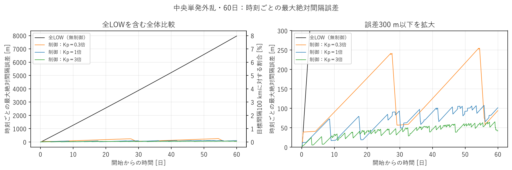
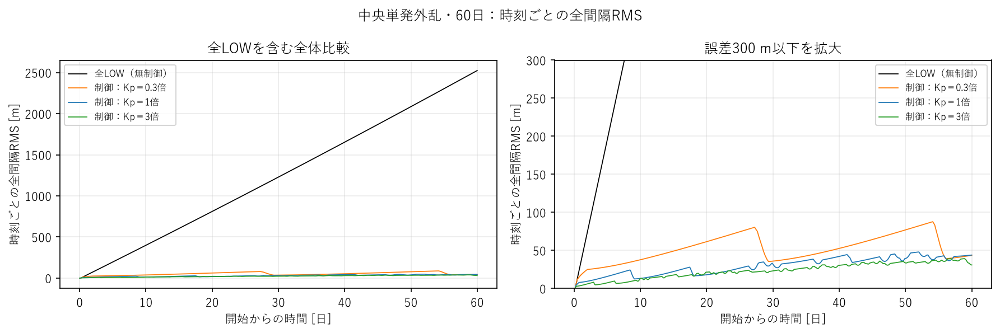
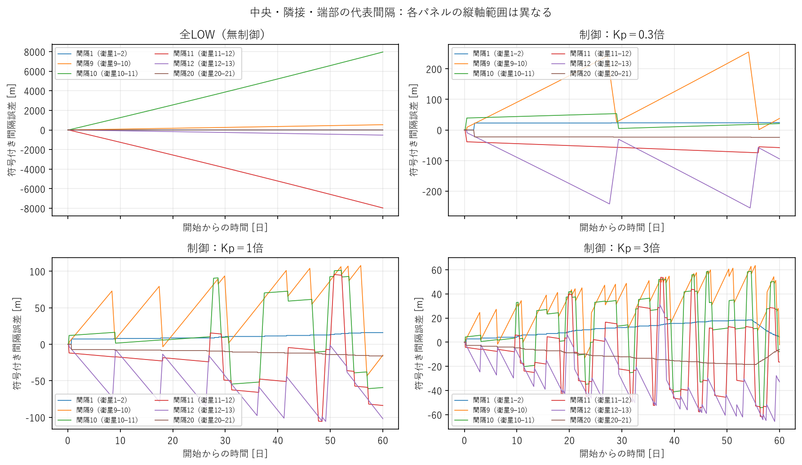
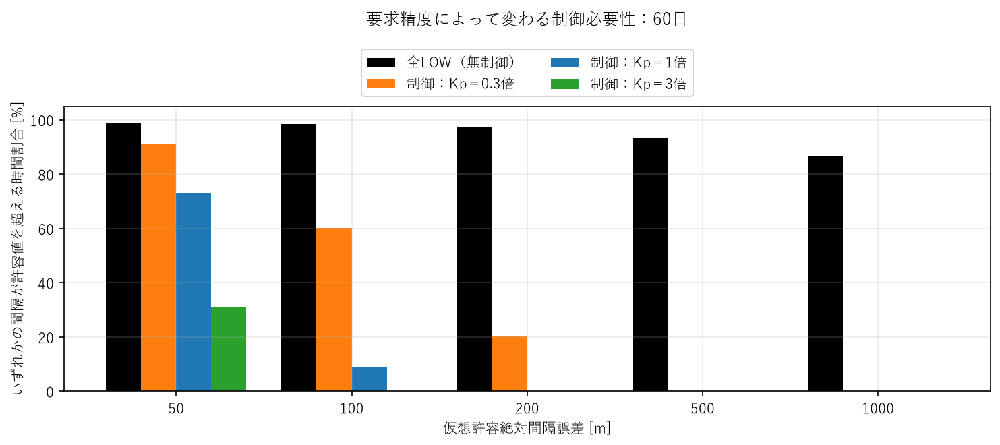
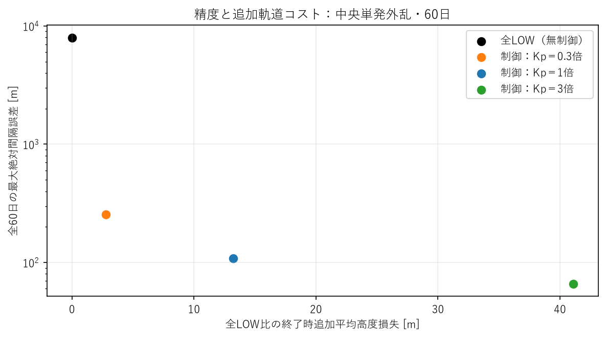

# 詳細技術付録

主たる研究判断は[サマリー](report.md)に集約しました。本付録は結果を検証するための定義・統計・図・再現手順です。

## 1. 観測されたこと

### 1.1 全体・終了時誤差と100 km比

無制御では中央付近のずれが時間とともに蓄積しました。制御による差は、数百m同士の小さな改善ではなく、約8 kmから数十〜数百mへの削減です。

|条件|全期間最大 [m / %]|全期間RMS [m / %]|終了時最大 [m / %]|
|---|---:|---:|---:|
|全LOW（無制御）|7968.855 / 7.968855|1437.934 / 1.437934|7968.855 / 7.968855|
|制御：Kp＝0.3倍|255.004 / 0.255004|54.982 / 0.054982|94.496 / 0.094496|
|制御：Kp＝1倍|107.819 / 0.107819|31.480 / 0.031480|101.945 / 0.101945|
|制御：Kp＝3倍|65.689 / 0.065689|25.353 / 0.025353|42.313 / 0.042313|

全LOWの終了値は全期間最大と一致します。一方、Kp＝0.3倍の終了値94.50 mだけを見ると±100 mを満たすように見えますが、途中の最大255.00 mと60.17%の超過時間を見れば満たしていません。終了値と期間全体の保証を区別する必要があります。

### 1.2 時間発展

以下は各日の「その瞬間の最大絶対誤差」であり、その日までの累積最大値ではありません。

|観測日|全LOW [m]|Kp＝0.3倍 [m]|Kp＝1倍 [m]|Kp＝3倍 [m]|
|---:|---:|---:|---:|---:|
|1|108.454|39.394|12.424|8.216|
|3|362.956|40.392|26.426|20.247|
|7|874.338|64.631|60.755|9.834|
|14|1776.989|125.226|49.557|27.216|
|21|2689.667|186.494|38.844|43.503|
|30|3878.205|57.290|78.351|41.184|
|45|5898.101|170.905|93.971|56.567|
|60|7968.855|94.496|101.945|42.313|

全LOWは7日で874 m、14日で1.78 km、30日で3.88 km、60日で7.97 kmです。外乱終了から60日まで、保存時刻での最大絶対誤差に減少はありませんでした。制御3条件は誤差の蓄積と切替後の減少を繰り返し、観測内では全LOWより狭い範囲に収まっています。特に弱い制御は長い待機と大きな誤差の往復が目立ちます。一定範囲に永久に収まることを示したものではありません。



左は全体、右は300 m以下の拡大です。黒線の大きさを省くと制御3条件の差ばかり目立つため、両方を併記しました。右側の百分率軸は100 kmに対する割合で、1,000 mが1%です。



瞬間RMSは、その時刻の全20間隔を平均した誤差の大きさです。60日終了時の全LOWは2,524.27 mで、全期間RMSの1,437.93 mとは違います。後半ほど誤差が大きいため、この違いが生じます。制御では切替に伴う増減があり、全期間平均だけでは時間構造が見えません。

### 1.3 gap別の状態

誤差は全LOWで全列一様には増えていません。中央衛星11の前後に集中しています。

- 間隔10（衛星10–11）：終了時＋7,960.701 m、速度＋1.616425 mm/s。
- 間隔11（衛星11–12）：終了時−7,968.855 m、速度−1.618081 mm/s。
- 間隔9：＋534.943 m、間隔12：−526.793 m。
- 最小間隔92,031.145 m、最大間隔107,960.701 m。観測内で衛星順序の逆転はありません。

RMSが最大値より小さいのは、少数の間隔に大きなずれが集中するためでもあります。全80行の最大・RMS・符号付き終了誤差・速度は[gap別CSV](results/gap_metrics.csv)に保存しました。



各パネルで縦軸範囲が違う点に注意してください。制御は中央の大きなずれを抑える一方、反応が列へ広がり、端部にも誤差を生じさせています。「全間隔で常に無制御より誤差が小さい」という意味ではありません。

### 1.4 仮想許容値の超過

±という表現は、各間隔の符号付き誤差が−許容値から＋許容値までに入ることを意味します。いずれか一つでも超えた時間を評価します。

|条件|許容値 [m]|一度でも超過|最初の超過 [日]|超過時間割合 [%]|最大連続超過 [日]|終了時も超過|
|---|---:|---|---:|---:|---:|---|
|全LOW（無制御）|50|あり|0.539815|99.1003|59.460185|はい|
|全LOW（無制御）|100|あり|0.933565|98.4441|59.066435|はい|
|全LOW（無制御）|200|あり|1.720139|97.1331|58.279861|はい|
|全LOW（無制御）|500|あり|4.074421|93.2093|55.925579|はい|
|全LOW（無制御）|1000|あり|7.979167|86.7014|52.020833|はい|
|制御：Kp＝0.3倍|50|あり|5.298380|91.1694|54.701620|はい|
|制御：Kp＝0.3倍|100|あり|11.095255|60.1705|18.410301|いいえ|
|制御：Kp＝0.3倍|200|あり|22.532755|20.1817|6.665856|いいえ|
|制御：Kp＝0.3倍|500|なし|なし|0.0000|0.000000|いいえ|
|制御：Kp＝0.3倍|1000|なし|なし|0.0000|0.000000|いいえ|
|制御：Kp＝1倍|50|あり|5.749537|73.1987|29.281713|はい|
|制御：Kp＝1倍|100|あり|41.052662|9.1107|1.370949|はい|
|制御：Kp＝1倍|200|なし|なし|0.0000|0.000000|いいえ|
|制御：Kp＝1倍|500|なし|なし|0.0000|0.000000|いいえ|
|制御：Kp＝1倍|1000|なし|なし|0.0000|0.000000|いいえ|
|制御：Kp＝3倍|50|あり|32.430208|31.0828|6.060185|いいえ|
|制御：Kp＝3倍|100|なし|なし|0.0000|0.000000|いいえ|
|制御：Kp＝3倍|200|なし|なし|0.0000|0.000000|いいえ|
|制御：Kp＝3倍|500|なし|なし|0.0000|0.000000|いいえ|
|制御：Kp＝3倍|1000|なし|なし|0.0000|0.000000|いいえ|

全LOWは1 kmを超えた後も下回らず、残り約52.02日間ずっと超過しています。±200 mならbaselineと3倍が満たし、0.3倍は20.18%の時間で超過。±50 mは今回の全条件で一度は超過しました。±500 m・±1 kmなら、制御3条件はすべて超過なしです。



超過率0%の棒は高さゼロです。±100 mでbaselineが9.11%超過することと、±500 mなら弱い制御で十分であることが重要です。「制御あり」の一括評価ではなく、要求と条件を対応させる必要があります。

### 1.5 全LOWからの改善とコスト

以下の改善率は元の約8 kmと併記します。改善率だけで効果を大きく見せることは避けました。

|制御|最大誤差：全LOW→制御 [m]|削減量 [m]|削減率 [%]|RMS：全LOW→制御 [m]|RMS削減量 [m]|RMS削減率 [%]|
|---|---:|---:|---:|---:|---:|---:|
|制御：Kp＝0.3倍|7,968.855→255.004|7713.851|96.8000|1,437.934→54.982|1382.952|96.1763|
|制御：Kp＝1倍|7,968.855→107.819|7861.036|98.6470|1,437.934→31.480|1406.454|97.8107|
|制御：Kp＝3倍|7,968.855→65.689|7903.166|99.1757|1,437.934→25.353|1412.581|98.2368|

|条件|遷移開始 [回]|完了L-H-L [回]|最終遷移完了 [日]|HIGH安定時間の全機合計 [衛星・時間]|HIGH等価時間の全機合計 [衛星・時間]|初期高度からの平均損失 [m]|全LOW比追加損失 [m]|
|---|---:|---:|---:|---:|---:|---:|---:|
|全LOW（無制御）|0|0|なし|0.0000|0.0000|5569.672928|0.000000|
|制御：Kp＝0.3倍|124|62|56.092014|5.1667|7.2333|5572.468293|2.795365|
|制御：Kp＝1倍|586|293|57.336227|24.4167|34.1833|5582.884460|13.211532|
|制御：Kp＝3倍|1822|911|59.810069|75.9222|106.2889|5610.762350|41.089422|

初期高度からの約5.57 kmの低下は、全LOWにも生じる通常の抗力を含む本モデルの結果です。baselineの追加13.21 mはその約0.237%、3倍の追加41.09 mは約0.738%ですが、これを実軌道寿命の損失割合と解釈することはできません。追加損失が小さく見えても、切替回数の許容値や姿勢運用の負担が分からなければ合理性を断定できません。

弱い制御は124遷移・追加2.80 mで最大誤差を7.71 km削減しました。その先のbaseline→3倍では、改善は最大誤差42.13 m・RMS6.13 mで、追加1,236遷移・27.88 mを払います。±100 mにはこの改善が効きますが、±500 mを要求するだけなら根拠になりません。



縦軸は対数です。無制御→弱い制御の大きな効果と、それ以降の精度向上に伴う追加コストを分けて読んでください。原点の全LOWは「抗力による損失がゼロ」という意味ではなく「比較基準との差がゼロ」です。

## 2. そこから言えること

### 2.1 なぜ短い外乱で長期にずれるのか

現行モデルは各衛星のほぼ円軌道の長半径aと平均経度λを積分します。以下は実装そのものの関係です。

`da_j/dt = −ρ_j C_D A_j / m × sqrt(μ a_j)`

`dλ_j/dt = n(a_j) = sqrt(μ/a_j³)`

抗力が強かった衛星はわずかに高度が下がり、平均運動nが増えます。外乱が消えても、すでに生じた軌道の差は自動で消えないため、沿軌道位置の差が積み上がります。

`e_i = a0(λ_(i+1) − λ_i − d/a0)`

`de_i/dt = a0[n(a_(i+1)) − n(a_i)]`

これは間隔誤差の変化速度が、隣接衛星の平均運動の差で決まるという意味です。距離は現行コードの基準半径a0による定義を維持しました。

外乱終了時（4時間）で全LOWの最大相対速度は1.468639 mm/s、長半径の最大差は0.922625 mでした。60日には1.618081 mm/s・1.014425 mです。おおよそ1.5 mm/sが60日残れば約7.8 kmの位置差になるので、小さな速度差と約8 kmの誤差は矛盾しません。速度も少し増えるため、厳密な一定速度予測ではありません。指数大気と各衛星の高度差を含む既存軌道計算の結果です。

[この検証の保存値](results/all_low_mechanism.json)。共通の高度低下は全衛星の同程度の高度減少であり、中央の相対速度・前後の正負のずれとは区別します。

### 2.2 研究上の判定

- **パターンAに該当する観測：** 無制御ではkm級になり、±500 m・±1 kmの間隔維持効果は明確。
- **ミッション要求次第の部分：** ±100 mまで精度を求める必要、1,822遷移・追加41.09 mを受け入れる価値。
- **現在支持されない見通し：** 全LOWが60日でも数百m以下、したがって制御する意味がほぼない、という主張。

無制御との比較は、精度改善の研究意義を支える結果でした。しかし、現在のbaseline制御が最適・必要十分という結果ではありません。弱い制御も±500 mを満たすため、精度と切替・軌道損失の取引を要求に合わせて研究するのが合理的です。

## 3. まだ言えないこと

今回の結論は、現行モデル・100 km間隔・中央の単発人工外乱・60日間に限ります。

- 永久に誤差が増えるという数学的発散の証明はしていません。全LOWは60日間で増加傾向、制御は観測内の狭い範囲で増減、と表現します。
- 100 m級の要求が実ミッションで必要かは未確認です。先行研究が一律にkm級を許すとも確認していません。
- 空間Gaussian・FWHM100 km・密度最大＋50%・時間half-cosine・1時間は人工条件です。強い・弱い・現実的・代表的とは、今回の結果だけでは判定できません。外乱条件は変更していません。
- 無外乱の60日全LOWrunは保存データに見つかりませんでした。Case Eは新規長時間計算を避けて省略しました。通常抗力と外乱の平均高度損失の厳密な差分は、本比較だけでは分離できません。
- 姿勢切替の電力・機器寿命・通信姿勢制約や高度低下からの軌道寿命は未評価です。切替を減らせば必ず総運用コストが最小になるとも断定しません。

次の優先事項はサマリーの3項目です。新たなKp/Kd/閾値/dwell/外乱掃引は実施していません。以前のKp＝2・2.5の結果は保存されたままですが、今回の主比較には入れていません。

## 4. 指標の定義と保存精度

### 4.1 編隊性能

`e_max = max_(k,i) |e_i(t_k)|`

`e_RMS = sqrt(mean_(k,i) e_i(t_k)²)`

`e_final = max_i |e_i(T)|`

全期間最大、全保存サンプルと20間隔の平均、最後の瞬間の最大を区別します。RMSは従来の正式指標に合わせたサンプル平均で、時間積分RMSではありません。今回は全ケースの同じ10秒等間隔なので比較条件が揃っています。百分率はこれらを100,000 mで割って100を掛けます。

### 4.2 超過時間

`M_k = max_i |e_i(t_k)|`, `b_k = 1[M_k > ε]`

`T_over = Σ_(k=0..K−1) b_k (t_(k+1)−t_k)`

`fraction = T_over/(t_K−t_0)`

保存時刻の値を次の10秒間に保持する近似で評価します。端点t_K自体に時間幅を付けず、60日に10秒を上乗せしません。等号は許容内です。初回時刻と「一度でも」は最後の保存点も含みます。最大連続超過は左端保持で連続する超過区間の最大長です。最終時刻で超過している連続区間は、60日で打ち切られた観測値です。

超過時刻の時間分解能は10秒で、保存点間の全挙動を保証しません。途中の未観測の横断を除けば、初回超過時刻には最大1保存間隔のずれ、全超過時間には各横断のサンプル化誤差が含まれます。長い連続超過を永久に続くものと解釈しません。非等間隔時系列にも実際の間隔幅で重みを付ける実装です。

### 4.3 制御・軌道コスト

標準切替数は姿勢遷移の開始回数。command・開始・完了は[各ケースのswitching JSON](results/baseline_switching.json)に別々に保存。完了L-H-Lは同一衛星がLOW→HIGH→LOWの両遷移を完了した往復であり、全列の「波数」ではありません。

`T_HIGH = Σ_j ∫ 1[安定HIGH] dt`

`T_HIGH,equiv = Σ_j ∫ (A_j−A_LOW)/(A_HIGH−A_LOW) dt`

前者はslewを除くHIGH安定時間、後者は面積が途中のslewを含めHIGH面積何秒分に相当するかです。イベントと現行smoothstep actuatorから従来関数で積分します。全機合計なので「衛星・時間」であり、ケースの経過時間と混同しません。

`L_initial = mean_j[h_j(0)−h_j(T)]`

`L_extra = mean_j[h_allLOW,j(T)−h_case,j(T)]`

正の値は高度損失。同じ外乱・初期状態・終了時刻の算術衛星平均です。h=a−地球半径なので長半径差と一致します。比較基準の全LOWは外乱ありです。追加損失は60日終了時の結果であり、姿勢遷移1回当たりの普遍定数ではありません。

### 4.4 データの所在

[comparison.json](results/comparison.json)、[比較CSV](results/comparison.csv)、[超過CSV](results/exceedance.csv)、[削減CSV](results/reductions.csv)、[gap別CSV](results/gap_metrics.csv)、[時点別CSV](results/checkpoints.csv)をGitへ保存しました。全10秒時系列は元runのNPZを参照し、巨大ファイルを重複しません。図用の約2万サンプルの小さなキャッシュは新output内だけにあり、Gitには含めません。各ケースの最大値の時刻は描画点にも残しています。全指標は間引く前の518,401時刻で計算しました。

## 5. 入力・回帰・テスト・非破壊確認

### 5.1 入力の機械照合

まず全LOWの設定を凍結24時間referenceの設定と照合し、観測時間だけ60日に変更されていることを確認しました。その全LOW設定と3制御を比較し、Kp明示値・派生Kp以外の設定差分がないことを確認しました。ケース名とcontrol_enabledだけは別途許可し、disturbance_enabledはすべてtrueです。

N21・高度400 km・100 km間隔・4 kg・Cd2.2・LOW0.01/HIGH0.03 m²・密度3.584968e−12・scale height58,310 m・中央外乱開始3時間/1時間/+50%/FWHM100 km・RK4/2秒・保存10秒・control10秒・slew120秒・dwell300秒・h_on1.5e−7/h_off1.4e−7・Kd2/21600を固定しました。Kpは0.3/1/3倍、基準1/21600²です。

実データの全時刻配列と初期のa・λ・面積・姿勢・密度は一致。全LOWは全保存点の面積0.01 m²・姿勢L・イベントゼロを確認。全ケースの最大/RMS/終了時誤差は保存済み正式metricsとも一致しました。[入力チェック](results/input_checks.json)と各input JSONに保存しています。

### 5.2 24時間回帰

保存済み3ケースを凍結software referenceと再照合。集計、全command/start/completeイベント、time・誤差・速度・長半径・高度・面積・姿勢の主要7時系列すべて合格し、時系列の最大差は0でした。

制御ケース：最大12.423898 m、RMS5.991742 m、40遷移、追加損失0.821149887 m、左右速度20.263407 m/s。全LOWの最大108.453581 mも維持。無外乱制御も一致。再シミュレーションはしていません。[回帰JSON](results/regression_24h.json)。これは科学的正当性を保証するreferenceではなく、実装の挙動監視用です。

### 5.3 テスト

対象テスト12件、全テスト189件が合格しました。以前の177件に、等号・端点のゼロ時間幅・非等間隔・分離した超過区間・全期間超過/超過なし・不正入力・絶対値を保つ削減量・Kp以外の入力変更拒否の12件を追加。比較runnerと描画runnerは実保存データで完走しました。

### 5.4 既存成果の保全

作業前に既存outputs/runs/docsの1,814ファイルをSHA256で固定。作業後の全照合で変更・欠落ゼロ。[保全結果](results/preservation.json)、[作業前manifest](results/preserved_inputs_sha256.json)、[4runのhash](results/source_run_sha256.json)。元NPZ、既存解析、旧レポートを削除・上書きしていません。新しい物理runは0本です。解析途中のJSON型変換エラーを修正し、完成版は別のcomparison_completeへ保存しました。未完のcomparisonは旧データではなく本作業の中間物で、研究結果には使っていません。

## 6. Gitと再現手順

branch：`astra/control-necessity-baseline`。作業開始：`379ba1ea1d35f01f9d7c6a2f0887621fd46fea6f`。解析コードcommit：`053d7f27098c9059bd52b092659e202f396995e1`。レポート・集計・図は後続のdocs commitに保存。最終hashはpush後の報告と`git log -2 --oneline`で確認できます。mainへのmerge・force pushはしていません。

変更は新規ファイルのみ：

- `src/sat_string/necessity.py`：仮想許容値の超過・絶対改善量・入力一致の評価。
- `scripts/compare_control_necessity.py`：既存4runを検証・集計。物理coreを呼ばない。
- `scripts/plot_control_necessity.py`：日本語の5図。
- `scripts/check_saved_data_preservation.py`：既存成果のhash確認。
- `tests/test_necessity.py`：上記12テスト。
- `docs/control_necessity_analysis/`：サマリー・本付録・結果・図。

リポジトリルートで実行します。`NEW`以下は存在しない新ディレクトリを選びます。各runnerは既存outputを拒否します。Python環境と元runのNPZはローカルに必要です。

```powershell
.analysis-venv/Scripts/python.exe scripts/compare_control_necessity.py --all-low outputs/long_horizon_q_20261008/runs/low_60d --kp03 outputs/kp_residual_20261010/runs/kp_0.3_60d --baseline outputs/long_horizon_q_20261008/runs/central_60d --kp3 outputs/kp_residual_20261010/runs/kp_3_60d --output outputs/NEW/comparison
.analysis-venv/Scripts/python.exe scripts/plot_control_necessity.py --comparison outputs/NEW/comparison --output outputs/NEW/figures
.analysis-venv/Scripts/python.exe -m pytest tests/test_necessity.py -q
.analysis-venv/Scripts/python.exe -m pytest -q
.analysis-venv/Scripts/python.exe scripts/check_baseline_regression.py --existing-suite outputs/long_horizon_q_20261008/regression_24h/suite --output outputs/NEW/regression_24h
.analysis-venv/Scripts/python.exe scripts/check_saved_data_preservation.py --manifest outputs/control_necessity_20261010/preserved_inputs_sha256.json --output outputs/NEW/preservation
```

補助的な全LOWの速度・長半径差は、同じ元NPZで`gap_rate_m_s`の最大絶対値、`a_m`の衛星間最大差を、時刻14,400/86,400/2,592,000/5,184,000秒で計算しています。保全manifestは元の作業環境に対応し、別環境では同じ保存ファイル群が必要です。図は日本語フォントYu Gothicを使用し、依存追加はありません。
