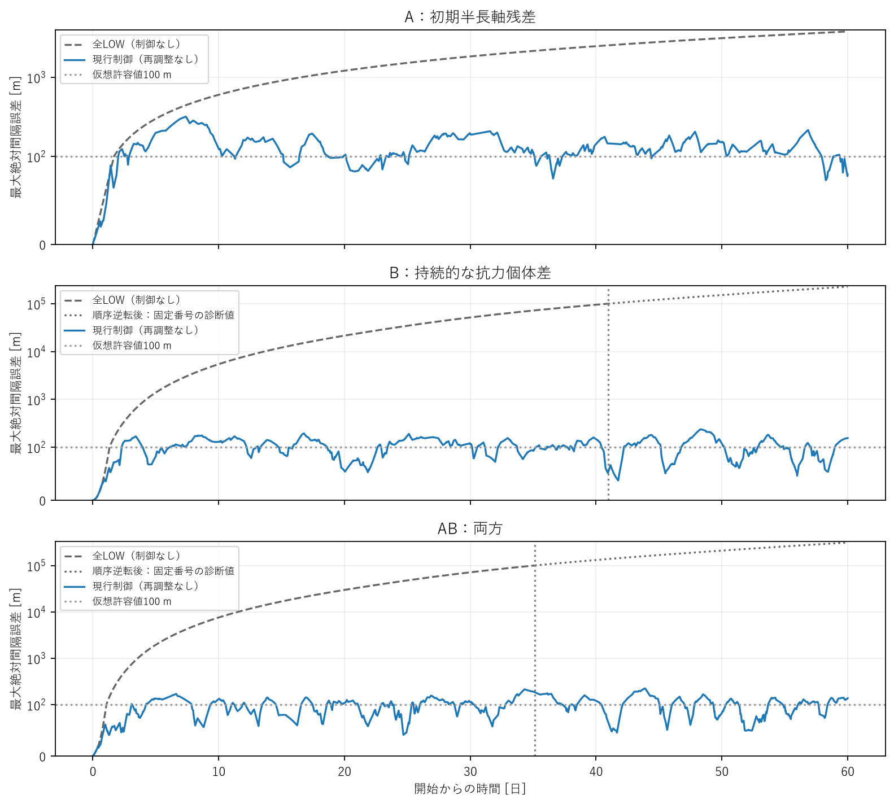
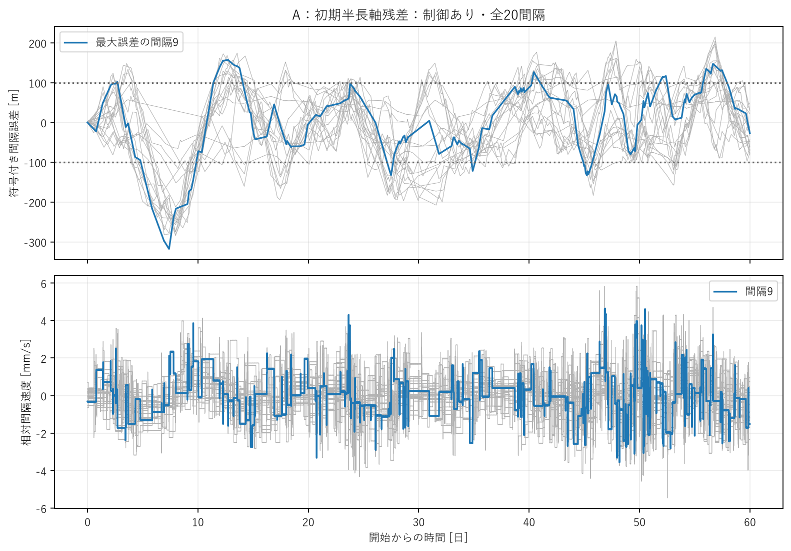
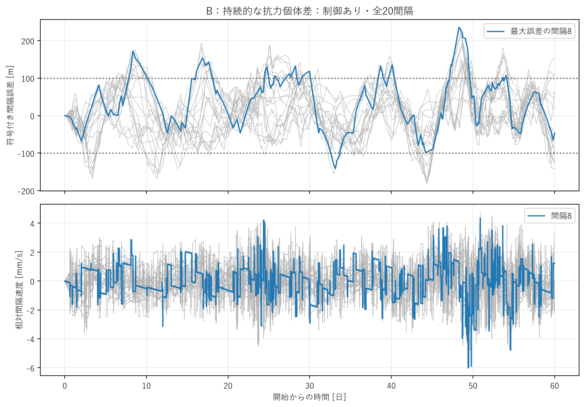
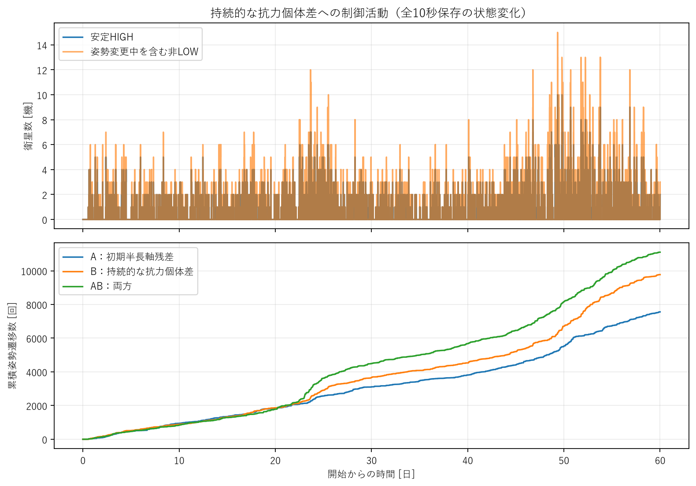
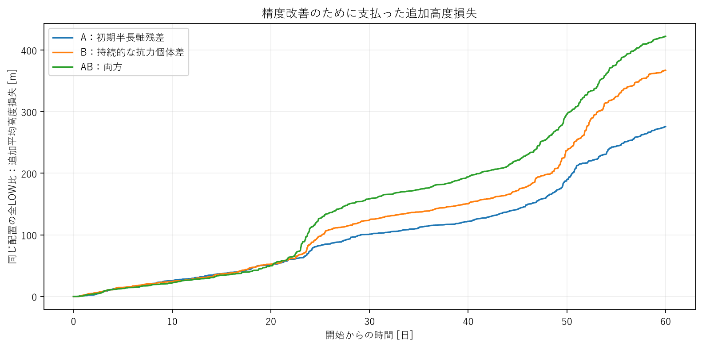
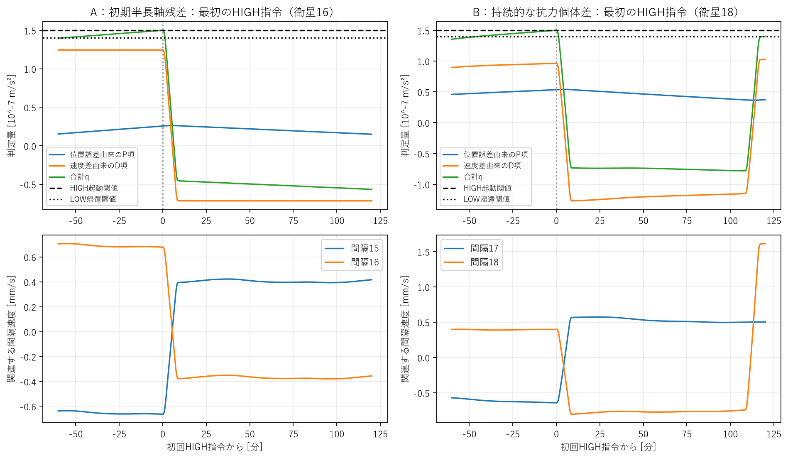

# 研究判断用サマリー

## 1. 結論

現行制御は再調整なしでA・B・ABすべての60日間の最大誤差を約318・236・224 mに抑え、衛星順序を維持しました。ただし±100 mを常時守ることも、初期補正後に制御を停止することもできませんでした。**誤差抑制には有効ですが、低負荷の収束制御とまでは言えません。**

## 2. 主要比較

|Case|全LOW・60日最大誤差|制御・60日最大誤差|削減率*|姿勢遷移開始|追加平均高度損失|
|---|---:|---:|---:|---:|---:|
|A：半長軸0.1 m|3.774 km|317.8 m|91.58%|7,560|275.8 m|
|B：抗力個体差0.3%|226.9 km†|235.7 m|99.81%*|9,773|367.2 m|
|AB：両方|312.3 km†|224.3 m|99.79%*|11,104|422.3 m|

†Bの全LOWは40.94日、ABは35.13日に番号順序が逆転しました。逆転後を含む値は固定番号の診断値で、通常の隣接編隊精度ではありません。*B/ABの削減率は逆転直前までの同じ時間窓で比較しました。Aは60日全体です。全LOWと制御の各組では、初期状態・個体差・大気入力が一致しています。

## 3. Case A：初期残差は一度で消えたか

消えませんでした。無制御の3.77 kmを318 mまで抑えましたが、後半30日も平均148回/日の姿勢変更を続け、最終変更完了は59.91日でした。LOW復帰時に速度差が残り、位置誤差が再び育つ挙動です。補正パルスの1往復あたりの追加高度低下は中央値約1.47 mで、初期残差設定0.1 mより大きく、小さな残差を一度で消すには粗い入力だったと考えられます。

## 4. Case B：持続する個体差を補償できたか

60日では500 m以内を維持しました。しかし抗力倍率はLOW復帰後も残り、次の速度差を生むため、後半も約204回/日の姿勢変更が必要でした。速度を一定とする次回予測の時刻誤差中央値は約510秒で、Aの10秒より大きく、単発外乱後の「残った速度だけ」の説明では不足します。

## 5. Case AB・許容精度

両要因があっても最大224 mでした。3ケースとも500 m・1 kmの超過はありません。一方、100 m超過時間はA約81%、B約58%、AB約53%です。ABの配置はA/B単独と異なる前回の乱数配置を縮小しているため、ABの誤差が小さいことを相殺効果とは断定できません。

## 6. 研究判断

**3ケースとも暫定的にPattern II（精度は良いが継続負荷を要する）として扱います。** 精度だけなら良好な維持ですが、3,780〜5,552往復と276〜422 mの追加損失を低コストとはまだ評価できません。後半のHIGH換算時間は21機合計で約8.7〜12.9衛星時間/日です。これが実用上過大かは姿勢変更寿命・高度予算次第です。現行則は卒論の比較基準として残す価値があり、初期残差と持続個体差の両方を抑制できましたが、静穏化・永久安定性・100 m保証は確認していません。

## 7. 次の作業

1. 形成後0.1 m・抗力個体差0.3%の現実性を文献・実機条件から確認する。
2. 100/500 mの要求精度、切替寿命、高度予算を決める。
3. その条件で、密度によって強さが変わる最小HIGHパルスと残留速度を調べ、調整で足りるか再設計が必要か判断する。

# 詳細技術付録

## 1. 比較条件と乱数配置

今回変えたのは初期半長軸残差、衛星固有の抗力倍率、制御ON/OFFだけです。ゲイン・閾値・姿勢変更時間・大気場・積分器は固定しました。分散量は暫定スクリーニング値であり、実衛星の分布と確認された値ではありません。

|Case|指定した半長軸標準偏差|指定したB相対標準偏差|a乱数番号|B乱数番号|実現したa標準偏差|実現したB標準偏差|
|---|---:|---:|---:|---:|---:|---:|
|A|0.1 m|0%|4|未使用|0.110695 m|0.000000%|
|B|0 m|0.3%|未使用|10002|0.000000 m|0.224868%|
|AB|0.1 m|0.3%|0|10000|0.083045 m|0.282894%|

平均を引いたGaussian標本を再規格化していないため、実現した標準偏差は指定値と一致しません。Aは前回7日最大誤差の中央値に対応するseed4、Bはseed2を再利用しました。ABは前回の組合せseed0/10000を縮小した配置です。ABはA/Bと同じ個別配置ではなく、差の単純な加算や相乗効果を論じる比較ではありません。

各衛星の値は[data/satellite_profiles.csv](data/satellite_profiles.csv)、元配置への参照は[data/profiles.json](data/profiles.json)に保存しました。初期の平均経度は従来通り100 km間隔で、半長軸だけをずらしています。

```text
Kp = 1/21600² = 2.143347050754458e-9 s^-2
Kd = 2/21600 = 9.259259259259259e-5 s^-1
h_on = 1.5e-7 m/s²; h_off = 1.4e-7 m/s²
制御周期10 s / slew120 s / 完了後dwell300 s / command delay0 s
N=21 / 目標間隔100 km / 初期高度400 km
質量4 kg / Cd2.2 / LOW0.01 m² / HIGH0.03 m²
NRLMSIS2.0 / pymsis0.12.0 / 質量密度kg/m³
2024-03-01 UTC開始 / 傾斜角51.6° / RAAN0° / 初期位相0°
既存120 s密度補間 / RK4最大2 s / 保存10 s
```

B=C_D A/m（逆数の定義ではない）です。各衛星の倍率1+εをLOW/HIGH/姿勢変更中の面積すべてに掛けています。元のspacecraftのスカラー設定や既存coreは変更していません。NRLMSISは各ケースの実際のa・平均経度から既存幾何変換で評価し、旧密度時系列の単純再生はしていません。宇宙天気CSV、epoch、軌道面、キャッシュ方式は前回と同じです。

## 2. 精度と制御効果

無制御と制御は同じ配置・同じ観測時間で比較しています。RMSは全保存時刻と全20間隔の二乗誤差を等しい重みで平均し、平方根を取ったものです。終了時最大誤差は収束判定とは別です。

### 30日

|Case・制御|最大誤差 m|RMS m|終了時最大誤差 m|最大間隔速度 mm/s|最大誤差削減率|
|---|---:|---:|---:|---:|---:|
|A・全LOW|1828.036|486.952|1828.036|0.745780|—|
|A・制御|317.822|95.086|191.934|4.336645|82.614%|
|B・全LOW|51627.809|11076.804|51627.809|43.637041|—|
|B・制御|194.142|65.017|117.441|4.514139|99.624%|
|AB・全LOW|71205.966|15130.164|71205.966|60.067492|—|
|AB・制御|170.250|55.282|113.689|5.363467|99.761%|

制御による削減率だけでなく、左側の実際の誤差を合わせて読む必要があります。†は全LOWに順序逆転があり、全期間の削減率が固定番号の参考診断であることを示します。逆転後の最大誤差は隣接編隊の精度として解釈しません。逆転前の同一時間窓による改善量も各metrics.jsonのmatched_pre_allLOW_reversal_improvementへ別保存しています。

|Case|姿勢遷移開始/完了|L→H / H→L|完了L-H-L|安定HIGH 衛星時間 h|HIGH換算 衛星時間 h|追加平均高度損失 m|
|---|---:|---:|---:|---:|---:|---:|
|A|3108 / 3108|1554 / 1554|1554|129.858|181.658|101.046|
|B|3662 / 3662|1831 / 1831|1831|153.128|214.161|124.279|
|AB|4494 / 4494|2247 / 2247|2247|187.700|262.600|158.475|

安定HIGH時間は姿勢変更中を除きます。HIGH換算時間は∫(A−A_LOW)/(A_HIGH−A_LOW)dtで、姿勢変更中の部分面積も数えます。ここでの時間は21機の合計であり、経過時間とは異なります。姿勢遷移は実際に始まった変更を数え、L-H-LはHIGHとLOWへの変更が両方完了した1機単位の往復です。

30日では全LOWのA 1.828 km、B 51.628 km、AB 71.206 kmを、制御で318/194/170 mに抑えました。全LOW側もこの時点では順序を保持しています。ただしAでも1,554往復を要し、初期補正だけで終わる状態ではありません。

### 60日

|Case・制御|最大誤差 m|RMS m|終了時最大誤差 m|最大間隔速度 mm/s|最大誤差削減率|
|---|---:|---:|---:|---:|---:|
|A・全LOW|3774.111|996.164|3774.111|0.789538|—|
|A・制御|317.822|86.312|79.541|5.840413|91.579%|
|B・全LOW|226902.010|48695.956|226902.010|96.454553|—|
|B・制御|235.727|65.558|154.294|6.013906|99.896%†|
|AB・全LOW|312313.922|66375.908|312313.922|132.638789|—|
|AB・制御|224.255|62.232|136.776|5.363467|99.928%†|

制御による削減率だけでなく、左側の実際の誤差を合わせて読む必要があります。†は全LOWに順序逆転があり、全期間の削減率が固定番号の参考診断であることを示します。逆転後の最大誤差は隣接編隊の精度として解釈しません。逆転前の同一時間窓による改善量も各metrics.jsonのmatched_pre_allLOW_reversal_improvementへ別保存しています。

|Case|姿勢遷移開始/完了|L→H / H→L|完了L-H-L|安定HIGH 衛星時間 h|HIGH換算 衛星時間 h|追加平均高度損失 m|
|---|---:|---:|---:|---:|---:|---:|
|A|7560 / 7560|3780 / 3780|3780|315.953|441.953|275.806|
|B|9773 / 9772|4888 / 4885|4885|408.061|570.937|367.187|
|AB|11104 / 11104|5552 / 5552|5552|463.661|648.728|422.320|

安定HIGH時間は姿勢変更中を除きます。HIGH換算時間は∫(A−A_LOW)/(A_HIGH−A_LOW)dtで、姿勢変更中の部分面積も数えます。ここでの時間は21機の合計であり、経過時間とは異なります。姿勢遷移は実際に始まった変更を数え、L-H-LはHIGHとLOWへの変更が両方完了した1機単位の往復です。

60日ではAの最大誤差は30日から増えず、B/ABは236/224 mへ増えました。3ケースとも500 m内でしたが、これを永久に誤差が有界である証明とはしません。B/AB全LOWの順序逆転前の同一期間では、ほぼ100 kmへ達した誤差をそれぞれ194/213 m以内に抑えました。60日全期間の226.9/312.3 kmを普通の編隊精度として比べるより、この比較が適切です。

Bの終了時は衛星12・13がHIGH、14がHIGHへ姿勢変更中で、1遷移が未完了です。そのため9,773開始と9,772完了、4,888回のHIGH起動と4,885完了往復を区別しました。A/ABは終了時全LOWです。最後の変更完了はA59.9069日、B59.9997日、AB59.8825日で、末期まで制御が続きました。

## 3. 仮想許容誤差と順序

100/500/1000 mは実ミッション要求ではありません。保存サンプルで絶対誤差が厳密に許容値を超えたかを判定し、時間割合は各10秒区間の左端値から求めました。未観測のサンプル間挙動を保証しません。

|日数|Case・制御|許容 m|初回超過 日|超過時間 %|最大連続超過 日|
|---:|---|---:|---:|---:|---:|
|30|A・全LOW|100|1.67650|94.412|28.32350|
|30|A・全LOW|500|8.34861|72.171|21.65139|
|30|A・全LOW|1000|16.60451|44.652|13.39549|
|30|A・制御|100|2.00961|72.275|8.36493|
|30|A・制御|500|なし|0.000|0.00000|
|30|A・制御|1000|なし|0.000|0.00000|
|30|B・全LOW|100|1.32303|95.590|28.67697|
|30|B・全LOW|500|3.01204|89.960|26.98796|
|30|B・全LOW|1000|4.24502|85.850|25.75498|
|30|B・制御|100|2.29028|63.261|6.58380|
|30|B・制御|500|なし|0.000|0.00000|
|30|B・制御|1000|なし|0.000|0.00000|
|30|AB・全LOW|100|1.07025|96.432|28.92975|
|30|AB・全LOW|500|2.50926|91.636|27.49074|
|30|AB・全LOW|1000|3.56910|88.103|26.43090|
|30|AB・制御|100|3.05532|46.313|3.62465|
|30|AB・制御|500|なし|0.000|0.00000|
|30|AB・制御|1000|なし|0.000|0.00000|
|60|A・全LOW|100|1.67650|97.206|58.32350|
|60|A・全LOW|500|8.34861|86.086|51.65139|
|60|A・全LOW|1000|16.60451|72.326|43.39549|
|60|A・制御|100|2.00961|80.624|13.47188|
|60|A・制御|500|なし|0.000|0.00000|
|60|A・制御|1000|なし|0.000|0.00000|
|60|B・全LOW|100|1.32303|97.795|58.67697|
|60|B・全LOW|500|3.01204|94.980|56.98796|
|60|B・全LOW|1000|4.24502|92.925|55.75498|
|60|B・制御|100|2.29028|58.413|6.72986|
|60|B・制御|500|なし|0.000|0.00000|
|60|B・制御|1000|なし|0.000|0.00000|
|60|AB・全LOW|100|1.07025|98.216|58.92975|
|60|AB・全LOW|500|2.50926|95.818|57.49074|
|60|AB・全LOW|1000|3.56910|94.052|56.43090|
|60|AB・制御|100|3.05532|52.873|4.54398|
|60|AB・制御|500|なし|0.000|0.00000|
|60|AB・制御|1000|なし|0.000|0.00000|

主要誤差は従来の固定基準半径a_ref上の誤差 e=a_ref(λ[j+1]−λ[j]−目標角間隔)です。現在半径上の物理弧長は隣接2機の半径平均×角差として別保存し、フィードバックには使いません。

|日数|Case・制御|最小固定基準の符号付きgap km|最小現在半径の符号付き弧長 km|現在半径上の最大誤差 m|全ペア最小直線距離 km|初回順序逆転 日|
|---:|---|---:|---:|---:|---:|---:|
|30|A・全LOW|98.251819|98.201125|1798.875|98.200265|なし|
|30|A・制御|99.682178|99.670805|329.195|99.669906|なし|
|30|B・全LOW|48.372191|48.347185|51652.815|48.347089|なし|
|30|B・制御|99.831876|99.814776|185.224|99.813873|なし|
|30|AB・全LOW|28.794034|28.779169|71220.831|28.779169|なし|
|30|AB・制御|99.858170|99.825652|174.348|99.824749|なし|
|60|A・全LOW|96.396712|96.290395|3709.605|96.289583|なし|
|60|A・制御|99.682178|99.670805|329.195|99.669906|なし|
|60|B・全LOW|-126.902010|-126.761768|226761.768|0.026174|40.94398|
|60|B・制御|99.819738|99.742357|257.643|99.741455|なし|
|60|AB・全LOW|-212.313922|-212.079615|312079.615|0.027227|35.12882|
|60|AB・制御|99.841898|99.761704|238.296|99.760802|なし|

全ペア直線距離は同一軌道面の円軌道幾何から算出し、保存時刻に限定した距離です。衝突確率や運用安全性を保証する指標ではありません。順序逆転時刻以降は固定番号誤差を通常のformation precisionとして扱いません。

制御ありの現在半径上の物理弧長誤差も、最大A329.2 m、B257.6 m、AB238.3 mで500 m以内でした。ただし、制御に使う従来の固定基準誤差とは値が違うので要求の定義は別途決めます。最小の全ペア直線距離は約99.67/99.74/99.76 kmでした。これは保存時刻の円軌道幾何に限定した確認です。

## 4. 初期過渡と長期運用

切替が初期だけで終わったかを見るため、0–7日、7–30日、30–60日を分けました。追加高度損失は同じ個体差の全LOWに対する差なので、自然な高度低下やB差自体による高度差とは区別できます。

|Case|区間 日|遷移/日|HIGH換算 衛星時間 h/日|区間RMS m|追加平均高度損失 m/日|
|---|---|---:|---:|---:|---:|
|A|0–7|88.286|5.165|95.722|2.514|
|A|7–30|108.261|6.326|94.893|3.628|
|A|30–60|148.400|8.676|76.538|5.825|
|B|0–7|98.000|5.742|52.307|2.708|
|B|7–30|129.391|7.564|68.418|4.579|
|B|30–60|203.700|11.893|66.094|8.097|
|AB|0–7|89.429|5.231|58.512|2.425|
|AB|7–30|168.174|9.825|54.260|6.152|
|AB|30–60|220.333|12.871|68.480|8.795|

期間末の指令は最後の区間だけに含めます。RMSは各区間の両端保存サンプルを含みます。追加平均高度損失=mean(a_OFF(T)−a_ON(T))で、正の値ほど制御によって平均高度が余分に下がったことを表します。全LOW側の順序が崩れても平均半径差としては計算できますが、その時点の番号gap精度と同じ意味ではありません。

後半の切替頻度はA148、B204、AB220回/日で、7–30日区間より増えました。全21機で平均すると約7.1/9.7/10.5回/機/日です。HIGH換算時間は全21機の運用可能時間に対して後半約1.72/2.36/2.55%でした。HIGHを常時維持する破綻ではありませんが、追加高度損失は5.83/8.10/8.79 m/日となり、負荷が停止・低下したとは言えません。大気密度が変動する1期間の区間平均なので、切替負荷が永続的に増大することや年間損失をこの数字から外挿しません。

60日終端の高度差はA：全LOW0.515 m→制御8.228 m、B：76.895 m→4.385 m、AB：77.943 m→4.043 mでした。B/ABでは自然に育つ高度差を小さくした一方、Aでは制御パルスが初期より大きな半長軸差を作っています。全LOWとの差を取った追加損失と、自然な共通高度低下は別です。

## 5. 切替原因・残留状態・予測の限界

qPは位置誤差、qDは速度差を切替判定へ写した量です。端部 q[1]=Kp e[1]+Kd v[1]、内部 q[j]=Kp(e[j]−e[j−1])+Kd(v[j]−v[j−1])、反対端 q[N]=−Kp e[N−1]−Kd v[N−1]です。q≥h_onでLOW→HIGH、q≤h_offでHIGH→LOWですが、姿勢変更・dwell中の指令は禁止されます。

|Case|初回HIGH 日・衛星|P優勢起動|D優勢起動|混合起動|300秒で帰還した往復|帰還が遅れた往復|最短同一機HIGH開始間隔 s|840秒に一致した間隔|
|---|---|---:|---:|---:|---:|---:|---:|---:|
|A|0.103125・16|376|2342|1062|3663|117|840.0|324|
|B|0.555440・18|187|3461|1240|4802|83|840.0|388|
|AB|0.264120・20|160|4129|1263|5439|113|840.0|440|

優勢は絶対値が相手の2倍以上という分類であり、P/Dが逆符号で打ち消す場合もあります。初回HIGHのqP/qD、関連gapの符号付き誤差・速度は*_HIGH_triggers.csvに残しています。HIGH完了から帰還指令まで300秒ならdwell支配、300秒より長ければ閾値条件による待ち時間も発生しています。最短840秒は120+300+120+300の2回の姿勢変更と両側dwellを足した値です。

残留速度V_res=max_gap|v|はLOW復帰完了直後の全gap速度です。他衛星の活動がある局所完了と、全LOWになる完了境界を分け、各状態の符号付きe/v/qP/qDをローカルの*_end_states_*.npzへ保存しています。要約CSVでは最大・RMS・絶対値中央値とe×vの悪化方向割合を残しました。

静穏中の簡易予測は q(t)≈qP(t0)+qD(t0)+(Kp/Kd)qD(t0)(t−t0)です。残った速度が一定なら、その速度に応じてP項が増え、閾値へ達する時刻を計算できるという意味です。実際にはNRLMSISの変動とB差が継続するため、qD一定が破れることがあります。後続切替、他機のHIGH、D変化10%以上などを無効理由として記録し、無効な予測を成功例に含めません。

|Case|局所完了時V_res中央値 mm/s|全LOW完了境界数|有効な全LOW次回予測数（実測・起点一致）|静穏候補開始 日|その後の監視 日|
|---|---:|---:|---:|---:|---:|
|A|2.384631|772|763|なし|—|
|B|2.381437|888|622|なし|—|
|AB|2.477268|955|609|なし|—|

予測の一致を、閾値が将来横断される予測と、既に閾値を超えていてLOW側dwell解除を待つ予測に分けました。後者の時刻一致は待ち時間の再現であり、残留速度によるP項蓄積の証拠には数えません。以下はD変化10%以内・実測あり・予測した起点が実測と一致した区間に限定します。

|Case|将来横断の有効件数|時刻誤差の絶対値中央値 s|待ち時間に対する誤差中央値 %|既に閾値以上で待機した件数|
|---|---:|---:|---:|---:|
|A|739|10.0|0.172|24|
|B|614|510.0|28.040|8|
|AB|596|490.0|41.746|13|

D項の大きさがP項の2倍以上でも、次の切替へ近づく変化をP項が担う場合があります。大小の分類は起動時の内訳であり、閾値へ近づいた原因の証明ではありません。D一定を10%以内とした有効判定も、予測時刻の小さな誤差を保証しません。BとABでは持続する個体差でDが変わり、単発外乱後と同じ予測精度を前提にできません。

静穏候補は既存評価条件50 m・1 mm/s・1800 sの全LOW最終区間です。数学的収束とは呼びません。この条件で候補がないことと、誤差を500 m以内に保てないことは同じではありません。*_mechanism_hourly.csvにはB差→半長軸変化率差→半長軸差→速度差→誤差の符号付き履歴と、同じ瞬間状態でB倍率だけを1へ戻した補助計算を保存しました。

### 機構の比較と分類

Aは最初から速度差を持ち、衛星16で開始2時間28分30秒後に最初のHIGH指令が出ました。Bは初期速度差ゼロから抗力差で速度差が育ち、衛星18で13時間19分50秒後に起動しました。ABは衛星20で6時間20分20秒後でした。Aの初回P/Dは2.565×10^-8 / 1.244×10^-7 m/s²、Bは5.370×10^-8 / 9.633×10^-8 m/s²です。Aでは初めからある速度差を背景にP項が増え、Bでは位置と速度の両方が育ちます。

Aの終了時最大gap速度は初期0.707 mm/sから2.331 mm/sへ増えました。残留速度がゼロへ近づいたわけではなく、切替を繰り返して位置誤差を抑えていました。Bの終了時速度は3.308 mm/s、ABは1.589 mm/sです。LOW完了時の全gap最大速度の中央値は約2.38/2.38/2.48 mm/s、当該衛星に隣接するgapだけでは1.27/1.31/1.34 mm/sでした。他衛星が動作中の局所完了と、全LOW境界を同一視しません。

HIGH帰還はA96.9%、B98.3%、AB98.0%がHIGH完了後300秒でした。1往復の最小HIGH換算は420秒（300秒安定HIGH＋2つの120秒slewの半分）で、1往復の当該衛星追加高度損失中央値は1.47/1.50/1.51 mでした。最短840秒の再起動間隔は324/388/440件ありますが、全期間それに張り付く状態ではありません。dwellと密度により決まる有限のパルス量が残留速度を作り得ることと、BではLOWでも新しい速度差が育ち続けることの両方が重要です。

**分類は3ケースとも暫定Pattern IIです。** 精度だけではPattern I相当ですが、低負荷の良好な制御と呼ぶには数千回の切替と追加高度損失の予算確認が必要です。実機予算がないため「過大」との最終判定は留保します。km級誤差が残るPattern III、順序逆転・計算異常などのPattern IVは制御ありでは観測していません。初期値問題Aは今回の制御では一度修正すれば終わる問題にならず、Bは持続外乱と残留状態の両方による繰返し補償になりました。

現行則は卒論の主要比較方式として残す価値があります。ただし100 m保証や初期補正停止を目標にするなら、そのまま運用候補とはしません。既存Kp/Kd/dwell解析の道具と診断観点は再利用できますが、人工単発外乱での順位・最適性を今回へ移し替えることはできません。単なるtuningで解決できるか、パルス設計そのものの改善が必要かは次段階です。

## 6. 図

図1の縦軸は100 m以下が線形、それより上が対数の目盛です。全LOWの大きなdriftと制御の100 m級誤差を同じ図で読めるようにしました。図4のHIGH衛星数が0へ戻ることは、速度差や誤差が消えたことを意味しません。図6では初回パルス中に速度の符号が変わり、LOW復帰後にもゼロでない速度が残ることが見えます。

履歴図は1分抽出に切替時刻・極値を加えています。HIGH衛星数は全10秒保存の状態変化を省略せず表示し、初回q診断も10秒です。集計は全10秒保存データ・正確なイベントを使い、描画用間引きは集計へ適用しません。

### 3ケースの全LOWと制御の最大誤差



### Aの符号付き全gap誤差・速度



### Bの符号付き全gap誤差・速度



### BのHIGH衛星数と各ケースの累積切替



### 同じ個体差の全LOWに対する追加平均高度損失



### A/B初回HIGHの判定量と関連gap速度



## 7. 観測・解釈・未確定

### 観測されたこと

上の表は指定した3つの配置とNRLMSISの1期間に対する数値結果です。誤差・イベント・高度コストは別々に保存し、順序逆転と予測無効も隠さず記録しました。

### そこから言えること

Aでは初期半長軸差だけでなく、制御パルスが新しい半長軸差を作ることと、通常の大気空間差が継続することも考慮します。BではB倍率が制御後も残るため、LOWへ戻っても半長軸変化率の差が再発し得ます。再切替をすべて単発外乱の残留速度だけで説明することはできません。

### まだ言えないこと

0.1 m・0.3%が実衛星の典型的分散か、永久にboundedか、切替と高度コストが運用上許容できるかは未確定です。1配置・1大気期間の結果から一般的な性能保証や最適ゲインを主張しません。実機の姿勢変更制限・寿命予算がないため、負荷の「過大」判定も数値を示した上で留保します。

## 8. 再現方法

本研究で実際に実行した手順は下記です。A/B全LOWの前半30日は既存保存データを再利用しました。巨大NPYはGitに含めません。既存結果がある場合は再利用し、必要な再現計算は新しい保存先を指定してください。既存runを消して再実行する手順ではありません。

```powershell
.analysis-venv/Scripts/python.exe -X utf8 scripts/run_dispersion_control.py --days 30
.analysis-venv/Scripts/python.exe -X utf8 scripts/analyze_dispersion_control.py --days 30
# data/extension_decision.jsonの30日結果をレビューしてからgoを記録
.analysis-venv/Scripts/python.exe -X utf8 scripts/run_dispersion_control.py --days 60 --prefix outputs/dispersion_control_20261011/batch_30d
.analysis-venv/Scripts/python.exe -X utf8 scripts/extend_dispersion_control_OFF.py
.analysis-venv/Scripts/python.exe -X utf8 scripts/analyze_dispersion_control.py --days 60
.analysis-venv/Scripts/python.exe -X utf8 scripts/audit_dispersion_control_density.py --days 60
.analysis-venv/Scripts/python.exe -X utf8 scripts/plot_dispersion_control.py --days 60
.analysis-venv/Scripts/python.exe -X utf8 scripts/report_dispersion_control.py
.analysis-venv/Scripts/python.exe -X utf8 -m pytest -q
```

30日後は姿勢状態・dwellの時刻・pending command・イベント履歴を含むcheckpointから再開します。境界サンプルは解析時に1つだけ残し、0–30日を再計算しません。

### 巨大な旧runがないGit取得直後の再現

scripts/reproduce_dispersion_control.pyは凍結した3配置の制御ON/OFFだけを計算する再現専用です。この研究では追加実験として実行していません。旧スクリーニング全37条件を計算し直す必要はありません。30日結果の順序・精度・負荷を確認してから、必要なら60日へ進めます。

```powershell
$env:PYTHONUTF8="1"
.analysis-venv/Scripts/python.exe -X utf8 scripts/reproduce_dispersion_control.py --days 30 --output-root outputs/control_reproduction
$env:SAT_CONTROL_OUTPUT="outputs/control_reproduction"
$env:SAT_CONTROL_DOC="docs/control_reproduction"
.analysis-venv/Scripts/python.exe -X utf8 scripts/analyze_dispersion_control.py --days 30
# 30日の結果を確認した後のみ実行
.analysis-venv/Scripts/python.exe -X utf8 scripts/reproduce_dispersion_control.py --days 60 --output-root outputs/control_reproduction --prefix outputs/control_reproduction/batch_30d
.analysis-venv/Scripts/python.exe -X utf8 scripts/analyze_dispersion_control.py --days 60
.analysis-venv/Scripts/python.exe -X utf8 scripts/audit_dispersion_control_density.py --days 60
.analysis-venv/Scripts/python.exe -X utf8 scripts/plot_dispersion_control.py --days 60
```

Python環境は既存pyproject.tomlのtest/nrlmsis追加依存（pip install -e ".[test,nrlmsis]"）に従ってください。この解析で使用した版はnumpy2.4.6、matplotlib3.11.2、pytest9.1.1、pymsis0.12.0です。特にNRLMSIS version2.0を維持してください。宇宙天気CSVはconfigs/dispersion_control_transfer.yamlが指す既存ファイルを使います。SAT_CONTROL_OUTPUT/SAT_CONTROL_DOCは別保存先を選ぶための環境変数です。再現後は解除すれば元の研究成果を参照できます。

## 9. 検証・Git

[検証結果](data/verification.json)と[Git情報](GIT.md)を参照してください。273件（既存256＋新規17）のテストに合格し、作業前の8570ファイルはSHA256がすべて一致しました。新しい軌道の75600点を密度直接評価と照合し、最大相対差5.483×10^-5（0.005483%）で既存基準0.1%内でした。30→60日境界のa・平均経度・姿勢・面積と過去イベントは完全一致を確認し、密度キャッシュ再初期化による相対差6.12×10^-10は別記しています。

標準3ケースの24時間回帰に加え、分散ゼロの新しい実験用コードを24時間計算し、物理時系列・イベントが旧coreの保存結果と一致することを確認しました。
