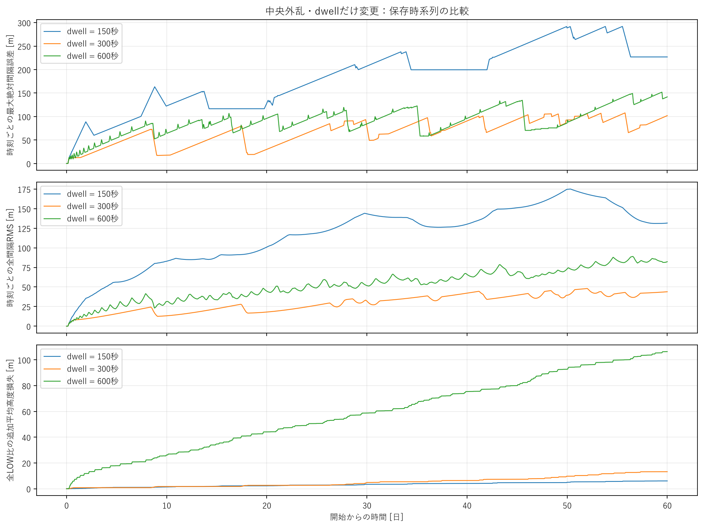
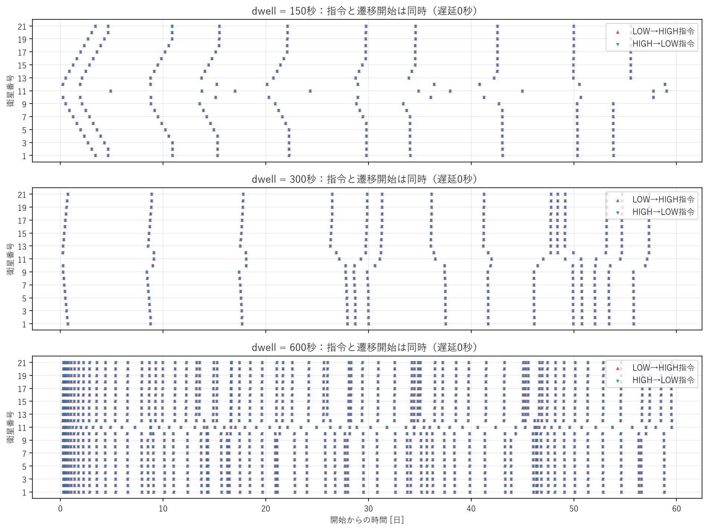
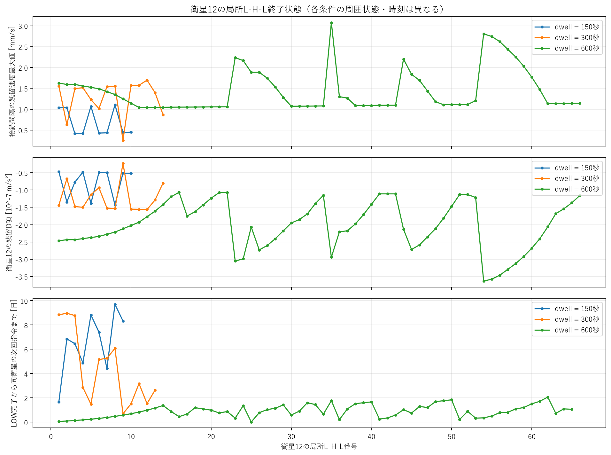
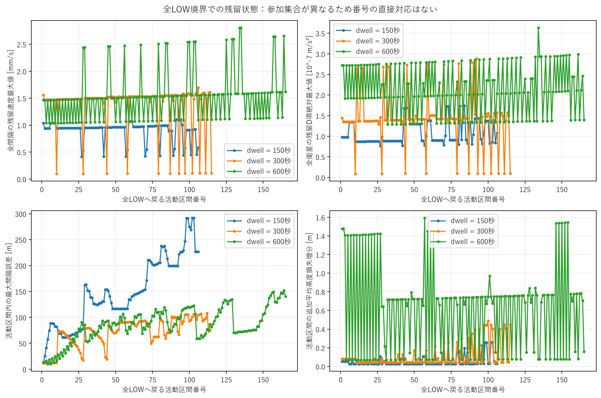
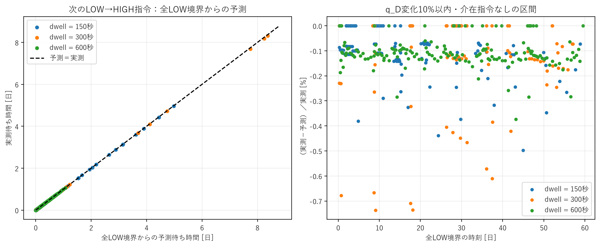
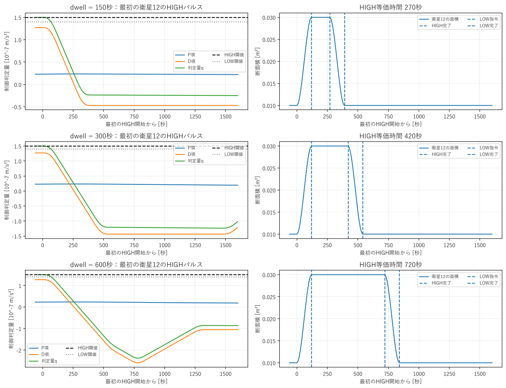
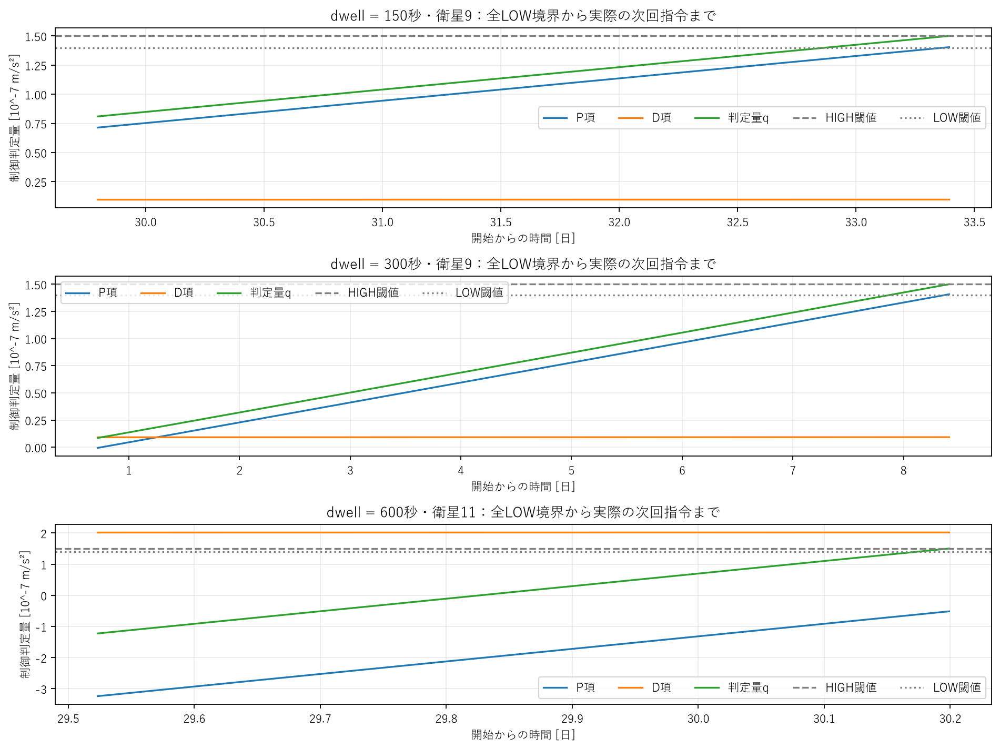

# dwell・残留速度・長時間再切替の因果評価

## 結論

**dwell介入が実パルス量と残留P/D状態を変え、その後の再切替時刻を変えるという機構は支持された。**
ただし「残留速度が小さいほど編隊性能が良い」という単調な関係は成立しない。
150秒は60日で切替・高度コストを削減したが誤差が著しく悪化し、600秒は再切替と損失を大幅に増やした。
3条件とも60日以内に収束を確認できない。300秒を最適・安定な設計とは認定しない。

## A. 評価指標追加

V_res=max_(全gap)|de_i/dt|、Q_D_res=max_(全衛星)|q_D,j|。
種点・参加集合・全体のscopeを分け、q_Dの符号も保存する。
各衛星のLOW完了直後のlocal終了状態と、全LOW境界の終了状態を別に抽出する。
終了時全配列はローカルNPZ、参照番号・要約はCSV。

実装どおりの差分PDから、d(q_P)/dt=(Kp/Kd)q_D。
q_D一定なら、q0=q_P0+q_D0、s=(Kp/Kd)q_D0>0、
T_cross=t0+(h_on−q0)/s。LOW待機時計と10 s格子を反映して指令時刻へ変換する。
負/ゼロの傾き、待機中の下向き通過、他衛星の介在指令などは有効な予測に数えない。
[詳細定義](definitions.md)を参照。

## B. 30日比較

全体RMSは全保存時刻・20gapの二乗平均平方根。追加損失は終了時の全LOW比衛星算術平均。

|dwell [s]|e_max [m]|全体RMS [m]|終了時誤差 [m]|完了L-H-L|姿勢遷移|最後の完了 [日]|追加高度損失 [m]|
|---:|---:|---:|---:|---:|---:|---:|---:|
|150|210.325|93.294|207.408|124|248|29.79745|3.423|
|300|93.529|20.978|78.351|112|225|29.99850|4.829|
|600|119.554|38.919|84.366|797|1594|29.52326|58.702|

300秒は終了時に1個のL-H-Lが未完了（HIGH保持）なので遷移数は2×完了cycle数と一致しない。
各衛星の完了cycle数は150秒が6回（中央11のみ4回）、300秒が4〜6回、600秒が38回（中央11のみ37回）。
2回目以降の**完了**cycle総数は103 / 91 / 776。

残留指標の代表値は、各local LOW完了時に全衛星列を評価した値の中央値。
他衛星の活動を含むので、全LOW後の自由応答とは区別する。

|dwell [s]|V_res全gap中央値 [mm/s]|Q_D_res全衛星中央値 [m/s²]|同衛星L→H開始間隔中央値 [日]|HIGH安定時間合計 [衛星・s]|HIGH等価時間合計 [衛星・s]|
|---:|---:|---:|---:|---:|---:|
|150|0.95529|8.92938e-8|6.63171|18600|33480|
|300|1.49086|1.39056e-7|8.27205|33730|47230|
|600|1.63439|1.94069e-7|0.78854|478200|573840|

未観測の次回は間隔中央値に入れず、右打切りとして保存。異なる参加集合の番号を対応づけない。

## C. 60日結果

30日の悪化と30日以降の横断予測を確認して、150・600秒とも延長した。
300秒は既存60日runを再利用。30日以前の全配列・イベントは変えていない。

|dwell [s]|e_max [m]|全体RMS [m]|終了時誤差 [m]|完了L-H-L|姿勢遷移|最後の完了 [日]|追加高度損失 [m]|
|---:|---:|---:|---:|---:|---:|---:|---:|
|150|291.907|122.772|226.870|209|418|59.02674|6.058|
|300|107.819|31.480|101.945|293|586|57.33623|13.212|
|600|151.948|56.406|141.850|1375|2750|59.53611|106.369|

60日完了cycle数は150秒で各10（中央11は9）、
300秒で各14（中央11は13）、600秒で衛星1〜11が65、12〜21が66。
2回目以降の完了cycle数は188 / 272 / 1354。
HIGH安定時間合計は31350 / 87900 / 825000衛星・s、
HIGH等価時間合計は56430 / 123060 / 990000衛星・s。

全条件で終了時最大誤差が50 mを超えるので、既存速度条件1 mm/s・W1800 sの
ε_e=1/5/10/50 mはいずれもsettled_by_tmax=false。
有限settling時刻・verification horizonを付けられない。
150秒・300秒の最初のrecoveryはそれぞれ46030、63460 sで、後の収束とは別。
600秒は既存recovery条件自体を満たしていない。

## D. dwellと残留速度

最初のHIGH指令は全条件で衛星12・20430 s、HIGH完了20550 s。
そこまでは同一状態。最初のh_off以下標本も全条件で20500 s。

|dwell [s]|LOW指令 [s]|LOW完了 [s]|HIGH等価時間 [s]|衛星12に接続するV_res [mm/s]|衛星12のq_D [m/s²]|衛星12のq_P [m/s²]|
|---:|---:|---:|---:|---:|---:|---:|
|150|20700|20820|270|1.03666|−4.69825e-8|2.33798e-8|
|300|20850|20970|420|1.55864|−1.43646e-7|2.29146e-8|
|600|21150|21270|720|1.62827|−2.46758e-7|2.12723e-8|

保持時間が伸びると最初の衛星12のD項はより負へ変化する。
長いパルスが相対運動を強く変えるという因果効果は明確。
ただしこの時点で150/300秒は衛星10、600秒は9/10/13も非LOW。
個別終了状態を、その後に一切制御されない自由応答の初期条件とは扱えない。
60日local接続V中央値は0.954 / 1.510 / 1.613 mm/s、
own |q_D|中央値は8.836e-8 / 1.395e-7 / 1.494e-7。
この比較も異なる時刻・近隣状態の分布比較であり、1つのcycleの単独応答ではない。

## E. 残留速度と再切替

各衛星の直後のown q_Dは多くが負。後の近隣パルスで符号・大きさが変わるため、
**local終了から同衛星の次回までq_D一定とする予測は、全条件で有効件数0**だった。
無効な生予測・理由はCSVに残した。
この事実は、単独衛星の残留値だけで全再切替を説明する仮説を制限する。

一方、全LOW・保留なしの境界から次の任意衛星の指令までなら介在制御がなく、
q_Dの変化10%以内という後処理条件を全観測区間で満たした。
実測衛星を事後選択せず、全nodeの予測の最早値を選んで比較した。

|dwell [s]|60日で検証できた予測数|次回衛星一致数|相対誤差絶対値中央値 [%]|最大 [%]|
|---:|---:|---:|---:|---:|
|150|105|105|0.10453|0.49715|
|300|114|114|0.00000|0.73656|
|600|164|164|0.11153|0.37313|

最後の未観測予測は的中数に含めない。短い伝播途中の休止から数日待ちまでが混在する。
中央値0は10 s指令格子で同じ時刻になったという意味。
q_P変化と(Kp/Kd)∫q_D dtとの差の最大は各条件約1.00 / 1.48 / 1.51e-12 m/s²。
位置差分の蓄積がP項を増やす関係は保存データ上でも確認できた。

300秒の最初の応答群終了62000 sでは、次回最早node9のq_P=−6.499e-10、
q_D=+9.134e-9 m/s²。P項増加率2.114e-13 m/s³から
次回指令8.46412日を予測し、実測8.41192日（−0.678%）だった。

30日で未観測だった予測を60日延長で確認すると：

|dwell [s]|30日末の全LOW境界 [日]|次回予測 [日]|次回実測 [日]|待ち時間の相対誤差 [%]|
|---:|---:|---:|---:|---:|
|150|29.79745|33.40637|33.39294|−0.37341|
|600|29.52326|30.20000|30.19907|−0.13701|

60日末の次回指令予測は150/300/600秒で60.296 / 60.740 / 60.168日。
これは未検証の外挿であり、永久に落ち着いた証拠ではない。今回は追加計算しない。

## F. h_offとdwell

60日で完了した209 / 293 / 1375 cycleの全てで、
HIGH完了→LOW指令は150 / 300 / 600 sぴったり。
したがって実パルス幅は大部分でdwellに拘束されている。
HIGH開始後最初のh_off以下→LOW指令の遅れ中央値は200 / 340 / 560 s。

HIGH完了時に既にq<=h_offだった件数は202/209、261/293、201/1375。
600秒ではその後にoff条件へ入る場合が多いが、1374/1375は待機終了より前に最初のoff条件を満たす。
1件だけ最初のoff標本と最早帰還格子が一致し、閾値とdwellが同時に制約し得る。
「全cycleでh_offが無関係」とは言わない。実際のLOW指令時には全件q<=h_off。

## G. 性能・コスト

60日150秒は300秒比で遷移−28.7%、追加損失−54.1%。
しかし最大誤差約2.71倍、RMS約3.90倍で、速度補正の量や空間的釣合いが不足する領域を示す。
600秒は遷移約4.69倍、追加損失約8.05倍、RMS約1.79倍。
300秒より性能・コストの両方が悪化した。短いdwellが必ず良いという仮定は棄却。
30日では300秒が最少遷移、60日では150秒が最少。観測期間で順位も変わる。

## H. 因果仮説の評価（Q1〜Q8）

- **Q1/Q2**：dwell介入でV_resと符号付きq_Dは変化。初回衛星12では保持時間増加で
  接続Vと負のown D残留が増加。全列の後続補償まで含めると単純な大小関係ではない。
- **Q3**：残るP/D全状態と再切替には定量関係がある。静穏窓の予測は最大誤差0.74%未満。
  Vの絶対最大値や負のown Dだけからは次回を決められない。
- **Q4**：60日で再切替数最少は150秒、編隊誤差最良は300秒。600秒は再切替を増やす。
- **Q5**：150秒の低コストは安定化ではない。誤差が増え、59日まで活動が続き、
  60日以降の閾値到達も予測される。静穏期間が長いだけの区間がある。
- **Q6/Q7**：150/600秒とも基準より最大誤差・RMSが悪化。150秒には精度とコストの交換関係、
  600秒には両者の悪化がある。
- **Q8**：dwellはパルス量と残留状態に強い因果影響を持つ。
  ただし同じ変更がLOW後の再指令待機にも作用し、近隣連鎖を変える。
  長時間振動の原因をdwellだけに還元したりHIGH保持だけの独立効果と断言はできない。

150秒では誤差包絡増大、600秒でも反応反復と誤差増大を観測。
有限60日で非有界発散・安定limit cycle・漸近収束のどれも数学的には証明していない。
現在の3条件は、収束が未確認の長時間再切替系として扱う。

## I. 次の研究（Q9）

**次はKdを独立に評価することを優先**する。
P蓄積が静穏期間の横断を決める一方、その蓄積率は残るD状態に結び付く。
現在のHIGHパルスは閾値帰還より待機時間に拘束され、暫定Kdでの速度補償量を再検討する理由がある。
Kd変更はq_Dの測定スケール自体も変えるので、評価は必ず物理量V_resと併用する。

初回候補：dwell300 s、Kp・閾値・外乱・他条件を固定し、
Kd/Kd0=0.3 / 1 / 3の3条件。これは提案であり今回は未実施。
保存30日→必要条件のみ60日、同じ残留予測・群/packet指標を使う。
次にKp/Kp0=0.3 / 1 / 3を独立評価し、残留速度を消す効果と、
P蓄積が閾値へ届くまでの遅延を区別する。
h_cはその後。h_cを上げて再切替だけ減っても状態が収束したとは言えない。
今回は上記掃引を一切実施していない。

## J. 回帰・テスト・Git

- 既存104件＋新規14件、**118件合格**。
- 凍結24時間3ケースを前回の実再実行済みsuiteと再照合し全合格。
  集計値、全衛星指令/開始/完了イベント、主要7配列の最大差0。
  制御最大誤差12.423898255 m、RMS5.991741618 m、40遷移、
  追加損失0.821149887 m、左右速度20.263407114 m/sを維持。
- 574個の既存run/outputファイルのSHA256は全て不変。
  150/600秒の共通初期prefixと30→60日prefix、計4組の全配列・イベントを完全一致確認。
  4新規物理runの設定差はdwellとdurationだけ。
- 物理・制御・積分core、旧metrics、旧fixturesに変更なし。mainへmergeしない。
- branch：astra/dwell-residual-analysis。
  評価実装commit：d971fb9（dwell残留指標・待機時計を反映した再横断予測）。
  結果・回帰・文書commitは同branchのGit履歴と作業完了メッセージを参照。
- [変更ファイル・実行手順](reproduction.md)、[比較CSV](results/comparison.csv)、
  [旧データ・prefix保全検証](results/preservation.json)、
  [24時間回帰](results/regression_24h.json)。

## 図

図の長時間曲線は描画だけ間引き、集計は10 s全標本を使用。
起点・参加集合・背景状態が異なるため、異条件のcycle番号は1対1に対応しない。

最後の図は、300秒では初回応答群終了、150/600秒では30日段階の最後の全LOW境界を使用。
150/600秒の横断を60日延長の実測と比較しており、未観測時点の予測を事後に作り替えていない。
