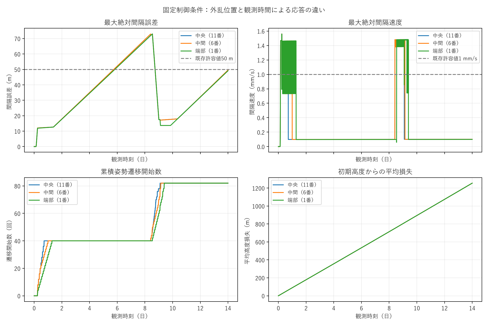
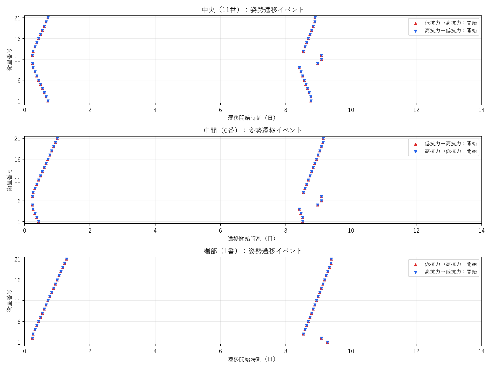

# 評価基盤・24時間回帰・観測時間の結果

## 結論

評価基盤と24時間software regression referenceを整備した。全94テストと、3ケースの集計・イベント・主要時系列回帰が合格。既存299ファイルのSHA256に変更なし。物理・制御・積分coreは変更していない。

**24/72時間では見えなかった二次L-H-Lを、固定標準条件の約8.4–9.4日で確認した。** 中央・中間・端部のいずれも、切替は40回から82回へ増えた。7日観測も二次応答を検出するには短い。

現時点では、**二次応答のスクリーニングに14日を暫定採用**することを推奨する。ただし収束確認に十分な固定Tmaxは決められない。14日終了時も誤差の絶対値が増加中で、50 m条件のSettlingは終了までの4.6–4.9日を観測したという意味に限られる。1/5/10 m条件ではSettling未成立。

## A. 変更したファイル

| ファイル | 目的 |
|---|---|
| src/sat_string/evaluation.py | RMS、観測済みイベント数、cycle、Recovery/Settling、左右波、終了時高度損失を後処理で計算 |
| src/sat_string/metrics.py | 既存キーを維持して新しい構造化指標を追加 |
| src/sat_string/report.py | standard suite各ケースに、整合する全LOWとの終了時追加損失を保存 |
| src/sat_string/regression.py | 固定24時間基準に対する3段階の比較 |
| scripts/evaluate_saved_case.py | 元runを変更せず、新しいディレクトリへ閾値・W・観測期間別評価を保存 |
| scripts/check_baseline_regression.py | 3ケースを1回再実行して比較、または再実行済みsuiteを再計算せず確認 |
| scripts/run_observation_case.py | 制御を固定して観測時間・Gaussian中心位置だけを変更する実行方法 |
| scripts/summarize_observation.py | 結果表と日本語の応答図・切替イベント図 |
| tests/fixtures/regression_24h/ | 独立した固定設定、主要時系列、イベント、集計値、SHA256 |
| .gitattributes | 固定fixtureのテキスト改行をLFに固定し、OSによるSHA256の変化を防止 |
| tests/test_evaluation.py, test_evaluation_cli.py, test_regression.py | 未完了・遅延・二次cycle・後の逸脱・基準改変・出力保護の試験 |
| tests/test_plotting.py | standard reportの追加高度損失の保存と符号を確認 |
| README.md、今回のdocs/ | 定義、結果、再現方法 |

新しい物理モデル・制御則・ゲイン掃引・依存パッケージは追加していない。

## B. 指標

詳細は[定義](definitions.md)を参照。

- RMS：全保存時刻・全隣接間隔の `sqrt(mean(e²))`。間隔別RMSも保存。従来の時間積分RMSは併記。
- 切替標準指標：観測終了までに実際に開始した姿勢遷移。command、start、completion、衛星別数を区別。
- T_last_switch：最後の実際の姿勢変更完了。min_switch_intervalは同じ衛星の連続start間隔。
- L-H-L：完了したL→H→Lのみを数える。secondaryは最大cycle>=2、multipleは>=3。未完了の二次応答開始も別flag。
- T_recover：最初の許容区間がW以上続いた確認時刻。入口も別保存。
- T_settle：最後のslew完了以降の、観測終了まで許容条件内にある最初の時刻。未完了/pendingを認めず、最低Wの監視を必要とする。
- verification_horizon：Tmax−T_settle。有限観測と保存サンプルの範囲に限る。
- 波：初回L→H start、左右別距離対時刻のfit、最大hop、最終到達時刻・衛星。速度は条件を満たすfitだけ採用。
- 高度損失：衛星平均の初期−終了高度。追加損失は同条件の全LOW終了高度−制御終了高度の衛星平均。正が追加損失。

既存のflat metrics、recovery、attitude_switching、比較指標、control_costを維持した。新しいformation/switching/settling/waveとaltitudeの追加キーを利用できる。

## C. 24時間回帰

| ケース | 最大誤差（m） | サンプルRMS（m） | 遷移開始数 | 全LOW比追加平均高度損失（m） |
|---|---:|---:|---:|---:|
| 全LOW＋外乱 | 108.453581 | 18.329162 | 0 | 0 |
| 制御＋外乱 | 12.423898 | 5.991742 | 40 | 0.821150 |
| 制御＋無外乱 | 2.43e-7 | 8.67e-8 | 0 | 比較対象外 |

左右の初回切替波速度は20.263407 m/sで従来値と整合。従来の時間積分RMSは5.991770632 m、今回のサンプルRMSは5.991741618 mで、どちらも約5.99 m。

3ケースのcommand/start/complete時刻・向き・衛星番号が一致。誤差、間隔速度、a、高度、面積、姿勢mode、保存時刻の最大差はすべて **0**。許容誤差を設定した比較だが、今回の環境では厳密に同一だった。

さらに14日runの7日prefixは中央・中間・端部とも旧7日runに対して誤差/a/面積/mode差0。中央の24/72時間prefixにも差0を確認した。

固定基準は **software regression reference**。Kp/Kdや閾値を科学的に正しい・最適と認定するものではない。

## D. テストとデータ保護

- 既存64件＋前回追加8件＋今回追加22件＝**94 passed**。
- 未開始command、未完了slew、末尾の未完了二次cycle、3 cycle以上、後の再逸脱、短すぎるverification、左右fit、基準の履歴/イベント改変を試験。
- CLIの閾値後処理、物理条件/外乱有無が異なるLOW基準の拒否、既存出力ディレクトリの拒否を試験。
- 既存runsと前回outputsの299ファイルをSHA256で確認し、変更0。
- core8ファイルは前回commitに対して差分なし。すべての新規数値結果は `outputs/evaluation_20261007/`。

[回帰詳細](results/regression.json)、[データ保護・prefix検証](results/validation.json)。

## E. 中央外乱：観測時間

| 観測 | 最大誤差（m） | RMS（m） | 終了時誤差（m） | 切替開始数 | 最終完了（日） | 平均高度損失（m） | 全LOW比追加損失（m） |
|---|---:|---:|---:|---:|---:|---:|---:|
| 24 h | 12.424 | 5.992 | 12.424 | 40 | 0.718 | 89.487 | 0.821 |
| 72 h | 26.426 | 8.586 | 26.426 | 40 | 0.718 | 267.126 | 0.824 |
| 7 d | 60.755 | 13.432 | 60.755 | 40 | 0.718 | 624.028 | 0.829 |
| 14 d | 72.994 | 15.664 | 49.557 | 82 | 9.096 | 1254.769 | 1.717 |

24/72時間は保存済みhistoryを後処理。7日で50 mを再逸脱したため14日へ延長した。全LOWも同じ期間で1回ずつ計算し、追加損失を取得した。

T_recoverは全期間で63,460 s（17.628 h）のまま。初回応答の入口は61,660 s、確認はその1800 s後。後の逸脱・切替を考慮しないRecoveryが長期収束を表さないことが明確になった。

| 観測 | 50 m条件のT_settle（日） | その後の監視（日） | 最大L-H-L cycle数 | 二次cycle |
|---|---:|---:|---:|---|
| 24 h | 0.718 | 0.282 | 1 | なし |
| 72 h | 0.718 | 2.282 | 1 | なし |
| 7 d | 未成立 | — | 1 | なし |
| 14 d | 9.096 | 4.904 | 2 | あり |

条件は50 m、1 mm/s、W=1800 s。約5.750日に50 mを初めて再逸脱、約8.412日に2回目のL→H開始。20機が2 cycle、中央11番が1 cycleとなった。最小start間隔は420 s＝slew120+dwell300。

14日末の最大誤差49.557 mは、当該間隔の絶対誤差が約0.101 mm/sで増加中。14日T_settleを恒久的な収束と解釈できない。**誤差50 mより厳しい1/5/10 m条件では、今回の全観測期間でRecovery/Settlingとも未成立**だった。

14日には中央機にも初回L→Hが9.090日で発生する。このため全衛星の「最終初回到達」は中央機になるが、左右への最初の伝播波の速度とは分けて解釈する。first-arrival集計だけで二次波を評価せず、cycle・イベント履歴を併用する。

## F. 外乱位置

Gaussianの幅・振幅・継続時間・制御条件は固定。中心座標だけ0/−500/−1000 kmへ移した。7日で再逸脱を確認してから14日へ延長し、24/72時間値は保存historyのprefixから後処理した。

| 外乱位置 | 初回応答の最終完了（h） | 14日RMS（m） | 14日最終完了＝50 m T_settle（日） | その後の監視（日） | 14日切替数 |
|---|---:|---:|---:|---:|---:|
| 中央11番 | 17.222 | 15.664 | 9.096 | 4.904 | 82 |
| 中間6番 | 24.031 | 15.620 | 9.148 | 4.852 | 82 |
| 端部1番 | 30.822 | 12.930 | 9.396 | 4.604 | 82 |

24時間の中間ケースは40開始/39完了、端部は30開始/29完了で、まだ応答中。72時間ではすべて最初の応答が完了するが、その後の二次応答は捉えられない。14日最大誤差はいずれも約72.994 m、最大cycle数2。14日末の最大絶対誤差は中央/中間49.557 m、端部49.132 m。

左右速度は中央20.263/20.263 m/s、中間右20.307 m/s、端部右20.352 m/s。中間左は既存fit除外後2点で不足、端部左は隣接機なしなので正式速度はnull。無理に速度を定義していない。

位置比較の目的はT_last/T_settleの変化であり、中間・端部のLOW基準を追加計算していない。従って追加損失はnull、絶対平均高度損失は保存した。端部ではGaussianの一側に衛星がないため、編隊全体への外乱露出も変わる。同じ外乱量の最遅mode励起実験と解釈しない。

## G. 推奨Tmax

1. **24 h：ソフトウェア回帰**に固定して残す。
2. **72 h：今回3位置で初回応答を確認**するには足りるが、長期の制御反応を評価するには足りない。
3. **14 d：現行条件で二次応答を検出する暫定スクリーニング期間**として使う。これは全条件に十分な期間の保証ではない。
4. 収束判定用Tmaxはまだ決められない。まず工学的に意味のあるepsilon_e/epsilon_vと、必要なverification期間を決め、最後の切替や再逸脱があれば延長する。

理想化線形モデルの11.3日を実hybrid系の時定数として使っていない。今回は14日で、初回Recoveryと長期Settlingの違い・二次応答・位置依存性を確認できたため30日への延長は行わなかった。三次応答の有無や繰返し周期が次の明確な検証対象になった場合、中央1ケースから30日を段階追加する。

## H. 次の実験

1. **最初に許容誤差・速度とverification期間を定める**。既存50 mは暫定条件であり、14日で成立しても誤差増加を許している。
2. 標準条件を残したまま、外乱幅・振幅・継続時間を少数ずつ変え、二次cycleが再現する条件とT_lastの変化を確認する。位置3ケースは今回の既存結果を再利用する。
3. その後、**Kp/Kdを独立に調べる**。現在の1つの設計時間による関係に最適性を与えず、形成誤差・cycle・exposure・追加損失で比較する。
4. ゲインの評価領域を把握した後にh_c/Δh、dwellを調べる。420 sの最小間隔は現在の姿勢制約と一致し、既存の高速切替抑止を新しい指標で確認できる。

2 cycleだけから定常limit cycleの存在や安定性は証明できない。今回得られたのは「単発外乱でも、同じ現行hybrid制御が時間を空けて再反応する」という実モデルの観測結果である。

## 図・保存成果・再現

[全12条件の比較CSV](results/comparison.csv)、[判定閾値別CSV](results/settling_sensitivity.csv)、[構造化集計JSON](results/summary.json)、[実験設定・イベント一覧](results/manifest.json)。新規NPZはローカルoutputsに保存し、固定24時間fixtureと小さい結果表・図をGitで管理する。

実行方法は[再現手順](reproduction.md)。作業branchは `astra/evaluation-observation-horizon`。mainへのmergeは行わない。
