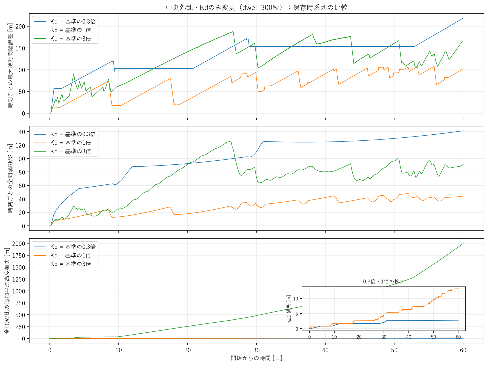
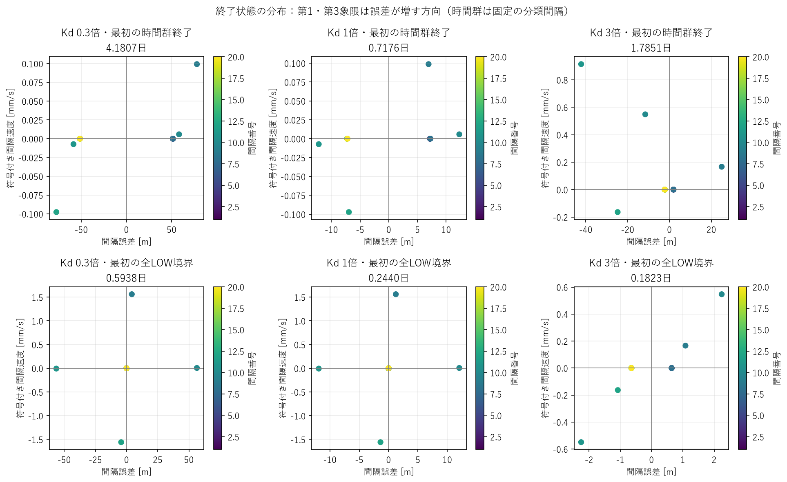
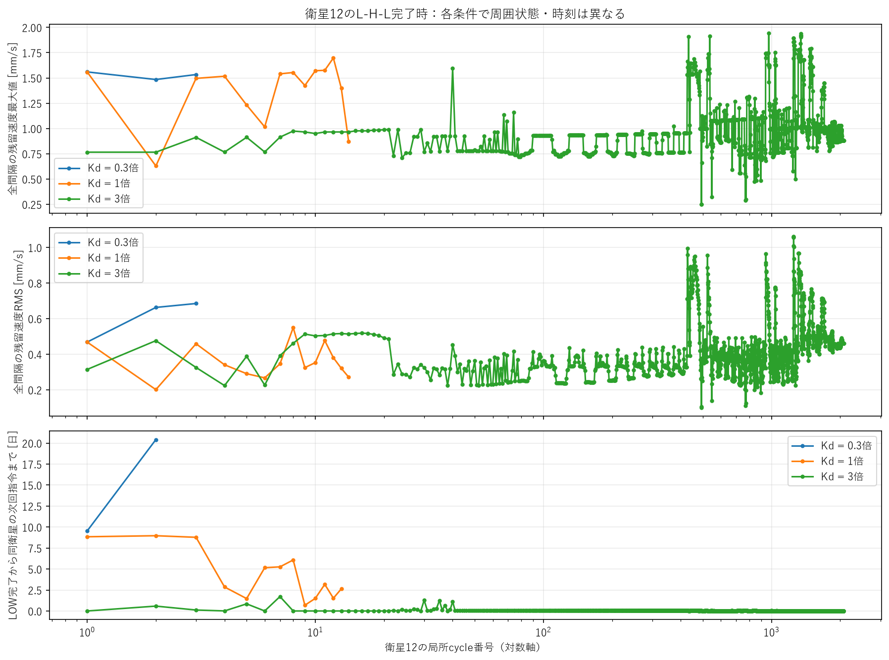
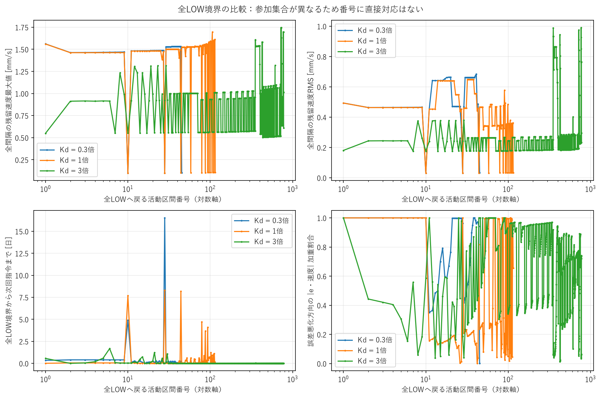
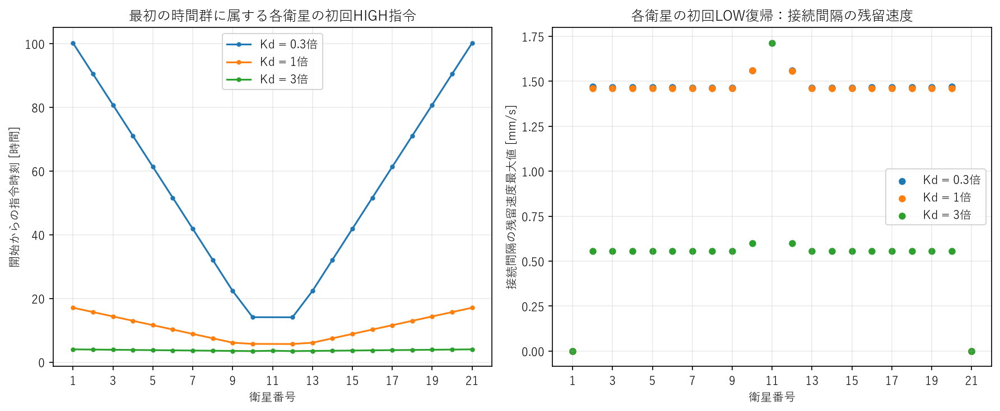
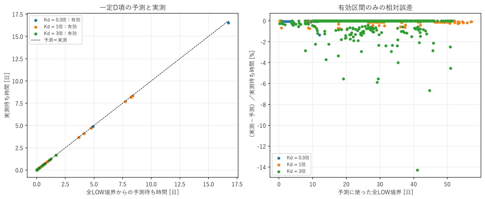
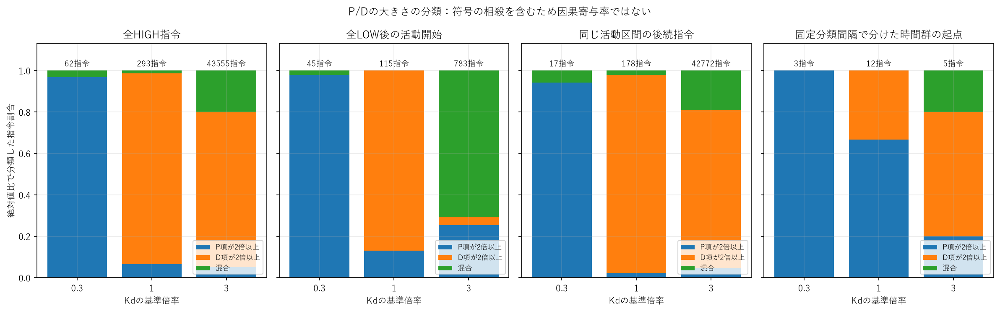
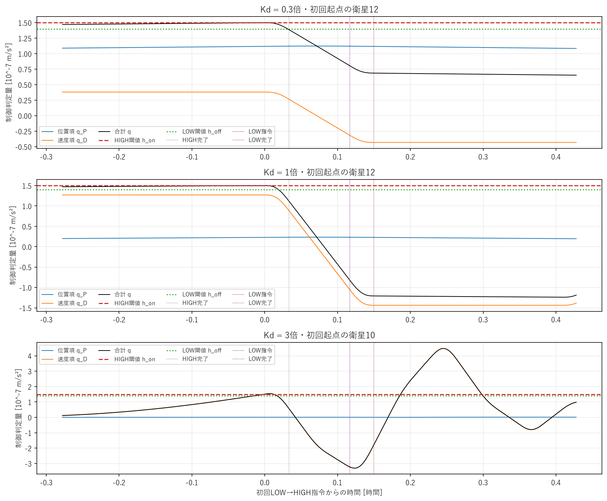
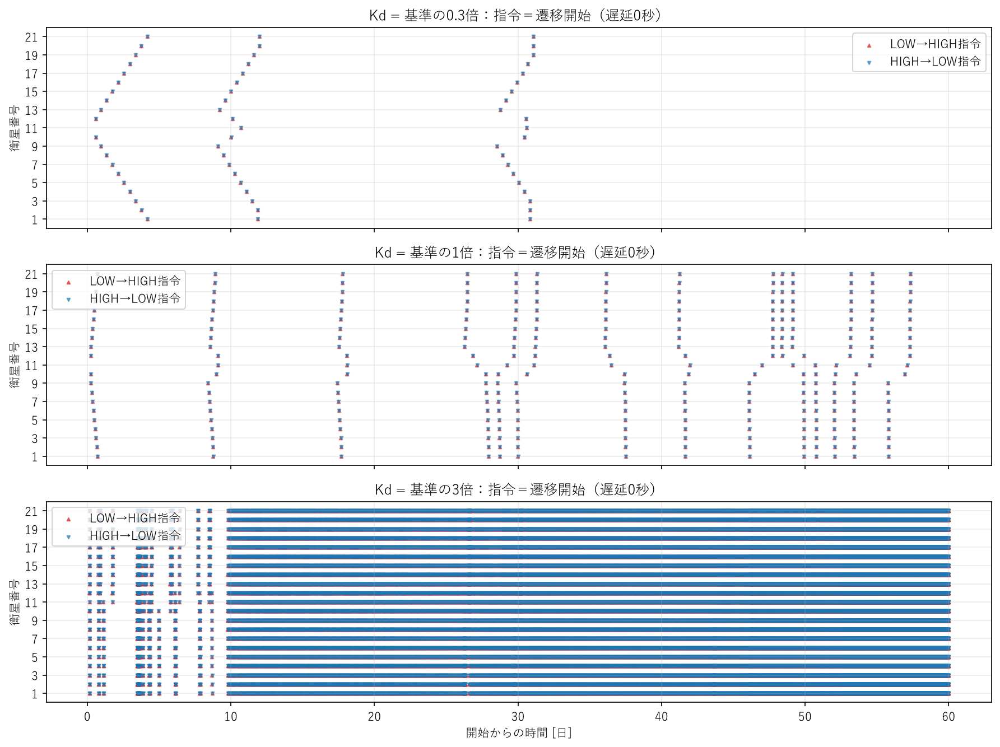

# Kdだけを変えた残留速度・長時間再切替の比較

結論：**Kdを強くすると物理的な残留速度が単調に減って長時間応答が良くなる、という仮説は支持されなかった。** この3条件では1倍が誤差性能に優れる。0.3倍は低コストと大きな誤差のトレードオフ、3倍は非常に頻繁な切替・大きな追加抗力コストを伴う。いずれも60日で漸近収束を確認できない。

これは現行の二値・slew・dwell制約付きモデルでの結果。連続PD系の「Kd増加＝減衰増加」をそのまま当てはめない。

## A. Kd条件と実装確認

|Kd倍率|Kd [s^-1]|Kp [s^-2]|
|---:|---:|---:|
|0.3|2.7777777777777776e-5|2.143347050754458e-9|
|1|9.259259259259259e-5|同上|
|3|2.777777777777778e-4|同上|

凍結24時間設定を入力基準とし、dwell300秒、slew120秒、制御10秒、h_on1.5e-7・h_off1.4e-7 m/s²を固定。N=21、400km、100km間隔、4kg、Cd2.2、LOW0.01/HIGH0.03m²、既存の高度依存密度モデル・RK4最大2秒刻みを固定した。外乱は3時間から1時間、密度増分振幅0.5、FWHM100km、列中央に追従する既存single pulseのまま。

design_time_sはKp/Kdを同時に変更するため、任意のcontroller.kd_s_inv指定を追加。未指定の式・正規化設定は従来と同じ。物理方程式、switching_function、姿勢state machine、積分器を変更していない。[4つの新規runの設定検査](results/inputs.json)はKdと観測時間以外の一致を確認した。

1倍の30/60日run・残留解析・全LOW比較runを再利用。0.3/3倍だけを30日まで計算し、結果を確認してから保存状態を60日へ継続した。大規模掃引は行っていない。

## B. 30日比較

|Kd倍率|最大誤差 [m]|全体RMS [m]|終了時最大誤差 [m]|姿勢遷移開始|完了L-H-L|最後の完了 [日]|追加平均高度損失 [m]|
|---:|---:|---:|---:|---:|---:|---:|---:|
|0.3|171.283|81.451|153.146|98|49|29.93565|2.104|
|1|93.529|20.978|78.351|225|112|29.99850|4.829|
|3|187.724|69.520|128.696|22,331|11,163|29.99861|481.492|

|Kd倍率|局所終了時V_res中央値 [mm/s]|同速度RMSの中央値 [mm/s]|同一衛星LH開始間隔中央値 [日]|HIGH安定時間合計 [衛星・s]|HIGH相当時間合計 [衛星・s]|
|---:|---:|---:|---:|---:|---:|
|0.3|1.48368|0.46837|8.25359|14,700|20,580|
|1|1.49086|0.46334|8.27205|33,730|47,230|
|3|0.93127|0.32751|0.04144|3,349,810|4,689,651.878|

局所終了時の速度は全20間隔を評価。他衛星が作動中の場合を含む。中央値は終了イベントを1標本とする統計であり時間平均ではない。異なる時刻・参加集合の単純な対応比較ではない。1倍は30日末に未完了1 cycle、3倍は未完了3 cycleを別記している。

0.3倍は30日末の新規予測で次回横断が30.059日、3倍は30日末にも頻繁な活動が続いたため、両方を60日へ延長した。

## C. 60日比較

|Kd倍率|最大誤差 [m]|全体RMS [m]|終了時最大誤差 [m]|姿勢遷移開始|完了L-H-L|最後の完了 [日]|追加平均高度損失 [m]|
|---:|---:|---:|---:|---:|---:|---:|---:|
|0.3|218.403|107.667|218.403|124|62|31.09005|2.795|
|1|107.819|31.480|101.945|586|293|57.33623|13.212|
|3|187.724|75.576|167.999|87,096|43,539|60.00000|1,997.135|

0.3倍は31.09日以降の切替がない一方、最終誤差は最大値を更新。3倍は後半30日だけで64,765遷移を追加した。3倍の最大誤差は30日の値を超えていないが、制御活動の減衰は認められない。

3倍の観測内遷移完了は87,089、終了時にpending/active遷移7件。完了していないL-H-Lは16 cycle（HIGH側14、LOW帰還開始済みで完了が観測外2）であり、完了cycleへ加えていない。

既定50m・1mm/s・1800秒窓のsettlingは全6ケースで未成立。1/5/10mに狭めても、終了時最大誤差がそれぞれの許容値を超えるためsettled suffixは成立しない。verification horizonはnull。60日を永久収束・発散の証明として扱わない。

上段は時刻ごとの最大誤差、中段は瞬間RMS、下段は同じ外乱の全LOW比の追加平均高度損失。図の瞬間RMSと表の全時間RMSは定義が異なる。下段の拡大図で0.3/1倍の小さいコスト差も確認できる。描画のみ間引き、数値集計は全10秒サンプルを使用した。

## D. 残留速度と空間分布

|60日データの局所終了統計|0.3倍|1倍|3倍|
|---|---:|---:|---:|
|V_res中央値 [mm/s]|1.48475|1.52285|0.96216|
|V_res最大値 [mm/s]|1.56099|1.69749|2.73825|
|速度RMSの中央値 [mm/s]|0.47087|0.45963|0.40809|
|各状態のmedian(abs(v))の中央値 [mm/s]|約7e-9|約3e-8|0.15374|
|誤差悪化のabs(e*v)加重割合の中央値|0.99807|0.29603|0.62376|

3倍のV_res中央値は下がるが、最大値は増え、多数のgapへ非ゼロ速度が広がっている。0.3/1倍は半数以上のgapが丸め誤差に近い速度で、一部に速度差が集中する。3倍を「物理的速度誤差が全体として改善した」と判定できない。

### 同じ60日時刻の状態

|Kd倍率|全LOW/pendingなし|速度最大 [mm/s]|速度RMS [mm/s]|瞬間誤差RMS [m]|悪化の加重割合|
|---:|---|---:|---:|---:|---:|
|0.3|はい|0.108626|0.034166|141.111|0.997822|
|1|はい|0.108646|0.034173|43.901|0.853043|
|3|作動中|0.837594|0.471529|91.311|0.691638|

0.3/1倍は、この同時刻の物理的速度がほぼ同じでも位置状態が大きく違う。累積HIGH相当時間の「外側20機−中央11番」の差は両条件とも420秒。完了cycle数も外側3・中央2と、外側14・中央13で同じ1 cycle差を残す。この同じ差動パルス量が、近い残留速度と整合する。別の時刻・条件でも同じ速度になることを保証するものではない。

e_i*v_i>0は誤差二乗を増す方向、<0は減らす方向。ただし符号だけの割合には微小な丸め誤差も入るため、abs(e*v)による重みとsigned配列を併用した。0.3倍では31日群終了時は主に回復方向だったが、60日では主に悪化方向へ移った。残留速度が持続し、誤差の符号を越えて流れ続けることにも注意が必要。

横軸e、縦軸符号付きv。第1・第3象限は悪化方向。上段の最初の時間群終了では0.3/1倍の速度最大が近くても、位置分布が異なる。下段の最初の全LOW境界は、条件により参加集合・cycle数が違う。軸範囲もパネルごとに異なる。

同じ衛星12の各局所cycleで、全間隔の速度最大/RMSと同衛星の次回指令までの時間を追う。cycle番号は対数軸。0.3/1/3倍の番号は異なる周囲状態・時刻なので、線を1対1の因果対応と解釈しない。

全LOWへ戻った活動区間だけを使った比較。全LOWになる回数とその間の待ち時間も条件で大きく違う。番号は対数軸で、全列の独立した波番号ではない。右下の加重割合が1へ近いと、その境界で主に誤差を増す方向に動いている。

## E. 初回応答

|Kd倍率|最初のHIGH指令 [s / 時間]|起点衛星|左/右外側伝播速度 [m/s]|最初の時間群終了 [日]|その群の遷移数|
|---:|---|---|---|---:|---:|
|0.3|50,650 / 14.0694|12|2.85755 / 2.85755|4.18067|40|
|1|20,430 / 5.6750|12|20.26341 / 20.26341|0.71759|40|
|3|12,410 / 3.4472|10・12|454.54545 / 454.54545|1.78507|270|

伝播速度は中心から4 hop以上の外側枝でdistance = speed*time + interceptを回帰したもの。全域1つのfrontや物質の伝播速度を意味しない。3倍は外乱中から起動し、最初の時間群にも反復cycleが含まれる。0.3/1倍は最初の群で中央11番を除く20機、3倍は中央を含む全21機へ到達する。

同じ最初の24時間では、最大誤差/RMS/遷移は0.3倍56.604m/15.034m/8、1倍12.424m/5.992m/40、3倍31.428m/6.528m/186。遅い伝播によって、0.3倍では最初から誤差が大きくなる。

衛星12の初回LOW復帰時、接続gapの速度最大は0.3倍1.55949、1倍1.55864、3倍0.59855mm/s。この時点で近傍が作動中で、3倍は外乱も継続中。3倍の小さい初回速度だけで長時間性能を予測できない。

左図は最初の時間群に属する各衛星の初回指令。0.3/1倍の中央11番はこの群に参加しない。右図は各衛星に接続する間隔の速度最大。3倍では端部の接続速度がほぼゼロでも、他のgapに速度が残るため、全列の状態を別に確認する。

## F. 再切替と予測

同じ差分演算Bに対して、q_P=Kp*B*e、q_D=Kd*B*v、e_dot=v。

**P項の増加率はd(q_P)/dt = (Kp/Kd)*q_D = Kp*B*v。** 静穏区間でq_D一定とすると、閾値までの時間は(h_on−q_P−q_D)/[(Kp/Kd)*q_D]。その後LOW側dwell時計・10秒制御格子を適用する。詳細は[定義](definitions.md)。

|60日内の全LOW予測|0.3倍|1倍|3倍|
|---|---:|---:|---:|
|有効・実測次回あり|44|114|778|
|次回衛星が一致|44|114|778|
|将来の上向き横断予測|44|114|774|
|すでにon以上からの指令予測|0|0|4|
|絶対相対誤差の最大 [%]|1.347|0.737|14.286|

3倍の最悪相対誤差は実測70秒に対し予測80秒の1制御周期差。待ち時間が短いため比率が大きい。有効判定は観測された静穏窓でD項変動10%以内等を満たすこと。全局所cycleの予測は近傍作動・介在指令などで有効有限予測0件だった。局所復帰時のD一定近似を全cycleへ無条件に使えない。

最初の時間群終了から次回HIGHまでは、0.3倍で実測423,660秒/予測425,380秒、1倍664,790秒/669,300秒、3倍144,920秒/145,440秒。3倍の群は複数cycleを含むため、同じ1 cycleからの待ち時間ではない。

### 60日終了時からの新しい予測

0.3倍は衛星13が60.36690日、1倍も衛星13が60.72813日に次回指令と予測される。どちらも観測外で、実測確認はしていない。3倍は他衛星が作動中で、一定D・無作動の予測前提を満たさない。

0.3/1倍の60日でのP増加率は約2.292e-13 m/s³とほぼ同じ。しかし0.3倍はP項が1.39765e-7まで増え、1倍の1.25675e-7よりonへ近い。小さいKdでも先に再横断する予測になった。残留速度だけで次回時刻を決められない。

さらにbaselineの**同一**第1群終了状態・同一dwell時計にKdだけを代入すると、予測指令は0.3/1/3倍で761,540/731,300/644,900秒。P増加率ではKdが相殺されても、初期D項と閾値までの残り距離は変わる。実際のKd介入では、それに加えて切替履歴と状態軌道が変わる。予測式の係数の入替だけを実験効果とはみなさない。

左は全LOW境界からの待ち時間。右は実測−予測の相対誤差。静穏区間で残留速度によるP蓄積が再横断を説明することを支持するが、作動中のhybrid応答・永久収束を保証しない。

## G. P/D寄与

HIGH起動につながった保存格子での上向き横断を分類。abs(P)≥2abs(D)をP優勢、逆をD優勢、他を混合とした。全条件で今回の記録はLOW入時すでに上ではなく、下からの横断だった。

|60日・上向き横断時の分類|P優勢|D優勢|混合|
|---|---:|---:|---:|
|0.3倍|60|0|2|
|1倍|19|270|4|
|3倍|2,305|32,496|8,754|

初回起点のD絶対値比は0.3倍25.41%、1倍84.66%、3倍99.64%。0.3倍は位置が蓄積してから起動し、1/3倍は速度項に敏感になる。

全指令と、全LOW活動区間の起点、後続の伝播指令、固定分類間隔での時間群の起点を分けた。例えば1倍の時間群起点はP優勢8・D優勢4だが、全指令ではD優勢270。伝播中のD優勢を数えて「長い静穏後の再切替もD項だけが原因」とは判断しない。

3倍では横断側状態のP/Dが反対符号となる記録17,422件。絶対値比は、相殺も含む信号の大きさの比であり、因果寄与率ではない。個々の符号・qの合計をCSVへ保存した。

図は指令時の分類で、上表の横断サンプルと区別する。3倍ではLOW側dwellを待つ間に寄与が変わる場合があり、指令時分類はP2,264/D32,518/混合8,773。分類対象・時刻・群分けを固定した比較が必要。

3倍は最初の起点10番、他は12番。縦線はHIGH完了・LOW指令・LOW完了。0.3/1倍は同じ長さのpulseでも判定量が違う。3倍は外乱と近傍作動が重なりD項が往復する。qがoffを下回った時刻と、dwellが解除されて実際にLOWを指令する時刻を分けて読む。

## H. dwellとの相互作用

0.3/1倍の完了cycleは全件HIGH完了→LOW指令300秒。3倍は最早帰還gateでoff条件を満たさないcycleが30日15、60日128。完了43,539 cycle中43,411は300秒、128は310〜340秒。終了時の未完了・gate観測外を別扱いにした。

一方LOW側にも300秒のdwellがある。最短LH→次LH間隔は2*(120+300)=840秒。3倍の60日内実測43,534間隔中10,978（25.22%）がこの下限に一致した。30日では300/11,145（2.69%）。横断から指令まで待ったHIGH起動も60日4,145件。HIGH保持がほぼ同じでも、LOW側の時計と高いD感度が頻繁な再起動へ関わっている。

dwell値を変えた効果ではない。今回の介入はKdのみであり、同じ時計・同じpulse量の下で、時刻・順序・反復数が変化した。[gate診断](results/trigger_gates.json)と3倍caseのblocked_return_gates.csvを参照。

## I. 性能・コスト・空間パターン

|60日|0.3倍|1倍|3倍|
|---|---:|---:|---:|
|HIGH安定合計 [衛星・s]|18,600|87,900|13,065,320|
|HIGH相当合計 [衛星・s]|26,040|123,060|18,290,721.826|
|同一衛星LH開始間隔中央値 [日]|18.95347|3.80214|0.02245|
|衛星別完了cycle数|外側3・中央2|外側14・中央13|2,071〜2,076|

0.3倍は1倍より遷移・追加損失が約79%小さい一方、最大誤差約2.03倍、RMS約3.42倍。3倍は1倍より遷移約148.63倍、追加高度損失約151.17倍で、長時間誤差も悪い。コスト増は主にpulse数で、HIGH幅の10〜40秒の延長は少数。

帯状部分には多数のHIGH/LOW指令が重なる。0.3倍は大きな静穏区間、1倍は後半の部分列・非対称応答、3倍は全21機の高頻度反復が続く。3倍の衛星別cycle数がほぼ等しいことは、全時刻で同期している証明ではない。固定時間群は頻繁な反復をまとめるため、群数を比較して局所化・同期改善を断定しない。実イベント列と衛星別回数を優先した。

追加平均高度損失はmean(a_allLOW−a_control)、同一時刻・同一外乱の21機平均、正が追加損失。円軌道モデルでは長半径差と高度差は同じ。初期高度からの全抗力損失とは区別する。

## J. Kdの評価

- **0.3倍：この条件では速度感度が不足する候補。** 初回の伝播・補正が遅く、位置誤差を大きく許す。長い静穏は安定化を示さず、P蓄積と将来横断が残る。
- **1倍：3点の中で誤差とコストのバランスが良い候補。** 最適・工学的に妥当とは証明していない。60日でも再切替が続く。
- **3倍：現行二値pulse制約では過敏・過剰作動の候補。** 一部の残留速度統計を下げても、長時間誤差とコストを改善しない。状態誤差の急激な発散は60日内で観測されないが、高頻度切替は増え続けた。

「Kd→残留速度低下→再切替減少」という単純な単調因果列は成立しない。支持されるのは、**Kd→初回起動/伝播/切替履歴→e/vの終了状態と空間分布→静穏中のP蓄積と再起動**。dwell拘束下では単発HIGH量がほぼ固定されるので、Kdは理想連続系の減衰量として自由に作用していない。

## K. 次の実験

**主目的を残留状態と再切替の機構分離に置くなら、次はKpの独立3点（0.3/1/3倍）を優先する。Kd=1倍、dwell・閾値・外乱を固定し、1倍runを再利用する。** P蓄積率と位置感度の変更が、誤差・静穏期間・次回指令へどう作用するかを分けられる。Kp変更で残留速度がゼロになるとは仮定しない。

Kdの細かい確認は補助として0.9/1/1.05倍程度が候補。baseline衛星12の初回LOW復帰時20970秒、衛星13のP=2.58727e-9、D=1.44317e-7。同じ状態でKd倍率を変えると、(h_on−P)/D = 1.02145倍でqがonに達する。この値は**固定された1状態での瞬間判定境界**であり、実モデル全体の臨界ゲイン・安定境界ではない。近傍伝播が僅かなゲイン差で変わる可能性を確認する目的なら、この狭いKd確認を先に行う価値がある。

今回はこれらの追加計算を行っていない。閾値・dwellの追加掃引、制御則変更も行っていない。

## L. 回帰・テスト・Git・変更ファイル

- [全147テスト合格](results/tests.json)：既存118、新規29。V/RMS/符号統計、P/D分類、独立Kdの設定読込・不正値、endpoint抽出、予測の相殺/残る閾値margin、帰還gateの打切り、検索境界、初日窓を検証。
- [24時間software reference回帰](results/regression_24h.json)：保存済みの実再実行suiteを凍結referenceと照合。3ケースの集計・全イベント・7主要配列一致、最大差0。baselineの物理計算を重複していない。暗黙Kdと明示同値Kdの短時間hybrid simulationも全配列/イベント一致。
- [旧残留解析との互換検査](results/metrics_compatibility.json)：既存60日baselineの全局所/群/全LOW行、元の要約、全endpoint配列一致。
- [非破壊確認](results/preservation.json)：作業開始時の725ファイルに変更・欠落なし。新規2条件の30→60日全11配列/イベントprefix一致。
- branch：`astra/kd-residual-analysis`。基点はdwell解析の`b4a217066ec7a1490558c0591bebbf64e5518294`。評価コードのcommitは`4380fbac9954cdc733941678548defbe6df36f16`。結果commitは作業完了の報告とGit履歴を参照。mainへmergeしない。

|ファイル|目的|
|---|---|
|src/sat_string/config.py|Kdだけの任意指定と検証。旧省略値の動作/形式維持|
|src/sat_string/kd_analysis.py|速度分布・符号・P/D分類・帰還gate・初回応答・同一状態予測|
|src/sat_string/residual.py|既存残留後処理の検索高速化。式・サンプル・結果維持|
|scripts/run_kd_case.py|0.3/3倍だけの新規計算。凍結設定からKdと期間のみ変更|
|scripts/analyze_kd_residual.py|保存run/cacheから正式指標・signed endpoint配列を保存|
|scripts/summarize_kd_residual.py|6ケース表、初日比較、観測末状態と条件付き予測|
|scripts/check_kd_trigger_gates.py|横断/指令の差と840秒の再起動下限を診断|
|scripts/plot_kd_residual.py|日本語9図。既存日本語フォントを使用|
|scripts/export_kd_results.py|小さい設定・集計・代表cycle・60日イベントをGit用に整理|
|scripts/check_kd_inputs.py|Kdと期間以外が凍結入力と同じことを検査|
|scripts/check_kd_metrics_compatibility.py|高速化した後処理と旧baseline解析の一致検査|
|tests/test_kd_analysis.py|新規29テスト|
|docs/kd_residual_analysis/|定義・本報告・再現手順・集計・図|
|README.md|本解析への案内|

[全比較JSON](results/comparison.json)、[CSV](results/comparison.csv)、各caseのgap別RMS/衛星別統計/初回cycle/群・全LOW残留値を保存した。Gitのlocal_cycle_samples.csvは各衛星の最初/最後3 cycleだけであり、全分布ではない。全局所CSV・P/D横断CSV・帰還gate CSV・全signed endpoint NPZ・全物理時系列NPZはローカルの新規outputsに保存し、各caseのlocal_files.jsonから参照できる。巨大NPZと全局所JSONの重複Git登録は避けた。

主要コマンドと再現方法は[reproduction.md](reproduction.md)。
