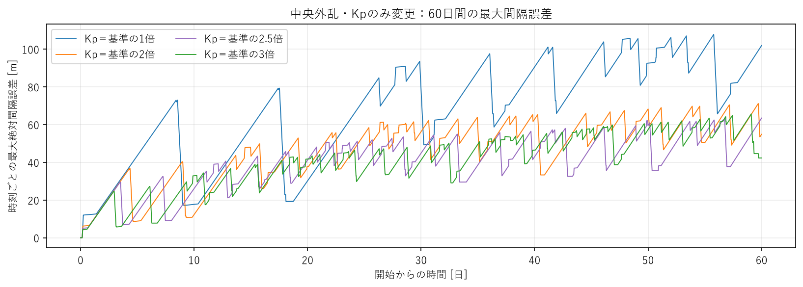
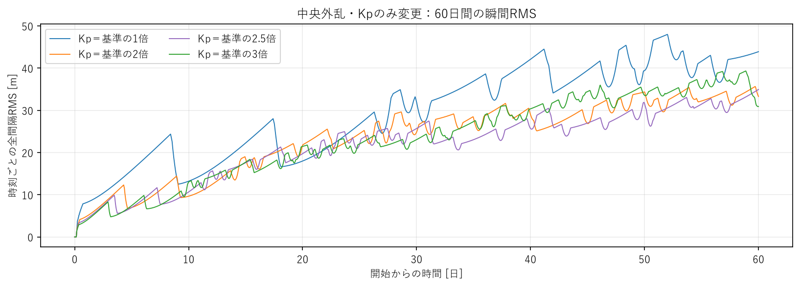
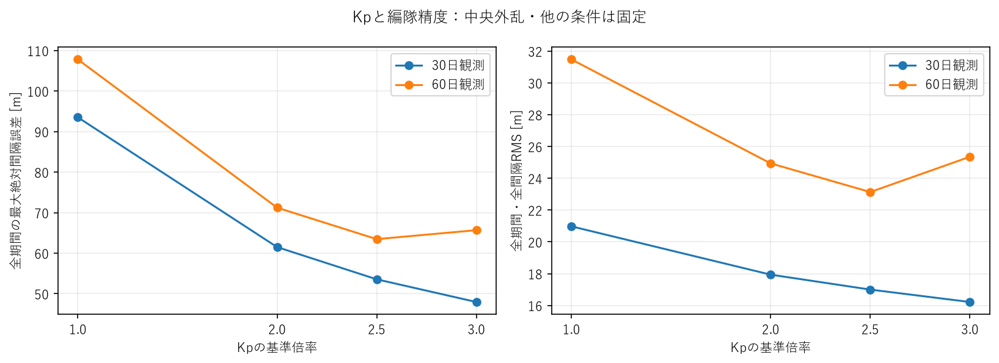
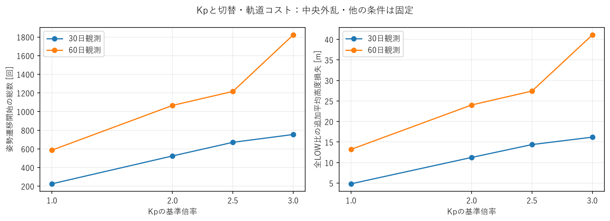
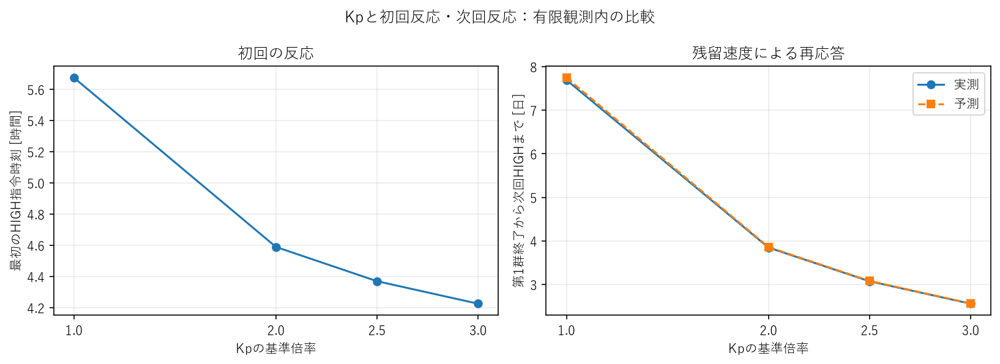

# 詳細技術付録

## 1. 条件と保存先

位置誤差への感度だけを変えた比較である。新規2条件の差を、他の制御・物理設定の変更と混同しない。

Kp0=1/21600²=2.143347050754458e-9 s^-2。新規2倍は4.286694101508916e-9、2.5倍は5.3583676268861455e-9 s^-2。
Kd=2/21600、dwell300秒、slew120秒、制御・保存10秒、h_on1.5e-7/h_off1.4e-7 m/s²を固定した。
21機・400km・100km間隔、4kg、Cd2.2、LOW0.01/HIGH0.03m²。高度依存密度、中央追従の単発密度外乱（3時間から1時間、増分振幅0.5、FWHM100km）、RK4最大2秒刻みも凍結設定のまま。

1倍・3倍は前回の保存runと比較行を再利用した。新規2倍・2.5倍だけを30日計算し、[結果を確認した延長判断](results/extension_decision.json)を保存した後、30日状態から60日へ継続した。30日までの軌道を再積分していない。

物理量・制御量・予測の定義は[前回の定義](../kp_residual_analysis/definitions.md)、今回の改善率と追加コストは[今回の定義](definitions.md)。全量を文章へ転記せず、[比較CSV](results/comparison.csv)を参照する。

## 2. 30日比較

### 観測

30日では、Kp増加とともに最大誤差と全期間RMSが下がり、遷移数と追加高度損失が増えた。
完了往復（L-H-L cycle）は、1機がLOW→HIGH→LOWの姿勢変更を終えた1回を指す。

|Kp倍率|最大誤差 [m]|全期間RMS [m]|終了時最大 [m]|遷移開始|完了往復|最終完了 [日]|追加高度損失 [m]|
|---:|---:|---:|---:|---:|---:|---:|---:|
|1|93.529|20.978|78.351|225|112|29.99850|4.829|
|2|61.512|17.938|56.284|524|262|29.94630|11.252|
|2.5|53.558|16.999|44.893|670|335|29.24734|14.388|
|3|47.959|16.217|41.184|754|377|29.43785|16.192|

見るべき点は、2.5倍と3倍のRMS差が約0.782mである一方、遷移差が84回、追加損失差が約1.804mあること。2.5倍は3倍より最大誤差11.7%、RMS4.8%大きいが、切替と追加損失は約11.1%少ない。終了時だけの値は応答の停止位相を反映するため、主たる優劣判定にはしない。

### 解釈

中間倍率でも、早めに反応して精度を改善する一方、切替を多く使う関係が続いた。1→2倍に比べ、同じ倍率増加あたりの誤差改善は小さくなる。ただし4点だけから連続的な飽和曲線や最適点を確定できない。

### 判断

2倍は30日末も速度差1.540mm/sが残り、2.5倍は0.103mm/sながら誤差を増す方向だった。全LOW・保留なしの終了状態から次回HIGHはそれぞれ30.16667日、31.06956日と予測された。両方を60日まで延長し、短い静穏を収束と取り違えない。

## 3. 60日比較

### 観測

60日では、2.5倍が最大誤差と全期間RMSの両方で最小となった。30日の単調な順位は維持されなかった。

|Kp倍率|最大誤差 [m]|全期間RMS [m]|終了時最大 [m]|遷移開始|完了往復|最終完了 [日]|追加高度損失 [m]|
|---:|---:|---:|---:|---:|---:|---:|---:|
|1|107.819|31.480|101.945|586|293|57.33623|13.212|
|2|71.235|24.938|54.877|1,066|533|59.75440|24.035|
|2.5|63.472|23.135|63.472|1,216|608|57.56354|27.418|
|3|65.689|25.353|42.313|1,822|911|59.81007|41.089|

2.5倍は3倍より最大誤差3.38%、RMS8.75%小さく、遷移33.26%、追加損失33.27%少ない。2倍も3倍よりRMSが1.64%小さく、追加損失は41.50%少ない。ただし最大誤差は8.44%大きい。2.5倍と2倍が、精度とコストの異なる折衷候補になった。

### 解釈

3倍は初回の反応をさらに早めるが、長時間ではその効果を単純に積み上げられない。30〜60日の追加遷移は1／2／2.5／3倍で361／542／546／1,068回。後半の3倍では再切替が特に多かった。衛星別往復数は2倍24〜26回、2.5倍28〜29回、3倍42〜44回で、実イベントでも活動増を確認した。

終了時誤差は3倍が2.5倍より小さい。2.5倍の最大誤差は60日末そのもので、まだ増加中だった。全期間RMSの優位は終端1サンプルだけの差ではないが、2.5倍が「全ての性能で優れる」とは言えず、観測時間を変えた順位も保証しない。

### 判断

この固定外乱・60日・最大誤差/RMSとコストの比較では2.5倍を有力候補、より低いコストを重視する場合は2倍も残す。永久収束や普遍的な最適Kpは確認していない。

各時刻の20間隔の最大値。上昇と急な減少が繰り返され、2倍・2.5倍でも再応答が終わっていない。

各時刻で20間隔を平均したRMS。表の全期間RMSはさらに全時刻を平均するため、最後の点や曲線の単純な算術平均とは異なる。描画だけ間引き、集計は全保存サンプルを使った。

## 4. 精度改善に必要な追加コスト

### 観測

1倍基準の改善率とコスト増加率は、2.5倍で最も有利な精度改善を示した。一方、2.5倍のコストも基準の約2.08倍であり、低コストの1倍に全面的に取って代わるものではない。

|60日・1倍基準|最大誤差減少 [%]|RMS減少 [%]|遷移増加 [%]|追加高度損失増加 [%]|
|---|---:|---:|---:|---:|
|2倍|33.93|20.78|81.91|81.93|
|2.5倍|41.13|26.51|107.51|107.53|
|3倍|39.08|19.46|210.92|211.01|

3倍は2.5倍よりコストを増やしたが、60日最大誤差とRMSはともに悪化した。このため、3倍への増加を「さらに精度を買った」と説明することはできない。

|60日・隣接条件|最大誤差改善 [m]|RMS改善 [m]|追加遷移|追加高度損失 [m]|RMS改善1mあたりの追加損失 [m]|
|---|---:|---:|---:|---:|---:|
|1→2|36.584|6.542|480|10.824|1.655|
|2→2.5|7.764|1.803|150|3.383|1.876|
|2.5→3|−2.217|−2.218|606|13.671|定義しない|

1→2倍より2→2.5倍のRMS改善単価が高くなった。2.5→3倍は改善量が負なので、改善単価を無理に算出しない。最大誤差1mあたりの追加遷移・損失を含め、30日/60日の全差分は[adjacent_cost.csv](results/adjacent_cost.csv)に保存した。

HIGH相当時間は、姿勢変更中の面積増加もHIGH滞在時間へ換算した量。30日では1／2／2.5／3倍で47,230／110,040／140,700／158,340衛星・秒、60日では123,060／223,860／255,360／382,640衛星・秒だった。
追加高度損失は同じ外乱・同時刻の全LOW軌道に対する21機平均の余分な損失で、正が損失。初期高度からの全損失とは別の量。

### 解釈

30日では改善が続いたが、60日では2.5倍から3倍への変更で精度とコストの両面が悪化した。「3倍へ近づくと必ず単調に改善する」という説明は支持されない。2.5→3倍の遷移増分606回は、同じ0.5倍幅の2→2.5倍の150回より大きく、長時間コスト増加には非線形な変化がある。

### 判断

最大誤差またはRMS・遷移・損失の3量に限れば、60日3倍は2.5倍に劣る。RMS基準では2倍にも劣る。ただし終了時誤差や初回応答を含めた全量での優位ではない。許容誤差・姿勢変更コスト・寿命要求が未定なので、重みを新設して最適値を決めない。

青は30日、橙は60日。30日の単調改善と、60日の2.5倍での折り返しを区別して読む。点を結ぶ線は未計算倍率の挙動を保証しない。

60日の2.5→3倍でコスト増が大きくなる。高度損失はm単位の追加分であり、この差だけから衛星寿命の優劣を定量化していない。

## 5. 初回応答と起動時誤差

### 観測

初回の起点と参加集合は同じで、2倍・2.5倍は1倍と3倍の間を滑らかにつないだ。

|Kp倍率|初回HIGH [時間]|左右外側到達速度 [m/s]|第1群終了 [日]|第1群最大誤差 [m]|第1群RMS [m]|初回起動時接続誤差 [m]|
|---:|---:|---:|---:|---:|---:|---:|
|1|5.675|20.263|0.71759|12.283|6.040|11.500|
|2|4.589|38.298|0.44977|6.348|3.174|5.757|
|2.5|4.369|46.573|0.39606|5.166|2.599|4.597|
|3|4.225|54.496|0.36019|4.374|2.216|3.833|

全条件で起点12番、中央11番を除く20機が各1往復、計40遷移。第1群は最初の連続した切替応答を、前回14日データから決めた固定時間間隔でまとめたもの。最大誤差・RMSの表は各群の開始から終了までなので、条件間で時間幅が違う。

伝播速度は中心から4hop以上の左右枝を距離対到達時刻で回帰した値。中央近傍の遅延を含む全域の単一front速度ではない。左右値の違いは浮動小数点丸めの範囲だった。

### 解釈

2倍・2.5倍でも、小さい実位置誤差の段階で起動している。初回HIGH時のP項（位置誤差由来の判定量）は約2.30e-8、D項（速度差由来）は約1.27e-7 m/s²で全条件ほぼ同じ。そのため、同じq_Pでも物理的な位置誤差が違う。

`q_P=Kp*B*e`。

これは同じ位置ずれでも、Kpが大きいほど切替判定へ強く反映されることを意味する。Bは実装の左右間隔差分で、端部では接続1間隔を見る。q_Pが小さいことを編隊状態の改善と直接解釈しない。

### 判断

初回の参加集合・パルス数には急な変化が見られなかった。長時間の誤差・再切替・コストを併用し、初回だけで倍率を選ばない。全HIGH指令の物理的起動誤差・P/D統計は比較JSONと各条件のthreshold_events.csvに保存した。

## 6. 残留速度と次回予測

### 観測

初回応答が列全体でLOWに戻った後の速度差は、4条件でほぼ同じだった。残留相対速度は、この応答終了後にも衛星間へ残っている速度差を指す。

全間隔最大の残留速度は1／2／2.5／3倍で0.098674／0.098633／0.098625／0.098620mm/s、速度RMSは0.031036／0.031023／0.031021／0.031019mm/s。最大値の条件間差は約0.055%。

|第1群終了→次回HIGH|1倍|2倍|2.5倍|3倍|
|---|---:|---:|---:|---:|
|P項増加率 [m/s³]|2.11441e-13|4.22707e-13|5.28340e-13|6.33973e-13|
|実測待ち時間 [日]|7.69433|3.84572|3.07292|2.55764|
|予測待ち時間 [日]|7.74653|3.85868|3.08113|2.56343|

実測・予測とも次回は9番衛星。2倍・2.5倍の待ち時間誤差は約0.34%・0.27%だった。同程度の速度差でも、再切替までの時間はKpに強く依存した。

### 解釈

`d(q_P)/dt=Kp*B*v`、`予測待ち時間=(h_on-q_P-q_D)/(Kp*B*v)`。

残った速度差vによって位置項が育つ。閾値までの残り量をその増加率で割り、次の反応までの時間を予測する。全LOWの静穏区間（新しい姿勢変更がない区間）でD項をほぼ一定と置き、dwellと10秒制御時刻も反映する。

初回の結果は、Kpが直接速度を減衰させたためではなく、切替開始・順序を変え、位置誤差の成長に早く反応したためという説明を支持する。長時間では状態や参加集合も変わるため、常に速度が同一とは保証しない。

### 判断

予測の妥当性は、観測内に次回実測があり、介在指令がなく、対象D項変動が既存許容差10%以内などの条件で確認する。近傍作動中や観測外の予測を精度集計へ無理に入れない。詳細はCSV・NPZを参照し、今回追加の残留指標開発は行っていない。

60日内の有効な全LOW予測は1／2／2.5／3倍で114／151／169／218件、全て次回起動衛星も一致した。絶対相対誤差の最大は0.737／0.637／0.826／1.020%。
2倍・2.5倍の30日末予測に対し、実際の次回HIGHは30.16667日・31.06829日で、時刻差は0秒・−110秒だった。2.5倍は30日末に有限settling判定を満たしていても、その後再切替したことを確認した。

60日末は全4条件とも全LOW・保留なし。新しい条件付き予測は1倍が衛星13・60.72813日、2倍が衛星10・60.00891日、2.5倍が衛星9・60.04410日、3倍が衛星2・60.02211日。これらは観測外で未検証であり、60日を超えて永久に静かという証拠はない。今回それ以上の計算は行っていない。

右の予測と実測が近いことは、初回終了後の同程度の残留速度でも位置感度によって次回時刻が変わることを支持する。hybrid系全体の安定性の証明ではない。

## 7. 切替密集・dwell・有限観測のsettling

### 観測

30日では2倍・2.5倍のHIGH完了→LOW指令は全て300秒だった。LOWへ戻る条件を満たしていても、姿勢変更完了後の待ち時間dwellがHIGH量を決めている。

過敏化の検査では、同じ衛星のHIGH起動→次HIGH起動の840秒下限と、LOW完了→次HIGH指令の300秒待機下限を分ける。どちらもslew・dwellに拘束された極端な密集を調べるための量。

60日でも2倍533往復・2.5倍608往復のHIGH保持は全て300秒。3倍は911往復中909回300秒、2回310秒だった。

|60日の実測間隔|1倍|2倍|2.5倍|3倍|
|---|---:|---:|---:|---:|
|同一衛星HIGH→次HIGHの最短 [s]|56,270|24,710|8,670|20,160|
|LOW完了→次HIGHの最短 [s]|55,730|24,170|8,130|19,620|
|同一衛星HIGH→次HIGHの中央値 [日]|3.802|2.195|1.951|1.262|
|840秒下限への一致件数|0|0|0|0|

2.5倍には3倍より短い局所再起動もあったが、最短でも840秒の約10.3倍。LOW完了後300秒で即座に再起動する事例もなく、全HIGH指令は下からの閾値横断だった。横断後にLOW側dwellを待った指令は0件。
3倍の総切替は2.5倍より約49.8%多いが、Kd3倍で見られた待機下限への張り付きとは異なる。「コストの非線形な増加」と「極端な最短周期切替」を混同しない。[全イベント診断](results/trigger_gates.json)を参照。

60日P優勢/D優勢/混合の起動は1倍19/270/4、2倍35/469/29、2.5倍40/527/41、3倍92/757/62。P優勢は位置項の絶対値が速度項の2倍以上、D優勢は逆、混合はその他。信号の絶対値分類であり、再切替時刻の因果寄与率ではない。初回D項が大きくてもP項の蓄積が起動時刻を動かしたことは6節で確認した。

### 有限観測判定と前回本文の訂正

30日の既定50m・1mm/s・1800秒設定では、1倍・2倍はsettling未成立、2.5倍は29.24734日から成立し確認期間0.75266日、3倍は29.43785日から成立し確認期間0.56215日だった。
このsettlingは「その後、観測終了まで逸脱・新しい切替がなかった」だけを意味し、永久収束ではない。両方とも30日後の新しい切替を予測するため、延長する理由になった。

**前回レポート本文の「全6ケースでsettling未成立」は記述誤りであり、保存された3倍・30日metricsではtrueだった。** 今回は保存値に基づいて観測期間ごとに区別する。旧run・旧metrics・旧文書は上書きせず、この付録で訂正する。60日比較の研究結論と、30日内の短い有限確認は区別する。

60日では全4条件でsettling未成立、確認期間はnull。2倍の終了時誤差54.88mと2.5倍63.47mは50m条件外、3倍は位置誤差42.31mでも速度最大1.503mm/sが条件外だった。
2.5倍の60日末速度最大は0.108673mm/sで、誤差二乗の平均は増える方向だった。低い残留速度や少ない切替だけを安定化と解釈しない。

## 8. 次の判断と未確定事項

### 観測

2.5倍は60日の主要な精度・コスト4量で3倍より有利で、2倍はさらに低コストだった。初回応答の中間変化は滑らかだが、長時間コストと精度の関係は単調でなかった。

### 解釈

支持される因果は「Kp変更→切替開始・順序・履歴→終了時の位置/速度状態→P項蓄積→再切替」。初回の残留速度がほぼ同じという事実は、Kpが直接速度を消したという説明を支持しない。後半の参加集合・同期・停止位相が変わるので、初回の良さが60日性能へ単純に比例しない。

### 判断

次は**Kp=2／2.5倍とKd=0.7／1倍の小規模2次元比較**を第一優先とする。今回のKd1倍の2条件を再利用すれば、新規物理計算はKd0.7倍の2条件だけ。dwell・閾値・外乱は固定し、まず30日、その後は必要条件のみ60日へ延長する。

目的はKpだけをさらに細かく最適化することではなく、今回精度を改善した候補で速度感度を少し下げると残留状態・コスト・再切替がどう変わるか確認すること。0.7倍は次の探索用の提案で、結果や改善を予想して正当化した値ではない。既存Kd0.3倍の誤差悪化と3倍の切替過多を踏まえ、基準近傍を少数で調べる。

その候補を得た後に、外乱位置などを1条件だけ変えて順位の頑健性を確認する。h_c変更は位置と速度の両方の切替感度を同時に動かすため、今回の因果整理の直後の第一選択にはしない。

まだ言えないことは、永久収束・普遍的な最適Kp・他の外乱や長い観測での順位。2.5倍の最大誤差が終端で生じた点からも、観測区間依存性が残る。今回、提案した追加実験は実施していない。

## 9. ソフトウェア確認・保存成果・Git

研究結果とは別に、以前の物理結果を壊していないことを確認する。24時間基準は制御の科学的な最適性ではなく、コード変更監視用のreferenceである。

- 全177テスト合格（前回169＋設定2条件・比較処理6件）。[記録](results/tests.json)
- 24時間保存済み実再実行suiteの3ケースを凍結referenceと照合。集計・全イベント・主要7配列が一致、最大差0。[回帰記録](results/regression_24h.json)
- 制御ケース最大誤差12.423898m、RMS5.991742m、40遷移、追加損失0.821150m、左右速度20.263407m/sを維持。別途短時間hybridテストも維持した。
- 新規4runはKp・期間以外の入力変更なし。全8比較条件も制御・外乱ONと凍結設定一致を検査。[新規入力](results/inputs.json)、[全比較条件](results/configuration_checks.json)
- 既存1倍・3倍の30/60日比較行・初回情報が元の保存値と一致。[再利用確認](results/reused_rows.json)
- 保護した既存1,555ファイルに変更・欠落なし。新規2条件の30→60日の11配列・イベントprefixが一致。[非破壊記録](results/preservation.json)、[SHA-256一覧](results/preserved_inputs_sha256.json)
- 日本語5図を作成し、目視確認。新しい依存追加なし。旧run・旧文書への上書きなし。巨大NPZはローカル保存。
- branch：`astra/kp-intermediate-analysis`、基点`510c19234d321b90ff579efb3551edbf29438b0e`。機能commit：`fc9415f9ca9ac8c767594e8fc9fdf7a6347104f4`。成果物commitは最終作業報告とGit履歴を参照。mainへmergeしない。

変更したコードは`run_kp_case.py`の2/2.5倍受付、`check_kd_inputs.py`の対象倍率指定、`export_kd_results.py`の新規条件のみの書き出し。
新規`tradeoff.py`と`compare_kp_tradeoff.py`は既存集計の改善率・隣接コスト・入力一致を確認する。新規`plot_kp_tradeoff.py`は保存runから5図を作る。テストは設定2条件と、符号・悪化・ゼロ基準・比較整理の6件を追加した。物理・制御・積分・継続coreは変更していない。

1倍・3倍の各条件ファイルは[前回成果](../kp_residual_analysis/results/)を再利用。今回の設定・イベント・残留CSVの書き出しは新規2倍・2.5倍だけで、全4条件の比較を[comparison.json](results/comparison.json)へ保存した。

主要コマンドと再利用先は[再現手順](reproduction.md)。全データを巨大JSONへ重複保存せず、既存NPZ・全CSVをローカル参照した。Git用局所cycle見本は各衛星の最初/最後3回であり、全分布ではない。
