# Kpだけを変えた位置誤差・再切替・コストの比較

## まず結論

- **Kpを小さくすると、反応は遅くなり、大きな位置ずれを許してから切り替わりました。** 切替と追加高度損失は減りますが、それだけで安定化とは言えません。
- **基準1倍は、誤差と切替コストの中間でした。** この値が最適、または物理的に妥当だと証明されたわけではありません。
- **3倍は、初回から早く反応し、30/60日とも3条件で最も小さい誤差でした。** 60日の最大誤差は約65.69mで、基準の107.82mより小さい。その代わり、切替と追加高度損失は約3.1倍へ増えました。
- **初回応答後に残った速度は3条件でほぼ同じでした。** 大きいKpが直接速度を消した、という結果ではありません。位置ずれが育つ前に反応する時刻と伝播が変わりました。
- **同程度の残留速度でも、Kpが大きいと次の反応が早くなりました。** 第1群終了から次回までの実測は約25.28／7.69／2.56日でした。
- **判定量で速度項が大きくても、位置項の増加が切替を決めることがあります。** 「大きい成分」と「閾値へ押し上げた変化」を区別する必要があります。
- **どれも60日で収束を確認できませんでした。** 3倍も60日末の速度差が許容値を超え、観測後の再切替を予測します。小さいKpは反応を先送りする面が強く、大きいKpも残留速度をなくしていません。
- **精度重視なら3倍、コストを抑えるなら別の選択が必要です。** 誤差と高度損失をどう重視するか未決定なので、単一の最良値は決められません。
- **次はKpの2倍・2.5倍を追加する小さい比較を推奨します。** 既存1/3倍を再利用し、改善とコスト増の間を確認する。今回、この追加計算は行っていません。

## A. 今回何を変えたか

位置ずれへの感度だけを変え、速度への感度、姿勢変更の待ち時間、外乱、物理条件は同じにした。これにより、差がKp変更による切替履歴の変化から生じたかを確認できる。

|Kp倍率|Kp [s^-2]|固定したKd [s^-1]|
|---:|---:|---:|
|0.3|6.430041152263374e-10|9.259259259259259e-5|
|1|2.143347050754458e-9|同上|
|3|6.430041152263374e-9|同上|

Kpはdesign_time_sから独立して指定できる任意設定を追加。未指定時は従来の式・正規化設定を維持した。dwell300秒、slew120秒、制御・保存10秒、h_on1.5e-7/h_off1.4e-7 m/s²を固定。N21、400km、100km間隔、質量4kg、Cd2.2、LOW0.01/HIGH0.03m²、高度依存密度・RK4最大2秒刻みも固定。既存の中央追従密度外乱（3時間から1時間、増分振幅0.5、FWHM100km）のまま。

1倍の30/60日物理runと残留解析、全LOW比較軌道は再利用した。0.3/3倍だけを30日まで計算し、結果を確認してから保存状態を60日まで継続。詳細な掃引と制御則変更は行っていない。入力差分と保存状態継続は機械的に検査した。

## B. 30日結果

小さいKpは切替を節約する代わりに大きな誤差を許し、大きいKpは誤差を抑える代わりに切替を増やした。30日末の誤差だけを見ると、0.3倍が1倍より小さく見えるが、途中で許した最大誤差と全期間RMSは大きい。

|Kp倍率|最大誤差 [m]|全期間RMS [m]|終了時最大誤差 [m]|遷移開始|完了L-H-L|最終完了 [日]|追加平均高度損失 [m]|
|---:|---:|---:|---:|---:|---:|---:|---:|
|0.3|241.822|50.905|57.290|82|41|29.35741|1.761|
|1|93.529|20.978|78.351|225|112|29.99850|4.829|
|3|47.959|16.217|41.184|754|377|29.43785|16.192|

最も重要なのは、0.3倍で241.82mまで位置ずれを許した点。低い切替回数を、そのまま優れた制御と評価できない。3倍は最大誤差を1倍の約51%へ抑えたが、遷移は約3.35倍、追加損失も約3.35倍になった。終了時の値は応答のどの段階で観測を切ったかに依存するので、全期間の値を併用する。

|30日終了イベント統計・活動|0.3倍|1倍|3倍|
|---|---:|---:|---:|
|残留速度最大値の中央値 [mm/s]|1.46501|1.49086|1.48377|
|残留速度RMSの中央値 [mm/s]|0.46419|0.46334|0.44809|
|HIGH安定時間合計 [衛星・s]|12,300|33,730|113,100|
|HIGH相当時間合計 [衛星・s]|17,220|47,230|158,340|

残留相対速度はL-H-L終了後にも間隔へ残る速度差。ここは各衛星の局所完了時に全20間隔を評価した中央値で、近傍が作動中の場合を含む。速度の中央値が近くても位置誤差は大きく違った。HIGH相当時間は、slew中の面積増加もHIGH滞在時間へ換算した量で、コストを比較するために使う。

### 60日へ延長した理由

両条件とも30日末は全LOWで作動・保留がなかったが、残った速度は主に誤差を増す方向だった。保存状態からの次回指令予測は0.3倍54.66065日、3倍30.84178日。静かな終了状態を安定化と取り違えないため、両方を延長した。[延長判断](results/extension_decision.json)を計算前に保存した。

## C. 60日結果

60日へ延ばしても、3倍は精度で優れ、0.3倍は低コスト・大きな誤差という関係が残った。ただし、どの条件でも反応が終わって永久に静かになったとは言えない。観測末の位相によって、終了時誤差の順位と全期間性能の順位は違う。

|Kp倍率|最大誤差 [m]|全期間RMS [m]|終了時最大誤差 [m]|遷移開始|完了L-H-L|最終完了 [日]|追加平均高度損失 [m]|
|---:|---:|---:|---:|---:|---:|---:|---:|
|0.3|255.004|54.982|94.496|124|62|56.09201|2.795|
|1|107.819|31.480|101.945|586|293|57.33623|13.212|
|3|65.689|25.353|42.313|1,822|911|59.81007|41.089|

3倍は1倍より最大誤差約39.1%、RMS約19.5%小さい。一方、切替と追加損失は約3.11倍。0.3倍は終了時誤差だけでは1倍より少し小さいが、全期間では最大誤差約2.37倍、RMS約1.75倍だった。このため、1個の終了時点で優劣を決めるのは適切でない。

0.3倍は30日以降にも54.11030日にHIGHへ再起動した。30日末からの予測54.66065日より約0.55日早く、長い静穏中に速度項が少し変化した影響を含む。3倍は30.84097日に再起動し、30日末の予測30.84178日と近かった。3倍の後半30日には1,068遷移を追加し、活動は終わっていない。

既定50m・1mm/s・1800秒窓で、全6ケースのsettlingは未成立、確認期間はnull。3倍の60日終了時誤差42.31mは50m以内だが、間隔速度最大1.503mm/sが1mm/sを超える。位置条件だけで「収束した」と判定しない。さらに、60日終了状態からの条件付き次回指令予測が残っている。

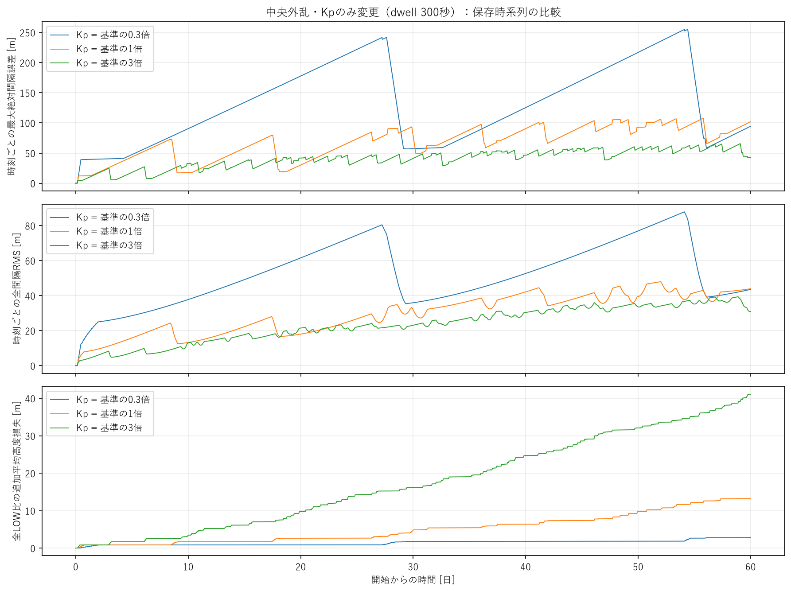

上段は各時刻の最大誤差、中段は各時刻の20間隔RMS、下段は同じ外乱の全LOW比の追加平均高度損失。表の全期間RMSと、図の瞬間RMSは平均する範囲が異なる。図だけを間引き、数値集計は全保存サンプルを使った。

## D. 初回応答

Kpを大きくすると、外乱後に反応するまでの待ち時間と、列へ反応が広がる時間の両方が短くなった。初回の参加衛星と往復回数は同じなので、この違いは単に多くの姿勢変更を使ったためではない。

|Kp倍率|最初のHIGH指令 [時間]|起点|左右の外側伝播速度 [m/s]|第1群終了 [日]|第1群最大誤差 [m]|第1群RMS [m]|
|---:|---:|---|---:|---:|---:|---:|
|0.3|10.72778|12番|6.41845|1.95127|39.868|19.305|
|1|5.67500|12番|20.26341|0.71759|12.283|6.040|
|3|4.22500|12番|54.49581|0.36019|4.374|2.216|

全条件の第1群は中央11番を除く20機、各1往復、計40遷移だった。3倍は半日以内に列全体の初回反応を終え、0.3倍は約2日を要した。遅い伝播中にも位置誤差が育つので、同じ総入力量でも結果が変わる。伝播速度は中心から4hop以上の外側枝の到達時刻を距離対時刻で回帰した値で、全域を1つの波として表すものではない。

同じ最初の24時間では、最大誤差/RMSは0.3倍39.394/11.714m、1倍12.424/5.992m、3倍8.216/2.827m。0.3倍はこの時点では16遷移だけで初回反応途中、1/3倍は40遷移を終えている。共通の時間窓でも3倍の誤差が小さいことを確認した。

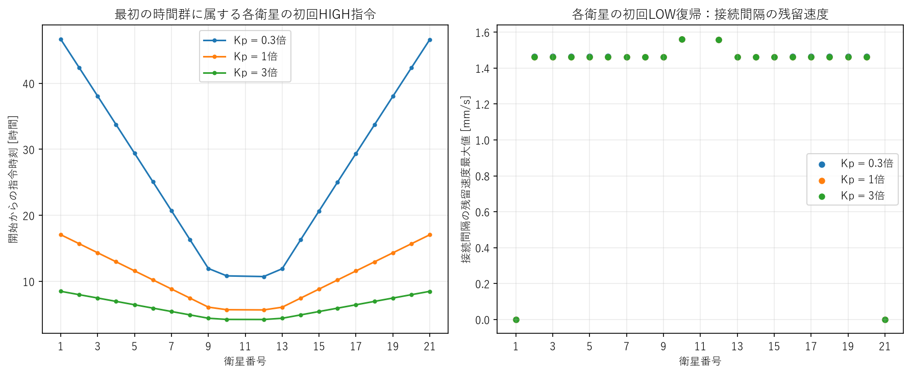

左は衛星ごとの最初のHIGH指令時刻で、遅い条件では反応が端部へ届くまで長くかかる。右は各衛星の初回LOW復帰時に接続間隔へ残る速度で、3条件の点はほぼ重なる。右の時点では周囲が作動中の場合があるため、全列がLOWになった後の速度をFで別に見る。

## E. 位置誤差と再切替

小さいKpでは、大きな位置誤差が育つまで同じ判定量へ届かない。さらに、往復後に少し速度差が残っていると、位置項が時間とともに増え、次の反応を引き起こす。今回はこの両方をm単位の状態と予測で確認した。

### 最初にどれだけずれてから起動したか

|Kp倍率|初回起動衛星の接続間隔最大誤差 [m]|位置項q_P [m/s²]|速度項q_D [m/s²]|D項の絶対値比|
|---:|---:|---:|---:|---:|
|0.3|38.222|2.29519e-8|1.27051e-7|84.699%|
|1|11.500|2.30186e-8|1.27009e-7|84.657%|
|3|3.833|2.30170e-8|1.26997e-7|84.657%|

起動時のP項はほぼ同じでも、実際の位置ずれは約10倍違う。0.3倍は大きな位置ずれを小さな係数で換算し、3倍は小さな位置ずれを大きな係数で換算したため。この例は、q_Pだけで物理状態の良し悪しを判断できないことを直接示す。全列最大誤差・瞬間RMS・接続間隔の符号付きe/vを、全HIGH指令と閾値横断サンプルで保存した。

|60日・HIGH起動時誤差の中央値 [m]|0.3倍|1倍|3倍|
|---|---:|---:|---:|
|全指令・全列最大|195.667|90.904|46.367|
|全指令・接続間隔最大|36.333|26.355|24.955|
|全LOW後の活動開始・全列最大|221.702|74.968|41.259|
|全LOW後の活動開始・接続間隔最大|36.529|27.528|28.222|
|固定時間群の起点指令・全列最大|158.165|96.722|44.180|

長時間でも、大きいKpでは全列の位置ずれが小さい段階でHIGHを起動する傾向がある。ただし全LOW後の起点に接続する誤差だけでは、3倍の中央値28.22mが1倍27.53mよりわずかに大きい。起動衛星と参加集合が変わるため、すべての起動型が単調に改善したとは言えない。初回の同じ衛星比較、全期間性能、起点と後続を分けた分布を併用する。

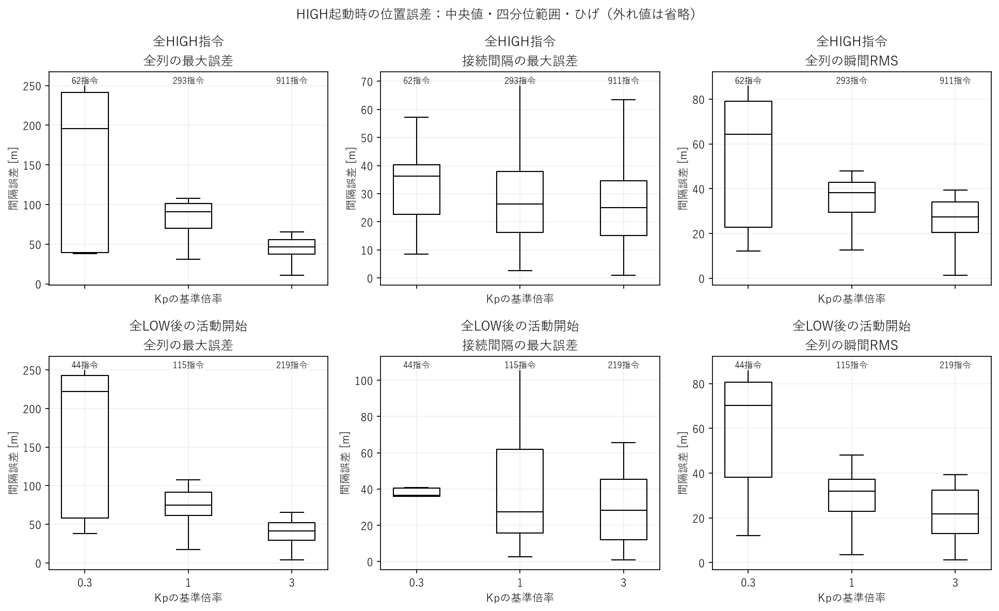

上段は全HIGH指令、下段は列全体LOWの後に活動が始まる指令。箱の黒線は中央値、箱は中央50%、ひげは1.5四分位範囲内、外れ値は描画を省略した。元の最小・最大値は集計へ残した。全列最大誤差と、実際の起動衛星に接続する間隔の誤差は別の量。

### 位置項が育つ速さと次回予測

`q_P=Kp*B*e`、`d(q_P)/dt=Kp*B*v`。

これは、残った間隔速度vが位置誤差eを増減させ、その近傍差分がP項を動かすという意味。同じ速度でもKpが大きいとP項が速く動く。ただし実際の実験では、切替時刻・順序・履歴を通じてe/vの状態も変わる。

`予測待ち時間=(h_on-q_P-q_D)/(Kp*B*v)`。

分子はHIGH閾値までの残り距離、分母はそこへ近づく速さ。全LOWでD項がほぼ一定という前提を置き、LOW側dwellと10秒制御時刻を反映する。増加率が非正なら、下からの将来横断を無理に予測しない。

|第1群終了→次回HIGH|0.3倍|1倍|3倍|
|---|---:|---:|---:|
|初期P増加率 [m/s³]|6.35535e-14|2.11441e-13|6.33973e-13|
|実測待ち時間 [日]|25.27882|7.69433|2.55764|
|予測待ち時間 [日]|25.85486|7.74653|2.56343|
|次回衛星・実測と予測|9番・一致|9番・一致|9番・一致|

残留速度はほぼ同じだったが、P項の増加率はKpにほぼ比例し、次回応答までの時間は大きく変わった。0.3倍の長い静穏は速度差が消えたためではなく、P項がゆっくり育つためだった。長い区間ではD項が少し変わるため、0.3倍の単純予測は実測より約0.58日遅かった。

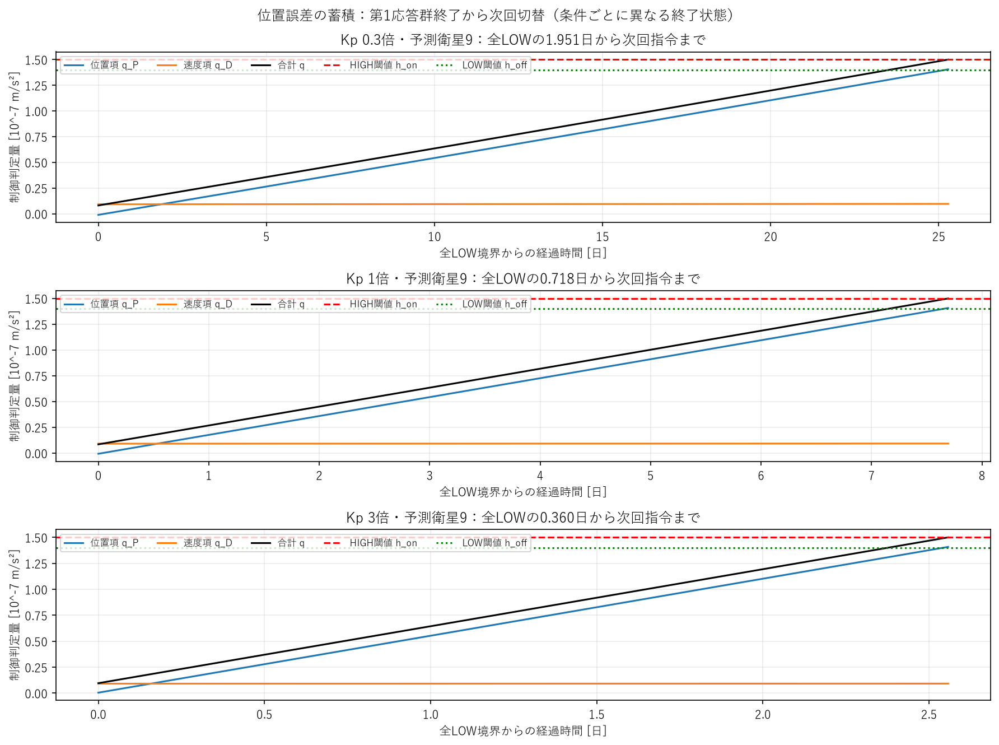

ほぼ一定の速度項に位置項が加算され、HIGH閾値へ届く様子を示す。各パネルの時間幅が違う点に注意。ここでの終了状態は条件ごとに異なる。

同一のbaseline第1群終了状態へKpだけを代入する補助計算でも、予測待ち時間は約25.74/7.75/2.61日。これは係数による効果を分ける計算で、新規条件の物理runではない。

|60日内の全LOW予測|0.3倍|1倍|3倍|
|---|---:|---:|---:|
|有効・次回実測あり|43|114|218|
|予測した次回衛星が一致|43|114|218|
|絶対相対誤差の最大 [%]|2.335|0.737|1.020|

有効な予測はすべて次回衛星も一致した。これは、作動がない区間で残留速度によるP項の蓄積が再切替時刻を説明することを支持する。実測が観測外、D変動が大きい、近傍が作動中などの予測はこの精度集計へ入れていない。

60日終了状態からの新しい予測は0.3倍で衛星13・77.77535日、1倍で衛星13・60.72813日、3倍で衛星2・60.02211日。すべて観測外で実測未確認。特に3倍は約32分後の再起動を予測しており、最後のLOW完了を収束の証拠にはできない。

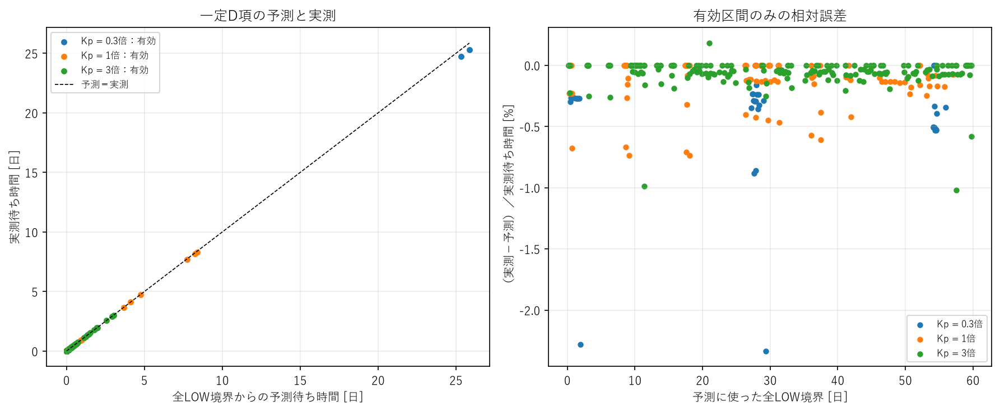

左の対角線に近いほど待ち時間が一致する。右は実測−予測を実測待ち時間で割った誤差。有効なのは作動・介在指令がなく、D変動が既存許容差10%以内などの条件を満たす区間だけ。予測が合うことは、この静穏区間の機構を支持するが、hybrid系全体の安定性を証明しない。

## F. 残留速度

Kpを大きくした初回応答では、位置誤差は小さくなったが、全列がLOWへ戻った後の速度差はほぼ変わらなかった。位置感度の変更が直接速度を減衰させたとは表現できない。

|第1群終了時・全列LOW|0.3倍|1倍|3倍|
|---|---:|---:|---:|
|残留速度最大 [mm/s]|0.098863|0.098674|0.098620|
|残留速度RMS [mm/s]|0.031095|0.031036|0.031019|
|位置誤差RMS [m]|24.937|7.843|2.903|

同じ20機の1往復でも、動かす順序と時間差で位置誤差は約8.6倍違った。一方、残留速度の最大差は約0.25%にとどまる。この初回比較では、速度補正量よりも、補正が列へ伝わるまでの位置蓄積の違いが大きかった。

|60日分の局所完了イベント統計|0.3倍|1倍|3倍|
|---|---:|---:|---:|
|V_res中央値 [mm/s]|1.52555|1.52285|1.49162|
|V_res最大値 [mm/s]|1.59537|1.69749|1.71266|
|速度RMS中央値 [mm/s]|0.46982|0.45963|0.45449|
|全LOW境界での最大abs(q_D)の中央値 [m/s²]|1.41384e-7|1.41350e-7|1.40813e-7|
|悪化の加重割合の中央値|0.16155|0.29603|0.41246|

長時間の局所終了統計でも、速度最大の中央値は3条件で近い。3倍は少し下がるが、最大値は逆に増える。0.3倍の悪化加重割合が低いことも全期間性能の改善を意味しない。これらは終了イベントだけの統計で、長い無作動期間に誤差が再び育つことを時間平均していない。

|同じ60日時点・全列LOW|0.3倍|1倍|3倍|
|---|---:|---:|---:|
|間隔速度最大 [mm/s]|0.108626|0.108646|1.502522|
|間隔速度RMS [mm/s]|0.034166|0.034173|0.337052|
|瞬間位置誤差RMS [m]|43.549|43.901|30.919|
|悪化の加重割合|約1.000|0.853|0.939|

3倍はこの時点で全LOWでも、9番間隔に−1.503mm/sが残っている。衛星別往復数が42〜44回で不均一なので、全LOWになる境界は「全列の同じ応答が完全に終わった」とは限らない。0.3/1倍の同時刻速度は近くても、途中の位置誤差の履歴は大きく違った。最大値だけでなく、符号・間隔別状態・位置との組を保存する理由がここにある。

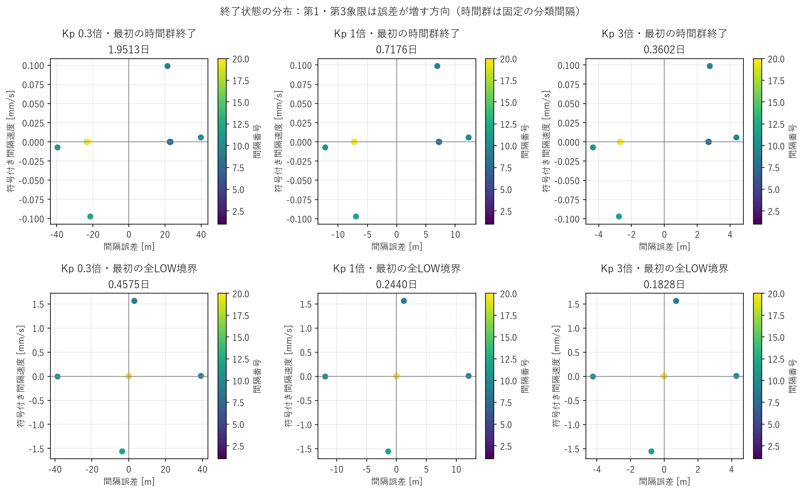

横軸が位置誤差、縦軸が間隔速度。右上と左下は誤差が増す方向、他の象限は戻る方向。上段は第1群終了、下段は最初の全LOW境界で、条件ごとに異なる時刻・参加集合。軸範囲もパネルごとに異なる。

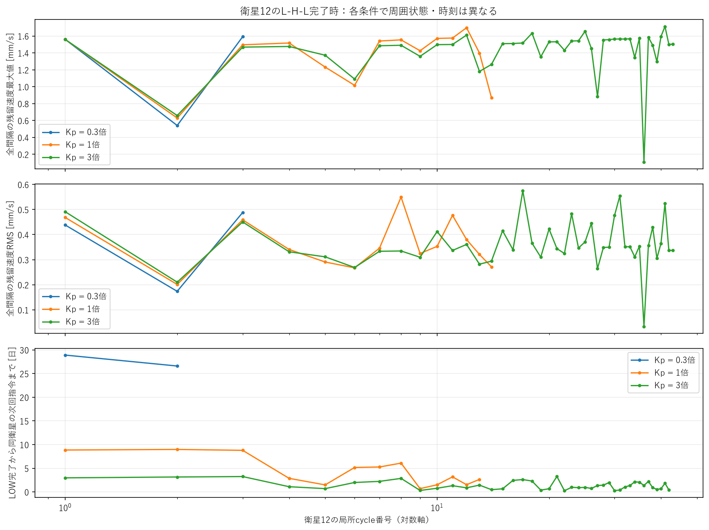

衛星12がLOWへ戻るごとに全間隔速度最大/RMSと次回指令までの待ち時間を示す。他衛星が作動中の場合も含む。番号は対数軸で、条件間の同じ番号を同じ時刻・同じ周囲状態とみなさない。

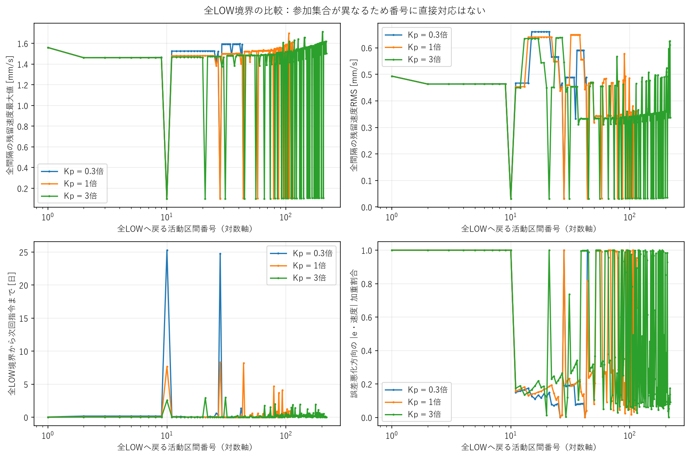

作動が止まった列全体の境界を別に比較した。右下の悪化の加重割合は、誤差と速度の積の大きさで重みを付け、誤差を増す方向の割合を示す。1に近いと主に悪化方向、0に近いと主に回復方向。微小値の符号だけに左右されないための補助量で、詳細な式は[定義](definitions.md)に残した。

## G. P/D寄与

位置項の感度を変えたからといって、すべての起動が位置項優勢になるわけではなかった。長い静穏後の起点と、その後の近傍伝播を分けて読む必要がある。

P優勢は位置項の絶対値が速度項の2倍以上、D優勢はその逆、その他を混合とした。これは信号の大きさの分類であり、因果寄与率ではない。反対符号と相殺も別保存した。

|60日・閾値横断サンプル|P優勢|D優勢|混合|
|---|---:|---:|---:|
|0.3倍|4|58|0|
|1倍|19|270|4|
|3倍|92|757|62|

全起動の大半は依然D優勢だが、3倍ではP優勢と混合が増えた。P優勢割合は0.3/1/3倍で約6.5/6.5/10.1%。この全指令数には、静穏後の新しい起点と、反応を近傍へ伝える指令の両方が含まれる。

固定時間群の起点指令だけではP優勢/D優勢は0.3倍2/2、1倍8/4、3倍13/1。3倍の長い静穏後の起点は、位置項が大きい場面が多かった。同時起動する衛星も別々の指令として数えるため、この起点指令数は群数ではない。反対符号のP/D横断状態はそれぞれ2/4/17件で、相殺を含む絶対値比を因果寄与率と解釈しない。

初回起動では、3条件ともD絶対値比が約85%だった。それでもDはほぼ同じで、KpによってP項が増える速さと必要な位置ずれが変わり、起動時刻が変わった。大きい成分が、閾値横断を時間的に引き起こした成分と同じとは限らない。

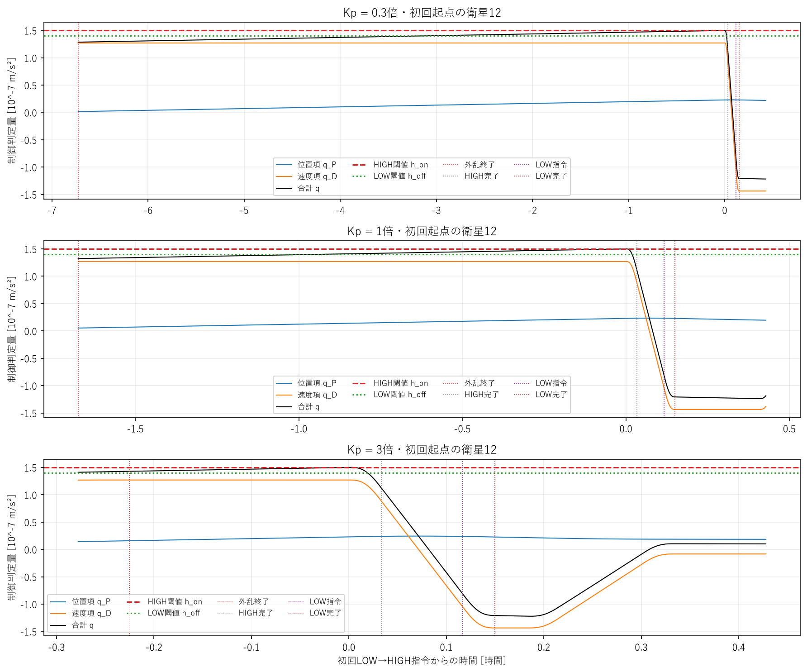

外乱終了後から起動までのP項蓄積と、起動後のHIGH完了・LOW指令・LOW完了を示す。qがoff以下になった時刻と、dwellが解除されて実際にLOWを指令した時刻を分けて読む。

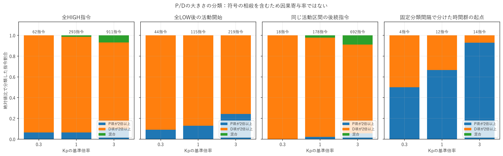

全HIGH指令、全LOW後の活動開始、同じ活動内の後続指令、固定時間間隔で分けた群の起点を区別する。時間群の分け方は既存14日baselineから固定し、都合よく変更していない。

## H. dwellとの相互作用

HIGH保持は、ほぼすべての往復で従来どおり300秒に決まっていた。大きいKpのコスト増は主にパルスの反復数で、保持時間を長くした結果ではない。ただし3倍の後半には、ごく少数のoff条件待ちが現れた。

|60日・完了往復の帰還条件|0.3倍|1倍|3倍|
|---|---:|---:|---:|
|HIGH完了→LOW指令300秒|62/62|293/293|909/911|
|300秒より長い保持|0|0|2回・各310秒|
|off条件を最早帰還時刻より前に観測|62/62|293/293|905/911|
|840秒のLH再起動下限に一致|0/41|0/272|0/890|

3倍でも99.78%は300秒保持で、off条件がdwell解除までに間に合わなかった2件だけ10秒延長した。「以前に一度off以下」と「指令許可時点でもoff以下」は別に記録する。LOW再起動の最短実測は3倍でも20,160秒（5.6時間）で、840秒への張り付きはない。今回の3倍を、Kd3倍で見られた最短間隔の高頻度反復と同じ機構とは断定しない。

## I. 性能とコスト

精度を改善するために、より頻繁に同じHIGHパルスを使っている。このためKpだけでも、編隊精度と姿勢変更・抗力コストの交換関係が生じた。

|60日・活動と入力量|0.3倍|1倍|3倍|
|---|---:|---:|---:|
|HIGH安定時間合計 [衛星・s]|18,600|87,900|273,320|
|HIGH相当時間合計 [衛星・s]|26,040|123,060|382,640|
|同一衛星LH開始間隔中央値 [日]|26.59699|3.80214|1.26209|
|衛星別完了往復数|外側3・中央2|外側14・中央13|42〜44|

0.3倍は1倍より遷移・追加高度損失を約79%節約したが、誤差は悪化した。3倍は精度を改善したが、HIGH相当時間・遷移・追加損失が約3.1倍だった。3倍の911往復では、基本420衛星・秒のパルスに2件の延長分20衛星・秒が加わり、382,640衛星・秒になった。コスト増のほとんどは往復回数で説明できる。

3倍の衛星別回数は1〜9番44、10番43、11番42、12〜21番43。部分列の反応・左右差が残るので、回数が近いことを同期の証明とはしない。どの性能とコストを許容するか未決定のため、この表だけで単一の最適値は決められない。

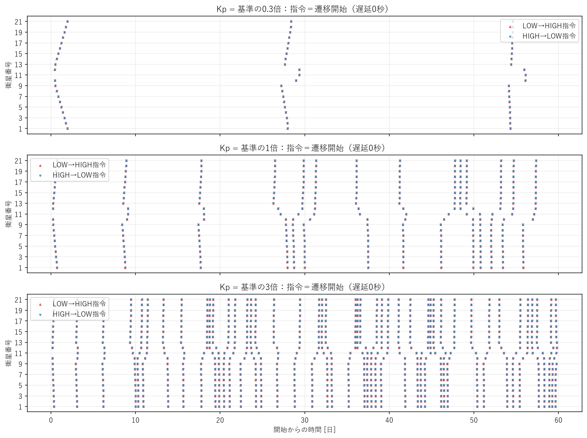

赤はHIGH指令、青はLOW指令。指令遅延0秒なので遷移開始と同時。密集する部分は1本のHIGH滞在ではなく複数の指令。群数だけで同期や局所化を断定せず、衛星別回数と実イベント列を併用する。

追加平均高度損失は、同時刻・同じ外乱の全LOW長半径から制御ケースの長半径を引いた21機平均。正が追加損失。円軌道モデルでは高度差と長半径差は同じで、初期高度からの全抗力損失とは別の量。

## J. Kpの評価

3倍は今回の3点では「精度を重視する候補」、1倍は「より低いコストで中間の精度を得る候補」と評価できる。3倍の切替が多いだけで過敏と断定せず、得られた精度改善と一緒に判断する。

- **0.3倍：位置感度不足の候補。** 反応が遅く、大きな位置ずれを許す。長い無切替期間は残留速度が消えたためではなく、位置項の蓄積が遅い面が強い。
- **1倍：コストと精度を両方見る基準候補。** 暫定値であり、設計の妥当性や最適性は保証していない。再切替は継続する。
- **3倍：精度重視の候補。** 初回・長時間とも誤差を抑えたが、入力量と追加損失を増やした。840秒下限への張り付きはなく、明確な過敏領域とまでは判定しない。

今回の問いへの答えは「Kp増加で、より小さい位置ずれから早く・頻繁に反応し、誤差を抑えた。ただし残留速度をなくしたわけではなく、追加抗力と切替を使った」というもの。漸近収束は3条件とも確認できない。

### 観測されたこと

Kpだけを変えた介入で、初回起動・伝播・終了時位置状態・再切替時刻・コストが変わった。初回の物理的な残留速度はほぼ同じでも位置誤差は変わり、静穏区間ではP項の増加率から次回時刻を説明できた。

### そこから考えられること

支持される流れは「Kp→切替時刻・順序→HIGH履歴→終了時e/v→位置項の蓄積→再切替」。Kpを直接の速度減衰係数とみなす説明は適切ではない。固定された二値パルス量の下で、いつ・どの衛星を動かすかが変わっている。

### まだ言えないこと

60日だけで永久収束・不安定性・最適Kpを証明できない。異なる外乱・列長でも順位が同じとは保証しない。異なる局所cycle番号を同じ状態として比較せず、後半の群分け依存性も残る。初回の残留速度が近いことが、全条件・全時刻で成立するとは言えない。

## K. 次の実験

次はKpの1〜3倍の間を少数点で確認するのが最も合理的。精度改善とコスト増の関係が見えた一方、3倍を過敏と断定する材料はない。先にこの範囲を整理すると、2次元探索を広く行う計算を節約できる。

**新規2倍・2.5倍、既存1倍・3倍を再利用する比較を推奨する。** Kd1倍、dwell・閾値・外乱を固定し、まず30日。残留状態と将来横断を見て必要な条件だけ60日へ延長する。目的は最適値を決めることより、伝播・起動誤差・コストに急な変化があるか確認すること。

補助的な同一状態計算では、baselineの20970秒・衛星13のP=2.58727e-9、D=1.44317e-7に対して、`Kp倍率=(h_on-D)/P=2.19664`でqがonへ届く。これはその1状態で位置感度を上げると隣接起動が変わる可能性を示す。実際のゲイン変更では状態も変わるため、全系の臨界Kp・安定境界ではない。[保存した計算](results/fixed_state_boundary.json)を参照。

Kp-Kdの2次元評価は、その後に有望範囲を絞って進む。h_c評価は速度と位置の両方の起動条件を動かすので、先にKp感度の役割を整理する。Kp細分化だけで残留速度が消えて収束するとは仮定しない。今回、これらの追加実験は実施していない。

## L. 回帰・テスト・Git

追加した評価が既存物理結果を変えていないことを、保存データ照合と短いhybrid実行テストで確認した。以前の基準は科学的な最適条件ではなく、コード変更を監視するsoftware referenceとして維持している。

- [全169テスト合格](results/tests.json)：既存147、新規22。独立Kp・省略/明示同値の物理一致・起動状態・P増加率・予測・帰還条件を検証。
- [24時間回帰](results/regression_24h.json)：保存済みの実再実行suiteを凍結referenceと照合。3ケースの集計・全イベント・7主要配列が一致、最大差0。物理計算を重複していない。制御ケースは最大12.423898m、RMS5.991742m、40遷移、追加損失0.821150m、左右速度20.263407m/sを維持。
- [baseline後処理の一致](results/baseline_reuse.json)：旧30/60日Kd=1解析の全局所/群/全LOW行、既存要約フィールド、全終了状態配列が一致。
- [入力検査](results/inputs.json)：4新規runでKpと期間以外が凍結設定と一致。
- [非破壊確認](results/preservation.json)：作業開始時の879ファイルに変更・欠落なし。新規2条件の30→60日の全11配列・イベントprefix一致。
- branch：`astra/kp-residual-analysis`。基点：前回Kd解析の`b8d0c2a54fe06a9513f9ffab2e6e9861b7fbf112`。機能追加commit：`7f48a61cd7fcc15a964b0ce539a4d231df067da3`。成果物commit hashは最終作業報告とGit履歴を参照。mainへmergeしない。

|変更ファイル|目的|
|---|---|
|src/sat_string/config.py|Kpだけの任意指定・検証。省略時の従来動作と形式を維持|
|src/sat_string/kp_analysis.py|HIGH起動時の物理誤差・符号・P増加率、早期off条件、同一状態のKp予測|
|scripts/run_kp_case.py|凍結設定からKpと期間だけを変え、既存coreで新規計算|
|scripts/analyze_kd_residual.py|--gain-axis kpで既存残留後処理を再利用し、新指標を追加|
|scripts/summarize_kd_residual.py|Kp比較表、起動時誤差分布、P増加率・marginを保存|
|scripts/plot_kd_residual.py、plot_kp_activations.py|既存描画を再利用し、日本語11図を生成|
|scripts/export_kd_results.py|Kp用の小さい設定・集計・イベント・代表cycleを整理|
|scripts/check_kd_inputs.py、check_kd_trigger_gates.py|Kpのみの入力差分、840秒下限などを検査|
|scripts/check_kp_baseline_reuse.py|旧30/60日baseline解析の全行・要約・終了配列と照合|
|tests/test_kp_analysis.py|独立Kp・同値省略時の物理一致・状態抽出・予測・off条件の22テスト|
|docs/kp_residual_analysis/、README.md|平易な説明・定義・集計・図・再現手順と案内|

比較JSON/CSV、間隔別RMS、衛星別回数、起動時P/Dと位置誤差、符号付き終了状態を保存した。巨大NPZは新規outputsへローカル保存し、小さい成果をGitへ整理した。Gitの局所cycle見本は各衛星の最初/最後3回だけで、全分布ではない。各caseのlocal_files.jsonは元の全CSV/NPZの場所を示す。

入力条件・主要コマンド・再現方法は[reproduction.md](reproduction.md)、数学的な定義は[definitions.md](definitions.md)。
