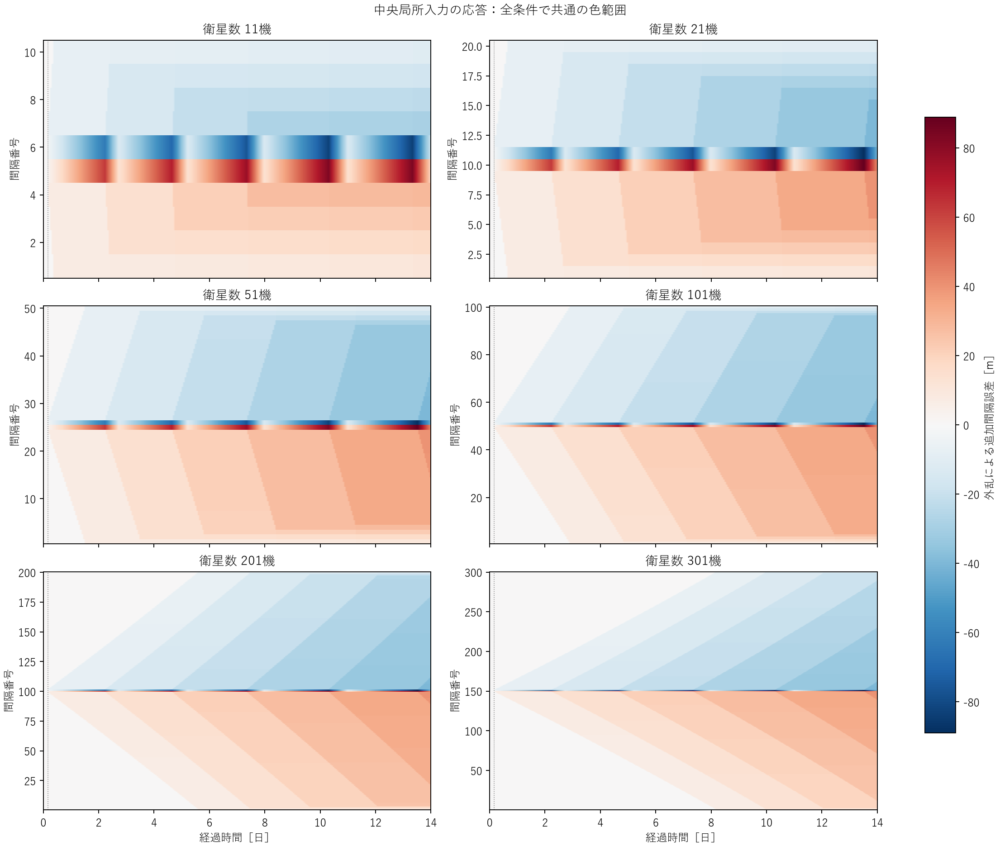
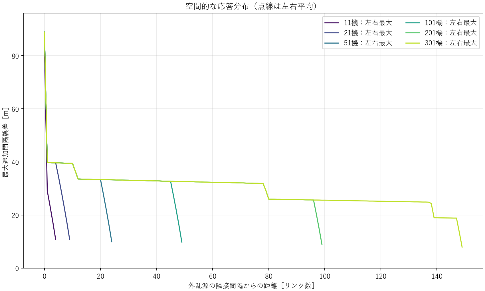
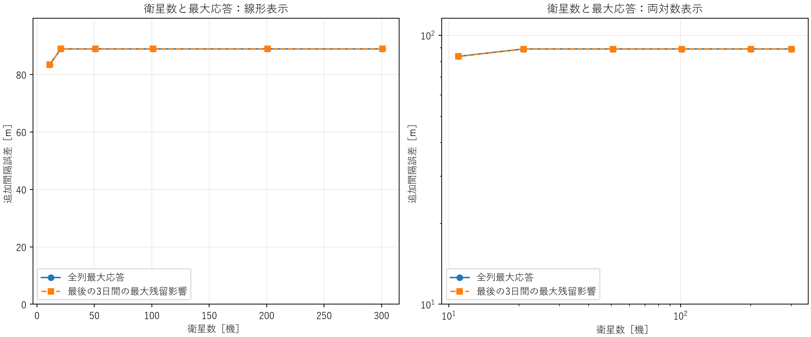
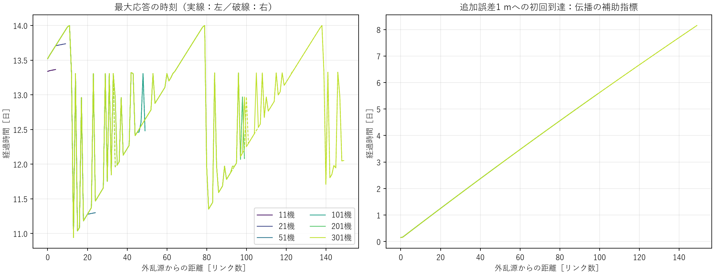
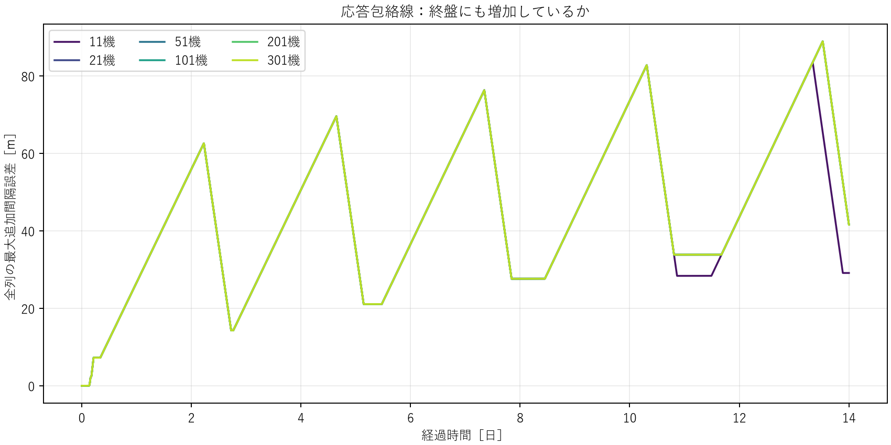
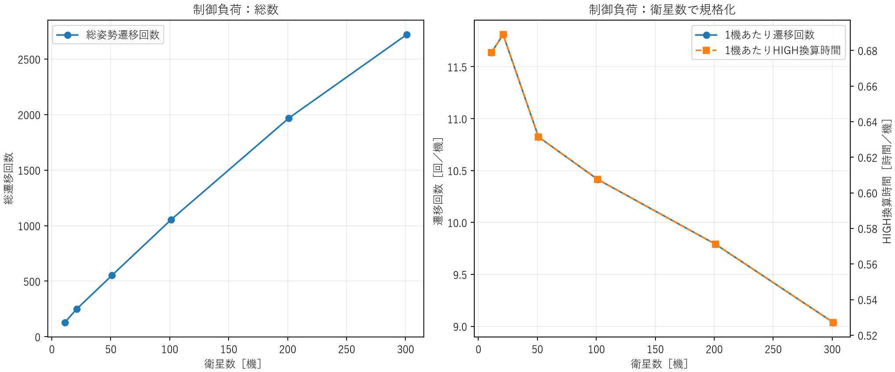

# 研究判断用サマリー

**今回の中央局所パルス・14日間では、衛星数を21機から301機へ増やしても、最大追加間隔誤差は約88.92 mのままでした。衛星数増加に伴って振幅が増え続ける傾向は確認できません。** 11機では83.46 mだったため11→21機では6.54%増えますが、その先は横ばいです。外乱源から離れたgapの最大値も、外乱源のpeakを上回りませんでした。

今回は過去のA-refと異なり、初期軌道半径分散・弾道係数分散はともにゼロです。NRLMSISやGaussian密度外乱も使わず、既存の高度依存背景密度だけを維持しました。中央衛星の平均運動を加速する一般化入力を1回与え、同じ制御を使う無外乱軌道との差を比較しています。現実の熱圏外乱を再現した試験ではありません。

| N | 最大追加誤差 P_max [m] | 終盤3日 E_ult [m] | 姿勢遷移 [回] | HIGH換算量 [衛星・時間] | 列端への初回1 m到達 [日] |
|---:|---:|---:|---:|---:|---:|
| 11 | 83.4605 | 83.4605 | 128 | 7.4667 | 0.3384 |
| 21 | 88.9205 | 88.9205 | 248 | 14.4667 | 0.6243 |
| 51 | 88.9205 | 88.9205 | 552 | 32.2000 | 1.4747 |
| 101 | 88.9205 | 88.9205 | 1,052 | 61.3667 | 2.8678 |
| 201 | 88.9205 | 88.9205 | 1,968 | 114.8000 | 5.5660 |
| 301 | 88.9205 | 88.9205 | 2,720 | 158.6667 | 8.1513 |

最大応答はほぼ同じでも、応答が列全体へ行き渡る時間と制御活動の総数は増えました。301機でも14日までに左右の列端へ1 m以上の応答が届いており、単に列端が全く応答していないため最大値が横ばいになった、という状態ではありません。一方、総切替数を機数で割ると11.64→9.04回/機です。遠方衛星は応答開始が遅いため、これを長期運用の効率改善とは解釈できません。

重要なのは、**N方向の横ばいと、時間方向の収束を区別すること**です。21機以上では、観測期間を1日・3日・7日・14日とした累積peakが26.59・62.59・69.59・88.92 mへ増えました。単発入力が終わっても再切替と誤差の増減が続いており、全gapが5 m帯へ戻る回復候補は全Nで成立していません。14日を越えた時間方向の飽和や増大は未確定です。

今回の判定は、提示された分類の**Dに近い「有限14日では顕著なN依存の最大応答増幅なし」**です。伝播距離が長くなった分の到達遅延は観測されましたが、回復時間の悪化は、そもそも回復を観測できていないため比較不能です。「string stable」「string unstable」の証明にはなりません。

次はパラメータを増やす前に、**21機と301機だけを同一30日へcheckpoint延長し、時間方向のpeak更新が続くか**を確認するのが最小限です。その結果を見てから、入力振幅・符号への依存を別実験で調べる価値を判断します。今回それらの追加実行はしていません。

# 詳細技術付録

## A. 実装確認と実験条件

元の状態は各衛星の近円軌道半径 a_j とunwrapped平均経度 lambda_j です。円軌道平均モデルなので、aは半長軸と同じ半径を表します。軌道傾斜角や地理座標を使うNRLMSIS実験とは異なり、今回は地理的な密度差を導入していません。

基準は `configs/baseline.yaml`。研究候補のH150-L300へ勝手に置き換えず、HIGH/LOWともdwell=300 sを使いました。

| 項目 | 全12軌道で共通の値 |
|---|---|
| 衛星数 | 11 / 21 / 51 / 101 / 201 / 301、各Nでnominal/disturbedの2軌道 |
| 質量 / Cd / LOW・HIGH面積 | 4 kg / 2.2 / 0.01・0.03 m² |
| 初期高度 / 固定基準半径 | 400,000 m / 6,778,137 m |
| 目標間隔 / トポロジー | 100,000 m / open path、端同士を接続しない |
| Kp / Kd | 2.143347050754458e-9 s^-2 / 9.259259259259259e-5 s^-1 |
| h_on / h_off | 1.5e-7 / 1.4e-7 m/s² |
| control / slew / HIGH dwell / LOW dwell / delay | 10 / 120 / 300 / 300 / 0 s |
| 背景密度 | rho_ref exp[-(h-400 km)/H] |
| rho_ref / H | 3.584968e-12 kg/m³ / 58,310 m |
| 数値積分 / 最大刻み / 保存 | 従来RK4 / 2 s / 10 s |
| 観測期間 / 終盤窓 | 14日 / 最後の3日 |
| 初期半径分散 / B倍率 / 初期spacing誤差 | 0 / 全衛星1 / 0（浮動小数丸め誤差を除く） |
| Gaussian・NRLMSIS空間変動・ノイズ・他の追加力 | すべて追加しない |

大気密度は全衛星に同じ高度関数を使います。外乱・制御により半径が変われば背景密度も変わりますが、これは既存の状態依存則であり、新しい外生密度外乱ではありません。設定に残るGaussianの振幅・幅の欄は後方互換のため残した未使用値であり、enabled=falseかつ実行フラグもfalseです。

各Nの全設定と機械的差分検証は `data/Nxxx_config.yaml` と `data/Nxxx_input_checks.json` に保存しています。基準から変更したキーはN・期間・既存密度外乱の無効化だけです。nominal/disturbed間はnode入力だけが異なり、両者とも制御ONです。Nに応じたゲイン、目標間隔、閾値の再調整はありません。

301機の列長は30,000 kmです。今回のopen-pathモデルには端同士の通信・制御linkや閉ループ軌道列はありません。Nを無限大へ延長できる物理配置の検証ではありません。

## B. gapと制御則

```text
n_j = sqrt(mu/a_j³)
e_i = a_ref*(lambda_(i+1)-lambda_i) - 100000
v_i = de_i/dt = a_ref*(n_(i+1)-n_i)
z_i = Kp*e_i + Kd*v_i
q_1 = z_1
q_j = z_j-z_(j-1)                 (interior nodes)
q_N = -z_(N-1)
```

eは固定基準半径上の間隔誤差です。現在半径上の物理弧長とは区別します。qは位置・速度の隣接差から各衛星のHIGH/LOWを判定する量で、LOW中にq>=h_onでHIGH、HIGH中にq<=h_offでLOWを指令します。slew中・dwell中の再指令禁止と同時スナップショットによる指令選択は既存実装のままです。

定義を確認した箇所：`src/sat_string/controller.py::gap_kinematics / switching_function / select_commands`、`src/sat_string/attitude.py::AttitudeStateMachine`。

## C. 差動外乱の正確な定義とindex

既存実装の外乱は密度Gaussianであり、一般化された差動入力の標準波形はありませんでした。そこで今回だけの独立オプションを追加しました。既存の密度外乱を今回の入力として流用していません。

```text
g_j = a_ref*n(a_j)
d_j = (dg_j/dt)_external
d_c(t) = W/2 * [1-cos(2*pi*(t-t0)/tau)]    (t0<t<t0+tau)
d_j(t) = 0                                (j!=c, または時間窓外)
W = 1e-6 m/s², t0=10800 s, tau=3600 s
integral d_c dt = W*tau/2 = 0.0018 m/s
```

つまりdは「固定基準半径に換算した平均運動速度gの加速率」です。Cartesianな推力加速度、観測された密度変動、弾道係数変動そのものではありません。正のdは平均運動を増やす向きです。

```text
da_j/dt = -rho_j*(Cd*A_j/m)*sqrt(mu*a_j)
          - 2*a_j*d_j/(3*a_ref*n(a_j))
dlambda_j/dt = n(a_j)
```

`dg/da = -3*a_ref*n/(2*a)`なので、追加した半径変化項のg加速度への寄与は厳密にdです。よってgap加速度への直接入力は、

```text
w_i = d_(i+1)-d_i
```

です。自然抗力・制御が状態に応じて変わることまで含めて、外乱有無の全軌道差がwの積分だけになる、とは仮定していません。

| N | 中央衛星ID c | +dが入るedge ID | -dが入るedge ID |
|---:|---:|---:|---:|
| 11 | 6 | 5 | 6 |
| 21 | 11 | 10 | 11 |
| 51 | 26 | 25 | 26 |
| 101 | 51 | 50 | 51 |
| 201 | 101 | 100 | 101 |
| 301 | 151 | 150 | 151 |

上表は1-basedです。コードの中央nodeは0-based `N//2`、正edgeは`N//2-1`、負edgeは`N//2`。node入力は中央1機だけで、結果として2本の接続gapへ符号反対の差動入力が入ります。max|w|=|W|なのでgainの分母もWで統一しています。

実装：`n_scaling.py::CentralNodePulse` → `dispersion_control.py::profile_rhs` → `dynamics.py::node_acceleration_radius_rate`。追加入力未指定時の既存経路は維持しています。入力境界でRK4ステップを切り、各内部段でも波形を評価します。

## D. 主要指標とN比較

```text
delta e_i(t) = e_i_disturbed(t) - e_i_nominal(t)
P_i = max_t |delta e_i(t)|
P_max = max_i P_i
G_peak = P_max / |W|                       [s²]
E_ult = max_(11日<=t<=14日),i |delta e_i(t)|
```

Gはこの振幅・波形に対する応答比です。hybrid系全体の誘導ノルム、H-infinityノルム、振幅によらない線形伝達関数とは呼びません。E_ultも最後の3日の観測値であり、無限時間のultimate boundではありません。

| N | P_max [m] | G_peak [s²] | 最大応答gap ID | 全体peak時刻 [日] | E_ult [m] | 終了時最大差分 [m] | 差分RMS [m] |
|---:|---:|---:|---:|---:|---:|---:|---:|
| 11 | 83.4605 | 8.34605e7 | 6 | 13.3380 | 83.4605 | 29.1205 | 26.1565 |
| 21 | 88.9205 | 8.89205e7 | 11 | 13.5207 | 88.9205 | 41.6121 | 25.3681 |
| 51 | 88.9205 | 8.89205e7 | 26 | 13.5207 | 88.9205 | 41.6121 | 23.9078 |
| 101 | 88.9205 | 8.89205e7 | 51 | 13.5207 | 88.9205 | 41.6121 | 22.3526 |
| 201 | 88.9205 | 8.89205e7 | 101 | 13.5207 | 88.9205 | 41.6121 | 19.6413 |
| 301 | 88.9205 | 8.89205e7 | 151 | 13.5207 | 88.9205 | 41.6121 | 17.3342 |

11→21機の増加は5.4600 m、6.5420%。21→301機のP_maxは保存精度で同じ値です。88.9205 mは100 kmの約0.08892%。RMSは全時間・全gapで平方平均しており単純合計ではありません。ただし列が長くなると、応答が遅く始まる遠方gapが増えます。RMS低下だけを制御性能の改善とみなしていません。

nominalのraw誤差は最大約2.56e-6 m、姿勢遷移0回でした。raw eを参照した結論もほぼ同じですが、主指標は一貫してnominal差分です。

## E. 空間分布と左右の伝播

中央nodeに接続する左右のgapをr=0、その外側をr=1,2,...とします。左右は別々に保存し、P(r)の左右平均と最大値を併記しました。

| N | r>0での最大P / P(0) | 列端のr | 列端1 m到達 [日] | t_peakが観測終了と一致するgap数 |
|---:|---:|---:|---:|---:|
| 11 | 0.3489 | 4 | 0.3384 | 0 |
| 21 | 0.4470 | 9 | 0.6243 | 0 |
| 51 | 0.4470 | 24 | 1.4747 | 2 |
| 101 | 0.4470 | 49 | 2.8678 | 2 |
| 201 | 0.4470 | 99 | 5.5660 | 4 |
| 301 | 0.4470 | 149 | 8.1513 | 6 |

r>0の最大値は、21機以上で約39.75 m、外乱源peakの44.7%以下でした。今回のP(r)>P(0)型の空間増幅はありません。301機でも左右の列端へ応答が届いていますが、局所gapの中には14日でpeakを更新中のものが残ります。全体最大値のt_peak自体は全Nで終了時刻より前です。

左右のPの差は最大約9.25e-6 mでした。浮動小数計算の微小な非対称を除き、空間分布はほぼ鏡像です。数値ノイズを物理的な左右非対称として解釈していません。

最大応答時刻t_peak(r)は11〜14日付近の複雑な折れ線になります。これは後半の再切替でgapのpeakが更新されるためで、単一の伝播波の到着時刻ではありません。併記した初回1 m到達は中央から列端へほぼ連続的に遅れ、初回伝播の読み取りに適しています。ただしこの到達時刻も閾値1 mに依存する指標です。

## F. 時間方向の残留と回復

| 観測終了 | N=11の累積peak [m] | N>=21の累積peak [m] |
|---:|---:|---:|
| 1日 | 26.5889 | 26.5889 |
| 3日 | 62.5921 | 62.5921 |
| 7日 | 69.5888 | 69.5888 |
| 14日 | 83.4605 | 88.9205 |

外乱は4時間で終了していますが、誤差の山と再切替はその後も残り、後の山が大きくなる時間帯があります。今回の14日で時間方向の増幅が永久に続くことも、やがて一定帯へ収まることも示していません。数学的な発散とは表現しません。

回復候補を「パルス終了後、全gapの|delta e|<=5 mが観測終了まで続き、少なくとも1日確認できる」と定義しました。全Nで不成立です。したがって回復時間T_recoveryは未観測で、Nとともに回復が遅くなるとは数値比較できません。E_ultがP_maxと等しいのは、今回の最大値が最後の3日にあるためです。

## G. 制御負荷と正規化

| N | 総遷移 [回] | 遷移/機 | 完了L-H-L [回] | 安定HIGH [衛星・時間] | 安定HIGH [時間/機] | HIGH換算 [衛星・時間] | HIGH換算 [時間/機] |
|---:|---:|---:|---:|---:|---:|---:|---:|
| 11 | 128 | 11.6364 | 64 | 5.3333 | 0.4848 | 7.4667 | 0.6788 |
| 21 | 248 | 11.8095 | 124 | 10.3333 | 0.4921 | 14.4667 | 0.6889 |
| 51 | 552 | 10.8235 | 276 | 23.0000 | 0.4510 | 32.2000 | 0.6314 |
| 101 | 1052 | 10.4158 | 526 | 43.8333 | 0.4340 | 61.3667 | 0.6076 |
| 201 | 1968 | 9.7910 | 984 | 82.0000 | 0.4080 | 114.8000 | 0.5711 |
| 301 | 2720 | 9.0365 | 1360 | 113.3333 | 0.3765 | 158.6667 | 0.5271 |

安定HIGHはslewを除くHIGH滞在時間です。HIGH換算はintegral[(A-AL)/(AH-AL)]dtで、slewの途中面積も含めます。今回の完了イベント列では各パルスのHIGH換算は420 s、安定HIGHは300 sに一致しています。全Nで未完了パルスはありません。

総負荷増加は参加衛星数の増加も含み、これだけでstring-instability-like増幅とは判定しません。1機あたり負荷の低下も、有限観測中の伝播遅延を含むので運用効率の改善とは断定できません。全ケースで固定基準半径上のsigned gapは正、全体最小は約99,911.08 mでした。

## H. 図

1. 共通色範囲のheatmap。中央から左右へ広がる波と、中央付近の再切替応答を見る。



2. P(r)。6条件の共通範囲は多くが重なる。点線は左右平均、実線は左右最大。



3. P_max(N)とE_ult(N)。線形・両対数表示とも継続的な増加は見られない。



4. t_peakと初回1 m到達。左の後半peak更新と右の初回伝播を区別する。



5. 時間方向の最大応答包絡線。N>=21の線はほぼ完全に重なる。



6. 総負荷と1機あたり負荷。右図は遷移回数とHIGH換算時間の単位が異なるため二軸。



図は60 s間隔、peak・RMS・時刻の計算は10 sの全保存点です。公開CSVだけは容量節約のため600 sへ間引きました。生の10 s状態・raw誤差・差分誤差はローカルに保存済みです。

## I. べき乗近似と判定の範囲

両対数直線性の診断R²は約0.4518でした。6点中5点が同じpeakなので、N^alphaの継続的な増大を説明する近似は採用していません。alphaを理論的なscaling指数として提示しません。

### 観測されたこと

- 11→21機ではpeakが6.54%増加、21→301機では同一。
- 遠方gapのpeakは外乱源より小さく、P(r)>P(0)はない。
- 左右への伝播と到達遅延、総制御負荷の増加がある。
- 入力終了後も再切替・残留誤差が続く。

### そこから考えられること

今回の入力・初期条件・既存制御・14日の範囲では、局所最大応答はN>=21でほぼ飽和し、顕著なN依存振幅増幅は認められません。中央に近い局所応答が全体peakを決めています。大きいNでは到達距離が増えるため、時間方向の広がりは大きくなります。

### まだ言えないこと

- 無限時間・無限列のstring stability、数学的な不安定性。
- 14日以降の誤差peakの飽和・増加・減衰。
- 回復時間のN scaling（全ケースで回復未観測）。
- 入力振幅・符号・持続時間を変えたときの応答。
- NRLMSIS、初期分散、B分散を含めた実環境でのscalability。
- 一つのpulse gainから一般的な誘導ノルムを評価すること。

## J. 最小限の次実験

ゲイン・閾値・dwell・入力を変えず、21機と301機の2条件だけを同じ30日へcheckpoint延長することを推奨します。nominal/disturbedの両軌道を同じ期間で比較し、後半のP_max更新とE_ult、中央付近・列端の局所peakが飽和するかを見るためです。今回のrunを最初から再計算する必要はありません。

この延長でもN間差がなく時間方向も頭打ちなら、次に入力の符号または振幅を一つだけ変えた検証を検討します。現段階でゲイン探索へ戻る根拠にはしません。

## K. 検証・非破壊・変更ファイル

- 全335テスト合格。うち今回の新規12件。
- 既存24 hの3ケースを新しく実行し、凍結software referenceと照合して合格。
  最大誤差、RMS、全切替イベント、高度損失、波速度、主要時系列を確認。
- 元simulatorとbatchの切替を含む区間で、a/lambda/密度/面積/mode/イベントが一致。
- node入力ゼロ時の旧経路一致、符号・単位・波形積分値、graph distance、終盤指標を検証。
- 各Nとも初期状態・B profile・制御設定一致を保存状態から再検証。
- nominalは全Nで切替0回。パルス開始までdelta eは厳密に0。
- 既存runs/outputsの2,409ファイルはサイズ・更新時刻不変。
  凍結24 h fixture全11ファイルのSHA256も不変。
- raw状態は1ケース120,961時刻×2軌道×N。巨大NPYをGitへ追加しない。

確認ログ：`data/verification.json`、`data/regression_24h.json`、`data/tests.txt`、`data/non_destruction.json`。

| ファイル | 変更理由 |
|---|---|
| src/sat_string/dynamics.py | node入力をKepler関係と整合する半径速度へ変換する補助関数 |
| src/sat_string/dispersion_control.py | 任意node入力とmetadata/checkpoint整合検査の独立オプション |
| src/sat_string/n_scaling.py | 共通pulse、N設定、graph distance、差分応答指標 |
| configs/local_disturbance_n_scaling.yaml | 6条件・入力・観測窓を固定 |
| scripts/run_local_disturbance_n_scaling.py | 上書き禁止の12軌道実行、元成果の保護manifest |
| scripts/analyze_local_disturbance_n_scaling.py | full-resolution比較、集計、6図 |
| scripts/verify_local_disturbance_n_scaling.py | 保存結果・回帰・非破壊確認 |
| tests/test_n_scaling.py | 新オプションと既存hybrid経路の検証 |
| docs/local_disturbance_n_scaling/ | 設計条件、結果、図、再現手順 |
| README.md | 新しい比較結果への案内 |

## L. 再現とGit

[再現手順](REPRODUCTION.md)、[実行前固定条件](DESIGN.md)、[主要集計CSV](data/comparison.csv)、[全体JSON](data/comparison.json)。

研究branchは`astra/local-disturbance-n-scaling`。開始点は`2084c4a12ed1a96c1faabaf8d7c6cdfe79ee30e2`。mainへのmerge、force push、既存runの削除・上書きは行っていません。完了commitの正確なhashは最終会話に記載し、checkout上では`git rev-parse HEAD`で取得できます。
