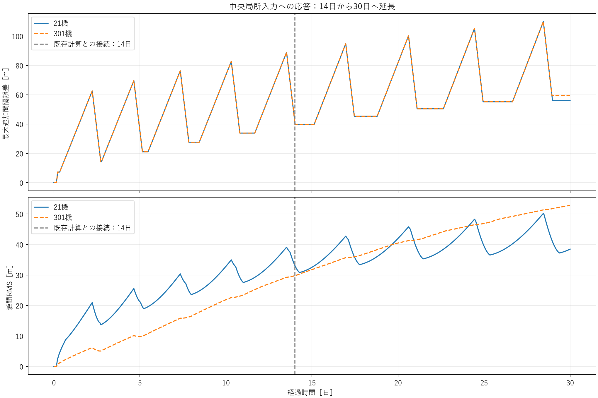
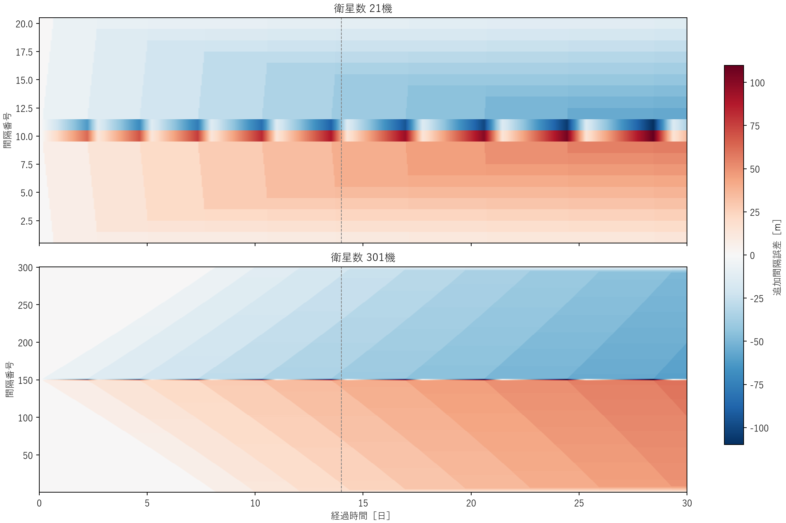
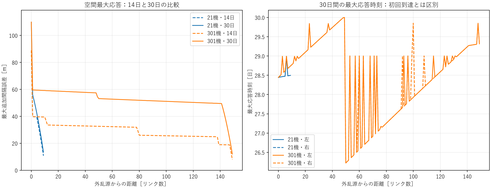
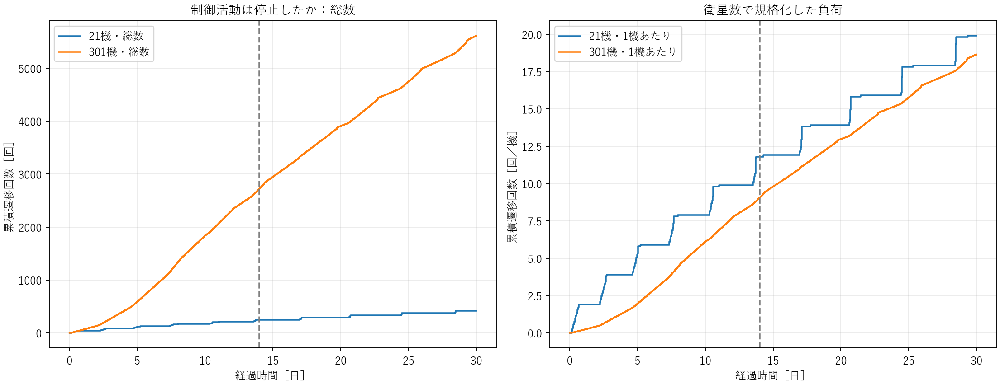

# 研究判断用サマリー

**N=21と301を同条件で30日まで延長しても、全列の最大追加間隔誤差はともに109.92 mで、最大値の明確な機数依存は確認されませんでした。ただし14日の88.92 mから約23.6%増え、時間方向の飽和・収束は確認できていません。**

旧14日間を再計算せず、各Nのnominal（無外乱）・disturbed（中央入力）の両軌道を保存checkpointから再開しました。元の0〜14日と新しい14〜30日を結合し、制御・入力・背景密度・積分条件は全て維持しています。人工Gaussian、NRLMSISの空間変動、初期半径分散、弾道係数分散は今回も加えていません。

| N | 14日最大 [m] | 30日最大 [m] | 全期間RMS [m] | Day27–30 RMS [m] | 完了L-H-L [回] | HIGH換算量 [衛星・時間] |
|---:|---:|---:|---:|---:|---:|---:|
| 21 | 88.92 | 109.92 | 33.70 | 43.31 | 209 | 24.38 |
| 301 | 88.92 | 109.92 | 33.62 | 51.29 | 2,807 | 327.48 |

最大値はどちらも中央衛星に接続するgapで約28.44日に生じました。終盤3日間の最大残留影響E_ultも109.92 mです。したがって「機数を増やすほど最大振幅が増え続ける」という結果ではありません。一方、**終盤RMSは301機の方が約18.4%大きい**ため、最大値だけで両者の応答が同じとは評価できません。

空間分布にも差があります。外乱源に直接接続しないgapの最大応答は、21機で55.98 m、301機で59.54 mでした。どちらも外乱源の109.92 mより小さく、P(r)>P(0)型の空間増幅はありません。ただし301機では列の広い範囲へ誤差が残り、14日では小さかった全gap平均RMSが後半で21機を上回りました。これは、有限時間の分布・残留の面で機数依存が現れたことを意味します。

両者とも再切替は継続しました。最後の姿勢変更完了は21機で29.38日、301機で29.99日です。終了瞬間は全機LOWですが、誤差が小さく回復したわけではなく、全gapが5 m帯へ戻って1日以上続く回復候補は成立していません。制御負荷は総数では大幅に違いますが、1機あたりの遷移は19.90回と18.65回で、総数増加をそのまま不安定性とは解釈できません。

今回の結論は、**「最大振幅のN依存増幅は30日でも未確認だが、時間方向のpeak更新と広い列の終盤RMS悪化は残る」**です。string stable/unstable、無限時間の有界性、数学的発散は判断していません。

次に続けるなら、ゲイン等を調整する前に同じ2条件をさらに長期観測し、最大値・終盤RMSの増加が止まるかを確認する価値があります。また301機には閾値近傍で10秒分の左右切替時刻差が生じたため、厳密な左右差や将来のscaling評価には数値感度確認も必要です。今回は30日で終了し、それ以上の計算は実施していません。

# 詳細技術付録

## A. 固定条件と入力の意味

前回の[14日実験](../local_disturbance_n_scaling/REPORT.md)をそのまま継続しました。現行基準のHIGH/LOW dwellは各300 sで、研究候補H150-L300等へ置き換えていません。

| 項目 | 設定 |
|---|---|
| N / topology / target spacing | 21・301 / open path / 100 km |
| 初期高度 / mass / Cd | 400 km / 4 kg / 2.2 |
| LOW / HIGH面積 | 0.01 / 0.03 m² |
| Kp / Kd | 1/21600² / 2/21600 |
| h_on / h_off | 1.5e-7 / 1.4e-7 m/s² |
| HIGH dwell / LOW dwell / slew / control / delay | 300 / 300 / 120 / 10 / 0 s |
| 背景密度 | 既存exponential高度則、rho_ref=3.584968e-12 kg/m³、H=58,310 m |
| 入力 | 中央nodeのd/dt[a_ref*n(a)]への一般化パルス |
| 振幅 / 開始 / 継続 / 形 | 1e-6 m/s² / 3 h / 1 h / raised cosine |
| RK4 / 保存 | 最大2 s / 10 s |
| 新規積分 / 解析期間 | Day14〜30 / Day0〜30 |
| 終盤窓 / 回復候補 | 最後の3日 / 全gapの差分誤差5 m以下を終了まで1日以上確認 |

今回の入力は密度変動そのものでもCartesianな推力加速度でもありません。g_j=a_ref*n(a_j)としたとき、外部入力のdg_j/dtへの寄与をd_jと定義します。

```text
da_j/dt|external = -2*a_j*d_j/(3*a_ref*n(a_j))
w_i = d_(i+1)-d_i
delta e_i = e_i_disturbed-e_i_nominal
```

中央衛星は21機でID11、301機でID151です。入力は中央1機のみで、隣接する2本のgapへ符号反対の差動入力が入ります。d_jは開始4時間後から常に0です。延長時刻を0へ戻さないため、パルスは再び与えられません。

e_iは固定基準半径a_ref=6,778,137 m上のspacing誤差です。現在半径上の物理弧長とは混同していません。初期radius/B profileの分散はゼロで、両ケースとも同じ現行controllerを作動させています。

## B. checkpoint継続と結合検証

- 元の14日runの完成状態・設定・入力metadata・profileを確認。
- 変更はsimulation.duration_s=14日→30日だけ。
- 元の最終a/lambdaとcheckpoint状態が厳密一致。
- 再開時のa/lambda/密度/面積/modeも全て厳密一致。
- 結合時はDay14の重複保存点を1つ除外。
- 新しいDay0〜30差分誤差の最初の14日が旧配列と全要素で完全一致。
- 累積イベント列も旧14日のprefixと完全一致し、指令を二重実行していない。

結合後は259,201時刻、suffixだけでは138,241時刻です。誤差配列は元状態をchunk単位で読んで作成し、旧14日の状態全体を新たなrunへ複製していません。詳細は各Nのjoin_checks.json、input_checks.jsonに保存しています。

継続テストでは、slew中に分割した短時間計算を一括計算と比較し、全保存a/lambda/密度/面積/modeと全イベントが厳密一致することを確認しました。

## C. 14・21・30日の比較

| N | 観測期間 | P_max [m] | 総姿勢遷移 [回] | HIGH換算量 [衛星・時間] |
|---:|---:|---:|---:|---:|
| 21 | 14日 | 88.9205 | 248 | 14.4667 |
| 21 | 21日 | 100.2118 | 332 | 19.3667 |
| 21 | 30日 | 109.9202 | 418 | 24.3833 |
| 301 | 14日 | 88.9205 | 2,720 | 158.6667 |
| 301 | 21日 | 100.2118 | 4,048 | 236.1333 |
| 301 | 30日 | 109.9202 | 5,614 | 327.4833 |

両Nの最大値は14→30日で20.9997 m、23.6163%増加しました。14→21日の更新量は11.2913 m、21→30日は9.7085 mです。異なる長さの観測区間で更新量が小さくなっていますが、有限時間の数点だけから飽和値を外挿していません。

30日最大値は目標100 kmの約0.10992%。G_peak=P_max/|W|は両者とも1.0992023e8 s²です。これは単一波形・振幅に対する応答比で、一般的な誘導ノルムや線形伝達関数ではありません。

## D. 区間別の精度と活動

| N | 区間 [日] | 最大追加誤差 [m] | 差分RMS [m] | cycles/day | transitions/day | HIGH換算量 [衛星・時間] |
|---:|---:|---:|---:|---:|---:|---:|
| 21 | 0–14 | 88.9205 | 25.3681 | 8.8571 | 17.7143 | 14.4667 |
| 21 | 14–21 | 100.2118 | 37.4481 | 6.0000 | 12.0000 | 4.9000 |
| 21 | 21–27 | 105.2504 | 40.0169 | 3.6667 | 7.3333 | 2.5667 |
| 21 | 27–30 | 109.9202 | 43.3093 | 7.0000 | 14.0000 | 2.4500 |
| 301 | 0–14 | 88.9205 | 17.3342 | 97.1429 | 194.2857 | 158.6667 |
| 301 | 14–21 | 100.2118 | 36.2821 | 94.8571 | 189.7143 | 77.4667 |
| 301 | 21–27 | 105.2504 | 45.8256 | 88.3333 | 176.6667 | 61.8333 |
| 301 | 27–30 | 109.9202 | 51.2903 | 84.3333 | 168.6667 | 29.5167 |

区間RMSは10 sの全保存点・全gapで平方平均しています。区間境界の状態を両区間へ含めますが、切替・cycle数は左端を含む半開区間で計数し、30日ちょうどのイベントだけ最終区間へ含めます。HIGH換算量はイベントからの連続時間積分です。

追加したDay14〜30だけのRMSは21機39.5693 m、301機43.0891 mでした。特にDay27〜30は301機が21機より18.4280%大きく、全期間RMS33.6953/33.6221 mがほぼ同じでも、後半の状態まで同じではありません。

21機は波が列全体へ短時間で到達し、群としての切替が間欠的に見えます。301機では伝播が時間的に分散し、全列RMSの低下が目立ちにくくなっています。これは図から整合的に解釈できますが、Nの一般的なscaling lawと断定しません。

## E. 空間分布・終盤・回復

| 指標 | N=21 | N=301 |
|---|---:|---:|
| 全列最大追加誤差 [m] | 109.9202 | 109.9202 |
| 最大応答gap ID | 10 | 150 |
| 全体peak時刻 [日] | 28.4433 | 28.4433 |
| 終盤Day27〜30最大E_ult [m] | 109.9202 | 109.9202 |
| 終了時最大追加誤差 [m] | 55.9791 | 59.5403 |
| r>0の最大応答 [m] | 55.9791 | 59.5403 |
| r>0最大 / P(0) | 0.5093 | 0.5417 |
| 列端への初回1 m到達 [日] | 0.6243 | 8.1513 |
| 回復候補 / verification horizon | 未観測 / 算出不可 | 未観測 / 算出不可 |

graph distance r=0は中央nodeへ接続する左右のgapです。全体最大はその一方にあり、r>0最大はいずれもr=1でした。301機のr>0最大は21機より6.3615%大きいものの、どちらもP(0)を下回るため、定義したP(r)>P(0)の空間増幅はありません。初回到達は既に旧14日内に観測済みで、延長後もその値は変わりません。

一部gapの最大応答時刻は30日の観測端になります。全体最大値は28.44日なので全体peakが観測端に張り付いているわけではありませんが、局所的な時間打切りは残ります。

全gapの差分誤差5 m以下が終了まで1日以上続く回復候補は、どちらも不成立です。終了瞬間に全衛星LOWであることは、誤差や速度が回復・収束したことを意味しません。E_ultも有限な最後3日の最大値であり、永久的なultimate boundではありません。

## F. 制御負荷と順序

| 指標 | N=21 | N=301 |
|---|---:|---:|
| LOW→HIGH開始 | 209 | 2,807 |
| HIGH→LOW開始 | 209 | 2,807 |
| 完了L-H-L | 209 | 2,807 |
| 総遷移 | 418 | 5,614 |
| 遷移/機 | 19.9048 | 18.6512 |
| 安定HIGH [衛星・時間] | 17.4167 | 233.9167 |
| HIGH換算量 [衛星・時間] | 24.3833 | 327.4833 |
| HIGH換算量 [時間/機] | 1.1611 | 1.0880 |
| 最後の遷移完了 [日] | 29.3785 | 29.9926 |
| 最終mode | 全LOW | 全LOW |
| 最小signed gap [m] | 99,890.0798 | 99,890.0798 |

全完了cycleの安定HIGHは300 s、HIGH換算は420 sに一致し、30日末に未完了のslewはありません。nominalは両Nとも姿勢遷移0回でした。nominalのraw spacing誤差は最大約9.8e-6 mで、主応答に比べて十分小さい数値差です。

総負荷の大きさは衛星数増加を含みます。1機あたり負荷は301機の方が少し低いものの、伝播・初期過渡の時間配分が異なるため、制御効率が改善したとは断定しません。signed gapは全期間正で、衛星番号順序は維持されました。

## G. 左右対称性と数値感度

対称な入力・モデルですが、有限精度と離散閾値判定の感度を確認しました。21機は鏡像衛星の指令時刻が一致し、左右peak差の最大は約1.54e-5 mでした。301機では左右peak差の最大が0.01530 mとなり、鏡像衛星の指令108組に10 sの開始時刻差がありました。鏡像間の指令総数は一致しています。

最初の分岐は約14.6038日、衛星58/244のHIGH開始です。早い方の指令時刻でのq-h_onは、

```text
satellite 58:  -9.7567e-15 m/s²
satellite 244: +1.0063e-14 m/s²
```

でした。閾値の両側へ極めて小さい差で分かれ、次の10 s判定へ1回ずれる挙動です。これは数値的な閾値近傍分岐と整合します。物理的な左右非対称外乱を検出したとは解釈しません。一方、厳密な数値収束やこの分岐の全原因を新しい刻み幅実験で証明したわけでもありません。

今回の全体peak比較は変わっていませんが、将来は小さな左右差や切替時刻の厳密な比較を扱う場合、精度・刻み幅への感度を別途確認すべきです。今回はcoreを変更して対称性を強制していません。記録はdata/symmetry_diagnostics.jsonです。

## H. 図

1. 最大追加誤差と瞬間RMS。最大値の線はほぼ重なる一方、後半RMSは301機が大きい。



2. 共通色範囲のheatmap。点線は保存checkpointとの接続時刻で、外乱の再投入時刻ではない。



3. 空間最大応答の14/30日比較と30日中のpeak時刻。後者は再切替による更新を含み、初回到達時刻とは区別する。



4. 累積遷移。21機は群ごとの階段、301機は伝播の時間差によってより連続的に見える。



図は60 s、公開時系列CSVは600 s、指標は10 sの保存点を使用しています。

## I. 観測・解釈・未確定

### 観測されたこと

- 両Nとも14→30日で最大値が23.6163%増加し、同じ109.9202 mとなった。
- Day27〜30 RMSは301機で18.4280%大きい。
- r>0の最大値も301機の方が6.3615%大きいが、外乱源peakは上回らない。
- 入力終了後も再切替が続き、回復候補は未成立。

### 解釈

最大振幅の顕著なN依存増幅は、30日でも確認できません。一方、最大値だけを見て同じ応答とみなすと、広い列へ残る誤差や後半RMSの違いを見落とします。有限30日の結果では、振幅上限そのものより、時間的な残留・空間分布を併せて見る必要があります。

### まだ言えないこと

- 30日以降のpeakが飽和・減衰するか、更新を続けるか。
- 数学的な有界性、漸近収束、string stability/instability。
- N=21/301の2点から一般的なN-scaling lawを決めること。
- 異なる入力振幅・符号、NRLMSIS、初期分散・B差への一般化。
- 微小な左右差や指令時刻が数値精度を変えても同じか。

60日等へさらに進める価値はありますが、今回は自動延長していません。続けるなら同じ2条件・同じ入力の継続を優先し、制御ゲインやdwellを同時に変えないことを推奨します。

## J. 検証・変更ファイル・Git

- 全345テスト合格、今回の新規10件。
- 既存24 h software referenceは、前タスクで新規実行した3ケースを再利用し、現行評価コードで再照合して合格。今回同一条件を再計算していません。
- 旧14日応答配列・旧イベントprefix・checkpoint接続状態の厳密一致を確認。
- 元のruns/outputsの2,552ファイルはサイズ・更新時刻不変、凍結fixtureのSHA256も不変。
- dynamics.py、controller.py、attitude.py、integrator.py、dispersion_control.pyは今回変更していません。
- 大きなNPYはローカルのみ。Gitには小さい集計・図・文書・テスト・再現コードを保存。

| ファイル | 変更理由 |
|---|---|
| src/sat_string/n_scaling.py | 凍結14日checkpointからdurationだけを変更する検証付き補助関数 |
| scripts/extend_local_disturbance_n_scaling.py | N=21/301のDay14〜30だけを実行 |
| scripts/analyze_local_disturbance_n_scaling.py | 共通解析が複数の保存区間をchunk単位で結合できるよう拡張 |
| scripts/analyze_local_disturbance_n_scaling_30d.py | 14/30日・区間別比較、左右診断、公開、4図 |
| scripts/run_local_disturbance_n_scaling.py | 保護manifestの除外先を今回ディレクトリへ指定可能にする |
| tests/test_n_scaling_extension.py | 入力固定・不正checkpoint拒否・分割/一括の厳密一致 |
| docs/local_disturbance_n_scaling_30d/ | 設計条件、結果、図、検証、再現手順 |
| README.md | 30日結果への案内 |

[再現手順](REPRODUCTION.md)、[固定条件](DESIGN.md)、[主要表](data/comparison.csv)、[全指標](data/comparison.json)、[検証](data/verification.json)。

branch：`astra/local-disturbance-n-scaling-30d`。開始commit：`aa1779ccb7dbc1851adb11fd0312d388a2b086cf`。
mainへmergeせず、既存run・14日報告書を変更していません。完了commitは会話で報告し、checkout上では`git rev-parse HEAD`で取得できます。
