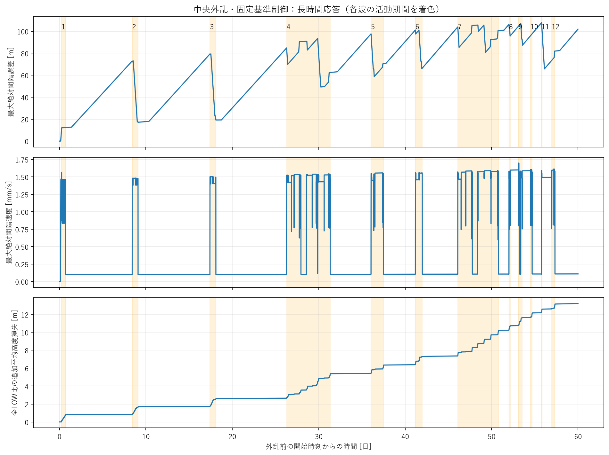
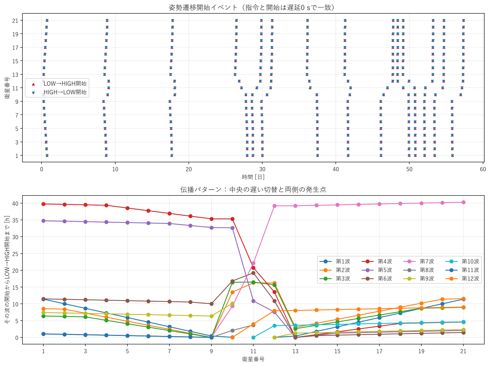
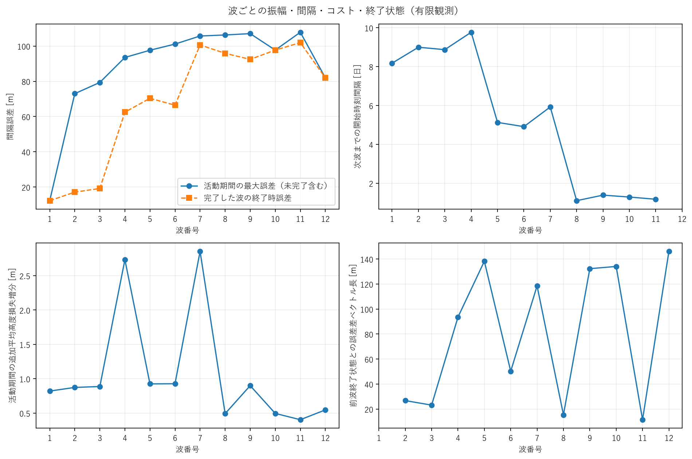
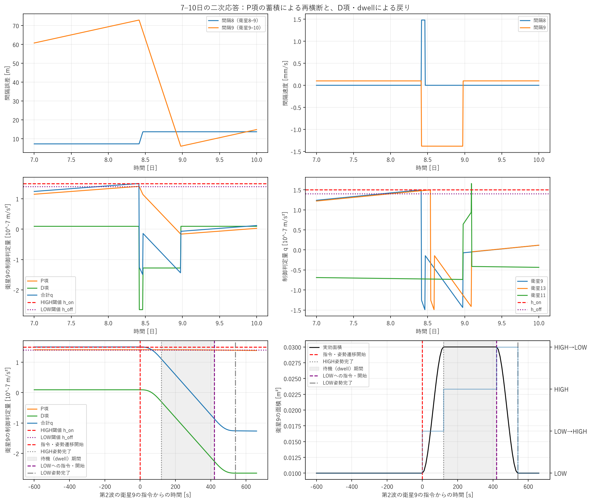
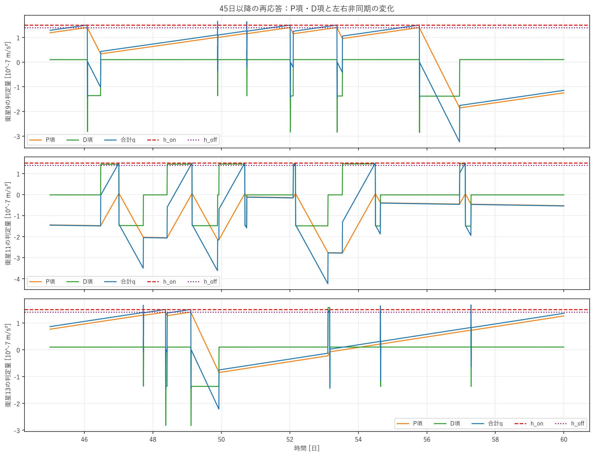

# 中央baselineの長時間再切替とq解析

## 結論

**60日以内で漸近収束は確認できなかった。繰り返し切替を伴う相対振動が続き、一定周期の安定limit cycleとも判断できない。**
14日の既存runを再利用し、21→30→45→60日と段階的に継続した。物理・制御・積分coreは変更していない。
新規の物理計算は14日以後の46日分だけで、同一条件の全LOW対照も同じ継続手順を使った。掃引は行っていない。

60日時点で、中央11番は13 cycle、それ以外の20機は各14 cycle。合計293 cycle、586遷移である。
観測された最大誤差は107.819 mで、最後の4日も最大101.945 mの誤差が残る。
急激な発散は観測していないが、最大誤差の包絡とRMSは増えており、真の有界性は証明できない。

候補の順位は、(1) 不規則な再切替を伴う相対振動（有限観測でのbounded oscillation候補）、
(2) 緩やかな不安定化・ドリフト候補、(3) 安定limit cycle候補。
漸近収束・非常に遅い減衰を支持する証拠は得られていない。
群の参加衛星数や位相が後半で変わるため、E_nだけの増減で不安定性を断定しない。

## A. 観測時間ごとの結果

| 観測 [日] | 全期間最大誤差 [m] | 全期間RMS [m] | 終了時最大誤差 [m] | 遷移開始数 | 全LOW比追加損失 [m] | 最後の遷移完了 [日] |
|---:|---:|---:|---:|---:|---:|---:|
| 14 | 72.994 | 15.664 | 49.557 | 82 | 1.717 | 9.096 |
| 21 | 79.364 | 17.805 | 38.844 | 124 | 2.625 | 18.102 |
| 30 | 93.529 | 20.978 | 78.351 | 225 | 4.829 | 29.998 |
| 45 | 101.118 | 27.257 | 93.971 | 334 | 7.346 | 41.984 |
| 60 | 107.819 | 31.480 | 101.945 | 586 | 13.212 | 57.336 |

初期高度からの平均損失は、14/21/30/45/60日で1254.769 / 1892.378 / 2723.502 / 4134.171 / 5582.884 m。
60日の全LOW損失は5569.673 mで、制御による追加分13.212 mはその約0.237%。
絶対高度低下の大部分は通常の抗力である。追加損失の寿命・工学的重要性は要求仕様なしには断定しない。

24時間software referenceは最大12.423898 m、RMS5.991742 m、40遷移、追加0.821150 mを維持。
全LOW24時間の最大108.453581 mも維持している。60日の制御誤差と24時間の全LOW誤差を同一観測長の比較として扱わない。

### Settling

速度許容1 mm/s、W=1800 sは既存条件を維持。誤差1/5/10 mでは、全観測長でT_settleなし。
50 mでは14日データで9.0961日（検証4.9039日）、21日データで18.1019日（検証2.8981日）と判定される。
しかし30/45/60日ではT_settle=null、settled_by_tmax=false、verification_horizon=nullとなる。
14日・21日の判定は、その観測端までの有限な静穏区間を意味しただけだった。

50 m条件のT_recoverは63460 s=0.73449日で維持される。入口61660 sに1800 sの確認時間を加えた時刻である。
最初の回復と、以後切替がなくなるsettlingは明確に異なる。

## B. 第3波・第4波と以後の再応答

波は14日で学習した80953.69 sのイベント間隔で区切った**時間的な群**。
第4群と第7群は各21機が3 cycleずつ行った126遷移であり、単一のL-H-L波ではない。
30日で第4群は未完了だったが、45日・60日では31.3308日までに完了したことが分かる。

| 群番号 | 開始 [日] | 完了 [日] | 最初の衛星 | 遷移数 | L→H/H→L経験機数 | 活動中最大E_n [m] | 活動中RMS [m] | 活動中追加損失増分 [m] |
|---:|---:|---:|---:|---:|---:|---:|---:|---:|
| 1 | 0.23646 | 0.71759 | 12 | 40 | 20/20 | 12.283 | 6.040 | 0.821 |
| 2 | 8.41192 | 9.09606 | 9 | 42 | 21/21 | 72.994 | 18.394 | 0.874 |
| 3 | 17.40856 | 18.10185 | 9 | 42 | 21/21 | 79.364 | 22.239 | 0.887 |
| 4 | 26.28102 | 31.33079 | 13 | 126 | 21/21 | 93.529 | 30.072 | 2.733 |
| 5 | 36.04850 | 37.50220 | 13 | 42 | 21/21 | 97.616 | 34.672 | 0.925 |
| 6 | 41.17674 | 41.98403 | 13 | 42 | 21/21 | 101.118 | 40.026 | 0.928 |
| 7 | 46.08611 | 50.79005 | 9 | 126 | 21/21 | 105.699 | 40.363 | 2.855 |
| 8 | 52.00903 | 52.16910 | 9 | 22 | 11/11 | 106.282 | 47.152 | 0.492 |
| 9 | 53.10868 | 53.53738 | 12 | 40 | 20/20 | 107.053 | 43.558 | 0.900 |
| 10 | 54.49352 | 54.69329 | 11 | 22 | 11/11 | 97.692 | 40.225 | 0.496 |
| 11 | 55.78021 | 55.82917 | 9 | 18 | 9/9 | 107.819 | 42.844 | 0.404 |
| 12 | 56.95301 | 57.33623 | 10 | 24 | 12/12 | 81.948 | 40.087 | 0.547 |

E_1=12.283 mは、活動区間だけの最大値。24時間全期間最大12.424 mとの相違は定義による。
開始直前・終了直後・次波までの最大値、衛星別開始時刻と切替数も
[波一覧CSV](results/60d/wave_summary.csv)と[完全な波・状態・トリガー情報](results/60d/waves.json)に保存した。

## C. 間隔・空間パターン・振幅

| 群番号 | 初回到達時刻の局所起点候補 | 遠方左枝速度 [m/s] | 遠方右枝速度 [m/s] | 中央から最大hop | 次群との開始間隔 [日] |
|---:|---|---:|---:|---:|---:|
| 1 | 10,12 | 20.26 | 20.26 | 10 | 8.1755 |
| 2 | 9,13 | 25.06 | 25.11 | 10 | 8.9966 |
| 3 | 9,13 | 33.95 | 34.04 | 10 | 8.8725 |
| 4 | 13 | 52.05 | 50.30 | 10 | 9.7675 |
| 5 | 13 | 207.47 | 207.00 | 10 | 5.1282 |
| 6 | 9,13 | 209.18 | 208.70 | 10 | 4.9094 |
| 7 | 9 | 213.15 | 213.15 | 10 | 5.9229 |
| 8 | 9 | 215.11 | — | 10 | 1.0997 |
| 9 | 9,12 | 217.40 | 216.93 | 10 | 1.3848 |
| 10 | 11 | — | 218.27 | 10 | 1.2867 |
| 11 | 9 | 218.80 | — | 10 | 1.1728 |
| 12 | 10 | — | 218.80 | 10 | — |

第1群は中央の両隣10/12番付近から外向き。第2・3群は9/13番が先行し、中央11番は遅れて切り替わる。
第4群は13番が先行し、右側・内側・左側の応答時刻がずれる。
後半には片側中心の群が現れ、全列を単一の伝播frontとする解釈は適切でない。
上記速度は、既存定義の中心3 hop以内を除いた外向き枝だけのフィット。欠けた枝はnull。

最初の開始間隔8.1755、8.9966、8.8725日は似ているが、その後は9.7675、5.1282、4.9094日などへ変化する。
衛星9の局所cycle開始間隔にも10.3444、0.8122、1.3086、7.5387、4.1817日などが含まれ、一定周期ではない。
群分け境界を0.5/1/2倍とすると60日の群数は25/12/7となる。
**293 cycleと586遷移はこの群分けに依存しないが、後半の「波数」とΔT_nは依存する。**

| 区間 [日] | 区間最大誤差 [m] | 区間RMS [m] | 遷移数 | 追加損失増分 [m] |
|---|---:|---:|---:|---:|
| 0–7 | 60.754 | 13.432 | 40 | 0.829 |
| 7–14 | 72.994 | 17.615 | 42 | 0.888 |
| 14–21 | 79.364 | 21.455 | 42 | 0.908 |
| 21–28 | 90.581 | 25.239 | 42 | 0.928 |
| 28–35 | 93.529 | 32.851 | 84 | 1.858 |
| 35–42 | 101.118 | 39.122 | 84 | 1.900 |
| 42–49 | 105.699 | 39.014 | 62 | 1.456 |
| 49–56 | 107.819 | 42.362 | 166 | 3.819 |
| 56–60 | 101.945 | 41.408 | 24 | 0.625 |

減衰型を支持する結果ではない。有限時間では振幅が約100 mへ近づくようにも見えるが、
包絡・区間RMSの増加が残り、振幅一定の周期系とは断定しない。
後半の異なる参加衛星集合でのE_nの低下は、そのまま減衰の証拠にならない。

波終了状態の差もゼロへ単調には減少しない。誤差ベクトル差L2は1→2群26.776 m、2→3群23.152 mだが、
以後93.569、138.240 mなどへ増える。後半の片側群は同じcycle位相の断面ではないため、
その差をPoincaré写像の収束判定として扱わない。
さらに完全な物理状態はaが低下し続け、厳密な周期軌道に戻らない。

## D. 40→82回の内訳

第1群は中央11番以外の20機が各L→H→L、20×2=40遷移。
第2群は中央11番を含む21機が各L→H→L、21×2=42遷移。合計82。
中央11番の第2群LOW→HIGH開始は785360 s=9.08981日、LOWへの帰還完了は785900 s=9.09606日。
第1群と第2群は参加衛星・起点・到達順序が同じではない。

## E. qの原因：閾値時の大きさと、時間変化を分ける

qは制御入力そのものの実加速度ではなく、HIGH/LOWを判定する量。
[厳密な実装数式と定義](definitions.md)に示す通り、同じ近傍差分をP項とD項へ別々に適用する。
保存済みqとP+Dの最大残差は1.059e-22 m/s²だった。

第2群の衛星9は726780 sではq=1.499986199×10^-7、726790 sでは1.500007601×10^-7 m/s²。
10 sの制御・保存分解能でh_onを再横断し、726790 sに指令・遷移開始した。
そのときP=1.407565328×10^-7、D=9.244227263×10^-9で、Pが93.84%。
第1群終了からの増加はΔP=1.414064750×10^-7、ΔD=1.099785742×10^-10。
qの増加の約99.92%がP項による。

ただし根本には**残る相対速度**がある。元モデルの恒等式

`d(q_P)/dt = (Kp/Kd) q_D = q_D / 43200 s`

により、小さな正のD項でもP項は日単位で増える。
第1群終了時のDを一定とした再横断予測は8.46403日、実測8.41192日。
第2群終了から第3群の予測は17.46972日、実測17.40856日。
これは位置誤差の蓄積を示し、追加のI制御を実装したことを意味しない。

表のP/Dは閾値時の値、ΔP/ΔDは前群終了から最初の指令までの変化。単位はすべて10^-7 m/s²。

| 群番号 | 最初の衛星 | P | D | ΔP | ΔD |
|---:|---:|---:|---:|---:|---:|
| 1 | 12 | 0.2302 | 1.2701 | — | — |
| 2 | 9 | 1.4076 | 0.0924 | 1.4141 | 0.00110 |
| 3 | 9 | 1.4062 | 0.0938 | 1.5486 | 0.00122 |
| 4 | 13 | 1.4064 | 0.0937 | 1.5220 | 0.00122 |
| 5 | 13 | 1.4049 | 0.0952 | 0.8944 | 0.00073 |
| 6 | 13 | 1.4041 | 0.0960 | 0.7031 | 0.00058 |
| 7 | 9 | 1.4018 | 0.0982 | 0.8032 | 0.00066 |
| 8 | 9 | 1.4008 | 0.0992 | 0.2417 | 0.00020 |
| 9 | 12 | 0.1169 | 1.3832 | 2.5973 | 0.00218 |
| 10 | 11 | 0.0360 | 1.4641 | 2.7975 | 0.00235 |
| 11 | 9 | 1.4002 | 0.0999 | 0.2169 | 0.00018 |
| 12 | 10 | 0.1109 | 1.3892 | 3.1196 | 0.00263 |

後半9/10/12群では、閾値時のD寄与が92–98%になる。
それでも、その前の静穏区間でのq増加はほぼPのランプであり、Dが突然増大して群を開始したわけではない。
左右のcycleがずれると大きな相対速度成分が残り、そのD項がPランプを速める。
一方、群内で隣接衛星へ反応が伝わる短時間応答では、D項の急変が重要である。
**Pの蓄積、Dが設定する蓄積速度、隣接切替によるDの急変**を分けて扱う必要がある。

### 戻りとdwell

第2群の衛星9は開始70 s後の726860 sにq≤h_offを最初に観測。
120 s後の726910 sにHIGH姿勢が完了した時点でもq≤h_offだった。
しかし戻りの指令はdwell終了の727210 sまで出ず、727330 sにLOW完了。
第3群の衛星9にも同じ順序を確認した。

60日までの全293 cycleで、戻り指令は「HIGH完了+300 s」と一致した。
1 cycleのHIGH等価時間は両slewを含め420 s、HIGH安定時間は300 s。
h_off近傍の往復による細かなchatteringが主機構という証拠はなく、
現在のHIGHパルス幅はdwellが決めている。

60日端の衛星13はq=1.355788194×10^-7、D=9.904115447×10^-9 m/s²で、再び上向き。
D一定なら次の横断は約60.73日という外挿になるが、**60日以降は計算しておらず未検証**。
最後の完了57.336日から2.664日静かなことを、切替の永久停止とは解釈できない。

## F. 追加高度損失

第1/2/3群の終了時追加損失は0.820799 / 1.704265 / 2.613284 m。
活動中の増分は0.820799 / 0.873794 / 0.887019 m。
21機が1 cycleずつ行う群では約0.87–0.93 m、3 cycleずつ行う第4/7群では2.733 / 2.855 m増える。
後半の片側群では参加機数が違うので、1群あたりの損失をそのまま同一応答として比較しない。
固定幅のHIGHパルスが繰り返され、累積コストが増えていることは確認できる。

追加損失はmean_j[h_LOW,j(t)−h_control,j(t)]。正なら制御の方が低い。
初期400 kmからの損失とは別の指標で、同一外乱・時刻の全LOWを基準にする。

## G/H. 次の実験と観測時間

今回は最適化・掃引を実施していない。次段階は以下を提案する。

1. **dwellの小規模因果確認**：実機制約を満たす範囲で150/300/600 s。slew120 sと他条件を固定。
   全帰還がdwell終了直後だったため、HIGH入力パルス幅とcycle終了時の残留速度の関係を先に確かめる。
   短縮すれば必ず安定化するとは仮定しない。
2. **Kp/Kd独立検証**：暫定値の0.1/0.3/1/3/10倍を独立に持つ候補表を用意する。
   費用節約の初回はKdだけ0.3/1/3倍をKp固定で試し、残留速度・伝播・再切替を確認。
   次にKpも独立に変える。設計時間だけを変える従来の連動変更と区別する。
   Pが閾値時に大きいという理由だけでKpを下げると、単に再切替を遅らせ誤差を増やす可能性がある。
3. **h_cをΔhより先に**：h_c=1.45×10^-7を0.5/1/2倍、Δh=1.0×10^-8を固定する小規模案。
   感度と許容誤差の関係を見る。短い観測で波を消したと判断しない。
4. **Δhは後順位**：h_c固定でΔhの0.5/1/2/5倍を候補にする。
   現条件では戻りがdwellで制限されているため、小幅のΔh変更だけでHIGH時間が減る根拠は弱い。

既存baselineは60日まで保持するsoftware観測基準として使える。
科学的な「十分なT_max」はまだ決められない。24時間の比較は長時間の安定性を示さない。
将来の少数候補は保存状態から段階的に延長し、最後の切替だけでなく、
cycle終了時の残留速度・qの上昇率・再横断の見込みを見て観測を打ち切るか判断する。
波が遅くなった候補で、30日以内に切替がないことだけを改善の証拠としない。

## I. 変更・検証・Git

追加したのは保存状態の継続補助、後処理q/波解析、解析・図・非破壊検証の各スクリプトとテスト。
既存8 coreファイル、既存metrics/evaluation、固定baseline fixtureは変更していない。
新規2テストファイルの10ケースを含む**104件合格**。

24時間3ケースは、既存0–20500 sを読み、slew中の20500 sから24時間まで実際に継続。
集計値と指令・開始・完了イベントが一致し、主要時系列7種類の最大差はすべて0。
短時間テストでは全保存配列と全イベントを途中再開なしと比較した。

旧442ファイルのSHA256はすべて一致。14→21→30→45→60日の制御・全LOWの8継続について、
全保存配列のprefixと既存イベントのprefixが完全一致した。
[回帰結果](results/regression_24h.json)、[非破壊検証](results/preservation.json)、
[観測長集計](results/horizon_summary.csv)、[再現方法](reproduction.md)を参照。

作業branch：`astra/long-horizon-q-analysis`。入力元commit：`ee25e3c`。
解析・継続補助コードのcommit：`0a40217`。
mainへのmergeは行わない。巨大な新NPZは`outputs/long_horizon_q_20261008/`にローカル保存し、
Gitには設定・イベント・集計・CSV・日本語図と文書を保存する。
