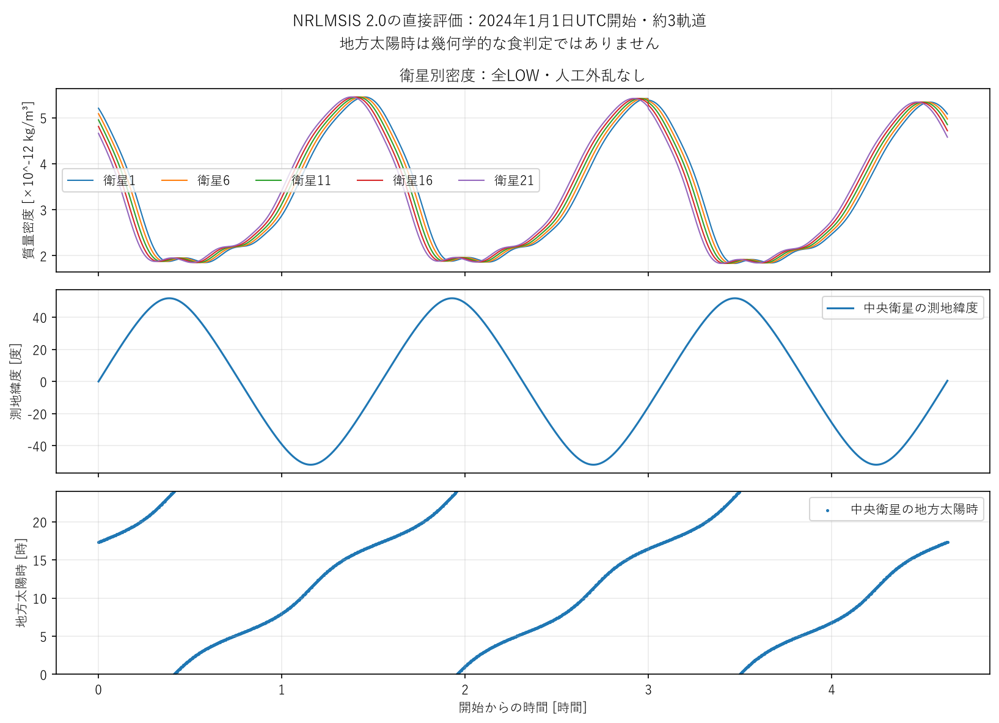
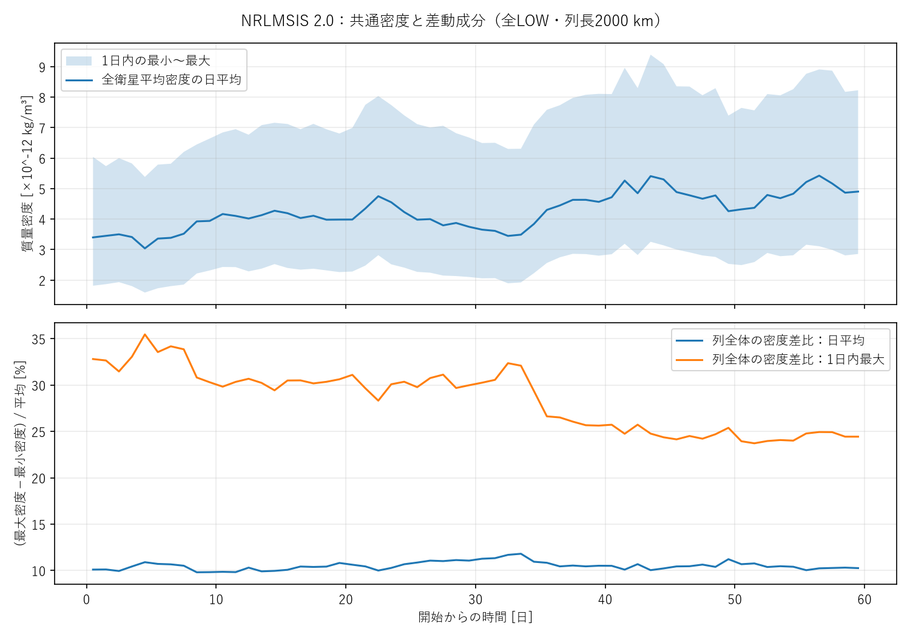
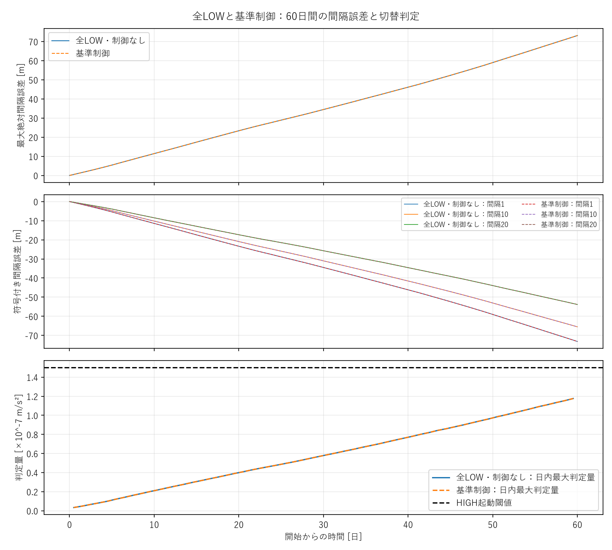
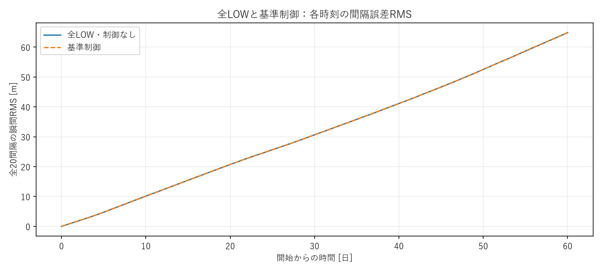
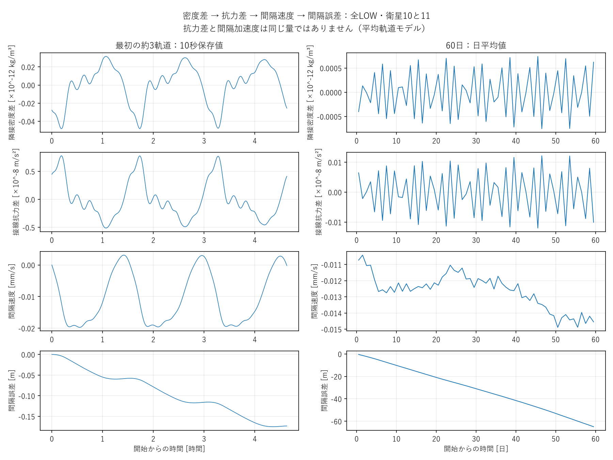
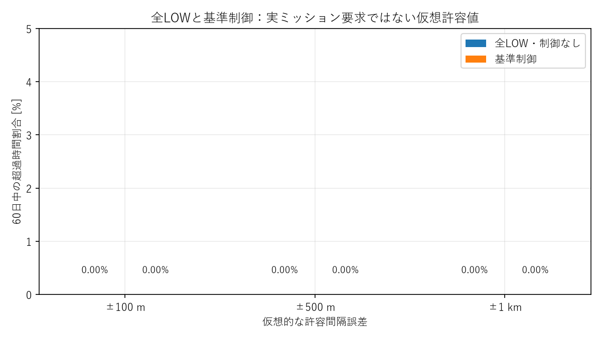

# 詳細技術付録

## 1. 検証の範囲

この検証は、観測に基づく経験大気モデルを既存の平均軌道モデルへ接続した、一軌道面・一期間の試験である。実測密度そのものを入力した試験でも、実大気を完全再現した試験でもない。

人工外乱は、原因を分離するための制御された実験として残した。NRLMSISは、その結果がより現実的な環境でも現れるかを調べる検証として独立に追加した。人工外乱とNRLMSISの数値を、同一入力の厳密比較として扱わない。

## 観測されたこと

基準制御は全518,401制御時刻でHIGH条件未到達だった。全LOWと物理時系列は同一で、command・遷移開始・完了・完了L-H-L・HIGH安定時間・HIGH換算時間はすべて0。最大誤差/RMSの改善量と改善率、追加高度損失も0である。

| 観測終了 | 最大誤差 [m] | 全期間RMS [m] |
|---|---:|---:|
| 1日 | 1.0495 | 0.5264 |
| 7日 | 7.8410 | 3.8606 |
| 14日 | 16.2173 | 8.1512 |
| 30日 | 34.4874 | 17.7669 |
| 60日 | 73.1710 | 36.2744 |

誤差は日単位で増加傾向にあり、短周期の変動もある。最大は間隔1、59.9935日、符号付き誤差−73.17097 m。終了時最大は73.16960 m。終了時の瞬間RMSは64.88569 mで、全期間RMS36.27436 mとは異なる。

| 代表間隔 | 最大絶対誤差 [m] | RMS [m] | 終了時誤差 [m] | 終了時速度 [mm/s] |
|---|---:|---:|---:|---:|
| 衛星1–2 | 73.171 | 40.794 | −73.170 | +0.003486 |
| 衛星10–11 | 65.513 | 36.634 | −65.510 | +0.004510 |
| 衛星20–21 | 53.836 | 30.322 | −53.830 | +0.005400 |

終端で一瞬回復方向に動いていても、それ以前の長期増加や将来の収束を否定・証明しない。全20間隔の値は [gap_metrics.csv](results/gap_metrics.csv)、時間履歴の抜粋は [hourly_summary.csv](results/hourly_summary.csv)。10秒全時系列はローカルNPZに保持した。

密度範囲は1.580〜9.429×10^-12 kg/m³、全衛星平均の時間平均4.256×10^-12 kg/m³。列全体の最大−最小密度は最大1.308×10^-12 kg/m³、平均比最大35.46%。隣接差は最大6.599×10^-14 kg/m³、RMS2.896×10^-14 kg/m³、列平均比最大2.15%。2000 kmの列全体と100 km隣接差を区別する。

速度の全期間最大は0.030271 mm/s。保存した平均軌道加速度を積分した速度との差は最大3.8215×10^-8 m/s、速度を積分した誤差との差は最大0.009812 mだった。モデル内の密度差→平均運動差→間隔速度→誤差の経路を数値的にも確認できる。

符号付きqの全期間最大は1.176064×10^-7 m/s²（h_onの78.4%）、閾値余裕3.239361×10^-8 m/s²。最大絶対qは1.594837×10^-7で閾値を上回るが、負側なのでHIGH起動を意味しない。P成分の最大絶対値1.568308×10^-7、D成分2.802865×10^-9。L-H-L終了状態・再切替・有効なcycle後予測は観測0件で、この環境で再切替機構を確認できたとは言わない。

### 許容誤差と共通軌道縮小

従来指標では±100/500/1000 mの初回超過なし、時間割合0%、最大連続超過0 s。全LOW・基準制御で同じ。[全統計CSV](results/tolerance_exceedance.csv)を参照。

共通の長半径低下は平均6306.282 m、終了時の球面基準平均高度393693.718 m。これによる100 km弧長の縮小を従来eは含まない。補助指標を `e_arc,i=((a_i+a_(i+1))/2)*(λ_(i+1)−λ_i)−100000` とした。現在半径に換算した近円軌道の弧長であり、正確な実空間距離や測地距離とは主張しない。力学・元のe・制御判定は変更しない。

補助指標の最大166.140 m、RMS87.444 m。±100 mを38.7185日で初めて超過し、35.469%・最大連続21.2815日。±500 mと±1 kmは超過なし。制御は非作動なのでこちらも改善0。主要表の73 mとこの166 mは矛盾せず、距離の定義が異なる。詳細は [all_low_metrics.json](results/all_low_metrics.json) の `current_radius_arc_diagnostic` にある。

## そこから言えること

この期間・軌道・モデル・従来指標では、±100 m以上を守るための現制御の作動は必要なかった。最大誤差はkm級ではなく数十m後半。NRLMSISには衛星間差があり、その効果は蓄積するが、大きな共通密度変動と列内差動成分は別の量である。周期的な密度差の符号反転もあり、人工の局所パルスと積分履歴が異なる。

人工外乱の全LOWは7968.855 m・RMS1437.934 m、制御baselineは107.819 m・RMS31.480 m・586遷移・293cycle・追加損失13.212 mだった。NRLMSISでは73.171 m・36.274 m・0遷移・追加0 m。これは入力環境が違うため、数値だけから制御の優劣を比べる表ではない。人工外乱で分離した機構には意味がある一方、そこでの制御必要性をこの環境へ直接一般化できない。

## まだ言えないこと

一期間から実大気全般で制御不要とは言えない。使用期間のAp日平均最大14・3時間最大32で、強い地磁気擾乱を網羅していない。NRLMSISの経験的な空間・時間構造で捉えない変動もあり得る。Gaussian外乱が非現実的、または十分強い実環境を代表する、とどちらにも断定しない。

60日で増加傾向にあることは、数学的発散や永久の有界性の証明ではない。固定軌道面、地球自転を抗力速度へ反映しない元モデル、近円軌道・平均位相の近似もある。±100 mを実ミッション要求に結びつけるには、距離の定義とモデル誤差を先に確認する必要がある。

### 6枚の図

図の時刻原点は2024-01-01 00:00 UTC。従来の間隔誤差図は固定基準半径による値。下記は独立した6図だけを公開する。

1. 直接評価の密度・緯度・地方時。衛星別密度差を確認できる。

2. 共通密度と列全体の密度差。影は1日内の範囲で、日平均と区別する。

3. 最大誤差、代表間隔、正側q最大。2ケースが重なるのは制御非作動のため。

4. 各時刻の瞬間RMS。主要表の全期間RMSと定義が異なる。

5. 代表間隔の因果経路。左は短時間の保存値、右は日平均。密度差の周期性と、小さな速度差が誤差へ蓄積する様子を分けて読める。

6. **従来指標**の超過率はすべて0%。現在半径の補助弧長指標については上の別記の35.47%を参照する。

## 2. 固定した物理・制御・数値条件

凍結された `tests/fixtures/regression_24h/config.yaml` を一次情報として使用した。N=21、基準高度400 km、目標間隔100 km、質量4 kg、Cd=2.2、LOW/HIGH面積0.01/0.03 m²。Kp=2.143347050754458×10^-9 s^-2、Kd=9.259259259259259×10^-5 s^-1。HIGH起動閾値1.5×10^-7 m/s²、LOW帰還閾値1.4×10^-7 m/s²、制御10 s、slew120 s、完了後dwell300 s、遅延0 s、RK4最大2 s、保存10 s。

変更した環境入力は `density_model=nrlmsis2` と人工外乱の無効化のみ。全LOWと基準制御の正規化設定・宇宙天気SHA・幾何設定・初期状態・時間格子が同一で、ケースの `control_enabled` だけが異なることを後処理で機械的に検査する（`results/input_checks.json`）。

既存の軌道微分方程式は変更していない。

\[
\dot a_j=-\rho_j\frac{C_D A_j}{m}\sqrt{\mu a_j},\qquad
\dot\lambda_j=\sqrt{\mu/a_j^3}.
\]

密度が高いほど長半径が早く減り、その分平均運動が増す、という元の平均軌道モデルである。地球自転は地理座標の計算に使用するが、抗力式の相対風速を新しく補正していない。

## 3. 軌道から測地座標への変換

`lambda` は軌道面内の位相として扱い、地理経度へ直接代入しない。円軌道、傾斜角51.6°、RAAN=0°、中央衛星の初期位相0°（昇交点）を固定した。

400 km・51.6°はISSと同様の地球観測軌道面を一つの代表として選んだ。[NASAの地球観測説明](https://science.nasa.gov/earth/earth-observatory/human-spaceflight-factsheet/)を参照。ISSの実軌道に合わせた試験ではない。RAAN=0°は慣性空間の基準面を定義する選択であり、密度や制御性能を見て最適化していない。

\[
\mathbf r_{ECI}=R_3(\Omega)R_1(i)
\begin{bmatrix}a\cos u\\a\sin u\\0\end{bmatrix},
\quad u=\lambda+u_0,
\quad\mathbf r_{ECEF}=R_3(-\theta_{ERA})\mathbf r_{ECI}.
\]

衛星の軌道面内運動と地球の回転を別々に扱い、地球に固定された位置へ変換する。ERAはJ2000からの日数を使った[IERSの式](https://www.iers.org/SharedDocs/Publikationen/EN/IERS/Publications/tn/TechnNote32/tn32_033.pdf?__blob=publicationFile&v=2)を使用し、UT1≈UTCとした。歳差・章動・極運動・J2による軌道面回転は追加していない。

ECEFから[NGAのWGS84](https://earth-info.nga.mil/index.php?action=wgs84&dir=wgs84)（赤道半径6378137 m、扁平率1/298.257223563）の測地緯度・経度・高度へ変換する。緯度は7回の反復で求め、高度は極付近でも安定な法線方向射影を使用する。

元モデルの「高度」は `a−6378137 m` である。一方、NRLMSISには楕円体からの測地高度を入れる。そのため、初期長半径を400 kmの基準に保っても、軌道上の測地高度は約400〜413 kmになる。この二つを混同して一律400 kmへ置き換えていない。

## 4. NRLMSIS呼出し・単位

任意依存を `pymsis==0.12.0` に固定し、毎回 `version='2.0'` と `geomagnetic_activity=-1` を指定する。既定値のモデルバージョンには依存しない。`Variable.MASS_DENSITY` のtotal mass densityをkg/m³のまま既存抗力式へ入れる。[公式API](https://swxtrec.github.io/pymsis/reference/generated/pymsis.msis.calculate.html)の入力単位は、経度・測地緯度が度、測地高度がkmである。

モデル係数 `msis2.0.parm` のSHAも各runに保存する。Windowsで長い絶対パスがFortran側の係数ファイルパス長を超える問題には、同じ実在ディレクトリへの短い相対パスを使う。係数やインストールされたモデルの内容は編集しない。

NRLMSIS 2.0は経験モデルであり、気象の細かな実変動すべてを再現するものではない。[原論文：Emmert et al. (2021)](https://ace.scisat.ca/static/publications/pdfs/Emmert-MSIS-2020.pdf)、[NRL配布元](https://map.nrl.navy.mil/map/pub/nrl/NRLMSIS/)を参照。

## 5. 歴史的宇宙天気と期間選択

開始2024-01-01 00:00 UTC、終了2024-03-01 00:00 UTC、60日。結果を見る前に、2026-10-10時点の完了年を新しい順に調べ、年初60日と81日平均の支持期間の入力が観測値で揃う最初の年を選ぶ条件を置いた。2025年は2月12日・17日のF10.7がINT（補間値）のため除外し、2024年を採用した。密度・編隊結果を理由とする期間変更はしていない。

出典は[CelesTrak SW-All.csv](https://celestrak.org/SpaceData/SW-All.csv)。[データ書式・元機関の説明](https://celestrak.org/spacedata/SpaceWx-format.php)も参照。ダウンロード時の全CSVはローカルに保存し、SHA256は `2c0fb9064a4c182056bec9fb47052af72eb2de75c7cc87c871d9e7f9d4d9c781`。

Gitには、2023-11-22〜2024-04-10の支持データ141日分と、実際に使う481組の3時間ごとの入力を保存する。欠損・非観測F10.7・不正値は拒否し、ローカルでの補完は行わない。自動取得される最新データへ暗黙に依存しない。

F10.7は前日の観測値、81日平均は当日の中央81日平均。Apは日平均、現在の3時間値、3/6/9時間前、12〜33時間前の8区間平均、36〜57時間前の8区間平均の7成分である。固定CSVから構成した入力と[pymsisの履歴入力関数](https://swxtrec.github.io/pymsis/reference/generated/pymsis.utils.get_f107_ap.html)は全要素で完全一致した。3時間境界で切り替え、入力値を時間補間しない。

使用範囲：前日F10.7=125.8〜208.3 sfu、81日平均157.9〜166.4 sfu、日平均Ap=1〜14、3時間Ap=0〜32。この実際の活動範囲を示すが、太陽活動全般の代表性を保証するものではない。

## 6. 密度補間と短時間の収束試験

120秒ごとに各衛星の実際の軌道状態へ密度キャッシュを合わせ直す。短区間だけ一定長半径の位相予測に沿って4点のlog密度を計算し、3次補間する。実際の長半径変化は±100 mの密度評価から求めたlog密度勾配で補正する。この予測は密度表を作るためだけで、衛星の物理状態は元のRK4で伝播する。

3時間ごとの宇宙天気更新をまたぐ補間はしない。UTC日境界の前後も別々に扱う。pymsisが整数UTC秒を使用する点を確認し、評価ノードも整数秒にする。キャッシュ内の長半径差100 mまたは位相差10^-6 radを超えたら停止する。

本格計算前に、約3軌道の直接密度計算と、全LOW・基準制御それぞれの1日計算を実施した。先に定めた合格基準は、最大誤差/RMSの差が1%または0.05 m以内、密度の直接評価との差が0.1%未満。合格した最大の候補を採用した。

| 密度キャッシュ間隔 | 1日最大誤差 [m] | 1日RMS [m] | 約3軌道の直接計算との差：誤差時系列最大 [m] |
|---|---:|---:|---:|
| 10 s | 1.048530 | 0.526392 | 0.000040 |
| 30 s | 1.048679 | 0.526393 | 0.000055 |
| 60 s | 1.048700 | 0.526392 | 0.000078 |
| 120 s | 1.049488 | 0.526412 | 0.000111 |

1日では両ケースの結果が同じだった。補間の影響は小さく、120秒を採用した。ただし、この短時間結果だけで60日後の誤差まで保証するとは扱わない。全期間の実位置における直接密度監査と、保存時刻の間の密度監査を別に行う（`results/cache_audit_*.json`）。10秒キャッシュを保存10秒時刻だけで調べると節点ばかりになるため、内部時刻の監査も必要である。

60日後の監査では、保存位置25,347点の直接評価との密度差は最大0.004566%、内部時刻25,326点では最大0.003029%。3時間入力更新・UTC日境界も含めて合格した。キャッシュ内最大長半径差0.3204 m、位相差4.784×10^-9 radで、空間近似の停止条件から十分小さい。

さらに、固定入力系列の最初のAp3時間最大32の日（2月11日、41日目）を結果と独立に選び、同じ実状態から1日だけ10秒／120秒キャッシュで伝播した。誤差時系列差は最大0.002460 m、最大誤差の差0.001134 m、RMS差0.00002177 m。初日だけの確認に依存せず、後半の高活動入力・低下した高度でも必要な精度を確認した（`results/late_convergence.json`）。

短時間の直接評価では密度は1.832〜5.451×10^-12 kg/m³、測地緯度は約±51.776°、地方太陽時は0〜24時にわたり、すべて正・有限だった。同一入力は同一密度を返した。緯度と地方時は連動して変わるため、この一軌道から各変動要因の寄与を独立に推定したとは言えない。

## 7. 評価量と原因の確認方法

最大誤差は全時刻・全20間隔の最大絶対値、全期間RMSは全保存時刻・全20間隔を同じ重みで平均した二乗誤差の平方根。規格化誤差は `誤差/100000×100 %`。全gap別の最大・RMS・終了時誤差・終了時速度をCSVに保存する。

元コードに合わせて `e_i=a0(λ_(i+1)−λ_i−100000/a0)` とする。これは固定基準半径a0上の沿軌道間隔誤差であり、低下していく実際の軌道半径上の弧長や、三次元の衛星間距離そのものではない。共通の軌道縮小による弧長変化を、この誤差へ新しく混ぜていない。

仮想許容値は±100 m、±500 m、±1 km。超過は最大絶対誤差が許容値より厳密に大きい保存時刻とする。時間割合と連続時間は、各保存値を次の保存時刻まで保持する方式で計算し、終端点の時間幅は0とする。10秒保存間の現象を完全保証せず、実ミッション要求とも扱わない。

密度は、全21機の平均、平均からの差動成分、列全体の最大−最小、隣接衛星間の密度差を分ける。「列全体」は2000 km、「隣接」は100 kmであり、密度差の比率を同じ空間尺度と見なさない。

\[
v_i=\dot e_i=a_0(n_{i+1}-n_i),\quad
\dot v_i=\frac{3a_0 C_D\mu}{2m}
\left(\frac{\rho_{i+1}A_{i+1}}{a_{i+1}^2}-\frac{\rho_iA_i}{a_i^2}\right).
\]

これは、元の平均軌道式で密度・面積の差が間隔速度を変える関係である。直接の接線抗力加速度とは符号・意味が異なる。保存された加速度を積分して速度と、保存速度を積分して誤差と比較し、単なるグラフの見た目以外でも機構を確認する。積分には10秒保存値の台形則を使い、密度入力の段差等を含むため診断の数値差も記録する。

制御は元の `q=Kp Be+Kd Bv` を維持した。Bは端部を片側、内部を隣接gapの差にする開路の結合。NRLMSISの差動入力は継続するため、人工外乱後のような「D一定・無入力の静穏区間」を仮定しない。L-H-Lが存在すれば既存cycle解析を実行し、予測の有効性検査を通らないものは有効予測として数えない。存在しなければ再切替機構の確認は「未観測」とする。

正確には `s_i=Kp e_i+Kd v_i`、`q_1=s_1`、内部衛星で `q_j=s_j−s_(j−1)`、`q_21=−s_20`。LOWでは**符号付きqが正のh_on以上**でHIGHへ、HIGHではqが正のh_off以下でLOWへ指令する。いずれも姿勢完了後のdwell解除が必要。最大絶対qが閾値を超えることや、最大間隔誤差が大きいことだけではHIGH起動を意味しない。

## 8. 制御コスト・高度損失

切替数は実際の姿勢遷移開始数。command・完了数も別保存。cycleは同一衛星のLOW→HIGH→LOWが両方完了したもの。

HIGH安定時間はHIGH姿勢完了からLOW遷移開始までの時間。HIGH換算時間（HIGH equivalent time）は `Σ∫(A−A_LOW)/(A_HIGH−A_LOW) dt` で、面積が変化しているslewの寄与も含む。

基準高度損失は `mean_j[a_j(0)−a_j(T)]`。追加平均高度損失は `mean_j[a_ALL_LOW,j(T)−a_control,j(T)]`、正が制御側の余分な損失である。評価時刻は同じ60日、平均は21機の算術平均、基準は同じNRLMSIS・同じ初期条件の全LOW。人工外乱の全LOWは使用しない。これは元モデルの長半径／球面基準高度の差であり、測地高度の平均差とは区別する。

## 9. 重複計算を省く方法

同じ密度・初期状態で、LOW→HIGH条件に一度も達していない区間は、制御を有効にしても命令が発生せず、LOW面積と力学は全LOWに一致する。保存周期と制御周期がともに10秒、RK4刻み2秒が両者の境界を既に刻むことを条件に、全制御時刻のqを実装と同じ演算順で再計算して検査する。

初めて条件に達する時刻があれば、その前の密度キャッシュ境界までを再利用し、残りは実際の制御を有効にして計算する。60日ずっと条件未到達なら、全区間の同値性を検査した結果として基準制御ケースを作る。これは制御を独立に二重計算したと偽るものではなく、同値な非作動区間の再利用である。`inactivity_proof.json` に検査時刻数・q最大・閾値余裕を保存する。初期約3軌道と1日のA/Bは独立実行し、同一結果を確認した。

## 10. 再現・検証・Git

手順は [reproduction.md](reproduction.md)。巨大NPZと全期間の元CSVはローカルの新規出力先に保持し、Gitには設定・使用入力CSV・集計JSON/CSV・図・本文を保存する。既存run・成果は削除・置換しない。

凍結24時間3ケースを実際に再実行し、集計値・全イベント・主要時系列の回帰が合格した。制御あり最大12.423898 m、RMS5.991742 m、40遷移、追加損失0.821150 m、左右速度20.263407 m/sが一致し、比較した主要時系列の差は0だった。これらはsoftware regression referenceであり、科学的に最適な制御条件の証明ではない。

テスト、既存ファイルSHA、長時間密度監査の最終結果は `results/verification.json` と各結果JSONに保存する。作業branchは `astra/nrlmsis2-necessity`。mainへmergeしない。開始commitは `16bfbb27246a910a27f0d66723c18ae6d7c50b01`。変更commitは `git log -2 --oneline` で確認できる。

全テスト **208件合格（既存189＋新規19）**。新規は座標逆変換・極・経度連続性、時間履歴入力、2.0指定・質量単位・再現性、10/30/60/120秒密度補間・日境界、同一力によるcore同値性、q分解・非作動区間、差動加速度、共通軌道縮小の補助指標を確認する。既存成果 **1879ファイルのSHA一致**、削除diffなし。巨大NPZはGitへ入れない。

変更ファイルの役割：

- `config.py`、`dynamics.py`、`simulator.py`、`continuation.py`：任意の密度提供関数を接続する最小変更。旧密度・力学式・制御・RK4の演算は維持。
- `nrlmsis.py`、環境YAML、`prepare_nrlmsis_weather.py`：地理座標・明示的2.0・歴史入力・短区間密度補間。
- `nrlmsis_analysis.py`、`analyze_nrlmsis_comparison.py`：入力差分、密度・誤差・コスト・原因検査、補助弧長、既存cycle評価の再利用。
- `run_nrlmsis_case.py`、`reuse_nrlmsis_inactive_prefix.py`：同じcoreで実行・継続、厳密に非作動な区間だけ再利用。
- `validate_nrlmsis.py`、`validate_nrlmsis_late_window.py`、`audit_nrlmsis_cache.py`：短時間・後半・直接評価の検証。
- `plot_nrlmsis_validation.py`、新規テスト、`verify_preserved_inputs.py`、任意依存・README：日本語図、回帰維持、旧成果の非破壊確認と利用方法。

コードcommit：`b42f90dd97dc869a730dac17829309e017337742`。公開CSVとテスト入力は、この新規ディレクトリだけの `.gitattributes` で改行自動変換を無効化し、保存したSHAとGitから復元した入力バイトが一致するようにした。

Gitへのpushは上記検証と成果保存後に研究branchのみへ行う。commit内容は `git log -2 --oneline`、主要再現コマンドは [reproduction.md](reproduction.md) を参照。
