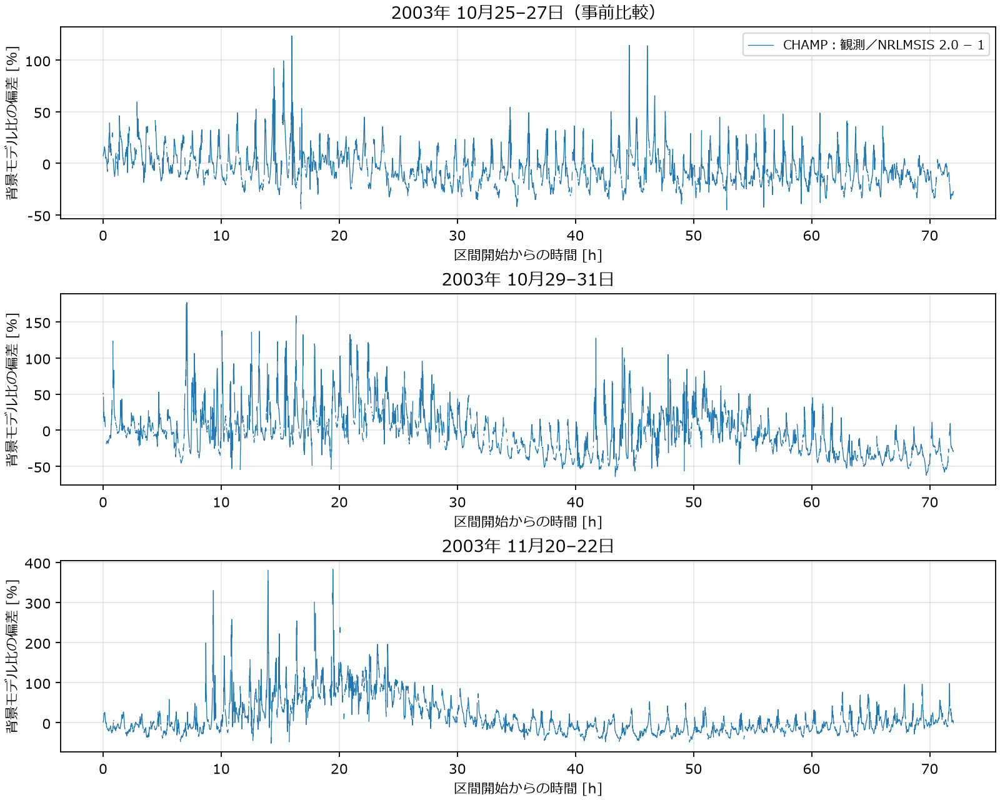
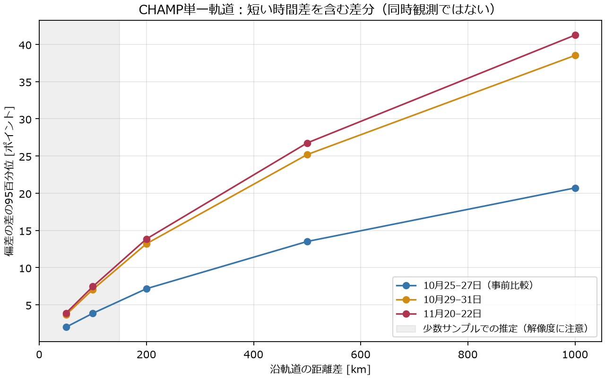
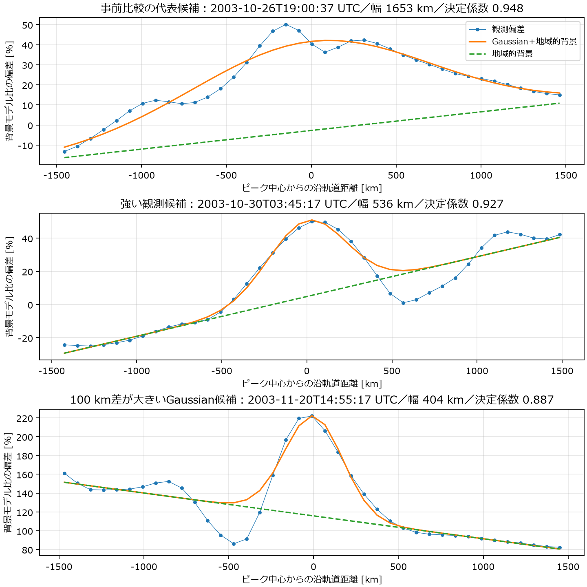
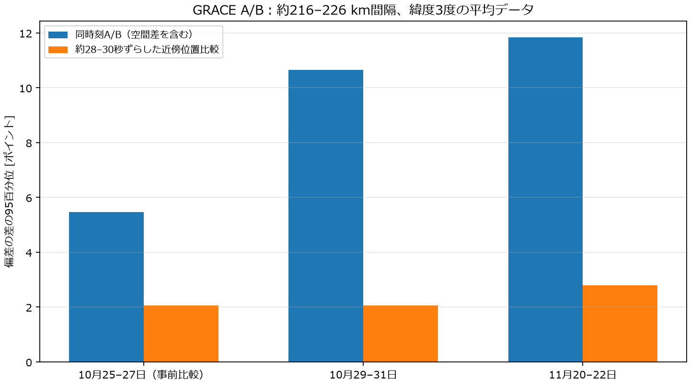

# 詳細技術付録

## 観測されたこと、解釈、未確定を分ける

**観測されたこと：** 以下の数値は、公開された加速度計観測から推定された密度と、明示的なNRLMSIS 2.0計算の後処理結果である。密度は真値の直接測定ではない。

**そこから言えること：** 選んだ2つの嵐と事前比較では、背景大気からの偏差と、沿軌道の密度差が存在する。相対振幅だけでは差動抗力の厳しさを決められない。空間幅、背景密度、構造と衛星の相対移動を揃えて設計する必要がある。

**まだ言えないこと：** 同時刻の100 km衛星対の真の密度差、個別構造の寿命・伝播方向、全球のnominalや発生確率、ミッション中の最悪外乱、衛星列の制御必要性は、この9日の解析だけでは確定できない。

## 1. データセットと仕様確認

### 採用した主データ

[Vielberg, Lück, Corbin, Forootan, Löcher, Kusche (2021), TND-IGG RL01, PANGAEA, DOI:10.1594/PANGAEA.931347](https://doi.pangaea.de/10.1594/PANGAEA.931347)。CC BY 4.0。READMEと実際のnetCDF変数を照合した。

- CHAMP・GRACE-A・Swarm-Cの推定中性質量密度。GRACE-Bは含まない。
- 10秒GPS時間、月単位netCDF4。密度 `kg/m^3`、高度 `m`、緯度・経度、太陽地方時、緯度引数、影情報。
- 動的精密軌道決定による加速度計のscale・日bias校正、太陽／地球放射圧を除去、空力係数モデルで密度へ逆算。組成・温度には既にNRLMSIS 2.0を使う。よって背景モデルと完全に独立な観測ではない。
- エネルギー適応係数はCHAMP 0.85、GRACE 0.93、Swarm 0.82。校正、姿勢、空力モデル、組成、風の扱いによる系統誤差が残る。
- アーカイブの実際の月一覧はCHAMP 2002-05〜2010-09、GRACE-A 2002-08〜2017-01。これは収録ファイル範囲で、全期間の無欠損を意味しない。
- READMEが非推奨とするGRACE-A 2007年1–6月は使用していない。

TU Delft Thermosphere Portalへの接続はタイムアウトし、データ取得にはPANGAEAを使用した。[Siemes et al. (2023), Table 2](https://elib.dlr.de/195131/1/swsc230004.pdf)の別製品では、10秒出力でも沿軌道分解能はCHAMP152 km、GRACE A/B422 km、GRACE-FO C152 kmである。**この数字をTND-IGG RL01の確定分解能として流用してはいない。** 同製品READMEで実効フィルタ幅は明示されず、今回確認できるのは10秒の標本間隔と推定手法までである。

実際のCHAMPの軌道標本間隔は約77 km。50 km差は標本より短く、100 km差は約1.3標本間隔の補間推定である。100 km幅を直接解像したとの主張は避ける。

### GRACE A/Bの補助データ

[Sutton (2011), version 2.3データとrelease report](https://zenodo.org/records/13287614)。公開ASCIIは緯度3度ごとの平均で、約300–350 kmの平均化を含む。実際の時刻間隔は可変である。報告書の400/410 km規格化と旧MSIS密度は使用せず、観測高度の未規格化密度から2.0で再計算した。

PDFの列18説明は補間点数、実ファイルheaderはthruster affected点数で食い違う。どちらの意味でも疑わしいため非ゼロを除外した。推定不確かさは両衛星とも密度の中央値約5.1–5.2%。これは完全な誤差予算ではない。小さいA/B差や時間シフト後の差を高精度な物理信号と断定しない。

### Swarm・GRACE-FO

Swarmには加速度計由来とPOD由来の別製品がある。[Siemes et al. (2016)](https://doi.org/10.1186/s40623-016-0474-5)は加速度計の温度影響などの処理を扱う。[He et al. (2023)](https://doi.org/10.1029/2023SW003521)のPOD密度は15–20分、約7000–9000 kmの分解能で、100 km構造の直接証拠にはならない。2003年の対象イベントはSwarm／GRACE-FO打上げ前なので、新規データを取得していない。GRACE-FOの製品と分解能は上記Siemes2023で確認した。

## 2. 期間選択と取得

密度計算前に `configs/observed_density_design.yaml` の期間を固定し、結果を見て変更していない。

| UTC期間（終了は含まない） | 選択根拠 | 最大Kp | 最小Dst [nT] | 最大3時間ap |
|---|---|---:|---:|---:|
| 2003-10-25〜10-28 | Halloween嵐前の比較用3日 | 4.3 | −52 | 32 |
| 2003-10-29〜11-01 | よく研究された強い嵐、CHAMPが400 km付近 | 9.0 | −383 | 400 |
| 2003-11-20〜11-23 | CHAMP・GRACE共同観測の代表的な強い嵐 | 8.7 | −422 | 300 |

最初の期間は静穏と仮定していない。2002年2月のSchlegel論文の期間は採用データ収録開始前で、文献比較に限定した。2つの嵐は[October: Sutton et al. (2005)](https://doi.org/10.1029/2004JA010985)、[November: Bruinsma et al. (2006)](https://doi.org/10.1029/2005JA011284)で事前に研究上の重要性を確認した。気候学的な代表性はない。

PANGAEAの年々ZIP全体は取得せず、HTTP byte rangeで中央ディレクトリと2003年10・11月の4個のnetCDFだけを取得した。ZIP CRCとサイズを検証。Suttonは2003年のA/B各年tar.gzが最小公開単位で、選択日だけをメモリで読む。生データ、ローカルNPZ、原報告PDFはGitに追加しない。URLとSHA256は `data/download_receipts.json` に保存する。

CHAMPの品質採用数は21504／20473／21193、GRACE-Aは19669／21614／19636。10月末のGPS→UTC変換により、10月ファイルだけでは最後の13秒を覆わない。Halloween窓は25918行、他窓は25920行。末尾を補完していない。

## 3. 品質管理と座標・時間

gapグループのstarcamera／orbit／accelerometerが非ゼロ、flag/thrust非ゼロ、位置欠損、密度非正・非有限を除外。`flag/path` は軌道の進行方向なので除外しない。`shadow` の半影・変化点の前後30秒を追加除外した。30秒は解析者の保守的な除外設定であり、製品の物理精度ではない。

2003年GPS−UTC=13秒を明示的に引く。[時刻系の一次資料](https://www.oc.nps.edu/oc2902w/gps/timsys.html)。別年代への適用は拒否する。測地緯度・経度・高度は観測ファイルから直接入力し、平均経度lambdaを地理経度へ読み替えていない。GRS80を用い、緯度引数の差と平均地心半径から沿軌道距離を計算した。

品質除外、11秒を超える時刻飛び、非単調時刻、3時間Ap入力の切り替わりをまたぐ差分／fitは作らない。これはNRLMSISの入力ジャンプを局所空間勾配と誤認しないためである。

## 4. 背景NRLMSIS 2.0と宇宙天気

`pymsis==0.12.0`、`version='2.0'`、`geomagnetic_activity=-1` を固定。`Variable.MASS_DENSITY` のtotal mass densityはkg/m³で使用する。`netCDF4==1.7.4`、`scipy==1.17.1`。

F10.7は地球位置での**観測flux**、前日値と当日の中心81日平均を使用する。元データは既存の[CelesTrak SW-All](https://celestrak.org/SpaceData/SW-All.csv)キャッシュで、元のSHA256を記録し、2003年用支持期間を小CSVへ切り出した。daily Ap、現在／3／6／9時間前のap、12–33／36–57時間前の3時間apの平均、計7成分を明示的に保存。実際の解析日はpymsisの入力組立結果と一致を検証した。使用F10.7範囲は155.1–298.3 sfu、81日平均145.2–147.1 sfu。採用期間では欠損補完・予測値を使っていない。

支持期間内の11月4日F10.7=560.9は対象イベント外。pymsisの自動readerは400超の値を81日平均へ置換するため、最初の全支持期間照合で不一致を検出した。原値を残し、照合対象を実際に解析する日に限定した。11月5日の前日fluxをどの密度計算にも使っていない。失敗時に作られた出力は上書きせず保存した。

Kp／3時間ap／Dst／AE／1 AU調整F10.7は[NASA OMNI年ASCII](https://spdf.gsfc.nasa.gov/pub/data/omni/low_res_omni/omni2_2003.dat)から選択216時間を保存。[列仕様と出典](https://omniweb.gsfc.nasa.gov/html/ow_data.html)：Kp/apはGFZ、Dst/AEは京都。2003年Dstはfinal、AEはprovisionalとして扱う。OMNIの1 AU調整F10.7は状況説明用で、MSISへ入れる観測fluxとは区別する。各検出窓にはKp、ap、Dst、AEを結合した。

## 5. 偏差と400 km規格化

$$\delta=\rho_{obs}/\rho_{bg,obs}-1,\qquad\rho_{400}=\rho_{bg,400}(1+\delta).$$

同じ日時・位置・高度のモデルからの相対偏差を残し、モデルの高度依存だけを使って400 kmへ移す。Schlegel論文の「地域的背景比」、静穏日比、MSIS比は異なる分母なので混同しない。

CHAMP高度388–420 kmでは比較的小さい高度移動だが、GRACE-Aの468–521 kmからは約68–121 kmの移動になる。相対偏差が鉛直方向で同じという仮定、組成・温度・スケールハイト誤差があり、GRACEのrho400は400 km直接観測ではない。文献のDTM等によるモデル比規格化も考え方は類似するが、今回は要求どおり2.0のみ計算した。

| CHAMP期間 | δ最小 | δ最大 | δ中央値 | rho400最大 [kg/m³] |
|---|---:|---:|---:|---:|
| 事前比較 | −45.1% | +123.6% | −6.0% | 1.19×10⁻¹¹ |
| Halloween | −64.2% | +176.9% | −4.5% | 3.02×10⁻¹¹ |
| November | −51.1% | +383.1% | −1.2% | 3.61×10⁻¹¹ |

この大きいδには広域応答とモデルの過小評価も含まれる。純粋なTAD、局所Gaussian振幅、無作為抽出の平均誤差とは呼ばない。

## 6. 差動密度：2種類の分母を区別

$$D_L=\max_s|\delta(s+L,t+\tau)-\delta(s,t)|.$$

単一衛星が約13秒後に100 km先を通った観測の差である。δ差0.07は「背景モデル比の差7ポイント」であり、「2衛星の密度が7%違う」と同義ではない。時間変動、背景モデル誤差、推定密度のノイズを含む。

さらに物理密度の比較用に、400 km規格化した2点の差を2点平均で割った `R100=|rho400_2−rho400_1|/mean(rho400_1,rho400_2)` を保存した。こちらも約13秒差を含む。

| CHAMP期間 | δ差の絶対値中央値 [pt] | 95百分位 [pt] | 最大D100 [pt] | R100中央値 | R100の95百分位 |
|---|---:|---:|---:|---:|---:|
| 事前比較 | 0.48 | 3.86 | 40.47 | 0.53% | 3.72% |
| Halloween | 0.80 | 7.06 | 45.11 | 0.81% | 5.91% |
| November | 0.76 | 7.45 | 84.69 | 0.77% | 5.39% |

大部分の標本差は小さいが上位側は大きい。84.69ポイントは11月20日10:53 UTCごろ南高緯度での急変であり、品質flagを通過している。ただし極値だけを設計値にせず、再処理・風・空力・フィルタ等の不確かさを残す。推定された密度の個々の標本を真値とは扱わない。

CHAMPの距離差50／100／200／500／1000 kmでの95百分位 [pt]：事前比較2.00／3.86／7.16／13.51／20.71、Halloween3.66／7.06／13.20／25.19／38.51、November3.89／7.45／13.85／26.75／41.25。これらは**選択期間の標本の分位**で、嵐の発生率・独立イベントの分位・ミッション設計確率ではない。50/100 km値は解像度上の留保付き。巨大な単発極値のI100指標は追加せず、D100とR100に限定した。

## 7. 局所イベント抽出とGaussian近似

地域的背景と局所ピークを区別するため、連続軌道で2400 km中央値を引き、正負双方のprominence≥0.1、ピーク間隔≥300 kmの候補を検出。1600/3200 km背景窓も計算した。前処理設定は保存し、変更可能である。これは局所構造を一意に分離する保証ではない。

各候補の±1500 km窓を

$$\delta(s)=b+m(s-s_c)+A_\delta\exp[-(s-s_c)^2/(2\sigma^2)]$$

でrobust least squares近似した。bとmは地域的な背景のずれ・勾配、AδはMSIS比での局所増分。既存Gaussianへ移す振幅は `A_local=Aδ/(1+b)`。FWHMは `2 sqrt(2 ln2) sigma`。

採用条件はR²≥0.80、fit振幅≥0.10、線形背景だけより残差二乗和が25%以上改善、FWHM≥4標本、sigmaが上限1200 kmに張り付かないこと。同符号の複数ピークが近接した窓は別分類。単なる傾斜でR²が高くなる偽陽性を排除した。Gaussian候補でも、図にあるように左右の窪み・非対称・広域背景は完全には表現できない。

CHAMP/GRACE合計1306候補窓中507採用、CHAMP151、うち正108。CHAMP採用FWHM318–2507 km、中央値912 km。正振幅A_localは5.1–89.0%、中央値26.0%。**窓は重複・選別を含み、独立なイベント分布ではない。** この方法の4標本条件は幅100 kmを採用できないため、100 km構造が自然界に存在しないという結論は出さない。

## 8. 最大3つの設計候補：空間部分のみ確定

| 候補 | CHAMP UTC | 局所背景比A | FWHM | R² | 背景rho400 [kg/m³] | Gaussian成分のD100 |
|---|---|---:|---:|---:|---:|---:|
| 事前比較の代表 | 10-26 19:00:37 | +45.6% | 1653 km | 0.948 | 5.36×10⁻¹² | 3.94% |
| 強い観測例 | 10-30 03:45:17 | +43.7% | 536 km | 0.927 | 1.18×10⁻¹¹ | 11.47% |
| 採用fit中の最大D100 | 11-20 14:55:17 | +49.3% | 404 km | 0.887 | 1.23×10⁻¹¹ | 16.96% |

選択は事前比較の正候補でfit-D100中央値に近い窓、HalloweenでR²≥0.9・幅≤600 kmの最大fit-D100、全採用正候補の最大fit-D100。**期間は事前固定、代表窓の選択は解析後**である。最大fit-D100は生系列最大D100と別物で、Gaussian成分だけの値。

表のUTCはfit中心に最も近い観測標本の時刻。幅は衛星軌道上の見かけ幅で、構造が移動すると真の空間幅と異なる。一定速度・軌道方向の単純化では `L_apparent=L_true*v_sat/|v_sat−v_structure|`。実際の方向と速度を同定せず、真の幅への補正はしていない。

最初の候補は静穏nominalではない。検出時Kpは3.3／7.3／7.7、Dstは−8／−303／−162 nT。既存の全期間medianや少数イベントp99から発生確率付きnominal／severeを作らない。

背景をピーク中心の値に固定したGaussian成分の絶対100 km差は約0.21／1.36／2.09×10⁻¹² kg/m³。現在の人工条件（3.58×10⁻¹²、A=0.5、FWHM100 km）の連続空間最大はD100=47.30%、絶対差1.69×10⁻¹²。**観測候補は相対勾配が小さくても、嵐中の背景が高いため絶対差は同等以上になり得る。** 地域的背景勾配を除いた補助比較であり、衛星列の最悪応答ランキングではない。

候補の通過FWHM時間は約215／70／53秒。これは衛星が観測した見かけの通過時間で、構造の寿命ではない。JSONの `duration_s:null`、`runnable_as_observation_validated_disturbance:false` は意図的な未確定表示である。

## 9. 時間スケールと座標系：最重要の留保

文献では[Schlegel et al. (2005)](https://angeo.copernicus.org/articles/23/1659/2005/angeo-23-1659-2005.pdf)の約430 kmで正ピーク平均振幅15–18%、平均FWHM790–860 km、+53%・800 kmの例がある。背景の定義は今回と違う。負の構造も存在し、正Gaussianだけでは全現象を表せない。

[Bruinsma & Forbes (2007)](https://agupubs.onlinelibrary.wiley.com/doi/full/10.1029/2007GL030243)は大規模TADの約20–30%と460–730 m/sの伝播を観測。[Bruinsma & Forbes (2009)](https://doi.org/10.1016/j.asr.2008.10.031)は1000 km超の選択TADで平均646±122 m/s。[Gardner & Schunk (2010)](https://doi.org/10.1029/2009JA015129)の数値実験や紹介された30分〜3時間の波周期は、個別404 kmピークの寿命の根拠ではない。

Halloween論文には約1.5時間で弱まる応答と9時間以上の広域応答がある。しかしその時間と任意の100 km局所幅を掛け合わせない。November論文には300–500 km構造と、GRACE対での10–20%・1000–1500 m/sの波活動が報告されるが、これも今回の各fitピークの速度・寿命を測ったものではない。

現行coreの座標は `s=a0*(lambda−n0*t)`。baselineでは `propagation_speed=0` で、列と回る座標に外乱が固定される。地球に固定した構造が自動的に同じ衛星を1時間追いかけるわけではない。軌道方向に投影した地球基準構造速度から、衛星の地球基準沿軌道速度を引いた速度へ変換する必要がある。地球自転・投影を無視した目安は、軌道速度約7.6 km/sに対して `v_relative≈v_structure−7.6 km/s`。仮に構造速度0.6 km/sなら約−7 km/sだが、これは候補イベントで同定した値ではない。

同一の固定形状を全衛星が同じ姿勢で順次通過する理想化では、各機の総抗力impulseはほぼ同じになり得る。局所衛星だけに1時間作用して残る軌道差とは異なる。実際には背景・構造の時間変化、飛行経路、高度、姿勢でこの一致は崩れるため、今回だけで制御不要とも断定しない。

**したがってGaussianは機構分離用に残すが、観測検証用ではA・幅・背景密度・相対移動・寿命を一組で設計し直す。今回core変更や21機計算は実施していない。**

## 10. GRACE A/Bのクロスチェック

同時刻A/Bは近接した有効binのみ線形補間、100秒超gap／非ゼロflag／3時間入力ジャンプをまたがない。地理位置の局所接線への投影でBの近傍通過時刻を推定し、時差60秒未満、地理位置差50 km未満を条件とした。50 kmは解析上の許容値で、観測解像度を改善するものではない。

| 期間 | 対数 | 中央距離 [km] | 時間シフト [s] | 残る位置差 [km] | 同時刻差p95 [pt] | 位置合わせ差p95 [pt] |
|---|---:|---:|---:|---:|---:|---:|
| 事前比較 | 3409 | 215.6 | 28.26 | 8.76 | 5.45 | 2.05 |
| Halloween | 3210 | 216.5 | 28.33 | 8.30 | 10.65 | 2.05 |
| November | 3318 | 225.5 | 29.61 | 8.99 | 11.84 | 2.78 |

位置を合わせると差が小さくなることは空間差の寄与を示唆する。しかし3度平均による平滑化、約9 kmの位置差、2衛星の校正差・風・誤差相関がある。後者2–3ポイントを30秒の純粋な時間変動量と断定しない。補間や位置合わせで100 km分解能を作ったことにはならない。

## 11. 最終10問への回答

1. **400 km級の局所偏差：** 今回採用正fitは地域的背景比5–89%、中央値26%。MSIS比最大383%は広域・モデル誤差込み。文献には約15–18%平均と50%超の局所例がある。
2. **100 kmの差：** 約13秒差のrho400相対差は嵐期間中央値約0.8%、p95約5–6%。真の同時刻100 km差は未確定。
3. **幅：** 採用見かけFWHM318–2507 km。数百km構造は支持、100 kmの有無はこの選別で判定不可。
4. **時間：** 候補通過53–215秒。個別寿命は未確定。波周期や数時間の広域嵐応答とは別。
5. **現在の3条件：** 振幅単独は支持。幅・寿命・列との共移動を合わせた条件は未支持。
6. **Gaussianを残すか：** 機構解析用は維持。現実性確認には複数ピーク・負構造・背景・運動の限界を明記。
7. **変更候補：** 表の3つのA/FWHM/背景。寿命と速度が未確定なので、今回は標準設定を置き換えない。
8. **nominal/disturbed/severe：** 気候学的nominalは保留。事前比較代表／強い観測例／採用fit中の最大D100として暫定分類。
9. **厳しい例：** Gaussian成分のfit-D100なら2003-11-20 14:55 UTC。生D100極値なら同日10:53 UTCで、同一ではない。衛星列最悪条件とはまだ言えない。
10. **次に入力する価値：** ある。まず座標系・移動・寿命の扱いを確定し、短時間同条件の全LOW対制御を比較してから60日へ進む。

## 12. コード、回帰、テスト、Git

追加は観測後処理モジュール、選択download、イベント解析、GRACE比較、集計／日本語図、設定、単体テスト、文書。既存のsimulation・control・integrator・density coreは変更していない。READMEリンクと任意依存だけを更新。

テストは既存208＋新規15＝223件を対象。GPS時刻、単位、不正密度、400 km規格化、品質flag、入力ジャンプ、gapをまたがない補間、Gaussian回復／線形偽陽性／解像不足、GRS80、実NRLMSIS2.0再現性、GRACE補間を検証する。

24時間回帰は保存済み再実行suiteを再利用し、集計値、全イベント、間隔誤差・速度・軌道半径・高度・面積・姿勢状態を照合した。3ケース合格、主要時系列の最大差は0。制御あり外乱で12.423898 m、RMS5.991742 m、40遷移、追加高度損失0.821150 m、左右20.263407 m/sを維持。物理計算を重複実行していない。

旧保存ファイル1879個を既存SHA256一覧と再照合し、変更・欠落0。`sources/`も編集していない。生データ／大型NPZは新規ローカル出力のみ、Gitには小CSV／JSON・4図・再現方法を保存。

branchは `astra/observed-density-design`。テスト・確認記録は `data/completion.json`。commit hashはGit履歴と最終報告に記載する。mainへmergeしない。

[再現手順](reproduction.md)。[入力と加工統計](data/)。
