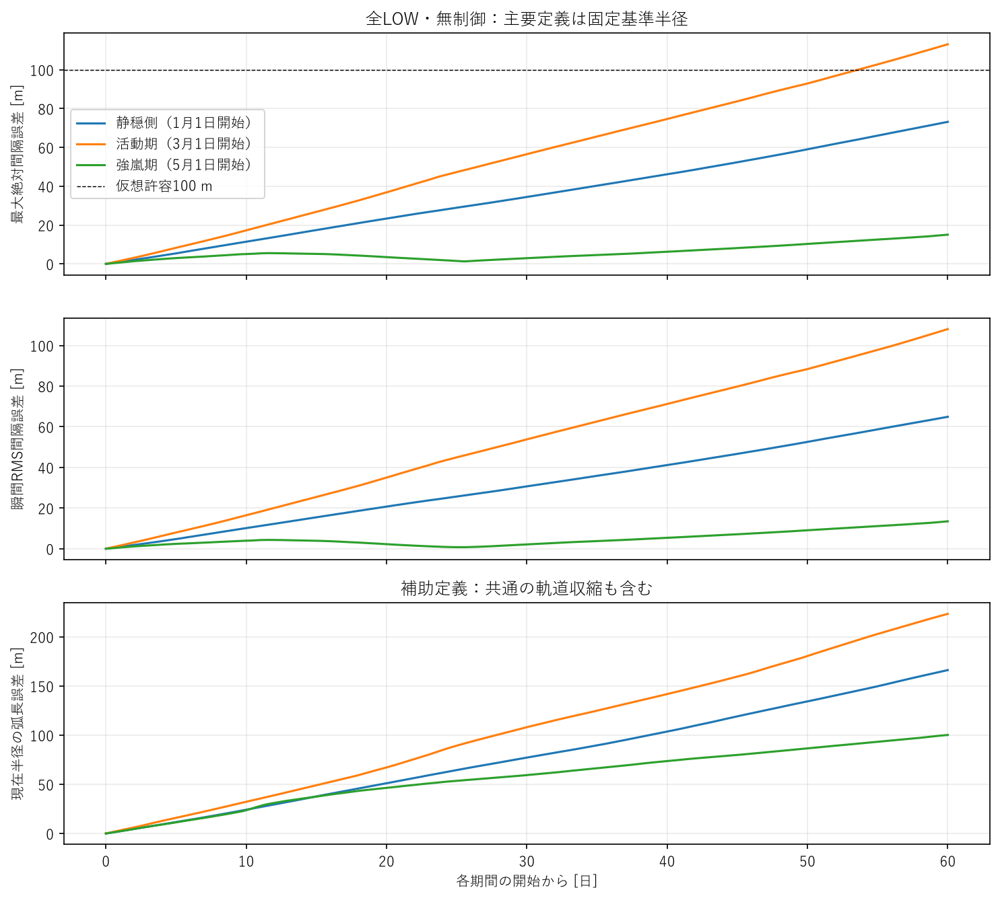
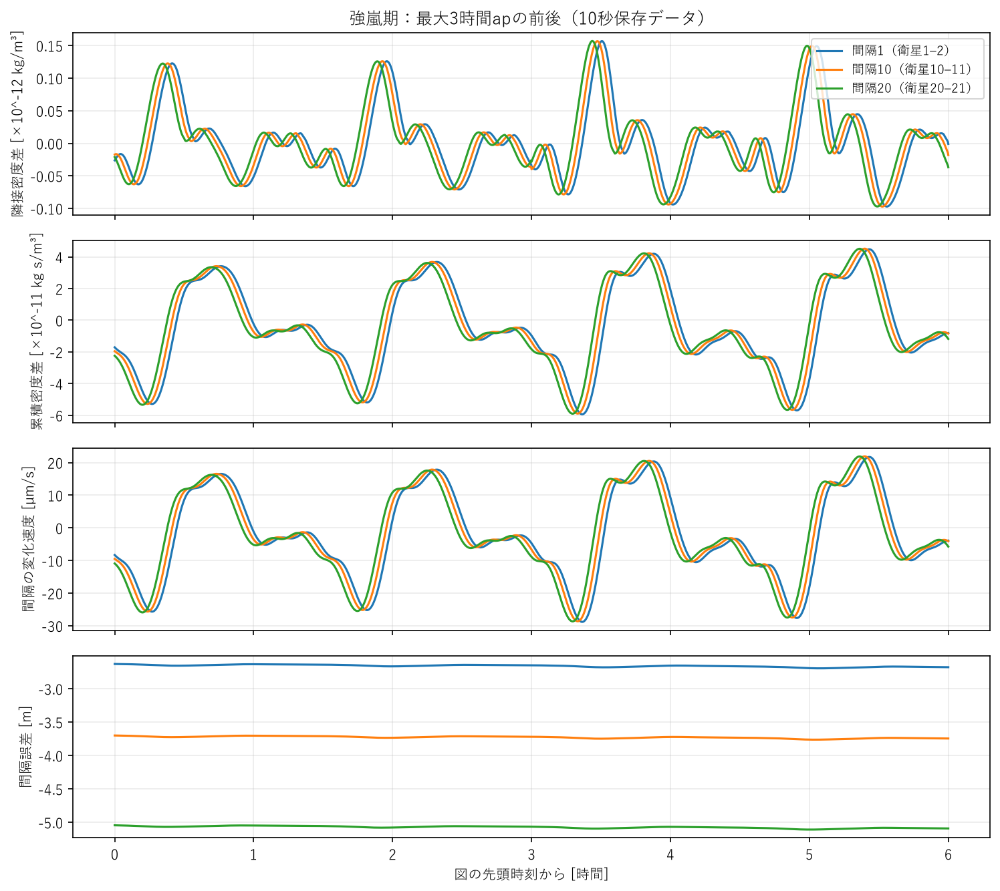
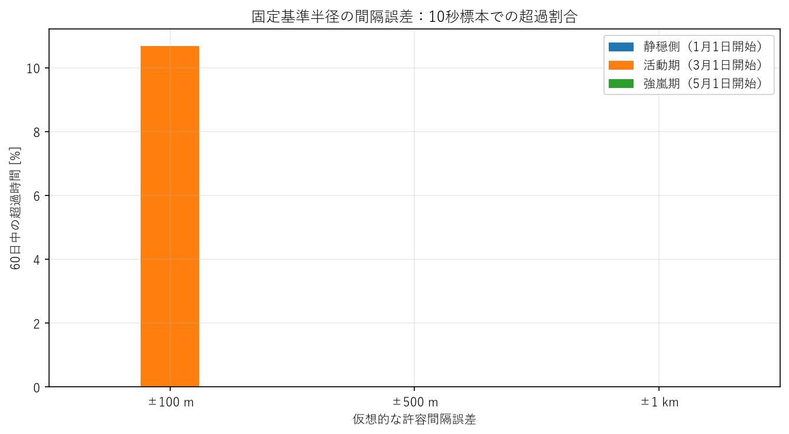
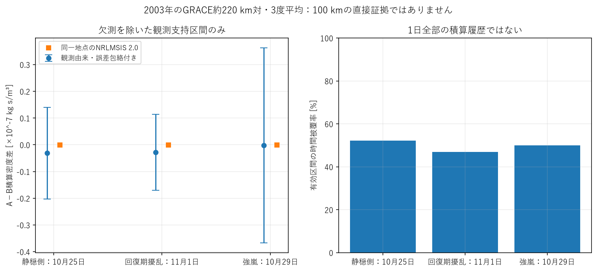

# 詳細技術付録

## 1. 観測・解釈・未確定

**計算で得られたこと：** 以下は既存平均軌道モデルとNRLMSIS 2.0の保存軌道の後処理値である。観測密度は加速度計観測から推定された量である。

**そこから言えること：** 選定した環境・軌道・期間での差動抗力と間隔誤差の規模を判断できる。積算差と速度の関係は元ODEの恒等関係でもあるため、独立な観測による因果証明と区別する。

**まだ言えないこと：** 全軌道面・実大気の上限、永久安定性、実ミッション要求、実測100 km対の60日誤差は未確定。NRLMSISは平均的な経験モデルで、個々のTADを再現しない。[原論文](https://agupubs.onlinelibrary.wiley.com/doi/full/10.1029/2020ea001321)。

## 2. PHASE 1の停止判断

[原典別の確認結果](PHASE1.md)を参照。新しい成長・減衰モデルは0ケース。波周期と包絡成長を混同しない。既存1回通過の結果を覆すために任意の時間窓は置いていない。隣接100 kmの通過時差は旧1D比較で約13〜14秒、列全体では約4〜5分であり、両者も区別する。

## 3. 宇宙天気選定・固定入力

選定は2024年Jan/Mar/May/Jul/Sep/Novの1日から各60日を候補とし、各クラスで観測入力が完全な最初の期間を採用。quietは最大Kp<5かつ最低Dst>−50、activeはKp>=5の日が2日以上かつ−250<最低Dst<=−100、strongは最低Dst<=−250 nT。これは研究上の区分で、公式嵐分類やSYM-HをDstへ置き換えた区分ではない。[全候補と凍結driver](data/weather_selection.json)。

| 環境 | UTC開始〜終了（終了を含まない） | 最大Kp | 最低Dst [nT] | Kp>=5の日数 | 平均観測F10.7 [sfu] | 初期中央地方時 [h] |
|---|---|---:|---:|---:|---:|---:|
| 静穏側 | 2024-01-01〜2024-03-01 | 4.3 | -27 | 0 | 168.4 | 17.34 |
| 活動期 | 2024-03-01〜2024-04-30 | 8.3 | -128 | 7 | 158.7 | 13.40 |
| 強嵐期 | 2024-05-01〜2024-06-30 | 9.0 | -406 | 10 | 186.9 | 9.39 |

Januaryは既存runを再利用した。normalized物理・数値設定、初期状態、保存時刻は機械的に一致確認した。変わるのはepochと宇宙天気系列。N21、400 km、100 km、4 kg、Cd2.2、LOW0.01 m²、RK4最大2秒・保存10秒、傾斜51.6度・RAAN0を固定し、制御・人工外乱はOFF。F10.7/centered81と7成分Apは[CelesTrak公式仕様](https://celestrak.org/SpaceData/SpaceWx-format.php)、Dst/Kpは[NASA OMNI仕様](https://omniweb.gsfc.nasa.gov/html/ow_data.html)を確認。入力を公開CSVへ凍結し、実際の系列に欠損補完はない。

## 4. 60日結果と誤差定義

主要指標は従来の固定基準半径誤差。現在半径の弧長は共通高度低下も含む別の補助量である。[定義・式・限界](metrics_and_limits.md)。

| 環境 | 最大 [m] | RMS [m] | 終了最大 [m] | 100km比 [%] | 最大速度 [µm/s] | 終了max abs(ΔJρ) [kg s/m³] | 弧長最大 [m] | 平均高度損失 [m] |
|---|---:|---:|---:|---:|---:|---:|---:|---:|
| 静穏側 | 73.171 | 36.274 | 73.170 | 0.0732 | 30.271 | 1.111e-11 | 166.140 | 6306.3 |
| 活動期 | 113.126 | 61.585 | 113.126 | 0.1131 | 47.099 | 2.693e-11 | 223.293 | 7475.8 |
| 強嵐期 | 15.046 | 5.973 | 15.046 | 0.0150 | 35.227 | 3.260e-11 | 100.189 | 7547.7 |

この表の細かい桁は保存軌道の再現用で、実環境や直接モデル解の精度を意味しない。高度損失は初期半径−終了半径を21機平均した通常の全LOW損失であり、「制御の追加高度損失」ではない。

| 環境 | 終了max abs(ΔJdrag) [m/s] | 終了最大gap速度 [m/s] | 最後14日・最大誤差の傾き [m/day] |
|---|---:|---:|---:|
| 静穏側 | 1.798e-06 | 5.400e-06 | 1.402 |
| 活動期 | 4.359e-06 | 1.309e-05 | 1.959 |
| 強嵐期 | 5.278e-06 | 1.585e-05 | 0.455 |

NRLMSISは継続して作用しており、終了時速度を「外乱後一定の残留速度」として60日以降へ直線外挿しない。初期地方時・季節・太陽活動が違うため、強い嵐ほど必ず最大誤差が大きいとの法則も主張しない。最後14日の正の傾きがある期間は180日を調べる価値があるが、今回180日・1年runは実施せず、まず数値精度・要求・観測の識別性を優先する。

## 5. 仮想許容誤差の超過

これは実ミッション要求ではない。10秒標本のstrict >、時間割合は左端標本保持、最後の標本は長さ0で計算した。

| 環境 | 許容 [m] | 初回超過 [day] | 超過 [%] | 最大連続超過 [day] |
|---|---:|---:|---:|---:|
| 静穏側 | 100 | なし | 0.000 | 0.000 |
| 静穏側 | 500 | なし | 0.000 | 0.000 |
| 静穏側 | 1000 | なし | 0.000 | 0.000 |
| 活動期 | 100 | 53.597 | 10.672 | 6.403 |
| 活動期 | 500 | なし | 0.000 | 0.000 |
| 活動期 | 1000 | なし | 0.000 | 0.000 |
| 強嵐期 | 100 | なし | 0.000 | 0.000 |
| 強嵐期 | 500 | なし | 0.000 | 0.000 |
| 強嵐期 | 1000 | なし | 0.000 | 0.000 |

現在半径弧長での超過統計は各 `data/*_metrics.json` に別保存。共通の軌道収縮を相対密度差による誤差と呼ばない。

## 6. PHASE 3のgo判断と観測支持区間

PHASE 2だけでは個別構造を含む実環境を判断できないため、キャッシュ済み観測の小規模後処理へ進んだ。新しい21機観測入力シミュレーションは0件。[Sutton v2.3製品仕様](https://zenodo.org/records/13287614)の3度平均GRACE A/Bを利用。加速度計観測から推定された密度であり、100 kmを直接解像したデータではない。気候学的分布や上位percentileは推定しない。

選定は既存driver supportの2003-10-25〜11-23内で、地磁気指標だけから各クラスの最初の1日を採用。[選定一覧](data/grace_window_selection.json)。quietは地磁気のみを意味し太陽活動は高い。disturbedはHalloween嵐の回復期であり、3つの独立嵐ではない。

| 観測日・区分 | 被覆 [h] | 最長連続 [min] | 同時刻J_A−J_B [kg s/m³] | 同地点近似J差 | 誤差包絡 | 一定校正ずれ相当 [%] |
|---|---:|---:|---:|---:|---:|---:|
| quiet | 12.51 | 31.90 | -3.143e-09 | -3.032e-09 | 1.711e-08 | 1.911 |
| disturbed | 11.25 | 37.04 | -2.831e-09 | -2.875e-09 | 1.418e-08 | 2.117 |
| severe | 11.99 | 26.98 | -1.901e-10 | -1.895e-09 | 3.649e-08 | 0.055 |

これらは有効支持区間の和で、欠測を含む1日全体や60日の持続積算差ではない。σの包絡、位置合わせ後の残る数kmの差、約220 kmの対間隔、300〜350 km平均、400 km規格化の仮定がある。観測由来値が同じ位置のモデルより大きくても、持続する100 km差動密度を識別したとは言えない。各区間の符号を残し、平均を引いて積算差を強制的に0にしていない。詳細は `grace_integrated_summary.json` と `grace_segments.csv`。

## 7. 数値検証・回帰・テスト

密度120秒キャッシュは各実runの保存位置と内部時刻で直接NRLMSIS2.0に照合した。すべて0.001相対誤差基準内。最大3時間apの約3軌道について10/30/60/120秒と直接2秒密度の収束も確認し、120秒の間隔への影響診断は約0.000508 mだった。ただし、これは60日の物理軌道の収束証明ではない。

静穏期の全10,886,421密度点の直接再評価では、最大相対密度誤差8.365e-05、最大累積隣接誤差8.769e-13 kg s/m³、凍結軌道による間隔差診断0.987 m。追加の全履歴1%基準（0.732 m）は**不合格**。これは単体テストや24時間回帰の失敗ではない。既存runを勝手に置き換えず、この精度限界を保持した。軌道・密度feedbackを再伝播した誤差上界ではなく、100 m近傍の厳密境界を議論する前に改善が必要。

新しい積算恒等式・符号・欠測非補間・誤差包絡・宇宙天気分類の14テストを含め、**245テスト合格**。24時間referenceは保存済み再計算suiteから集計・全イベント・主要時系列を照合し、3ケースとも合格。core変更はない。旧成果8404ファイルのSHA256保持検査を別保存する。

| 全保存位置の補間監査 | 間隔差診断 [m] | 追加基準 [m] | 判定 |
|---|---:|---:|---|
| 静穏側 | 0.987 | 0.732 | 不合格 |
| 活動期 | 0.857 | 1.131 | 合格 |
| 強嵐期 | 1.079 | 0.150 | 不合格 |

各監査JSONとソフトウェア検証記録は `data/` に保存した。補間を含む長期精度の厳密な合格とは扱わない。特に境界近くの要求判定には、より細かい密度キャッシュまたは直接評価軌道との収束確認が必要。

## 8. 最終10問

1. 4〜5分で全構造が不変とは言えない。局所の包絡変化率を観測で拘束できず、任意の成長・減衰modelは作らなかった。
2. 単発・時間不変TADの1回通過を大きな長期誤差の主要因とする根拠は今回残らない。継続forcingや急速生成を一般に否定するものではない。
3. 静穏側は73.171 m。
4. 活動期は113.126 m。
5. 強嵐期は15.046 m。
6. 元ODEでは積算密度から半径・速度への関係が導ける。位置誤差にはその速度履歴の積算が必要で、最終ΔJρや3期間の最大値だけでは説明しない。
7. 観測由来支持区間の差は推定できたが、付属密度誤差の積算包絡内で欠測もあり、NRLMSISを上回る持続した実差動積算密度は識別できていない。
8. この平均モデルで得た最大は113.1 m。100 km対・400 kmの実観測から数百m〜km級を確定したわけではない。
9. 100 mを超える環境はありますが、km級ではありません。「100 km列には制御が必須」という一般的主張は支持されません。精度要求によって必要性が変わる領域なので、制御性能の最適化より適用限界を先に調べるべきです。
10. 制御最適化を主題から外す（要求境界・適用限界の確認を先行）。追加の制御パラメータ計算は0件。

## 9. Git・再現・変更内容

branch：`astra/real-environment-applicability`。mainへのmergeなし。新しい物理runは活動期・強嵐期の2件のみ、既存静穏期を再利用。新しい追加は `environment_integrals.py`、選定・集計・密度精度監査・GRACE積算・描画・文書出力scripts、3条件の環境YAML、14 tests、この報告書・小さいCSV/JSON/図。既存core/config/runは変更していない。

[再現手順と主要コマンド](reproduction.md)。生観測・大NPZはローカルのみ。最終commit hashは `git log -2 --oneline` と完了回答で確認できる。
