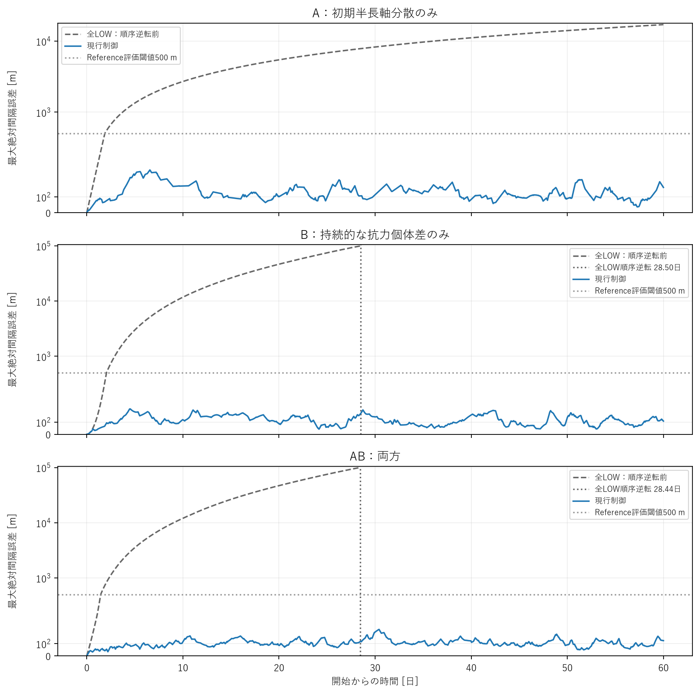
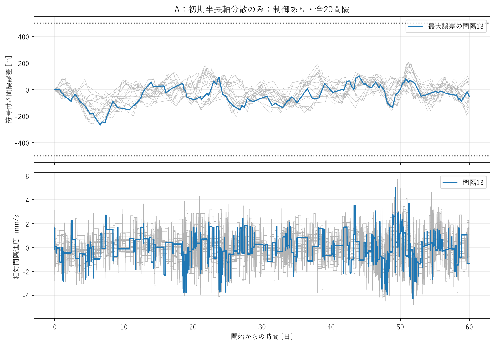
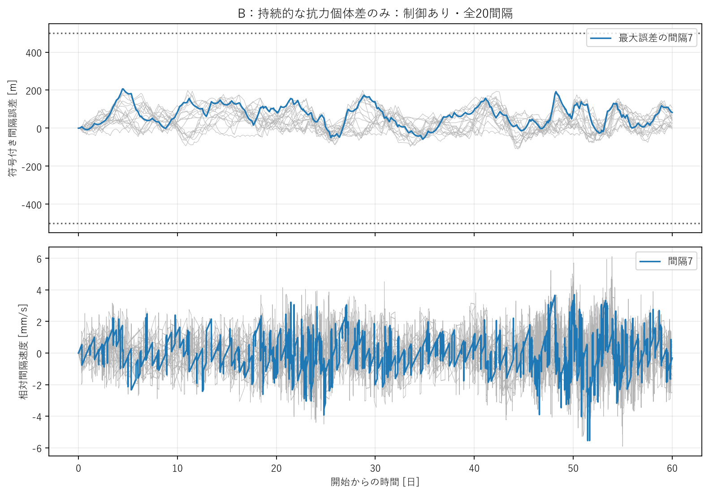
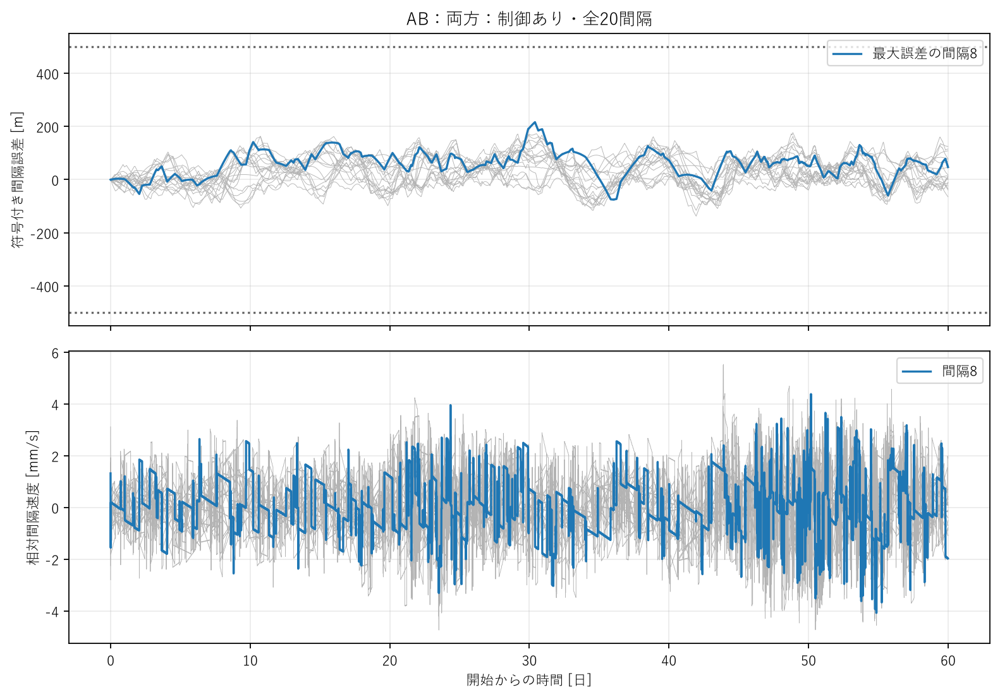
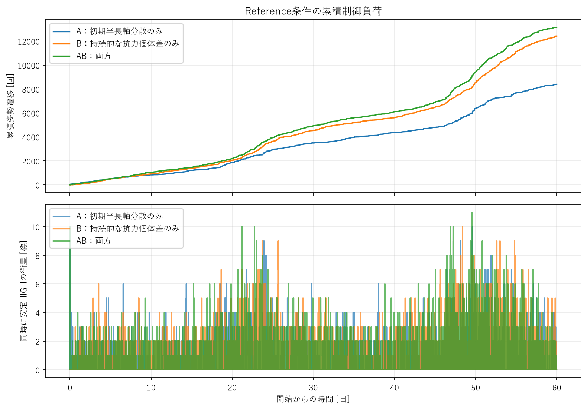
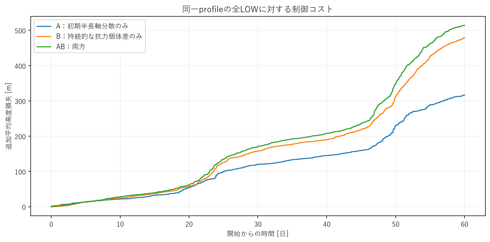

# 研究判断用サマリー

## 1. 結論

Reference 0.5 m / 0.5%条件で、現行controllerはA/B/ABすべての衛星順序を保ち、60日間500 m以内を維持できた。ただし、精度を保つための姿勢切替は60日末まで続き、制御が停止して落ち着いたとは言えない。無制御ではAもkm級へdriftし、B・ABは約1か月で番号順序が逆転した。したがって、この固定条件は今後の制御機構解析に使える一方、現行controllerの効率が十分とはまだ判断できない。

> 0.5 m・0.5%は実機母集団から推定された統計的nominal値ではなく、文献で確認された現実的な桁を踏まえた工学的Reference sensitivity conditionである。

## 2. 主要表

| Case | 全LOW・60日 | 制御最大誤差 [m] | 完了L-H-L [回] | 追加平均高度損失 [m] |
| --- | --- | --- | --- | --- |
| A | 17.02 km | 270.05 | 4198 | 316.70 |
| B | 28.4968日で順序逆転 | 206.92 | 6213 | 479.25 |
| AB | 28.4420日で順序逆転 | 215.85 | 6572 | 514.15 |

誤差は従来の固定基準半径での100 km間隔からのずれ。B・ABの逆転後を正常な精度として比較していない。500 mはReference評価閾値であり、実ミッション要求ではない。3ケースとも100 m閾値は超過したが、500/1000 m閾値の超過はなかった。

## 3. A-ref：初期残差のみ

無制御の最大誤差は30日8.25 km、60日17.02 km。制御は270.05 mへ抑えたが、初期補正後も再切替した。「最初に直せば終わる」挙動は確認できず、残る速度差と二値パルスの影響を調べる必要がある。

## 4. B-ref：持続個体差のみ

無制御は28.4968日で順序逆転した。制御は206.92 mまで抑え、持続する抗力差へ継続的に反応した。原因自体が消えないため、切替が続くことを初期条件補正と同一視できない。

## 5. AB-ref：両方

同じA配置と同じB配置を組み合わせた結果、制御最大誤差は215.85 m。A/Bの最大誤差を足した値にはならない。各gapでの打消し・強め合いと切替時刻の変化を含む、二値制御の応答として読むべきである。

## 6. Low conditionとの比較

旧Aのsample標準偏差は0.1134 m、旧Bは0.2304%。今回の実配列倍率は約4.41倍・2.17倍で、名目値比とは異なる。旧ABは配置も異なるため、純粋な分散倍率比較には使えない。制御下の誤差・cycle数・高度コストは単純比例せず、旧結果より誤差が小さくなる場合もあった。

## 7. 次の判断

1. このprofile・大気・controllerを固定し、最小HIGHパルスが残す半長軸差・速度差を先に調べる。
2. その結果を踏まえ、dwellの役割を別実験で評価する。今回のrunでは調整していない。
3. ゲイン探索やcontroller再設計は、パルス由来の負荷を理解した後に判断する。

# 詳細技術付録

## A. Reference profile definition

保存済みA seed 4、B生成seed 10002を再使用した。新しい乱数探索はない。B旧ケース名の末尾「2」は生成seed 10002を表す。ABの半長軸offsetはAと、固定抗力倍率はBと完全一致する。21機の数値は[profiles.json](data/profiles.json)および[reference_profiles.csv](data/reference_profiles.csv)へ固定した。

## B. realized standard deviation

今回の「0.5」は最大値ではなく21要素のsample標準偏差である。平均を引いてから規格化し、ddof=1を使用した。

| Case | 保存offsetのsample std [m] | 初期aから再算出 [m] | εのsample std | 初期最大\|e\| [m] |
| --- | --- | --- | --- | --- |
| A | 0.500000000 | 0.499999999949 | 0.000000000 | 0.000000000082 |
| B | 0.000000000 | 0.000000000000 | 0.005000000 | 0.000000000082 |
| AB | 0.500000000 | 0.499999999949 | 0.005000000 | 0.000000000082 |

半長軸へ加算した後の約5×10^-11 mの標準偏差差は浮動小数点の丸め。位置は変えていない。A/AB初期最大gap速度は約3.118 mm/sで、円軌道一次近似との差は約2.0×10^-10 m/s。

`δa = 0.5 (z-mean(z))/std(z,ddof=1)`、`ε = 0.005 (z-mean(z))/std(z,ddof=1)`。これは元の配置を保ちながら、平均0と指定sample標準偏差をそろえる操作である。

## C. all LOW results

Aは60日でも順序を保つがdriftが蓄積する。B/ABは順序逆転するため、その後の固定番号誤差を正常な編隊精度と解釈しない。

| Case | 日数 | 逆転前max [m] | 全時間の固定番号max（診断）[m] | 初回逆転 [日] | 最小signed gap [m] |
| --- | --- | --- | --- | --- | --- |
| A | 30 | 8,247.56 | 8,247.56 | — | 92,483.05 |
| B | 30 | 99,999.36 | 111,973.34 | 28.4968 | -11,973.34 |
| AB | 30 | 99,999.17 | 112,420.65 | 28.4420 | -12,420.65 |
| A | 60 | 17,016.57 | 17,016.57 | — | 84,497.41 |
| B | 60 | 99,999.36 | 492,324.28 | 28.4968 | -392,324.28 |
| AB | 60 | 99,999.17 | 493,248.28 | 28.4420 | -393,248.28 |

逆転の判定分解能は10 s。衝突・衛星間相互作用を含まない平均軌道モデルなので、逆転後OFFは反実仮想の診断軌道としてのみ保存する。

## D. control results

制御ONの精度は全観測時間で評価できる。最大誤差が小さくても、終了時速度差や後半の切替が残ることは収束とは異なる。

| Case | 日数 | 最大 [m] | 全体RMS [m] | 終了時max [m] | 最大gap速度 [mm/s] | 最終完了 [日] |
| --- | --- | --- | --- | --- | --- | --- |
| A | 30 | 270.05 | 84.32 | 113.43 | 5.395 | 29.9772 |
| B | 30 | 206.92 | 72.95 | 141.48 | 4.508 | 29.9653 |
| AB | 30 | 193.89 | 58.93 | 193.89 | 4.745 | 29.9781 |
| A | 60 | 270.05 | 76.00 | 159.69 | 5.725 | 59.9646 |
| B | 60 | 206.92 | 67.59 | 107.43 | 6.119 | 59.8924 |
| AB | 60 | 215.85 | 59.66 | 124.13 | 5.531 | 59.9654 |

RMS = sqrt(mean(e_i(t)^2))：全保存時刻・全20gapを同じ重みで平均する。gap別RMS、最小全衛星対距離、現在半径の弧長誤差は各metrics.jsonに保存した。主要誤差はa0で換算し、現在半径上の物理弧長とは混同しない。

### 同一の順序逆転前時間窓での改善

B/ABの全60日OFF誤差による削減率を主指標にしない。OFFが逆転する直前の保存サンプルまで、ONも同じ時間窓へ切り詰めた。

| Case | 共通窓の終端 [日] | OFF max [m] | ON max [m] | max削減率 [%] | OFF RMS [m] | ON RMS [m] |
| --- | --- | --- | --- | --- | --- | --- |
| A | 60.0000 | 17,016.57 | 270.05 | 98.41 | 4,383.10 | 76.00 |
| B | 28.4966 | 99,999.36 | 206.92 | 99.79 | 21,507.70 | 71.66 |
| AB | 28.4419 | 99,999.17 | 162.96 | 99.84 | 21,817.92 | 56.50 |

## E. threshold statistics

100/500/1000 mはstrict/reference/loose評価閾値。実ミッション要求ではない。ONの500 m維持は保存時刻上の結果であり、保存間の連続時間保証ではない。

| Case | 状態 | 閾値 [m] | 初回超過 [日] | 超過時間率 [%] | 最長連続超過 [日] |
| --- | --- | --- | --- | --- | --- |
| A | ON | 100 | 3.1789 | 67.25 | 9.0698 |
| A | ON | 500 | — | 0.00 | 0.0000 |
| A | ON | 1000 | — | 0.00 | 0.0000 |
| A | OFF | 100 | 0.3733 | 99.38 | 59.6267 |
| A | OFF | 500 | 1.8638 | 96.89 | 58.1362 |
| A | OFF | 1000 | 3.7221 | 93.80 | 56.2779 |
| B | ON | 100 | 3.2600 | 59.19 | 10.0649 |
| B | ON | 500 | — | 0.00 | 0.0000 |
| B | ON | 1000 | — | 0.00 | 0.0000 |
| B | OFF | 100 | 0.8992 | 98.50 | 59.1008 |
| B | OFF | 500 | 2.0384 | 96.60 | 57.9616 |
| B | OFF | 1000 | 2.9002 | 95.17 | 57.0998 |
| AB | ON | 100 | 4.0718 | 50.47 | 4.6888 |
| AB | ON | 500 | — | 0.00 | 0.0000 |
| AB | ON | 1000 | — | 0.00 | 0.0000 |
| AB | OFF | 100 | 0.3554 | 99.41 | 59.6446 |
| AB | OFF | 500 | 1.4443 | 97.59 | 58.5557 |
| AB | OFF | 1000 | 2.3147 | 96.14 | 57.6853 |

OFFの全60日時間率には逆転後の診断区間を含む。通常の精度として使える逆転前のON/OFF閾値統計は各metricsの`matched_pre_allLOW_reversal_thresholds`へ別保存した。期間長に依存する時間率を混同しない。

## F. switching statistics

精度維持の裏側で、繰返し姿勢変更を要している。回数はslew開始、完了L-H-LはLOW帰還完了を数える。

| Case | L→H | H→L | 全開始 | 全完了 | 完了cycle | stable HIGH [衛星h] | HIGH相当 [衛星h] | 同時HIGH最大 [機] |
| --- | --- | --- | --- | --- | --- | --- | --- | --- |
| A | 4198 | 4198 | 8396 | 8396 | 4198 | 350.82 | 490.76 | 10 |
| B | 6213 | 6213 | 12426 | 12426 | 6213 | 518.54 | 725.64 | 10 |
| AB | 6572 | 6572 | 13144 | 13144 | 6572 | 548.41 | 767.48 | 11 |

HIGH相当時間はintegral((A-A_LOW)/(A_HIGH-A_LOW)dt)を全衛星で合計し、slew中も含む。stable HIGHは姿勢変更完了後のHIGHだけ。衛星別回数・cycle数・最終姿勢・高度は各`satellites.csv`に保存した。command/開始/完了の全時刻は`events.csv`にある。

### 0–7 / 7–30 / 30–60日の運用負荷

後半の活動が停止するか、精度と負荷がどう変わるかを区間別に確認する。率の大小だけで定常性や増大を証明するものではない。

| Case | 区間 [日] | RMS [m] | 遷移/日 | cycle/日 | HIGH相当 [衛星h/日] | 追加高度損失 [m/日] |
| --- | --- | --- | --- | --- | --- | --- |
| A | 0-7 | 103.21 | 92.29 | 46.14 | 5.39 | 2.454 |
| A | 7-30 | 77.67 | 124.00 | 62.00 | 7.25 | 4.471 |
| A | 30-60 | 66.65 | 163.27 | 81.63 | 9.54 | 6.556 |
| B | 0-7 | 70.82 | 96.57 | 48.29 | 5.63 | 2.634 |
| B | 7-30 | 73.59 | 168.17 | 84.09 | 9.82 | 6.070 |
| B | 30-60 | 61.76 | 262.73 | 131.37 | 15.35 | 10.707 |
| AB | 0-7 | 32.04 | 96.86 | 48.43 | 5.65 | 2.603 |
| AB | 7-30 | 64.94 | 185.04 | 92.52 | 10.81 | 6.658 |
| AB | 30-60 | 60.38 | 273.67 | 136.83 | 15.98 | 11.427 |

## G. altitude cost

追加損失は通常の大気抵抗で全衛星が下がった量とは別である。同一profileの全LOWとONを同じ時刻で比較する。

| Case | 追加平均損失 [m] | 全LOW自然平均損失 [m] | ON最終平均高度 [km] | ON最終高度幅 [m] | OFF最終高度幅 [m] |
| --- | --- | --- | --- | --- | --- |
| A | 316.70 | 7,475.77 | 392.208 | 4.94 | 2.06 |
| B | 479.25 | 7,475.78 | 392.045 | 5.87 | 166.89 |
| AB | 514.15 | 7,475.78 | 392.010 | 3.98 | 167.88 |

Δh_extra=mean(a_OFF-a_ON)。正なら制御が余計に軌道半径を下げた。OFF逆転後も高度は番号ごとの反実仮想軌道として計算できるが、安全な運用基準と見なさない。高度コストをそのまま寿命短縮日数へ換算していない。

## H. A/B/AB comparison・q診断

A/ABは初期速度差があるため時刻0でHIGH条件を満たす。BはLOW中に抗力差から半長軸差・速度差が育つ。この違いを、最初のtriggerとLOW帰還後の状態で区別する。

| Case | 初回HIGH [s] | 代表衛星 | 初回qP [m/s²] | 初回qD [m/s²] | 初回局所LOW完了 [s] | その衛星の次HIGH [s] |
| --- | --- | --- | --- | --- | --- | --- |
| A | 0 | 3 | 0.0000e+00 | 1.9692e-07 | 540 | 930 |
| B | 26,610 | 18 | 3.5599e-08 | 1.1445e-07 | 27,150 | 55,690 |
| AB | 0 | 3 | 0.0000e+00 | 1.9692e-07 | 540 | 920 |

上表の「次HIGH」は最初にLOWへ戻った衛星自身の次回で、列全体の次回ではない。初回に同時起動した他衛星もイベントCSVに保持した。Aでも速度差が完全には消えず再切替する。Bには固定倍率差による再成長があり、一定D予測をそのまま適用できない区間がある。

| Case | P優勢起動 | D優勢起動 | 混合 | dwell300 s帰還 | 300 s後の帰還 | 840 s再起動間隔 |
| --- | --- | --- | --- | --- | --- | --- |
| A | 372 | 2839 | 987 | 4073 | 125 | 397 |
| B | 119 | 4528 | 1566 | 6117 | 96 | 503 |
| AB | 131 | 5081 | 1360 | 6474 | 98 | 565 |

P/D優勢は絶対値2:1以上の寄与分類で、符号と打消しも保存する。q=Kp·C e+Kd·C vで、Cは開いた列の隣接gap信号を前側−後側へ写す行列。端では片側だけを使う。ここでCはballistic coefficient Bとは別物。

120 sの往路slew＋300 sのHIGH dwell＋120 sの復路slew＋300 sのLOW dwellから、同一衛星の再起動下限840 sが生じる。最小パルスの詳細解析・dwell調整は今回実施しなかった。初回および観測後半の代表q、面積、姿勢、dwell解除時刻は`representative_triggers.csv`と小さいq時系列CSVに保存した。

### 静穏・残留状態・予測

一時的に全LOWへ戻ることと、制御が停止することは異なる。

| Case | 最長観測全LOW区間 [h] | 局所cycle後・全gap最大速度の中央値 [mm/s] | 関連gap最大速度中央値 [mm/s] | 最後の完了 [日] | 最終静穏candidate |
| --- | --- | --- | --- | --- | --- |
| A | 12.24 | 2.383 | 1.291 | 59.9646 | None |
| B | 8.79 | 2.352 | 1.313 | 59.8924 | None |
| AB | 7.71 | 2.332 | 1.290 | 59.9654 | None |

局所LOW帰還時に他衛星が制御中の場合も含むため、全gap最大速度の中央値だけで補正性能を決めない。符号付きe/v/P/D配列はローカルのend_states NPZへ保存した。最終静穏candidateは既存の50 m・1 mm/s・1800 sを満たす全LOWの最終連続区間であり、有限観測の定義である。

一定D予測はq(t)≈qP(t0)+qD(t0)+(Kp/Kd)qD(t0)(t−t0)で、dwellと10 s指令格子を加える。残留速度でP項が増えるという意味だが、B差や大気変動がDを変えると外挿が外れる。許容D変化10%などの有効性フラグは予測精度の保証ではない。各diagnosticsに実測との差・無効理由を保持した。

## I. low/reference comparison

A/Bは同じ空間配置を規格化した比較、旧ABは別配置を含む参考比較である。制御下で分散を大きくしても誤差や負荷が同じ倍率になる保証はない。

| Case | 旧条件（名目） | Reference | 旧max [m] | Ref max [m] | 旧cycle | Ref cycle | 旧追加損失 [m] | Ref追加損失 [m] |
| --- | --- | --- | --- | --- | --- | --- | --- | --- |
| A | 0.1 m | 0.5 m | 317.82 | 270.05 | 3780 | 4198 | 275.81 | 316.70 |
| B | 0.3% | 0.5% | 235.73 | 206.92 | 4885 | 6213 | 367.19 | 479.25 |
| AB | 0.1 m + 0.3% | 0.5 m + 0.5% | 224.26 | 215.85 | 5552 | 6572 | 422.32 | 514.15 |

旧A/Bの実現sample標準偏差は0.11342855 m / 0.23042064%。旧ABは0.08509592 m / 0.28987992%で、配置も違う。新しいOFFの1–7日は、NRLMSIS-onlyの誤差を差し引くと実配列倍率にほぼ比例した。7日RMS比例差はA約0.0083%、B約0.0020%。[比例性確認](data/early_OFF_proportionality.json)は保存済みrunだけで計算した。順序逆転後や長期までの完全比例を主張しない。

## J. verification / regression

解析の追加によって既存baselineを変えていないことを確認した。

- 全テスト **283件合格**。新規10件は規格化、共有profile、不正入力、初期間隔、共通時間窓、cycle区間計数を検証。
- 分散ゼロの新しい実行経路で24時間3ケースを新規照合。最大誤差・RMS・全イベント・高度損失・左右切替波速度・主要時系列がsoftware referenceと一致。
- 30→60日境界のa/lambda/area/modeは完全一致。30日までのイベント列も完全一致。密度キャッシュ再起動の差は既存の厳しい照合範囲に収まった。
- ON/OFFの初期状態・profile・大気・宇宙天気・積分条件を機械比較し、物理上の違いが制御ON/OFFだけであることを確認。
- 新軌道上で直接NRLMSISと密度cacheをspot照合。30/60日とも既存の相対差0.1%基準に合格。
- 旧追跡ファイルのSHA256、旧ローカルrunのサイズ・mtimeが不変。大きな旧runの全内容を再ハッシュした検証ではない。

[検証JSON](data/verification.json)、[回帰JSON](data/regression_24h.json)、[非破壊JSON](data/preservation.json)。24時間referenceはsoftware regression用で、制御の科学的妥当性を証明するものではない。

## K. reproduction・図

[再現手順](REPRODUCTION.md)に実行順序、評価定義、checkpoint継続、後処理のみの再利用方法を記載した。新規物理計算は6ケースの0–30日と同じcheckpointからの30–60日だけであり、旧run・旧profileを再計算していない。

図1はOFFを逆転前まで表示。図2–4は全20gapと代表gap速度。図5は累積遷移と同時HIGH数。図6は同一profileの全LOW比追加平均高度損失。描画用は60 s間引きにイベント時刻・最大誤差時刻を追加し、metricsは10 s全保存データから計算した。

## L. Git・変更内容

作業branch：`astra/reference-dispersion-baseline`。起点commit：`4f34e5e7b7ad5de26b7c761aa6057528ea41ab24`。mainへmergeしない。今回のcommit hashは最終応答と`git log -1`で確認できる。

- `src/sat_string/reference_condition.py`：保存profileの規格化と凍結後の検査。
- `src/sat_string/reference_metrics.py`：既存評価への共通窓RMS・閾値統計・区間cycle率追加。
- `configs/reference_dispersion.yaml`と`run_reference_dispersion.py`：固定入力とcheckpoint実行。
- `analyze_reference_dispersion.py`、`audit_reference_density.py`：既存後処理・密度監査を再利用する薄い接続。
- `supplement_reference_results.py`、`reference_profile_metadata.py`、`check_reference_proportionality.py`：共有profile、旧条件比較、代表q、初期比例性。
- `check_reference_regression.py`、`preserve_reference_inputs.py`、`verify_reference_results.py`：24h分散ゼロ回帰、旧成果非破壊、境界・入力・監査確認。
- `plot_reference_dispersion.py`、`write_reference_report.py`、`tests/test_reference_condition.py`：6図、報告、10テスト。
- docsにはprofile、config、集計JSON/CSV、小さいcycle sample、イベント、6図、再現手順を保存。巨大な配列・全幅cycle表・全HIGH trigger表はローカル保存。

### 観測・解釈・未確定

**観測**：表の精度・順序・切替・高度損失は固定Referenceの数値結果。**解釈**：現行制御はこの入力に対し精度を保つが、繰返し切替と追加抗力を要する。**未確定**：実機分散の統計的代表性、500 mの実ミッション要求、永久安定性、許容できる姿勢負荷・寿命損失、他のprofileや宇宙天気への一般性。今回の結果だけで解決したとはしない。
