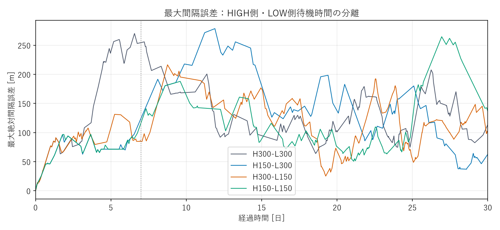
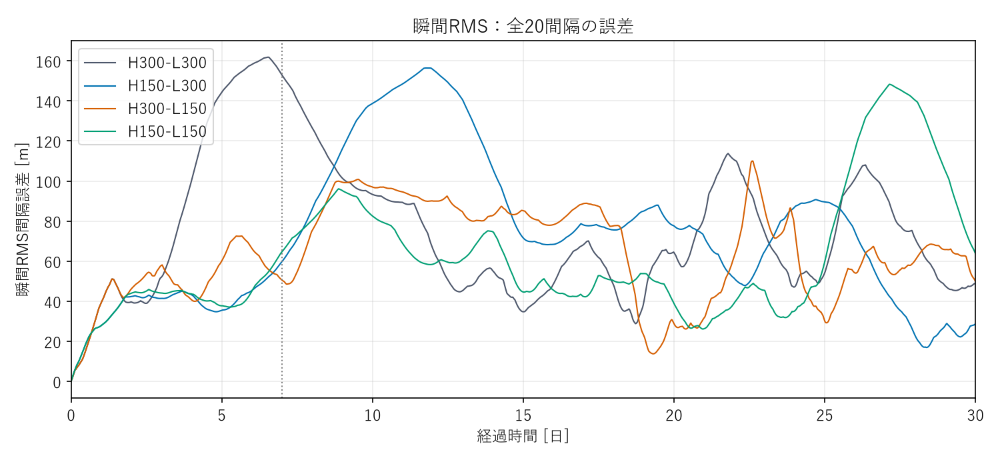
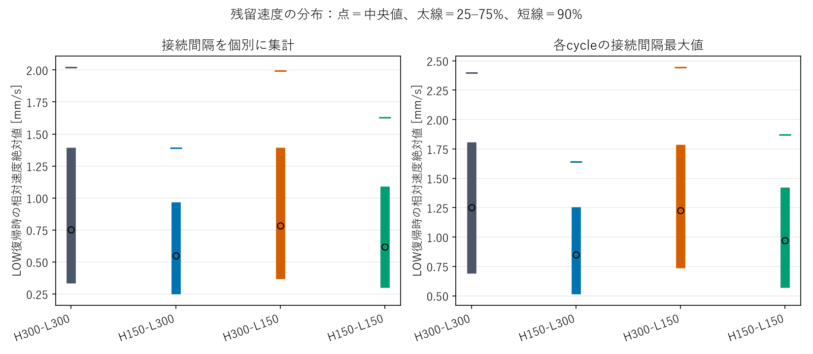
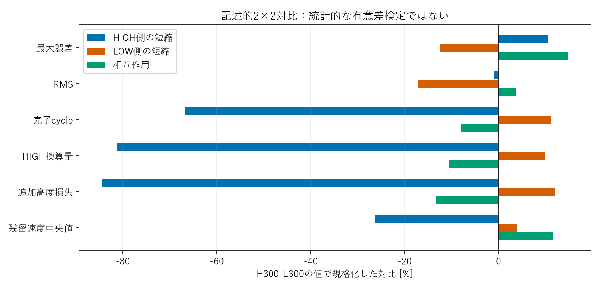
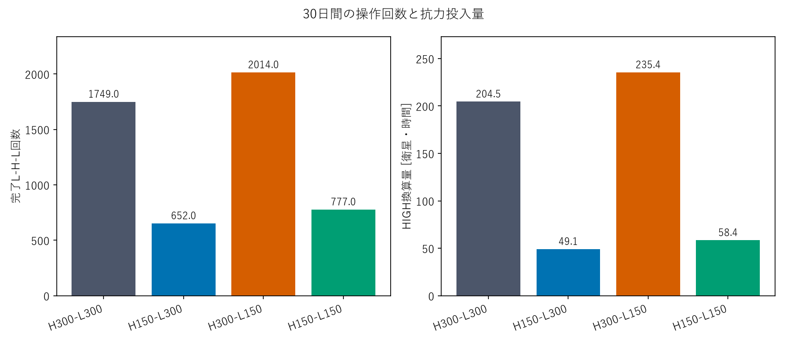
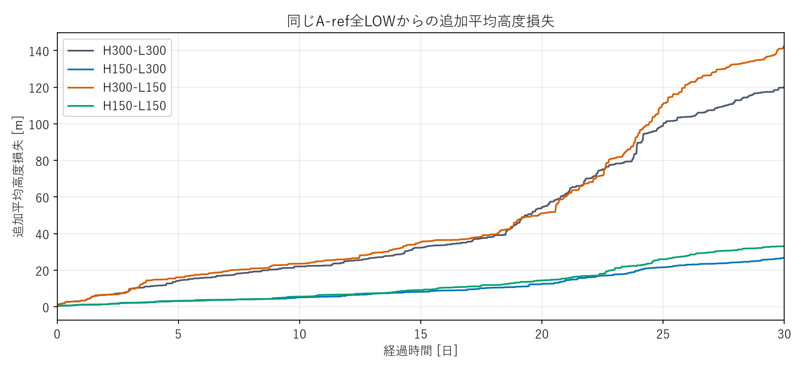

# 研究判断用サマリー

## 1. 結論

D150の低コスト化は、主に**HIGH側dwellの短縮による最小入力の縮小**で説明できます。LOW側短縮は低コスト化の原因ではなく、切替と高度損失を増やしながら誤差を小さくする方向へ作用しました。両側の相互作用はありますが、「両方を短くした場合だけ改善する」という結果ではありません。

## 2. 30日主要比較

| Case | 最大誤差 [m] | RMS [m] | 完了cycle | HIGH量 [衛星・h] | 追加高度損失 [m] |
|---|---|---|---|---|---|
| H300-L300 | 270.05 | 84.32 | 1749 | 204.51 | 120.01 |
| H150-L300 | 278.50 | 82.05 | 652 | 49.08 | 26.80 |
| H300-L150 | 216.32 | 68.33 | 2014 | 235.37 | 142.52 |
| H150-L150 | 264.54 | 69.15 | 777 | 58.42 | 33.18 |

HIGH量は全21機のHIGH換算時間の合計、高度損失は同じA-ref全LOWに対する追加平均値です。4条件とも衛星順序を保ち、500 mの仮想評価閾値内を30日維持しました。ただし100 m超過時間率は48.5〜68.5%であり、100 mを常時満たした条件はありません。

## 3. HIGH側の効果

LOW側を300秒に固定してHIGH側だけ短くすると、cycleは1,749→652回（62.7%減）、HIGH量は76.0%減、高度損失は77.7%減りました。1パルス自身の速度寄与中央値は2.408→1.409 mm/s、LOW復帰時の接続間隔最大速度のcycle別中央値は1.250→0.851 mm/sです。小さいパルスと小さい残留速度が、再切替低減に結びつく仮説を支持します。

ただし精度が全面的に改善したわけではありません。最大誤差は8.45 m増え、7〜30日のRMSは77.67→91.10 mへ悪化しました。LOW側150秒に固定した比較でも、HIGH短縮によるcycle・高度損失の削減は約61%・77%あり、低コスト効果は初週だけに限られません。

## 4. LOW側の効果

HIGH側300秒のままLOW側を短くすると、最大誤差は270.05→216.32 m、RMSは84.32→68.33 mへ改善しました。しかしcycleは1,749→2,014回、高度損失は120.01→142.52 mへ増えました。HIGH側150秒でも、LOW短縮はRMSを82.05→69.15 mへ改善する代わりに、cycleを652→777回へ増やしました。したがってLOW側は、早めに再反応して誤差を抑える代わりに操作負荷を払う要因です。

## 5. 相互作用と判断

記述的対比では、HIGH側短縮のcycle差は−1,167回、LOW側短縮は＋195回、相互作用は−140回でした。最大誤差の相互作用は39.76 mであり、精度と負荷を同じ一因子で説明することはできません。今回の判断は**A：HIGH側が主要な低コスト要因、B：LOW側にも独立した精度・負荷作用**です。統計的有意差や永久安定性を示すものではありません。

## 6. 次の判断

1. 最優先はH150-L300の60日確認。7日以降のRMS悪化が長期に続くかを確認する価値があります。
2. 精度との交換条件を長期比較する場合だけ、H300-L150も60日へ延長する候補です。今回はどちらも延長していません。
3. 150秒の最適性や実機許容性は未確定です。追加のdwell・ゲイン探索へは進まず、この因果分離結果を次の設計判断へ使います。

# 詳細技術付録

## A. state machineとdwell定義

HIGH側は1回の抗力入力の最小量、LOW側は復帰後の次指令の制約を変える。初期状態はLOWで指令可能であり、時刻0からLOW dwellを課す変更は行っていない。

状態遷移は「HIGH指令・上昇slew 120秒 → HIGH完了 → HIGH dwell → LOW指令・下降slew 120秒 → LOW完了 → LOW dwell → 次HIGH指令」。指令遅延0、判定周期10秒。

\[
T_{H,eq}=\int\frac{A(t)-A_L}{A_H-A_L}\,dt,\qquad
T_{H,eq,min}=120+T_H.
\]

120秒のsmoothstep slewは、上り・下りでそれぞれHIGH換算60秒になる。LOW待機時間はこの最小パルス量に直接は含まれない。

\[
T_{\mathrm{HIGH\ start\to LOW\ complete,min}}=240+T_H,
\quad T_{\mathrm{HIGH\ start\to next\ HIGH\ start,min}}=240+T_H+T_L.
\]

すべての時間が10秒判定格子に一致し、指令遅延0なので、この式に丸め待ち時間は加わらない。LOW完了から次HIGHまでの下限は単に `T_L`。一般の遅延・格子設定へ無条件にこの値を流用しない。

| 条件 | 最小HIGH換算 | HIGH開始→LOW完了 | HIGH開始→次HIGH | LOW完了→次HIGH |
|---|---:|---:|---:|---:|
| H300-L300 | 420 s | 540 s | 840 s | 300 s |
| H150-L300 | 270 s | 390 s | 690 s | 300 s |
| H300-L150 | 420 s | 540 s | 690 s | 150 s |
| H150-L150 | 270 s | 390 s | 540 s | 150 s |

## B. 実験条件

変更した物理入力はHIGH/LOW dwellだけ。新規30日runは交差2条件で、対角2条件と全LOWは保存runを再利用した。60日計算は実施していない。

固定A profileは既存の21個の実値をそのまま使った。sample std(ddof=1)は0.5 m、平均0、B倍率は全機1。初期半径の差を与え、初期間隔誤差は0のまま。
**0.5 mは実機母集団から推定した統計的nominal値ではなく、工学的Reference sensitivity conditionである。**

2024-03-01 00:00 UTC、NRLMSIS 2.0、pymsis 0.12.0、inclination 51.6度、RAAN 0、初期位相0、保存済みhistorical weatherを固定。密度キャッシュ120秒、RK4最大2秒、保存10秒。密度場の計算方法は同じだが、介入後に軌道が変われば評価位置と密度も変化する。他条件の密度時系列をコピーしていない。

Kp=1/21600²、Kd=2/21600、h_on=1.5×10⁻⁷、h_off=1.4×10⁻⁷ m/s²、control 10秒、slew 120秒、delay 0、質量4 kg、Cd=2.2、面積0.01/0.03 m²、21機、400 km、100 km間隔を固定。Gaussian、J2等は追加していない。

## C. regression / backward compatibility

古い単一dwell設定は同じ結果を返す。新しい任意キー `dwell_high_time_s` と `dwell_low_time_s` は、指定しない側について旧 `dwell_time_s` へ戻る。未指定キーは正規化ファイルへ追加しない。

新しい実装で300/300、150/150を明示した冒頭6時間は、保存済みD300/D150の全半径・位相・密度・面積・mode・全イベントと完全一致した。24時間の人工外乱3ケースは新規再計算して凍結fixtureと照合し、全イベント・全主要時系列・集計値・波速度の回帰が通った。

## D. spacing performance

主指標は固定基準半径の間隔誤差である。現在半径上の物理弧長誤差と混同しない。全期間RMSは保存10秒の全時刻・20間隔に対する平方平均平方根。仮想閾値100/500 mは実ミッション要求ではない。100 m超過時間率は、各時刻の全20間隔の最大絶対誤差が100 mを超えた時間割合。

| Case | 終了時最大 [m] | 100 m超過時間率 | 500 m超過 | 遷移数 | 最小物理距離 [km] |
|---|---|---|---|---|---|
| H300-L300 | 113.43 | 68.53% | なし | 3498 | 99.719 |
| H150-L300 | 62.64 | 64.08% | なし | 1304 | 99.703 |
| H300-L150 | 101.98 | 62.52% | なし | 4028 | 99.770 |
| H150-L150 | 136.34 | 48.47% | なし | 1554 | 99.688 |

区間別に見ると、初週だけの改善と7日以降の挙動を区別できる。区間RMSは既存定義と同じく両端sampleを含み、イベント・完了cycleは0–7日を右開、7–30日を右閉として重複計数しない。

| Case | 期間 [日] | RMS [m] | 最大 [m] | cycle/日 | 遷移/日 | HIGH換算 [衛星・h/日] | 追加高度損失 [m/日] |
|---|---|---|---|---|---|---|---|
| H300-L300 | 0–7 | 103.21 | 270.05 | 46.14 | 92.29 | 5.39 | 2.45 |
| H300-L300 | 7–30 | 77.67 | 255.70 | 62.00 | 124.00 | 7.25 | 4.47 |
| H150-L300 | 0–7 | 39.79 | 124.53 | 16.00 | 32.00 | 1.20 | 0.55 |
| H150-L300 | 7–30 | 91.10 | 278.50 | 23.48 | 46.96 | 1.77 | 1.00 |
| H300-L150 | 0–7 | 50.88 | 131.25 | 48.43 | 96.86 | 5.65 | 2.78 |
| H300-L150 | 7–30 | 72.82 | 216.32 | 72.83 | 145.65 | 8.51 | 5.35 |
| H150-L150 | 0–7 | 41.15 | 116.83 | 16.29 | 32.57 | 1.23 | 0.55 |
| H150-L150 | 7–30 | 75.64 | 264.54 | 28.83 | 57.65 | 2.17 | 1.28 |

## E. pulse size

HIGH側を短くすると理論最小量が減る。実際のHIGH保持は閾値条件によって延びるため、全cycleを一律270秒・420秒と置き換えずイベントから積分した。

| Case | 最小 [s] | 中央値 [s] | 75% [s] | 90% [s] | 最大 [s] | 理論最小一致 |
|---|---|---|---|---|---|---|
| H300-L300 | 420 | 420 | 420 | 420 | 520 | 96.80% |
| H150-L300 | 270 | 270 | 270 | 270 | 390 | 97.70% |
| H300-L150 | 420 | 420 | 420 | 420 | 520 | 97.72% |
| H150-L150 | 270 | 270 | 270 | 270 | 390 | 98.20% |

自身の1パルス速度寄与は、既存解析と同じく (g_j=a_{ref}n(a_j)) の追加抗力による変化を用いる。これはgap速度 (v_i=g_{i+1}-g_i) を構成する量で、衛星の実軌道速度 √(μ/a) の直接変化とは区別する。

\[
I_j=\int\frac{3a_{ref}\mu}{2a_j^2}\rho_j\frac{C_D}{m}(A_j-A_L)\,dt.
\]

この正の (I_j) が、その衛星の左右のgap速度へ逆符号で寄与する。実際の保存軌道上で10秒密度・状態を台形積分した寄与分解であり、近傍操作を消して再計算した別軌道ではない。

| Case | 最小 [mm/s] | 25% | 中央値 | 75% | 90% | 最大 |
|---|---|---|---|---|---|---|
| H300-L300 | 0.8510 | 1.7380 | 2.4084 | 2.9278 | 3.4115 | 5.0088 |
| H150-L300 | 0.5503 | 0.9400 | 1.4091 | 1.7890 | 2.1705 | 3.1654 |
| H300-L150 | 0.8592 | 1.7938 | 2.4534 | 3.0599 | 3.6324 | 5.2589 |
| H150-L150 | 0.5321 | 1.0599 | 1.4956 | 1.8126 | 2.2385 | 2.9881 |

単純な270/420倍を仮定していない。密度、起動時刻、状態履歴も変わるため、パルス寄与分布の比はこの時間比からずれ得る。

## F. residual velocity

LOW復帰時の相対速度を主指標とする。個別接続gapの分布と、各cycleで接続1〜2 gapの最大値を取った分布は別物なので、分けて示す。

| Case | 接続gap中央値 [mm/s] | 75% | 90% | 最大 | cycle最大の中央値 | 悪化方向割合 |
|---|---|---|---|---|---|---|
| H300-L300 | 0.7547 | 1.3944 | 2.0218 | 5.3745 | 1.2497 | 53.87% |
| H150-L300 | 0.5512 | 0.9701 | 1.3926 | 3.9140 | 0.8509 | 48.64% |
| H300-L150 | 0.7853 | 1.3934 | 1.9953 | 5.2094 | 1.2275 | 50.34% |
| H150-L150 | 0.6203 | 1.0916 | 1.6291 | 3.7252 | 0.9718 | 45.73% |

悪化方向割合は、LOW完了時の接続gap sampleで (e_i v_i>0) となる割合。隣接衛星のcycle同士で同じgapが重複するため、独立標本ではない。速度の符号反転だけを過補正とは呼ばない。

## G. re-trigger

待ち時間は同一衛星のLOW完了→次HIGH開始。次HIGHを30日内に観測できないcycleは右打切りで、無限待ち時間とも再切替なしとも扱わない。

| Case | 観測数 | 右打切り数 | 最小 [分] | 25% [h] | 中央値 [h] | 75% [h] | 90% [h] |
|---|---|---|---|---|---|---|---|
| H300-L300 | 1728 | 21 | 5.00 | 0.86 | 4.85 | 11.89 | 21.73 |
| H150-L300 | 631 | 21 | 5.00 | 7.24 | 17.49 | 31.86 | 48.51 |
| H300-L150 | 1993 | 21 | 2.50 | 0.94 | 4.09 | 10.45 | 18.41 |
| H150-L150 | 756 | 21 | 2.50 | 4.31 | 12.49 | 27.13 | 43.57 |

| Case | 30分以内 | 1時間以内 | LOW待機解除と同時 [件] | HIGH開始間隔が最短 [件] |
|---|---|---|---|---|
| H300-L300 | 21.84% | 25.87% | 154 | 148 |
| H150-L300 | 5.83% | 5.99% | 24 | 22 |
| H300-L150 | 22.85% | 25.71% | 50 | 46 |
| H150-L150 | 10.17% | 12.61% | 22 | 18 |

30分・1時間以内の割合は、当該時間内の再起動を観測したか、その時間以上追跡できたcycleを分母とする。観測された待ち時間だけの中央値は打切りの影響を受ける。分母・未確定数はcomparison.jsonに残した。

## H. all-LOW intervals

全21機がLOWで、未完了の指令もない時間を積算した。全LOW時間割合は実際の時間長で計算し、sample数の比ではない。観測終了へ続く区間は時間割合へ含め、継続時間の下限として別保存した。

| Case | 区間数 | 全LOW時間率 | 観測中央値 [h] | 75% [h] | 90% [h] | 観測最大 [h] | 右打切り区間 |
|---|---|---|---|---|---|---|---|
| H300-L300 | 378 | 82.18% | 1.00 | 2.13 | 3.89 | 12.24 | 1 |
| H150-L300 | 315 | 92.96% | 1.37 | 2.99 | 5.53 | 11.91 | 1 |
| H300-L150 | 398 | 80.62% | 0.97 | 1.93 | 3.44 | 16.40 | 1 |
| H150-L150 | 334 | 92.03% | 1.41 | 2.60 | 4.85 | 12.94 | 1 |

全LOW開始時に、各衛星のP/D状態と指令可能時刻から次HIGHを予測した。

\[
q_j(t_0+\tau)\simeq q_{P,j}(t_0)+q_{D,j}(t_0)
  +\frac{K_p}{K_d}q_{D,j}(t_0)\tau.
\]

残留速度がほぼ一定なら位置誤差由来のP項が一定の速さで育つ、という近似。LOW側待機と10秒格子を含める。観測区間で予測対象衛星のD変化10%以内、途中操作なし等を後処理で検査した。これは予測時点で保証された有効性ではない。

| Case | 条件を満たす観測区間 | 起動衛星一致 | 絶対時刻誤差中央値 [s] | 90% [s] |
|---|---|---|---|---|
| H300-L300 | 377 | 373 | 10 | 30 |
| H150-L300 | 313 | 313 | 10 | 50 |
| H300-L150 | 396 | 390 | 10 | 40 |
| H150-L150 | 333 | 332 | 10 | 50 |

衛星一致と時刻誤差を分けた。同時起動では、既存手法に合わせて最小衛星番号を実測代表とする。誤差中央値・90%値は有効かつ衛星一致した区間の絶対誤差。全予測の生値と不適合理由はローカルのquiet_intervals.csvへ保存し、実際に起動した衛星の開始時・起動時qP/qDは公開quiet_diagnostics.csvに保存した。

## I. neighbor contribution

近傍操作が自然LOW抗力より大きい「割合」と、そのような操作間隔が1日に何件あるかは区別する。割合が高いままでも、活動量全体は減り得る。

| Case | 次HIGH観測数 | 近傍>自然の割合 | 近傍|ΔqD|中央値 [m/s²] | 自然|ΔqD|中央値 | 該当区間/日 |
|---|---|---|---|---|---|
| H300-L300 | 1728 | 99.54% | 2.405e-07 | 3.055e-11 | 57.33 |
| H150-L300 | 631 | 99.21% | 1.716e-07 | 3.717e-11 | 20.87 |
| H300-L150 | 1993 | 99.35% | 2.441e-07 | 2.779e-11 | 66.00 |
| H150-L150 | 756 | 98.68% | 1.817e-07 | 3.621e-11 | 24.87 |

LOW完了→次HIGHにおけるqD変化を、対象自身の追加HIGH寄与（この区間では0）、他衛星のHIGH/slew、自然LOW抗力へ分けた。自然LOWには密度・軌道半径の衛星間差が含まれる。台形積分の閉合誤差はverification.jsonへ保存した。

## J. 2×2 contrasts

一因子だけを変えた直接比較を先に読む。以下の差は「変更後−変更前」であり、cycle・HIGH量・高度損失の負値は低負荷方向。

| 直接比較 | 最大誤差の差 [m] | RMSの差 [m] | cycle変化 | HIGH量変化 | 高度損失変化 | cycle最大残留速度変化 |
|---|---|---|---|---|---|---|
| H300-L300 → H150-L300 | 8.45 | -2.27 | -62.72% | -76.00% | -77.67% | -31.92% |
| H300-L150 → H150-L150 | 48.21 | 0.81 | -61.42% | -75.18% | -76.72% | -20.83% |
| H300-L300 → H300-L150 | -53.72 | -15.99 | 15.15% | 15.09% | 18.76% | -1.78% |
| H150-L300 → H150-L150 | -13.96 | -12.90 | 19.17% | 19.03% | 23.81% | 14.22% |

記述的な対比は4条件の傾向を圧縮する補助量で、統計的なANOVA、有意差検定、異なる衛星群への一般化ではない。

\[
C_H=(Y_{150,300}+Y_{150,150}-Y_{300,300}-Y_{300,150})/2,
\]
\[
C_L=(Y_{300,150}+Y_{150,150}-Y_{300,300}-Y_{150,300})/2,
\]
\[
C_I=Y_{150,150}-Y_{150,300}-Y_{300,150}+Y_{300,300}.
\]

HIGH/LOW対比は片側を短くしたときの平均差、相互作用はLOW短縮の差がHIGH条件でどれだけ変わるかを表す。最大誤差や異なるcycle集合の中央値を完全な加法的原因へ分解したものではない。

| 指標（記載単位） | HIGH側 | LOW側 | 相互作用 |
|---|---|---|---|
| max_error_m | 28.3324 | -33.8415 | 39.7614 |
| RMS_m | -0.7305 | -14.4471 | 3.0868 |
| cycles | -1,167.0000 | 195.0000 | -140.0000 |
| HIGH_equivalent_satellite_hours | -166.1847 | 20.1014 | -21.5194 |
| extra_altitude_loss_m | -101.2785 | 14.4460 | -16.1329 |
| residual_incident_abs_velocity_median_mm_s | -0.1842 | 0.0499 | 0.0385 |
| residual_cycle_max_velocity_median_mm_s | -0.3273 | 0.0494 | 0.1432 |

## K. altitude cost

高度コストは同一A profile・同一環境の全LOWとの平均半径差 (\bar a_{OFF}-\bar a_{ON}\)。初期高度からの共通自然降下量とは区別する。HIGH換算量は21機分の合計で、同時HIGHを衛星ごとに積算する。

衛星別HIGH時間・換算時間・高度・高度差はdataのsatellites.csv、全イベントはevents.csv、区間高度損失率はsegments.csvを参照。HIGH量と高度損失の比は、密度と軌道に依存するため一定と仮定しない。

## L. interpretation

### 観測されたこと

- HIGH側短縮は、LOW側300秒固定・150秒固定の両方で、1パルス寄与・残留速度・cycle数・HIGH量・高度コストを減らした。したがって低コスト化はLOW側短縮がなくても起こる。
- HIGH側300秒固定のLOW短縮では、cycleが15.15%、高度損失が18.76%増加。HIGH側150秒固定でも19.17%、23.81%増加した。LOW短縮は低コスト化への寄与ではなかった。
- LOW短縮は両HIGH条件で最大誤差と全期間RMSを改善した。一方、HIGH短縮の全期間RMS差は−2.27 mと＋0.81 mで、精度改善の共通傾向は弱い。HIGH短縮で7〜30日RMSは両LOW条件とも悪化した。
- LOW待機解除時に直ちに再HIGHとなった数は、LOW短縮で154→50回（HIGH 300秒固定）、24→22回（HIGH 150秒固定）。負荷増加を「理論最短への張付き数の増加」だけで説明できない。
- 近傍操作のD寄与が自然LOWより大きい割合は全条件で99%以上。一方、該当する操作間隔はHIGH短縮で57.33→20.87件/日、66.00→24.87件/日へ減った。連鎖が消えたわけではないが、その活動量は減った。
- 全LOW時間率はHIGH短縮で82.18→92.96%、80.63→92.03%へ増加した。再HIGHの観測待ち時間中央値も4.85→17.49時間、4.09→12.49時間へ延びた。

### 解釈

HIGH側の最小換算量420→270秒という介入は、1回の速度寄与とLOW復帰時残留速度を小さくし、近傍誘発を含めた後続の操作活動を減らす、という因果の流れを支持する。ただし、残留速度だけを唯一の媒介要因と証明したわけではない。密度を経験する時刻、近傍操作、位置誤差分布も履歴全体として変わっている。

LOW側短縮は、単に待ち時間から150秒を差し引く作用ではない。実際の待ち時間は数時間単位で変わり、次の指令時のP/D状態や近傍連鎖を変えている。その結果、精度向上と操作増加の交換条件が現れた。

組合せだけで低コスト化する仮説Iは支持されない。一方、最大誤差や残留速度への作用の大きさは他方のdwell条件に依存し、非加法的な履歴の影響は残る。とくに最大誤差はピークを取る時刻・gapも変わるため、対比39.76 mを独立した物理量の寄与とは扱わない。

全LOWの定D予測は典型的に10秒程度の誤差で一致したが、条件を満たす衛星一致区間にも最大約25〜71分の外れ例がある。中央値だけを使って全区間の高精度を主張しない。

### 未確定

150秒が最適か、実機の姿勢制約として可能か、B-ref/AB-ref・別profile・別宇宙天気でも同じかは未確認。30日の有限観測から数学的安定性・永久収束も結論できない。NRLMSISは観測に基づく経験大気モデルであり、実大気を完全再現していない。

60日延長候補はH150-L300を第一優先とする。低コスト化を保ったまま後半RMSが悪化するかを調べる。必要ならH300-L150を第二候補とし、精度向上と操作増加が60日でも持続するかを確認する。今回の保存checkpointから再開可能だが、追加runは実行していない。

## M. verification

全311件のテスト（新規18件）が合格。新規テストはHIGH/LOW各到達後の待機、状態復元、独立指定の検証、既存値へのfallback、対角条件の一致、HIGH帰還判定とLOW予測の別gate、対比式を含む。
24時間回帰は最大12.423898 m、RMS5.991742 m、40遷移、追加高度損失0.821150 m、切替波速度と全イベント・主要時系列を維持した。

新規2条件の入力差分を機械照合し、保存済み対角条件と同じ初期状態・profile・環境・weather・数値設定であることを確認。既存runは変更せず、大ファイルはsize/mtime、小ファイルはSHA256も照合した。生軌道と4段階状態NPZはローカル保存し、Gitには追加していない。

## N. reproduction / Git

[再現手順](REPRODUCTION.md)、[全指標と対比](data/comparison.json)、[検証結果](data/verification.json)、[固定A profile](data/reference_A_profile.json)を参照。
旧設定の物理モデル・制御ゲイン・slew・積分器は維持し、姿勢完了後の待機時間だけを状態別に選択する最小変更とした。

branch: `astra/reference-dwell-factorial`。出発点は `6ab1898aea75b86eb245da0995d67f472c46d727`。mainへmergeしない。確定commitは本branchの履歴および最終作業報告を参照。
