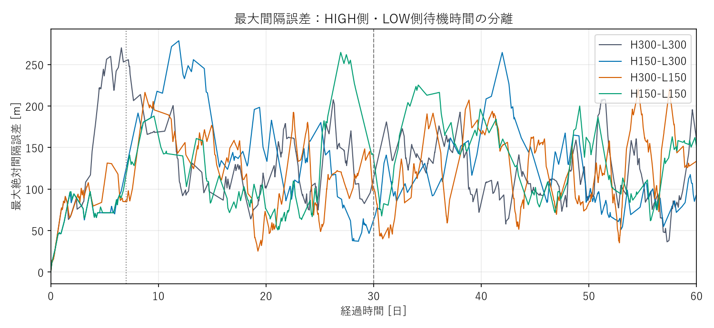
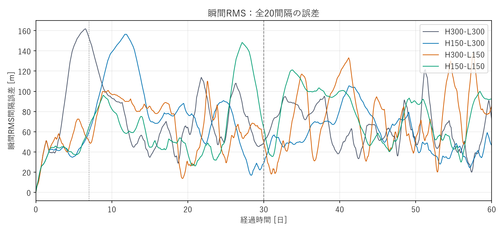
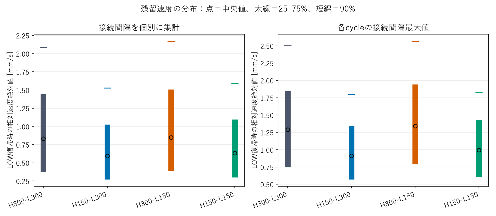
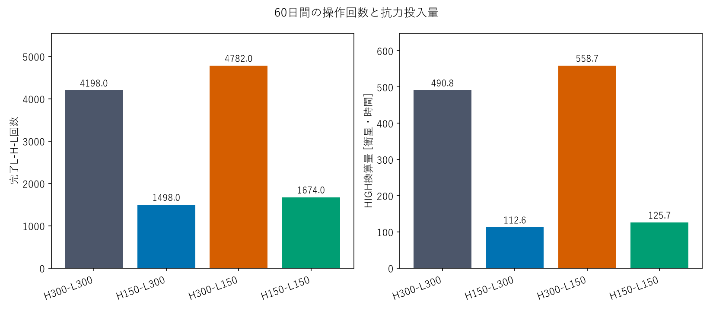
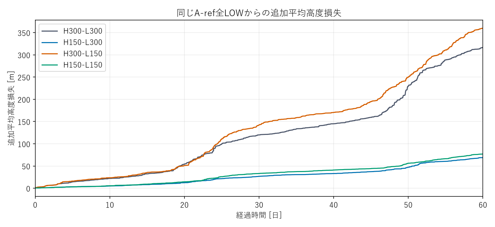
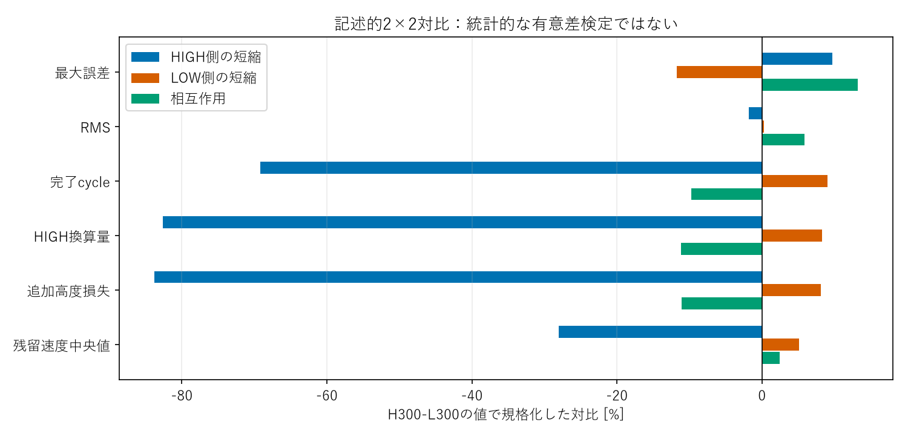

# 研究判断用サマリー

## 1. 結論

**HIGH側dwellを150秒にする低負荷効果は、60日でも維持されました。一方、LOW側短縮によるRMS改善は後半には続きませんでした。** 30日までの結果から「LOW側150秒は長期精度を改善する」と一般化することはできません。

## 2. 60日主要比較

| Case | 最大誤差 [m] | RMS [m] | 完了cycle | HIGH量 [衛星・h] | 追加高度損失 [m] |
|---|---|---|---|---|---|
| H300-L300 | 270.05 | 76.00 | 4198 | 490.76 | 316.70 |
| H150-L300 | 278.50 | 72.37 | 1498 | 112.59 | 68.86 |
| H300-L150 | 220.39 | 74.01 | 4782 | 558.71 | 359.88 |
| H150-L150 | 264.54 | 74.84 | 1674 | 125.74 | 77.00 |

HIGH量は全21機のHIGH換算時間の合計、高度損失は同一A-ref全LOW比の追加平均値です。全条件が衛星順序を保ち、固定基準の500 m仮想閾値内を60日維持しました。ただし100 m超過時間率は61.0〜67.3%で、100 mを常時維持した条件はありません。

## 3. HIGH側の効果は持続

LOW側300秒固定でHIGH側を短くすると、cycleは4,198→1,498回（64.3%減）、HIGH量は77.1%減、高度損失は78.3%減りました。LOW復帰時の接続gap最大速度のcycle別中央値も1.291→0.913 mm/sへ低下しました。

LOW側150秒固定でも、HIGH短縮でcycleは65.0%、高度損失は78.6%減少。したがって低負荷化の主因がHIGH側の最小入力縮小である、という30日の判断は維持されます。後半だけでも、LOW側300秒固定ではcycle/日が81.63→28.20へ減っています。

## 4. LOW側の精度効果は観測期間に依存

30〜60日のRMSは、HIGH側300秒固定のLOW短縮で66.65→79.29 m、HIGH側150秒固定でも61.19→80.12 mへ悪化しました。後半では両方ともLOW側300秒の方が低いRMSです。一方、全60日の最大誤差はLOW側150秒の方が小さいままで、最大値とRMSでは評価が分かれます。

H150-L300は今回の4条件でRMS・cycle数・HIGH量・高度コストが最小でしたが、最大誤差は278.50 mで最大。H300-L150は最大誤差220.39 mで最小ですが、負荷は最大です。単一の「最良条件」とは決めません。

## 5. 収束と相互作用

全条件で最終遷移完了は59.96〜59.99日、後半も再切替が続きました。H150-L300でも後半846 cycleがあり、停止・永久収束とは言えません。相互作用はRMSで4.45 m、cycleで−408回の記述的対比でした。組合せだけで低負荷化するわけではありませんが、履歴の影響は残っています。

## 6. 次の判断

1. 低負荷機構の解析用にはH150-L300を有力な比較対象として残す。実機用の最適値とはしません。
2. 追加のdwell掃引より先に、既存60日データでLOW側短縮が後半RMSを悪化させたgapと再起動順序を追うことを勧めます。

今回追加した物理計算は交差2条件の30〜60日だけで、過去runは再計算・上書きしていません。

# 詳細技術付録

## A. 今回の介入と再利用

今回変えたのは観測終了を30日から60日へ延ばしたことだけ。新規物理計算はH150-L300とH300-L150の30–60日部分であり、最初の30日、H300-L300・H150-L150の60日、同一A-ref全LOWは保存runを再利用した。

固定A profileの初期半径分散はsample std(ddof=1)=0.5 m、B分散0、初期間隔誤差0。これは実機母集団から推定したnominal分散ではなく、工学的Reference sensitivity conditionである。
Kp、Kd、閾値、120秒slew、10秒制御周期、指令遅延0、機体、21機・100 km間隔、RK4、最大2秒刻み、保存10秒を固定。
大気は同じNRLMSIS 2.0 / pymsis 0.12.0、2024-03-01 00:00 UTCのactive環境、同じhistorical weatherと120秒キャッシュ方式。
密度を経験する時刻・軌道が介入により変わることは許すが、他caseの密度時系列をコピーしていない。Gaussian、J2等は追加していない。

30日終了状態とcheckpointの軌道・姿勢を照合し、30日境界の指令を繰り返さず再開した。
半径・位相・面積・modeの接続は完全一致、密度のキャッシュ再始動差は既存rtol=1e-8の範囲で検査。
保存済み30日最大誤差・RMSとイベントprefixも再一致を確認し、境界sampleを重複計数していない。

## B. 定義と理論下限

指標とstate machineの定義は[30日報告](../reference_dwell_factorial_30d/REPORT.md)から変更していない。
HIGH完了後の保持THは最小HIGH入力、LOW完了後の待機TLは再指令可能時刻を規定する。
120秒smoothstep slewは各方向HIGH換算60秒なので、最小HIGH換算は120+TH、HIGH開始から次HIGH開始までは240+TH+TL秒。

| Case | 最小HIGH換算 | HIGH開始→次HIGH開始の理論下限 |
|---|---:|---:|
| H300-L300 | 420 s | 840 s |
| H150-L300 | 270 s | 690 s |
| H300-L150 | 420 s | 690 s |
| H150-L150 | 270 s | 540 s |

交差2条件は再起動下限がともに690秒だが、HIGH投入量とLOW待機を分けた結果、異なる履歴になる。
HIGH換算量は面積増分の時間積分を全衛星で合計する。高度コストは同一profile・同一環境の全LOW平均半径からの追加損失。

## C. 30日と60日の累積比較

| Case | 最大30日 [m] | 最大60日 [m] | RMS30日 [m] | RMS60日 [m] | cycle30日 | cycle60日 | 追加損失30日 [m] | 追加損失60日 [m] |
|---|---|---|---|---|---|---|---|---|
| H300-L300 | 270.05 | 270.05 | 84.32 | 76.00 | 1749 | 4198 | 120.01 | 316.70 |
| H150-L300 | 278.50 | 278.50 | 82.05 | 72.37 | 652 | 1498 | 26.80 | 68.86 |
| H300-L150 | 216.32 | 220.39 | 68.33 | 74.01 | 2014 | 4782 | 142.52 | 359.88 |
| H150-L150 | 264.54 | 264.54 | 69.15 | 74.84 | 777 | 1674 | 33.18 | 77.00 |

主誤差は従来どおり固定基準半径による間隔誤差。現在半径上の物理弧長とは区別する。
RMSは全20間隔・全10秒sampleの平方平均平方根。100/500/1000 mは実ミッション要求ではない仮想評価閾値。

| Case | 終了時最大 [m] | 全期間最大gap速度 [mm/s] | 最小物理距離 [km] | 最終遷移完了 [日] | 100 m超過時間率 | 500 m超過 |
|---|---|---|---|---|---|---|
| H300-L300 | 159.69 | 5.725 | 99.690 | 59.9646 | 67.25% | なし |
| H150-L300 | 92.12 | 3.956 | 99.703 | 59.9752 | 61.23% | なし |
| H300-L150 | 133.46 | 5.722 | 99.669 | 59.9741 | 65.99% | なし |
| H150-L150 | 151.38 | 4.108 | 99.688 | 59.9924 | 60.98% | なし |

100 m超過時間率は、いずれかのgapが100 mを超えた時間割合。終了値だけを収束判定に使わない。
許容値の初回超過・超過時間率・最長連続時間、current-radius誤差、衛星別高度とHIGH量はdata/comparison.json等へ保存した。

## D. 区間別の精度と負荷

初期の効果が平均に残るだけかを区別するため、0–7日、7–30日、30–60日を分ける。
区間RMSは両端sampleを含む。イベント・完了cycleは途中境界を次区間へ割り当て、最後の60日は含む。

| Case | 期間 [日] | RMS [m] | 最大 [m] | cycle/日 | 遷移/日 | HIGH換算 [衛星・h/日] | 追加高度損失 [m/日] |
|---|---|---|---|---|---|---|---|
| H300-L300 | 0–7 | 103.21 | 270.05 | 46.14 | 92.29 | 5.39 | 2.45 |
| H300-L300 | 7–30 | 77.67 | 255.70 | 62.00 | 124.00 | 7.25 | 4.47 |
| H300-L300 | 30–60 | 66.65 | 208.15 | 81.63 | 163.27 | 9.54 | 6.56 |
| H150-L300 | 0–7 | 39.79 | 124.53 | 16.00 | 32.00 | 1.20 | 0.55 |
| H150-L300 | 7–30 | 91.10 | 278.50 | 23.48 | 46.96 | 1.77 | 1.00 |
| H150-L300 | 30–60 | 61.19 | 264.41 | 28.20 | 56.40 | 2.12 | 1.40 |
| H300-L150 | 0–7 | 50.88 | 131.25 | 48.43 | 96.86 | 5.65 | 2.78 |
| H300-L150 | 7–30 | 72.82 | 216.32 | 72.83 | 145.65 | 8.51 | 5.35 |
| H300-L150 | 30–60 | 79.29 | 220.39 | 92.27 | 184.53 | 10.78 | 7.25 |
| H150-L150 | 0–7 | 41.15 | 116.83 | 16.29 | 32.57 | 1.23 | 0.55 |
| H150-L150 | 7–30 | 75.64 | 264.54 | 28.83 | 57.65 | 2.17 | 1.28 |
| H150-L150 | 30–60 | 80.12 | 225.17 | 29.90 | 59.80 | 2.24 | 1.46 |

## E. 後半30日の残留速度と再切替

LOW完了時刻が30–60日のcycleを集計した。対象衛星へ接続する1〜2 gapの最大速度をcycleごとに取り、その中央値を示す。個別gapの分布は別に保存する。

| Case | 後半完了cycle | パルス中央値 [mm/s] | cycle最大残留速度中央値 [mm/s] | 個別gap残留速度中央値 [mm/s] | 悪化方向割合 |
|---|---|---|---|---|---|
| H300-L300 | 2449 | 2.6703 | 1.3091 | 0.8849 | 50.93% |
| H150-L300 | 846 | 1.6486 | 0.9854 | 0.6233 | 45.26% |
| H300-L150 | 2768 | 2.6476 | 1.4181 | 0.9081 | 49.27% |
| H150-L150 | 897 | 1.6316 | 1.0054 | 0.6499 | 49.71% |

後半cycleの再起動と近傍寄与を分けて示す。割合が高いことと、操作件数が多いことは同義ではない。

| Case | 観測待ち時間中央値 [h] | 右打切りcycle | 近傍>自然の割合 | 該当間隔/日 | 全LOW時間率 |
|---|---|---|---|---|---|
| H300-L300 | 3.03 | 21 | 99.75% | 80.73 | 78.36% |
| H150-L300 | 11.44 | 21 | 99.15% | 27.27 | 91.21% |
| H300-L150 | 2.75 | 21 | 99.64% | 91.23 | 75.66% |
| H150-L150 | 11.49 | 21 | 99.43% | 29.03 | 90.87% |

次HIGHを観測終了までに見られないcycleは右打切りで、無限待ち時間とも再切替なしとも扱わない。観測待ち時間中央値は打切りの影響を受ける。
全LOW時間率は30日境界をまたぐ区間も切り詰めて積算。予測評価は30日以降に始まった全LOW区間を対象とし、左側で開始時点を観測できない区間は除く。

| Case | 有効な観測区間 | 起動衛星一致 | 時刻絶対誤差中央値 [s] | 90% [s] | 最大 [s] |
|---|---|---|---|---|---|
| H300-L300 | 406 | 402 | 10 | 30 | 1,820 |
| H150-L300 | 344 | 344 | 10 | 50 | 2,660 |
| H300-L150 | 458 | 452 | 10 | 30 | 2,170 |
| H150-L150 | 367 | 361 | 10 | 40 | 3,050 |

全LOW予測は残留D一定を仮定した既存式q(t0+τ)≈qP(t0)+qD(t0)+(Kp/Kd)qD(t0)τを使い、LOW側待機と10秒判定格子を含める。
予測対象のD変化10%以内・途中操作なし等を観測後に検査した条件付き評価。秒級の中央値だけを根拠に、全区間で同精度と主張しない。

## F. パルス量・残留速度・近傍操作

1パルス自身の速度寄与は、固定基準の沿軌道速度g=a_ref n(a)に対する追加抗力の積分。実軌道速度sqrt(μ/a)の直接変化とは異なる。
保存済み軌道上で自然LOW・対象自身・他衛星のHIGH/slewへ分解し、近傍操作を消した別軌道を計算したものではない。

| Case | 最小 [s] | 中央値 [s] | 75% [s] | 90% [s] | 最大 [s] | 理論最小一致 |
|---|---|---|---|---|---|---|
| H300-L300 | 420 | 420 | 420 | 420 | 520 | 97.02% |
| H150-L300 | 270 | 270 | 270 | 270 | 390 | 98.33% |
| H300-L150 | 420 | 420 | 420 | 420 | 520 | 97.89% |
| H150-L150 | 270 | 270 | 270 | 270 | 390 | 98.86% |

全60日のパルス速度寄与分布（すべてmm/s）:

| Case | 最小 [mm/s] | 25% | 中央値 | 75% | 90% | 最大 |
|---|---|---|---|---|---|---|
| H300-L300 | 0.8222 | 1.9326 | 2.5477 | 3.1070 | 3.7202 | 5.0088 |
| H150-L300 | 0.5441 | 1.0926 | 1.5577 | 1.9425 | 2.3868 | 3.1715 |
| H300-L150 | 0.7569 | 1.9455 | 2.5720 | 3.0892 | 3.6409 | 5.2589 |
| H150-L150 | 0.4681 | 1.1529 | 1.5579 | 1.8926 | 2.2731 | 3.1668 |

全60日のLOW復帰時残留速度:

| Case | 接続gap中央値 [mm/s] | 75% | 90% | 最大 | cycle最大の中央値 | 悪化方向割合 |
|---|---|---|---|---|---|---|
| H300-L300 | 0.8308 | 1.4446 | 2.0836 | 5.3745 | 1.2911 | 52.16% |
| H150-L300 | 0.5944 | 1.0254 | 1.5290 | 3.9140 | 0.9135 | 46.73% |
| H300-L150 | 0.8480 | 1.5076 | 2.1729 | 5.2474 | 1.3413 | 49.72% |
| H150-L150 | 0.6348 | 1.0979 | 1.5890 | 3.7252 | 0.9957 | 47.87% |

全60日での分布を示す。末尾の未完了パルスはcycle残留分布から除外し、HIGH総量には積分済みの寄与を含めた。
接続gapが別cycleで重複するため、独立した統計標本ではない。

近傍寄与が自然LOWより大きい「割合」と、該当する操作間隔の件数/日は区別する。割合が高いままでも、全体の活動量が減る場合がある。
台形積分による寄与分解の閉合誤差はverification.jsonへ保存した。

## G. 一因子比較と記述的対比

因果解釈は一方を固定した直接比較を優先する。差は変更後−変更前。

| 直接比較 | 最大誤差の差 [m] | RMSの差 [m] | cycle変化 | HIGH量変化 | 高度損失変化 | cycle最大残留速度変化 |
|---|---|---|---|---|---|---|
| H300-L300 → H150-L300 | 8.45 | -3.63 | -64.32% | -77.06% | -78.26% | -29.25% |
| H300-L150 → H150-L150 | 44.15 | 0.82 | -64.99% | -77.49% | -78.61% | -25.77% |
| H300-L300 → H300-L150 | -49.65 | -1.99 | 13.91% | 13.85% | 13.63% | 3.89% |
| H150-L300 → H150-L150 | -13.96 | 2.46 | 11.75% | 11.67% | 11.82% | 9.00% |

| 指標（記載単位） | HIGH側 | LOW側 | 相互作用 |
|---|---|---|---|
| max_error_m | 26.2985 | -31.8076 | 35.6936 |
| RMS_m | -1.4028 | 0.2355 | 4.4548 |
| cycles | -2,904.0000 | 380.0000 | -408.0000 |
| HIGH_equivalent_satellite_hours | -405.5681 | 40.5514 | -54.8139 |
| extra_altitude_loss_m | -265.3610 | 25.6574 | -35.0406 |
| residual_incident_abs_velocity_median_mm_s | -0.2248 | 0.0288 | 0.0232 |
| residual_cycle_max_velocity_median_mm_s | -0.3616 | 0.0662 | 0.0320 |

HIGH側対比はLOW両条件でのHIGH短縮差の平均、LOW側対比はHIGH両条件でのLOW短縮差の平均。
相互作用はY150,150−Y150,300−Y300,150＋Y300,300。決定論的・単一profileでの記述量であり、ANOVAや有意差検定ではない。
最大値や異なるcycle集合の中央値が、独立した物理原因へ完全に加法分解されたとは解釈しない。

## H. 観測・解釈・未確定

### 観測されたこと

- HIGH側短縮のcycle削減は、LOW 300秒固定で64.32%、LOW 150秒固定で64.99%。高度コストの削減も78.26%、78.61%であり、両LOW条件で持続した。
- 後半30日のcycle/日はH300-L300 / H150-L300 / H300-L150 / H150-L150の順に81.63 / 28.20 / 92.27 / 29.90。HIGH側短縮の効果は初期過渡だけに限られない。
- LOW短縮は全60日のcycleを13.91%（HIGH 300秒固定）、11.75%（HIGH 150秒固定）増やし、高度損失も13.63%、11.82%増やした。低負荷化の要因ではなかった。
- 全60日のRMSはHIGH 300秒固定ではLOW短縮で76.00→74.01 mと少し改善したが、HIGH 150秒固定では72.37→74.84 mへ悪化した。後半30日だけでは、LOW短縮でRMSが12.63 m、18.94 m悪化した。
- 全期間最大誤差はLOW短縮で49.65 m、13.96 m低下。一方、後半最大誤差はHIGH 300秒固定で208.15→220.39 mと増えた。前半ピークが残る累積最大値だけでは、後半の精度を代表できない。
- 後半のcycle最大残留速度中央値はHIGH短縮で1.309→0.985 mm/s、1.418→1.005 mm/sへ低下。近傍操作の寄与が自然LOWより大きい操作間隔も80.73→27.27件/日、91.23→29.03件/日へ減った。
- 後半の全LOW時間率はHIGH短縮で78.36→91.21%、75.66→90.87%へ増えた。ただし全条件で60日直前まで切替があり、50 m・1 mm/s・全LOW・1800秒保持という既存の静穏候補判定も成立しなかった。

### 解釈

「有限な最小HIGH入力が、残留速度と後続の操作活動の一因」という仮説は、60日でも支持される。HIGH側を変えるだけで、最小換算量420→270秒、残留速度低下、近傍操作の活動量減少、cycle・高度コスト低下が両LOW条件に共通して現れた。ただし残留速度だけが唯一の媒介要因と証明したものではない。

LOW側の短い待機は、初期には早い再反応によって誤差を抑えたが、その後の起動時刻・対象衛星・近傍連鎖を変え、長期の誤差分布を必ず改善するわけではなかった。これは単に待ち時間から150秒を差し引く作用とは異なる。LOW短縮の精度面の意味は、最大値/RMSと観測区間を指定して述べる必要がある。

30日時点の「LOW側短縮は精度と負荷の交換条件」という判断は、60日では限定する。最大誤差を小さくする代わりに負荷を増やす関係は残るが、後半RMSについては改善との交換になっていない。RMSを重視する今回の60日ではH150-L300が有力、最大ピークを重視するならH300-L150に利点がある。

### 未確定

4条件・固定profile・1期間の決定論的結果であり、数mの全期間RMS順位を普遍的優越性とは扱わない。150秒が実機として許容されるか、最適か、B-ref/AB-refや別の大気環境でも同じかは未確認。NRLMSISは経験大気モデルで、実大気を完全再現していない。

60日で500 m以内を維持したことは永久安定性の証明ではない。今回は60日を超える延長、追加dwell・ゲイン掃引、B-ref/AB-refは実行していない。次は既存データ上で、LOW側短縮により後半RMSが悪化したgap・P/D状態・隣接衛星の再起動順序を比較するのが合理的である。

## I. 検証・再現・Git

全323件のテストが合格。今回の追加12件は、30日終了・profile・状態形状・有限性・順序の検査、期間末尾と右打切りを含む集計を確認した。
物理・制御・積分coreに変更がないため、前回新規再生成した24時間suiteを現在の照合コードで再検証し、全主要時系列・イベント・最大誤差・RMS・高度損失・切替波速度の回帰が通った。24時間物理計算は重複実行していない。
300/300・150/150の冒頭6時間完全一致確認も前回結果を再利用した。

原資料はread-onlyで使用し、以前の30日・60日runは変更していない。大ファイルはsize/mtime、小ファイルはSHA256も比較。
全生軌道・四段階状態NPZはローカルに保存し、Gitへ入れない。
[再現手順](REPRODUCTION.md)と[機械可読な検証結果](data/verification.json)を参照。

branch: `astra/reference-dwell-factorial-60d`。基点は30日研究の `e735788be82fff9a26454c342e9d8845c0c78b4a`。mainへmergeしない。確定commitは本branchのGit履歴と最終作業報告を参照。
